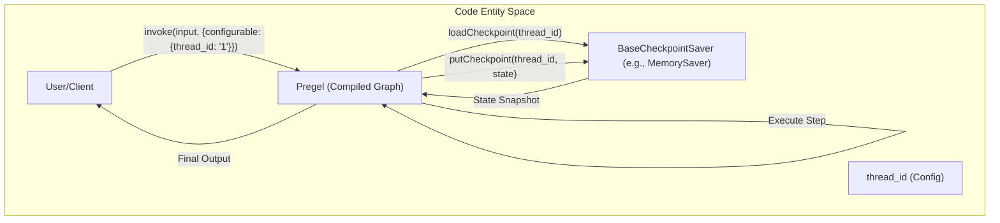
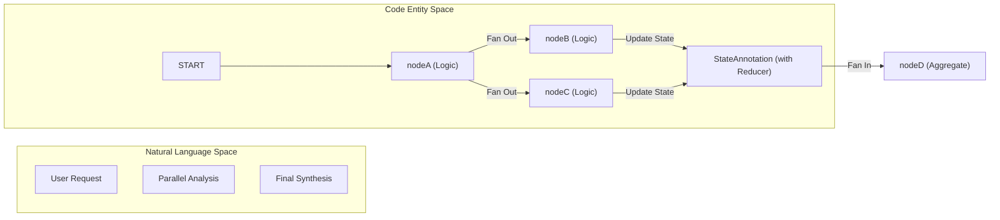

<!-- source: DeepWiki mcp.deepwiki.com · repo langchain-ai/langgraphjs · page 8.1 Core How-To Examples · fetched 2026-10-26 -->

# Core How-To Examples

<details>
<summary>Relevant source files</summary>

The following files were used as context for generating this wiki page:

- [docs/docs/troubleshooting/errors/GRAPH_RECURSION_LIMIT.ipynb](docs/docs/troubleshooting/errors/GRAPH_RECURSION_LIMIT.ipynb)
- [docs/docs/troubleshooting/errors/INVALID_CONCURRENT_GRAPH_UPDATE.ipynb](docs/docs/troubleshooting/errors/INVALID_CONCURRENT_GRAPH_UPDATE.ipynb)
- [docs/docs/troubleshooting/errors/INVALID_GRAPH_NODE_RETURN_VALUE.ipynb](docs/docs/troubleshooting/errors/INVALID_GRAPH_NODE_RETURN_VALUE.ipynb)
- [docs/docs/troubleshooting/errors/MULTIPLE_SUBGRAPHS.ipynb](docs/docs/troubleshooting/errors/MULTIPLE_SUBGRAPHS.ipynb)
- [docs/docs/troubleshooting/errors/UNREACHABLE_NODE.ipynb](docs/docs/troubleshooting/errors/UNREACHABLE_NODE.ipynb)
- [docs/docs/troubleshooting/errors/index.md](docs/docs/troubleshooting/errors/index.md)
- [examples/how-tos/add-summary-conversation-history.ipynb](examples/how-tos/add-summary-conversation-history.ipynb)
- [examples/how-tos/branching.ipynb](examples/how-tos/branching.ipynb)
- [examples/how-tos/breakpoints.ipynb](examples/how-tos/breakpoints.ipynb)
- [examples/how-tos/command.ipynb](examples/how-tos/command.ipynb)
- [examples/how-tos/configuration.ipynb](examples/how-tos/configuration.ipynb)
- [examples/how-tos/delete-messages.ipynb](examples/how-tos/delete-messages.ipynb)
- [examples/how-tos/dynamically-returning-directly.ipynb](examples/how-tos/dynamically-returning-directly.ipynb)
- [examples/how-tos/edit-graph-state.ipynb](examples/how-tos/edit-graph-state.ipynb)
- [examples/how-tos/force-calling-a-tool-first.ipynb](examples/how-tos/force-calling-a-tool-first.ipynb)
- [examples/how-tos/manage-conversation-history.ipynb](examples/how-tos/manage-conversation-history.ipynb)
- [examples/how-tos/managing-agent-steps.ipynb](examples/how-tos/managing-agent-steps.ipynb)
- [examples/how-tos/persistence.ipynb](examples/how-tos/persistence.ipynb)
- [examples/how-tos/respond-in-format.ipynb](examples/how-tos/respond-in-format.ipynb)
- [examples/how-tos/review-tool-calls.ipynb](examples/how-tos/review-tool-calls.ipynb)
- [examples/how-tos/stream-multiple.ipynb](examples/how-tos/stream-multiple.ipynb)
- [examples/how-tos/stream-tokens.ipynb](examples/how-tos/stream-tokens.ipynb)
- [examples/how-tos/stream-updates.ipynb](examples/how-tos/stream-updates.ipynb)
- [examples/how-tos/stream-values.ipynb](examples/how-tos/stream-values.ipynb)
- [examples/how-tos/streaming-tokens-without-langchain.ipynb](examples/how-tos/streaming-tokens-without-langchain.ipynb)
- [examples/how-tos/subgraph.ipynb](examples/how-tos/subgraph.ipynb)
- [examples/how-tos/time-travel.ipynb](examples/how-tos/time-travel.ipynb)
- [examples/how-tos/tool-calling-errors.ipynb](examples/how-tos/tool-calling-errors.ipynb)
- [examples/how-tos/tool-calling.ipynb](examples/how-tos/tool-calling.ipynb)
- [examples/how-tos/update-state-from-tools.ipynb](examples/how-tos/update-state-from-tools.ipynb)
- [examples/how-tos/wait-user-input.ipynb](examples/how-tos/wait-user-input.ipynb)

</details>


The LangGraph.js documentation includes a comprehensive set of how-to guides implemented as Jupyter notebooks. These examples demonstrate the practical application of core framework primitives, including state persistence, human-in-the-loop patterns, complex control flows, and advanced streaming techniques.

## Persistence and Memory

Persistence in LangGraph is achieved through **Checkpointers**, which allow a graph to save its state after every "super-step." This enables conversational memory across multiple interactions within a single thread.

### Thread-level Persistence
To add memory to a graph, you compile the `StateGraph` with a checkpointer implementation, such as `MemorySaver` [examples/how-tos/persistence.ipynb:17-21]().

```javascript
import { MemorySaver } from "@langchain/langgraph";

const checkpointer = new MemorySaver();
const graph = workflow.compile({ checkpointer });
```

### Conversation History Management
As conversation history grows, it can exceed LLM context windows. LangGraph provides patterns to manage this:
*   **Trimming/Filtering:** Using standard LangChain utilities to keep only the most recent N messages [examples/how-tos/manage-conversation-history.ipynb:10-15]().
*   **Summarization:** A node can be added to the graph that summarizes older messages and updates the state, effectively "compressing" the history [examples/how-tos/add-summary-conversation-history.ipynb]().

**Data Flow: Persistence Interaction**


Sources: [examples/how-tos/persistence.ipynb:8-21](), [examples/how-tos/manage-conversation-history.ipynb:76-83]()

## Human-in-the-Loop (HITL) Patterns

LangGraph supports complex human-agent interactions through **Breakpoints** and **State Updates**.

### Breakpoints
Breakpoints allow the graph to interrupt execution before or after specific nodes. This is commonly used for "Review and Approve" workflows [examples/how-tos/breakpoints.ipynb]().
*   **Interrupt:** Use the `interrupt` property during compilation to stop execution before a node [examples/how-tos/wait-user-input.ipynb]().
*   **Resume:** Once interrupted, the graph state is persisted. A user can then provide input or approval, and execution resumes from the breakpoint using the same `thread_id`.

### Time Travel
Time travel refers to the ability to view, rewind, and branch from past states [examples/how-tos/time-travel.ipynb:18-27]().
*   **`getState(config)`**: Fetches the state values for a specific thread and checkpoint [examples/how-tos/time-travel.ipynb:30-31]().
*   **`updateState(config, values)`**: Manually modifies the state of a thread. This can be used to correct an agent's mistake or inject external data [examples/how-tos/time-travel.ipynb:32-33]().

Sources: [examples/how-tos/breakpoints.ipynb:1-6](), [examples/how-tos/time-travel.ipynb:8-35](), [examples/how-tos/wait-user-input.ipynb:1-6]()

## Tool Calling and Structured Output

LangGraph provides specialized nodes and patterns for interacting with LLMs that support tool calling.

### ToolNode
The `ToolNode` is a prebuilt utility that automates the execution of tools requested by an LLM [examples/how-tos/tool-calling.ipynb:9-11](). It expects the state to contain a `messages` key where the last message is an `AIMessage` containing `tool_calls` [examples/how-tos/tool-calling.ipynb:95-98]().

### Structured Responses
To force an agent to respond in a specific format, developers can bind a "response tool" to the model. Instead of the LLM returning plain text, it populates the arguments of this schema-defined tool [examples/how-tos/respond-in-format.ipynb:18-24]().

### Dynamic Tool Returns
By default, a ReAct agent calls a tool and then returns to the LLM to summarize the result. The "Return Direct" pattern allows a tool's output to be returned to the user immediately, bypassing the final LLM step [examples/how-tos/dynamically-returning-directly.ipynb:8-18]().

Sources: [examples/how-tos/tool-calling.ipynb:7-12](), [examples/how-tos/respond-in-format.ipynb:208-218](), [examples/how-tos/dynamically-returning-directly.ipynb:64-74]()

## Control Flow Patterns

### Parallel Execution (Branching)
LangGraph supports fan-out and fan-in execution. When multiple edges originate from a single node, the target nodes run in parallel [examples/how-tos/branching.ipynb:9-12](). The results are merged back into the state using **Reducers** [examples/how-tos/branching.ipynb:60-62]().

### Subgraphs
Subgraphs allow for modularity by embedding one graph as a node within another. This is essential for managing complexity in large systems and avoiding the `MULTIPLE_SUBGRAPHS` error when state keys conflict [docs/docs/troubleshooting/errors/MULTIPLE_SUBGRAPHS.ipynb]().

**Data Flow: Branching and Reducers**


Sources: [examples/how-tos/branching.ipynb:71-108](), [docs/docs/troubleshooting/errors/MULTIPLE_SUBGRAPHS.ipynb]()

## Streaming

LangGraph supports multiple streaming modes to provide real-time feedback:

1.  **Values:** Streams the full state after each node execution [examples/how-tos/stream-values.ipynb]().
2.  **Updates:** Streams only the specific updates (deltas) returned by each node [examples/how-tos/stream-updates.ipynb]().
3.  **Tokens:** Streams individual tokens from the LLM inside a node. In modern `@langchain/core`, this can be achieved by streaming the graph and looking for `on_llm_new_token` events or by calling `await model.stream()` within a node [examples/how-tos/stream-tokens.ipynb:10-20]().

Sources: [examples/how-tos/stream-tokens.ipynb:8-20](), [examples/how-tos/stream-values.ipynb](), [examples/how-tos/stream-updates.ipynb]()

## Configuration and Metadata

Graphs can be made dynamic using the `RunnableConfig` object. This allows passing "out-of-band" information like `user_id` or `configurable` parameters (e.g., choosing between different LLM models at runtime) [examples/how-tos/configuration.ipynb:10-23]().

```javascript
// Example of accessing config in a node
const callModel = async (state, config) => {
  const modelName = config?.configurable?.model;
  // ... logic to select model
};
```

Sources: [examples/how-tos/configuration.ipynb:16-23](), [examples/how-tos/configuration.ipynb:105-113]()

---

