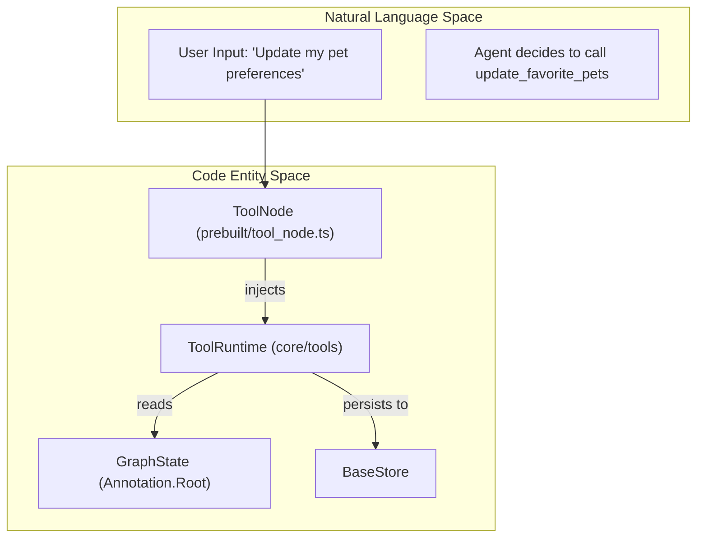

<!-- source: DeepWiki mcp.deepwiki.com · repo langchain-ai/langgraphjs · page 8.2 Multi-Agent and Advanced Examples · fetched 2026-10-26 -->

# Multi-Agent and Advanced Examples

Relevant source files

The following files were used as context for generating this wiki page:

- [docs/docs/agents/context.md](docs/docs/agents/context.md)
- [docs/docs/agents/multi-agent.md](docs/docs/agents/multi-agent.md)
- [docs/docs/agents/tools.md](docs/docs/agents/tools.md)
- [examples/agent_executor/base.ipynb](examples/agent_executor/base.ipynb)
- [examples/chat_agent_executor_with_function_calling/base.ipynb](examples/chat_agent_executor_with_function_calling/base.ipynb)
- [examples/chatbot-simulation-evaluation/package.json](examples/chatbot-simulation-evaluation/package.json)
- [examples/chatbots/package.json](examples/chatbots/package.json)
- [examples/how-tos/package.json](examples/how-tos/package.json)
- [examples/how-tos/pass-run-time-values-to-tools.ipynb](examples/how-tos/pass-run-time-values-to-tools.ipynb)
- [examples/multi_agent/agent_supervisor.ipynb](examples/multi_agent/agent_supervisor.ipynb)
- [examples/multi_agent/hierarchical_agent_teams.ipynb](examples/multi_agent/hierarchical_agent_teams.ipynb)
- [examples/multi_agent/multi_agent_collaboration.ipynb](examples/multi_agent/multi_agent_collaboration.ipynb)
- [examples/multi_agent/package.json](examples/multi_agent/package.json)
- [examples/plan-and-execute/package.json](examples/plan-and-execute/package.json)
- [examples/plan-and-execute/plan-and-execute.ipynb](examples/plan-and-execute/plan-and-execute.ipynb)
- [examples/quickstart/package.json](examples/quickstart/package.json)
- [examples/rag/langgraph_agentic_rag.ipynb](examples/rag/langgraph_agentic_rag.ipynb)
- [examples/rag/langgraph_crag.ipynb](examples/rag/langgraph_crag.ipynb)
- [examples/rag/langgraph_crag_mistral.ipynb](examples/rag/langgraph_crag_mistral.ipynb)
- [examples/rag/langgraph_self_rag.ipynb](examples/rag/langgraph_self_rag.ipynb)
- [examples/rag/package.json](examples/rag/package.json)
- [examples/reflection/img/reflection.png](examples/reflection/img/reflection.png)
- [examples/reflection/package.json](examples/reflection/package.json)
- [examples/reflection/reflection.ipynb](examples/reflection/reflection.ipynb)
- [examples/rewoo/package.json](examples/rewoo/package.json)
- [examples/rewoo/rewoo.ipynb](examples/rewoo/rewoo.ipynb)
- [libs/langgraph-core/src/prebuilt/react_agent_executor.ts](libs/langgraph-core/src/prebuilt/react_agent_executor.ts)
- [libs/langgraph-core/src/prebuilt/tool_node.ts](libs/langgraph-core/src/prebuilt/tool_node.ts)
- [libs/langgraph-core/src/tests/prebuilt.test.ts](libs/langgraph-core/src/tests/prebuilt.test.ts)

This section covers sophisticated architectural patterns implemented in LangGraph.js, moving beyond simple cyclic graphs to complex multi-agent systems, strategic planners, and self-correcting retrieval systems. These examples demonstrate how the framework orchestrates state across multiple specialized actors and handles high-level cognitive patterns like reflection and hierarchical delegation.

## Multi-Agent Patterns

Multi-agent systems in LangGraph.js utilize multiple nodes, where each node is powered by an LLM or a specialized agent, sharing a common state or communicating through structured handoffs.

### 1. Agent Supervisor
In this pattern, a "supervisor" node acts as a router. It receives the current state, decides which specialized worker should act next, and routes the flow accordingly. When a worker finishes, control returns to the supervisor [examples/multi_agent/agent_supervisor.ipynb:8-24]().

**Data Flow:**
1. The `AgentState` tracks a `next` field to determine the next actor [examples/multi_agent/agent_supervisor.ipynb:89-99]().
2. The `supervisor` node outputs the name of the next worker or `END` [examples/multi_agent/agent_supervisor.ipynb:95-97]().
3. A conditional edge uses this `next` value to route the graph execution.

### 2. Hierarchical Agent Teams
For complex tasks, a single supervisor may become a bottleneck. Hierarchical teams use subgraphs where a top-level supervisor delegates to mid-level supervisors, who in turn manage specialized worker nodes [examples/multi_agent/hierarchical_agent_teams.ipynb:20-27]().

**Code Entity Mapping: Hierarchical Research Team**

| Role | Code Entity | Purpose |
| :--- | :--- | :--- |
| Top-Level Supervisor | `topLevelSupervisor` | Orchestrates between Research and Writing teams |
| Research Team Graph | `researchGraph` | Subgraph containing Search and Scrape agents |
| Writing Team Graph | `writingGraph` | Subgraph containing Note-taking and Doc-writing agents |
| State Reducer | `messagesStateReducer` | Merges message arrays across teams |

Sources: [examples/multi_agent/agent_supervisor.ipynb:89-99](), [examples/multi_agent/hierarchical_agent_teams.ipynb:20-35]()

## Planning and Reasoning Patterns

Advanced agents often separate the "thinking" (planning) from the "doing" (execution) to improve reliability on long-horizon tasks.

### Plan-and-Execute
Inspired by Plan-and-Solve and Baby-AGI, this pattern involves an LLM creating a multi-step plan, executing steps one by one, and re-planning based on results [examples/plan-and-execute/plan-and-execute.ipynb:10-16]().

**Execution Cycle:**
1. **Planner**: Generates a list of steps stored in `PlanExecuteState.plan` [examples/plan-and-execute/plan-and-execute.ipynb:110-123]().
2. **Executor**: A `createReactAgent` [libs/langgraph-core/src/prebuilt/react_agent_executor.ts:365-367]() processes the current step.
3. **Re-planner**: Updates the plan or provides a final response [examples/plan-and-execute/plan-and-execute.ipynb:14-16]().

### ReWOO (Reasoning Without Observation)
ReWOO improves efficiency by generating a full chain of tool calls with variable substitution (`#E1`, `#E2`) in a single LLM pass, reducing redundant token consumption [examples/rewoo/rewoo.ipynb:10-21]().

**Graph Components:**
* **Planner Node**: Generates the symbolic plan [examples/rewoo/rewoo.ipynb:142-154]().
* **Worker Node**: Executes tools in the plan, substituting variables with previous outputs [examples/rewoo/rewoo.ipynb:39-39]().
* **Solver Node**: Synthesizes the final answer from all observations [examples/rewoo/rewoo.ipynb:40-41]().

Sources: [examples/plan-and-execute/plan-and-execute.ipynb:110-123](), [examples/rewoo/rewoo.ipynb:10-41]()

## Advanced RAG Patterns

LangGraph enables "Agentic RAG," where the agent can reflect on retrieved documents and decide to perform web searches if internal knowledge is insufficient.

### Corrective RAG (CRAG)
CRAG introduces a self-reflection step to evaluate the relevance of retrieved documents. If relevance is low, the agent triggers a web search to augment the context [examples/rag/langgraph_crag.ipynb:7-16]().

**Logic Flow:**
1. **Retrieve**: Fetch documents from a vector store.
2. **Grade**: An LLM grades each document as `relevant`, `ambiguous`, or `irrelevant`.
3. **Action**:
    * If `irrelevant`, trigger `web_search`.
    * If `relevant`, proceed to `generate`.

### Self-RAG
Self-RAG extends this by grading the generated answer itself for hallucinations or lack of focus, potentially looping back to retrieval if the answer is unsatisfactory [examples/rag/langgraph_self_rag.ipynb:4-6]().

Sources: [examples/rag/langgraph_crag.ipynb:7-16](), [examples/rag/langgraph_self_rag.ipynb:4-6]()

## Runtime Context and Tool Integration

Advanced examples utilize `ToolRuntime` to allow tools to access the current graph state dynamically during execution [examples/how-tos/pass-run-time-values-to-tools.ipynb:13-13]().

**Code Entity Mapping: Tool Runtime Access**

**Key Interactions:**
* `runtime.state`: Accesses the current state of the `StateGraph` [libs/langgraph-core/src/prebuilt/tool_node.ts:165-168]().
* `runtime.store`: Accesses the long-term `BaseStore` for cross-thread memory [examples/how-tos/pass-run-time-values-to-tools.ipynb:93-95]().
* `runtime.config`: Retrieves configurable values like `userId` [examples/how-tos/pass-run-time-values-to-tools.ipynb:92-92]().

Sources: [libs/langgraph-core/src/prebuilt/tool_node.ts:158-171](), [examples/how-tos/pass-run-time-values-to-tools.ipynb:85-110]()

## Implementation Summary

| Example Pattern | Primary State Key | Key Classes/Functions |
| :--- | :--- | :--- |
| **Agent Executor** | `messages` | `StateGraph`, `ToolNode` |
| **Plan-and-Execute** | `plan`, `pastSteps` | `createReactAgent`, `Annotation.Root` |
| **ReWOO** | `steps`, `results` | `Annotation.Root`, `ChatOpenAI` |
| **CRAG** | `documents`, `query` | `StateGraph`, `TavilySearch` |
| **Supervisor** | `next` | `Command`, `conditionalEdges` |

Sources: [examples/agent_executor/base.ipynb:79-83](), [examples/plan-and-execute/plan-and-execute.ipynb:110-123](), [examples/rewoo/rewoo.ipynb:111-132](), [examples/multi_agent/agent_supervisor.ipynb:89-99]()

---

