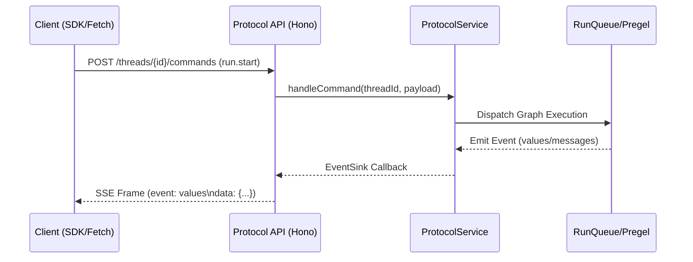
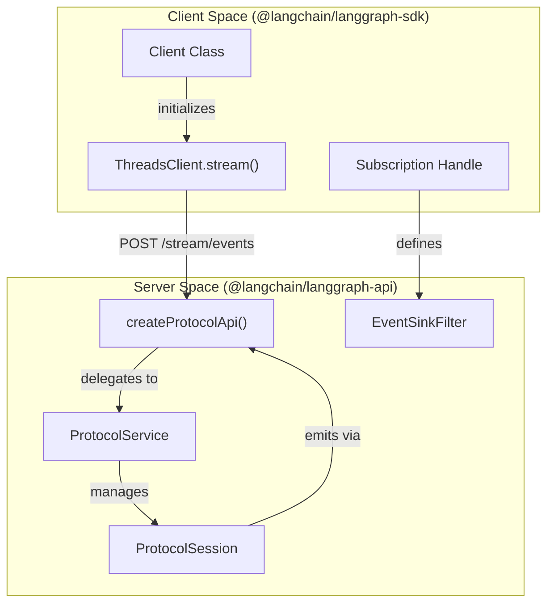

<!-- source: DeepWiki mcp.deepwiki.com · repo langchain-ai/langgraphjs · page 8.3 UI and Streaming Examples · fetched 2026-10-26 -->

# UI and Streaming Examples

Relevant source files

The following files were used as context for generating this wiki page:

- [examples/streaming/src/api/_shared.ts](examples/streaming/src/api/_shared.ts)
- [examples/streaming/src/api/basic.ts](examples/streaming/src/api/basic.ts)
- [examples/streaming/src/api/channels.ts](examples/streaming/src/api/channels.ts)
- [examples/streaming/src/api/commands.ts](examples/streaming/src/api/commands.ts)
- [examples/streaming/src/api/multimodal_stream_websocket.ts](examples/streaming/src/api/multimodal_stream_websocket.ts)
- [examples/streaming/src/api/reconnect.ts](examples/streaming/src/api/reconnect.ts)
- [examples/streaming/src/api/unsupported-channel.ts](examples/streaming/src/api/unsupported-channel.ts)
- [examples/streaming/src/api/websocket.ts](examples/streaming/src/api/websocket.ts)
- [examples/ui-multimodal/CHANGELOG.md](examples/ui-multimodal/CHANGELOG.md)
- [examples/ui-multimodal/package.json](examples/ui-multimodal/package.json)
- [examples/ui-react/CHANGELOG.md](examples/ui-react/CHANGELOG.md)
- [examples/ui-react/package.json](examples/ui-react/package.json)
- [libs/langgraph-api/src/api/protocol.mts](libs/langgraph-api/src/api/protocol.mts)

This section documents the implementation and architecture of example applications and streaming protocol integrations within the LangGraph.js ecosystem. These examples demonstrate how to bridge the gap between backend graph execution and frontend user interfaces using the LangGraph Platform's streaming capabilities.

## UI Framework Integrations

LangGraph.js provides dedicated examples for major frontend frameworks, showcasing the use of the `@langchain/react` and `@langchain/langgraph-sdk` packages to build responsive, stateful AI applications.

### React Integration
The React example demonstrates the use of high-level hooks to manage graph state and streaming. It utilizes the `useStream` hook to handle the complexities of SSE (Server-Sent Events) and WebSocket connections.

*   **Key Dependencies**: `@langchain/react`, `@langchain/langgraph-sdk`, and `streamdown` for markdown streaming [examples/ui-react/package.json:13-26]().
*   **Development Workflow**: The project uses a dual-process development setup where `turbo` orchestrates the Vite frontend and the LangGraph CLI development server [examples/ui-react/package.json:7-9]().

### Multimodal Applications
The multimodal example extends the standard UI patterns to handle diverse input types (images, audio, text) and demonstrates complex interaction patterns.

*   **Architecture**: It uses a split-process model with the agent running on port 2024 via `langgraphjs dev` and the web frontend served by Vite [examples/ui-multimodal/package.json:7-9]().
*   **Implementation**: It leverages `@langchain/openai` for vision/multimodal capabilities and `@langchain/react` for UI state synchronization [examples/ui-multimodal/package.json:14-23]().

### Framework Support Matrix
The repository includes support for multiple reactive frameworks through specialized SDK integrations.

| Framework | Primary Package | Key Features |
| :--- | :--- | :--- |
| **React** | `@langchain/react` | `useStream` hook, automated message projection, and thread history management. |
| **Angular** | `@langchain/langgraph-angular` | Observable-based streaming and reactive state selectors. |
| **Vue** | `@langchain/langgraph-vue` | Composition API support with reactive refs for graph state. |
| **Svelte** | `@langchain/langgraph-svelte` | Store-based integration for idiomatic Svelte state management. |

**Sources:** [examples/ui-react/package.json:1-37](), [examples/ui-multimodal/package.json:1-42]()

---

## Streaming Protocol Examples

The `examples/streaming` directory contains low-level technical demonstrations of the LangGraph Protocol (V2 and V3). These examples verify transport stability, isolation, and recovery semantics against the `langgraph-api` server.

### Protocol Transport Layer
The API server facilitates streaming through two primary transports: SSE (HTTP) and WebSockets. The `createProtocolApi` function handles the registration of these routes [libs/langgraph-api/src/api/protocol.mts:50-54]().

#### SSE (Server-Sent Events)
The standard transport for one-way streaming from server to client.
*   **Route**: `POST /threads/:thread_id/stream/events` [libs/langgraph-api/src/api/protocol.mts:156-159]().
*   **Filtering**: Clients can filter events by `channels`, `namespaces`, `depth`, and `since` (for replay) [libs/langgraph-api/src/api/protocol.mts:16-23]().
*   **Implementation**: Uses `streamSSE` from Hono to write serialized events to the wire [libs/langgraph-api/src/api/protocol.mts:176-192]().

#### WebSockets
Used for full-duplex communication where commands and events share the same persistent connection.
*   **Route**: `GET /threads/:thread_id/stream/events` (upgraded) [libs/langgraph-api/src/api/protocol.mts:60-63]().
*   **Command Handling**: Commands are parsed as JSON and dispatched via `protocolService.handleCommand` [libs/langgraph-api/src/api/protocol.mts:114-117]().

### Data Flow: Streaming Lifecycle
The following diagram illustrates the flow from a client command to a streamed event via the `ProtocolService`.

**Protocol Streaming Architecture**

**Sources:** [libs/langgraph-api/src/api/protocol.mts:1-212](), [examples/streaming/src/api/basic.ts:23-83]()

---

## Technical Implementation Details

### Channel Isolation and Validation
The protocol ensures that clients only receive the data they are subscribed to. Supported channels include `lifecycle`, `values`, `updates`, `messages`, `input`, and `tasks` [examples/streaming/src/api/channels.ts:44-59]().

*   **Validation**: The server strictly validates subscription envelopes. Invalid or empty `channels` arrays result in `HTTP 400 invalid_argument` [examples/streaming/src/api/unsupported-channel.ts:53-78]().
*   **Isolation**: The `ProtocolService` ensures zero cross-channel leakage, meaning a subscription to `messages` will not receive `internal_debug` events unless explicitly requested [examples/streaming/src/api/channels.ts:181-197]().

### Reconnection and Replay
The protocol supports resilient streaming through event replay.
*   **Mechanism**: Clients provide a `Last-Event-ID` or `since` parameter in the subscription request [libs/langgraph-api/src/api/protocol.mts:21]().
*   **Server Behavior**: `RunProtocolSession` identifies the sequence point and replays all historical events for that thread before continuing with live updates [examples/streaming/src/api/reconnect.ts:1-12]().

### Command Dispatching
Commands are the primary way to interact with an active session over the protocol.

| Command | Purpose | Implementation Status |
| :--- | :--- | :--- |
| `run.start` | Initiates a new graph execution | Fully Supported [examples/streaming/src/api/commands.ts:61-69]() |
| `agent.getTree` | Returns the namespace tree of the agent | Fully Supported [examples/streaming/src/api/commands.ts:75-80]() |
| `state.get` | Retrieves thread state | Not Supported (use REST API) [examples/streaming/src/api/commands.ts:82-88]() |
| `subscription.reconnect` | Manual reconnection trigger | Deprecated by `since` [examples/streaming/src/api/commands.ts:98-106]() |

**Sources:** [examples/streaming/src/api/channels.ts:1-216](), [examples/streaming/src/api/commands.ts:1-129](), [examples/streaming/src/api/unsupported-channel.ts:1-94]()

---

## Code Entity Mapping

The following diagram bridges the Natural Language concepts of "Streaming" to the specific Code Entities in the `langgraph-api` and `langgraph-sdk` packages.

**Entity Mapping: Client to Server Protocol**

**Sources:** [libs/langgraph-api/src/api/protocol.mts:50-58](), [examples/streaming/src/api/basic.ts:32-37](), [examples/streaming/src/api/channels.ts:40-60]()

---

