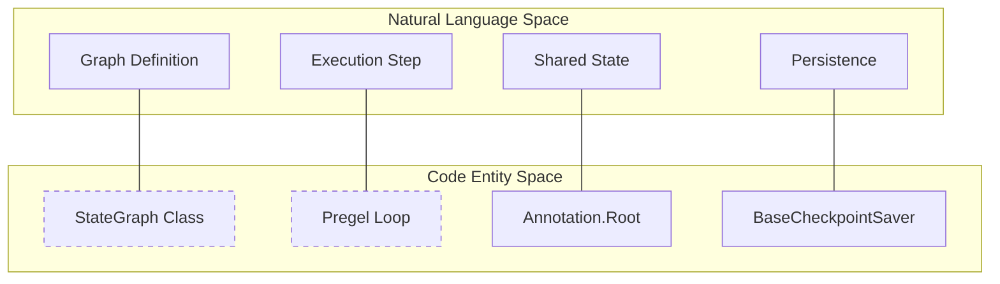
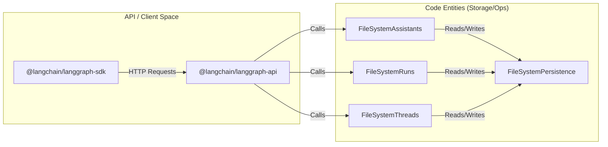

<!-- source: DeepWiki mcp.deepwiki.com · repo langchain-ai/langgraphjs · page 9 Glossary · fetched 2026-10-26 -->

# Glossary

Relevant source files

The following files were used as context for generating this wiki page:

- [docs/docs/concepts/agentic_concepts.md](docs/docs/concepts/agentic_concepts.md)
- [docs/docs/concepts/img/multi_agent/architectures.png](docs/docs/concepts/img/multi_agent/architectures.png)
- [docs/docs/concepts/img/multi_agent/request.png](docs/docs/concepts/img/multi_agent/request.png)
- [docs/docs/concepts/img/multi_agent/response.png](docs/docs/concepts/img/multi_agent/response.png)
- [docs/docs/concepts/low_level.md](docs/docs/concepts/low_level.md)
- [docs/docs/concepts/multi_agent.md](docs/docs/concepts/multi_agent.md)
- [examples/ai-elements/CHANGELOG.md](examples/ai-elements/CHANGELOG.md)
- [examples/ai-elements/package.json](examples/ai-elements/package.json)
- [examples/assistant-ui-claude/CHANGELOG.md](examples/assistant-ui-claude/CHANGELOG.md)
- [examples/assistant-ui-claude/package.json](examples/assistant-ui-claude/package.json)
- [examples/how-tos/define-state.ipynb](examples/how-tos/define-state.ipynb)
- [examples/ui-angular/CHANGELOG.md](examples/ui-angular/CHANGELOG.md)
- [examples/ui-angular/package.json](examples/ui-angular/package.json)
- [libs/checkpoint-mongodb/CHANGELOG.md](libs/checkpoint-mongodb/CHANGELOG.md)
- [libs/checkpoint-mongodb/package.json](libs/checkpoint-mongodb/package.json)
- [libs/checkpoint-postgres/package.json](libs/checkpoint-postgres/package.json)
- [libs/checkpoint-redis/CHANGELOG.md](libs/checkpoint-redis/CHANGELOG.md)
- [libs/checkpoint-redis/package.json](libs/checkpoint-redis/package.json)
- [libs/checkpoint-sqlite/package.json](libs/checkpoint-sqlite/package.json)
- [libs/checkpoint-validation/package.json](libs/checkpoint-validation/package.json)
- [libs/checkpoint/package.json](libs/checkpoint/package.json)
- [libs/langgraph-api/CHANGELOG.md](libs/langgraph-api/CHANGELOG.md)
- [libs/langgraph-api/package.json](libs/langgraph-api/package.json)
- [libs/langgraph-api/src/api/assistants.mts](libs/langgraph-api/src/api/assistants.mts)
- [libs/langgraph-api/src/api/runs.mts](libs/langgraph-api/src/api/runs.mts)
- [libs/langgraph-api/src/api/threads.mts](libs/langgraph-api/src/api/threads.mts)
- [libs/langgraph-api/src/graph/load.mts](libs/langgraph-api/src/graph/load.mts)
- [libs/langgraph-api/src/queue.mts](libs/langgraph-api/src/queue.mts)
- [libs/langgraph-api/src/schemas.mts](libs/langgraph-api/src/schemas.mts)
- [libs/langgraph-api/src/storage/ops.mts](libs/langgraph-api/src/storage/ops.mts)
- [libs/langgraph-api/src/storage/types.mts](libs/langgraph-api/src/storage/types.mts)
- [libs/langgraph-api/src/stream.mts](libs/langgraph-api/src/stream.mts)
- [libs/langgraph-api/tests/api.test.mts](libs/langgraph-api/tests/api.test.mts)
- [libs/langgraph-api/tests/graphs/langgraph.json](libs/langgraph-api/tests/graphs/langgraph.json)
- [libs/langgraph-cli/CHANGELOG.md](libs/langgraph-cli/CHANGELOG.md)
- [libs/langgraph-cli/package.json](libs/langgraph-cli/package.json)
- [libs/langgraph-core/CHANGELOG.md](libs/langgraph-core/CHANGELOG.md)
- [libs/langgraph-core/package.json](libs/langgraph-core/package.json)
- [libs/langgraph-cua/package.json](libs/langgraph-cua/package.json)
- [libs/langgraph-supervisor/CHANGELOG.md](libs/langgraph-supervisor/CHANGELOG.md)
- [libs/langgraph-supervisor/package.json](libs/langgraph-supervisor/package.json)
- [libs/langgraph-swarm/package.json](libs/langgraph-swarm/package.json)
- [libs/langgraph-ui/CHANGELOG.md](libs/langgraph-ui/CHANGELOG.md)
- [libs/langgraph-ui/package.json](libs/langgraph-ui/package.json)
- [libs/langgraph/CHANGELOG.md](libs/langgraph/CHANGELOG.md)
- [libs/langgraph/package.json](libs/langgraph/package.json)
- [libs/sdk-angular/CHANGELOG.md](libs/sdk-angular/CHANGELOG.md)
- [libs/sdk-angular/package.json](libs/sdk-angular/package.json)
- [libs/sdk-react/CHANGELOG.md](libs/sdk-react/CHANGELOG.md)
- [libs/sdk-react/package.json](libs/sdk-react/package.json)
- [libs/sdk-svelte/CHANGELOG.md](libs/sdk-svelte/CHANGELOG.md)
- [libs/sdk-svelte/package.json](libs/sdk-svelte/package.json)
- [libs/sdk-vue/CHANGELOG.md](libs/sdk-vue/CHANGELOG.md)
- [libs/sdk-vue/package.json](libs/sdk-vue/package.json)
- [libs/sdk/CHANGELOG.md](libs/sdk/CHANGELOG.md)
- [libs/sdk/package.json](libs/sdk/package.json)
- [libs/sdk/src/auth/types.ts](libs/sdk/src/auth/types.ts)

This glossary defines core technical terms, domain concepts, and codebase-specific jargon used throughout the LangGraph.js ecosystem. It provides pointers to the primary implementation files and classes for engineers onboarding to the project.

## Core Framework Concepts

### Pregel
The underlying execution engine of LangGraph.js. It follows a message-passing model where nodes execute in "super-steps." In each step, nodes receive data from their input channels and may output data to other channels for the next step.
*   **Implementation**: `Pregel` class in [libs/langgraph/package.json:87-98]().
*   **Runtime Logic**: Handles the execution loop, state resolution, and step transitions.

### StateGraph
The developer-facing API used to construct a graph. It allows for defining nodes, edges, and the shared state schema.
*   **Implementation**: Defined in [libs/langgraph/package.json:50-62]().
*   **Role**: Compiles a user-defined graph into a `Pregel` executable.

### Channel
A state container within the graph. Channels act as the "wires" between nodes, holding values that can be updated via reducers.
*   **Implementation**: Found in the `@langchain/langgraph/channels` export [libs/langgraph/package.json:75-86]().

### Checkpoint
A persisted snapshot of the graph's state at a specific point in time (thread and thread-step). Checkpoints enable "time-travel," fault tolerance, and human-in-the-loop workflows.
*   **Base Interface**: `BaseCheckpointSaver` (located in `@langchain/langgraph-checkpoint`).
*   **Implementations**: SQLite, PostgreSQL, MongoDB, and Redis [libs/checkpoint-sqlite/package.json:1-10](), [libs/checkpoint-postgres/package.json:1-10]().

---

## Code Entity Mapping: Framework Core

The following diagram maps high-level "Natural Language" concepts to their specific "Code Entities" within the framework layer.

**Diagram: Framework Conceptual Mapping**

**Sources**: [libs/langgraph/package.json:50-98](), [libs/langgraph-api/src/storage/ops.mts:1-10]()

---

## Platform and API Terms

### Assistant
A managed configuration of a LangGraph, including the specific `graph_id`, optional `config`, and `metadata`. In the LangGraph Platform, users invoke Assistants rather than raw graphs.
*   **Code Reference**: `Assistant` interface in [libs/langgraph-api/src/storage/types.mts:21]().
*   **Management**: Handled by `FileSystemAssistants` [libs/langgraph-api/src/storage/ops.mts:226-232]().

### Thread
A unique conversation session or execution context. A thread maintains a history of checkpoints, allowing for multi-turn interactions.
*   **Code Reference**: `Thread` interface in [libs/langgraph-api/src/storage/types.mts:26]().
*   **Persistence**: Managed via `FileSystemThreads` [libs/langgraph-api/src/storage/ops.mts:41]().

### Run
A single execution of an Assistant on a Thread. Runs have statuses (e.g., `pending`, `running`, `interrupted`) and produce a stream of events.
*   **Code Reference**: `Run` interface in [libs/langgraph-api/src/storage/types.mts:23]().
*   **Execution**: Managed by `FileSystemRuns` [libs/langgraph-api/src/storage/ops.mts:40]().

### Ops (Operations Layer)
The abstraction layer used by the LangGraph API to interact with underlying storage for assistants, threads, and runs.
*   **Interface**: `Ops` in [libs/langgraph-api/src/storage/types.mts:28]().
*   **Primary Implementation**: `FileSystemOps` in [libs/langgraph-api/src/storage/ops.mts:36-48]().

---

## Client and SDK Terms

### useStream / useChannel
React/Svelte/Vue hooks provided by the SDK to subscribe to real-time updates from a graph execution.
*   **Implementation**: Found in `@langchain/langgraph-sdk/react` [libs/sdk/package.json:119-130]() and framework-specific packages like `@langchain/angular` [libs/sdk-angular/package.json:1-5]().

### RemoteGraph
A client-side utility that allows a remote LangGraph (deployed on the platform) to be used as if it were a local subgraph or runnable.
*   **Implementation**: `RemoteGraph` in [libs/langgraph/package.json:111-122]() and used in tests [libs/langgraph-api/tests/api.test.mts:10]().

---

## System Architecture Mapping

This diagram bridges the gap between the REST API concepts and the internal storage/execution entities.

**Diagram: API to Storage Mapping**

**Sources**: [libs/langgraph-api/src/storage/ops.mts:36-48](), [libs/sdk/package.json:95-106]()

---

## Abbreviations and Jargon

| Term | Full Name | Definition |
| :--- | :--- | :--- |
| **SSE** | Server-Sent Events | The primary transport for streaming run events from the server to the client [libs/sdk/CHANGELOG.md:54-57](). |
| **HITL** | Human-in-the-loop | Workflows that require a manual interrupt and human "resume" or "update" action [libs/sdk/CHANGELOG.md:15-25](). |
| **CJS/ESM** | CommonJS / ES Modules | The dual-module build formats supported by the monorepo packages [libs/langgraph/package.json:50-62](). |
| **Superstep** | N/A | A single iteration of the Pregel loop where all active nodes process their inputs [libs/sdk/CHANGELOG.md:19-20](). |
| **Command** | N/A | A control flow primitive used to trigger state updates or navigation (goto) from within a node [libs/sdk/CHANGELOG.md:15-18](). |

**Sources**: [libs/langgraph/package.json:50-62](), [libs/sdk/CHANGELOG.md:15-57]()