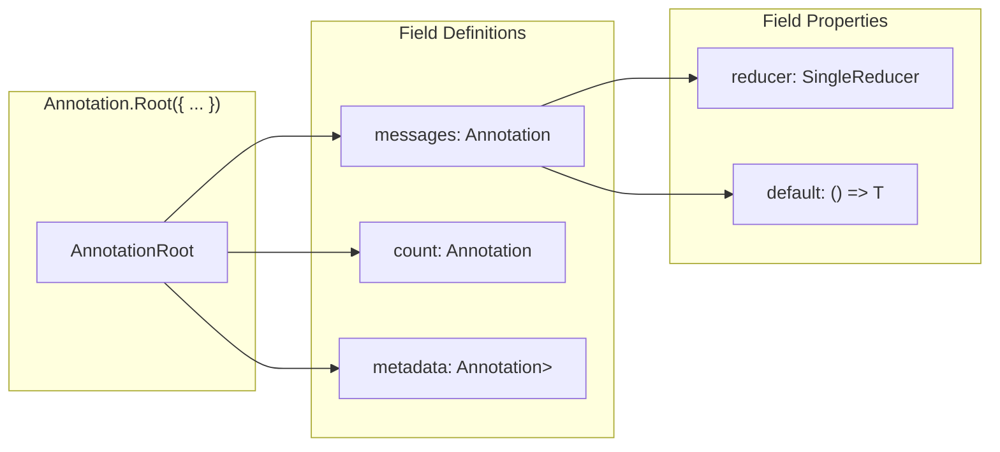
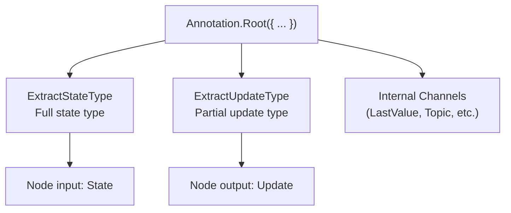
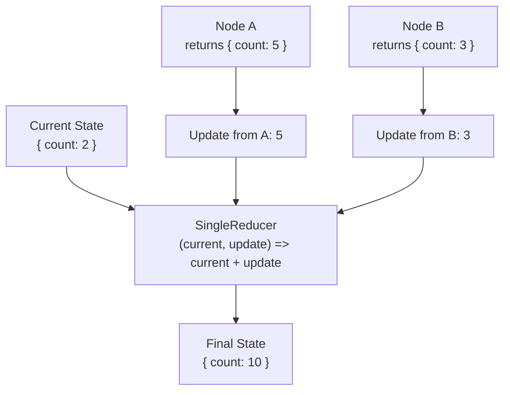
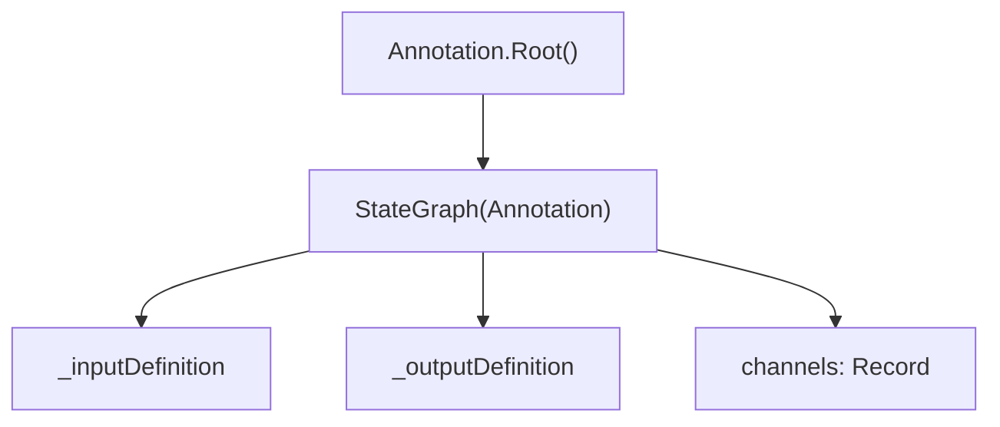

<!-- source: DeepWiki mcp.deepwiki.com · repo langchain-ai/langgraphjs · extra page Annotation System · fetched 2026-10-26 -->

# Annotation System

<details>
<summary>Relevant source files</summary>

The following files were used as context for generating this wiki page:

- [libs/langgraph-api/src/graph/load.utils.mts](libs/langgraph-api/src/graph/load.utils.mts)
- [libs/langgraph-api/src/graph/parser/index.mts](libs/langgraph-api/src/graph/parser/index.mts)
- [libs/langgraph-api/src/graph/parser/parser.mts](libs/langgraph-api/src/graph/parser/parser.mts)
- [libs/langgraph-api/src/graph/parser/parser.worker.mjs](libs/langgraph-api/src/graph/parser/parser.worker.mjs)
- [libs/langgraph-api/src/graph/parser/schema/types.template.mts](libs/langgraph-api/src/graph/parser/schema/types.template.mts)
- [libs/langgraph-api/tests/parser.test.mts](libs/langgraph-api/tests/parser.test.mts)
- [libs/langgraph-core/src/channels/any_value.ts](libs/langgraph-core/src/channels/any_value.ts)
- [libs/langgraph-core/src/channels/binop.ts](libs/langgraph-core/src/channels/binop.ts)
- [libs/langgraph-core/src/constants.ts](libs/langgraph-core/src/constants.ts)
- [libs/langgraph-core/src/graph/annotation.ts](libs/langgraph-core/src/graph/annotation.ts)
- [libs/langgraph-core/src/graph/index.ts](libs/langgraph-core/src/graph/index.ts)
- [libs/langgraph-core/src/graph/messages_reducer.ts](libs/langgraph-core/src/graph/messages_reducer.ts)
- [libs/langgraph-core/src/graph/state.test.ts](libs/langgraph-core/src/graph/state.test.ts)
- [libs/langgraph-core/src/graph/state.ts](libs/langgraph-core/src/graph/state.ts)
- [libs/langgraph-core/src/graph/types.ts](libs/langgraph-core/src/graph/types.ts)
- [libs/langgraph-core/src/graph/zod/meta.ts](libs/langgraph-core/src/graph/zod/meta.ts)
- [libs/langgraph-core/src/state/prebuilt/index.ts](libs/langgraph-core/src/state/prebuilt/index.ts)
- [libs/langgraph-core/src/state/prebuilt/messages.ts](libs/langgraph-core/src/state/prebuilt/messages.ts)
- [libs/langgraph-core/src/state/schema.test.ts](libs/langgraph-core/src/state/schema.test.ts)
- [libs/langgraph-core/src/state/schema.ts](libs/langgraph-core/src/state/schema.ts)
- [libs/langgraph-core/src/state/values/delta.test.ts](libs/langgraph-core/src/state/values/delta.test.ts)
- [libs/langgraph-core/src/state/values/delta.ts](libs/langgraph-core/src/state/values/delta.ts)
- [libs/langgraph-core/src/state/values/index.ts](libs/langgraph-core/src/state/values/index.ts)
- [libs/langgraph-core/src/state/values/reduced.test.ts](libs/langgraph-core/src/state/values/reduced.test.ts)
- [libs/langgraph-core/src/tests/channels.test.ts](libs/langgraph-core/src/tests/channels.test.ts)
- [libs/langgraph-core/src/tests/constants.test.ts](libs/langgraph-core/src/tests/constants.test.ts)
- [libs/langgraph-core/src/tests/run_control.test.ts](libs/langgraph-core/src/tests/run_control.test.ts)
- [libs/langgraph-core/src/tests/set_node_defaults.test.ts](libs/langgraph-core/src/tests/set_node_defaults.test.ts)
- [libs/langgraph-core/src/tests/state_graph_compat.test-d.ts](libs/langgraph-core/src/tests/state_graph_compat.test-d.ts)
- [libs/langgraph-core/src/tests/types.test-d.ts](libs/langgraph-core/src/tests/types.test-d.ts)
- [libs/langgraph-core/src/tests/zod_state.test.ts](libs/langgraph-core/src/tests/zod_state.test.ts)
- [libs/langgraph-core/src/web.ts](libs/langgraph-core/src/web.ts)
- [libs/langgraph-core/tsconfig.json](libs/langgraph-core/tsconfig.json)

</details>


The Annotation System is LangGraph's declarative API for defining state schemas in graphs. It provides a type-safe way to specify:
- Which fields exist in your graph's state
- How updates to those fields should be combined (reducers)
- Default values for fields
- Type inference for state and partial updates

This system is the recommended approach for defining state in `StateGraph`. For information about using Zod schemas directly, see [Zod Schema Integration](2.3.2).

---

## Purpose and Scope

The Annotation System serves as the primary interface for developers to define how state flows through their graphs. When you create a `StateGraph`, you typically start by defining an annotation that describes your state structure. The system then:

1. Infers TypeScript types for full state and partial updates.
2. Creates internal channels for each field.
3. Applies reducer functions to merge updates from multiple nodes.
4. Provides compile-time type safety for node inputs and outputs.

This document covers the core `Annotation` API, reducer patterns, and the prebuilt `MessagesAnnotation`.

---

## Core API

### Annotation.Root()

The `Annotation.Root()` function creates a state schema definition. Each key in the object becomes a field in your state. Internally, this is represented as an `AnnotationRoot` interface [libs/langgraph-core/src/web.ts:112-112]().

```typescript
const StateAnnotation = Annotation.Root({
  messages: Annotation<BaseMessage[]>({
    reducer: (current, update) => current.concat(update),
    default: () => []
  }),
  count: Annotation<number>({
    reducer: (_, update) => update
  }),
  metadata: Annotation<Record<string, string>>()
});
```

**Annotation Structure**

Sources: [libs/langgraph-core/src/graph/annotation.ts:1-9](), [libs/langgraph-core/src/graph/index.ts:1-9]()

---

### Annotation<Type>()

Individual fields are defined using `Annotation<Type>()`. It can be used as a function to define field metadata or as a type placeholder.

| Property | Type | Description |
|----------|------|-------------|
| `reducer` | `SingleReducer<T, U>` | Function to merge updates with current state |
| `default` | `() => T` | Function returning the initial value for this field |

**Type Parameters:**

- **T**: The type of the field in the full state (e.g., `BaseMessage[]`)
- **U** (optional): The type accepted in updates (defaults to `T`)

Sources: [libs/langgraph-core/src/graph/annotation.ts:1-9](), [libs/langgraph-core/src/graph/index.ts:1-9]()

---

## Type Inference

The Annotation System automatically infers TypeScript types for your state using utility types like `ExtractStateType` and `ExtractUpdateType` [libs/langgraph-core/src/graph/types.ts:42-43]().

**Annotation Type Inference Flow**


### StateType

The full state type represents the complete graph state. It can be accessed via `StateType<typeof MyAnnotation>` [libs/langgraph-core/src/graph/annotation.ts:3-3]().

```typescript
const MyAnnotation = Annotation.Root({
  count: Annotation<number>(),
  items: Annotation<string[]>()
});

type FullState = StateType<typeof MyAnnotation>;
// Resolves to: { count: number; items: string[] }
```

### UpdateType

The update type represents partial updates returned by nodes. It can be accessed via `UpdateType<typeof MyAnnotation>` [libs/langgraph-core/src/graph/annotation.ts:4-4]().

```typescript
type PartialUpdate = UpdateType<typeof MyAnnotation>;
// Resolves to: { count?: number; items?: string[] }
```

Sources: [libs/langgraph-core/src/graph/annotation.ts:1-9](), [libs/langgraph-core/src/graph/types.ts:42-43]()

---

## Reducers

Reducers are functions that combine the current value of a field with an incoming update. They follow the `SingleReducer` signature [libs/langgraph-core/src/graph/annotation.ts:8-8]().

### Common Reducer Patterns

| Pattern | Logic | Use Case |
|---------|-------|----------|
| **Last Write Wins** | Default behavior if no reducer is provided | Simple status flags |
| **Append** | `(current, update) => current.concat(update)` | History logs |
| **Merge Objects** | `(current, update) => ({ ...current, ...update })` | Configuration maps |

**Reducer Execution Flow**


Sources: [libs/langgraph-core/src/graph/annotation.ts:8-8](), [libs/langgraph-core/src/graph/state.ts:116-120]()

---

## MessagesAnnotation

`MessagesAnnotation` is a prebuilt annotation for conversational agents [libs/langgraph-core/src/web.ts:165-168](). It provides a single `messages` field with a specialized reducer.

### messagesStateReducer

The `messagesStateReducer` (also exported as `addMessages`) is the core logic for managing conversation history [libs/langgraph-core/src/web.ts:7-8]().

**Reducer Behavior**

| Input Type | Behavior |
|------------|----------|
| `BaseMessage[]` | Appends or updates messages based on ID |
| `REMOVE_ALL_MESSAGES` | Clears the entire message list [libs/langgraph-core/src/web.ts:10-10]() |
| `messagesDeltaReducer` | Handles streaming updates [libs/langgraph-core/src/web.ts:9-9]() |

Sources: [libs/langgraph-core/src/graph/messages_annotation.ts:1-5](), [libs/langgraph-core/src/graph/messages_reducer.ts:31-35]()

---

## Integration with StateGraph

When you pass an annotation to `StateGraph`, the graph uses it to define its input, output, and internal state schemas.

**Annotation to StateGraph Mapping**


The `StateGraph` constructor handles the conversion of Annotation definitions into internal `BaseChannel` instances [libs/langgraph-core/src/graph/state.ts:121-128]().

### Channel Mapping

| Annotation Property | Channel Property |
|--------------------|------------------|
| `reducer` | `BinaryOperator` logic in `BaseChannel` |
| `default` | Initial value of the channel |

Sources: [libs/langgraph-core/src/graph/state.ts:121-128](), [libs/langgraph-core/src/graph/annotation.ts:70-74]()

---

## StateSchema Class

For advanced use cases, the `StateSchema` class provides a unified API for defining state with mixed types (Zod, Reducers, and Untracked values) [libs/langgraph-core/src/state/schema.ts:190-196]().

- **ReducedValue**: Fields needing reducers [libs/langgraph-core/src/state/schema.ts:128-129]().
- **UntrackedValue**: Fields that are not persisted in checkpoints [libs/langgraph-core/src/state/schema.ts:130-131]().
- **DeltaValue**: Fields supporting incremental updates [libs/langgraph-core/src/state/schema.ts:126-127]().

Sources: [libs/langgraph-core/src/state/schema.ts:121-155](), [libs/langgraph-core/src/state/schema.ts:190-202]()

---

