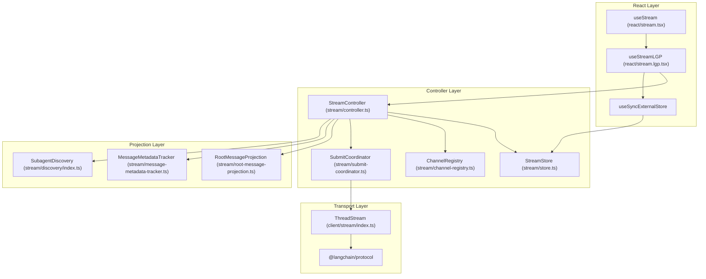
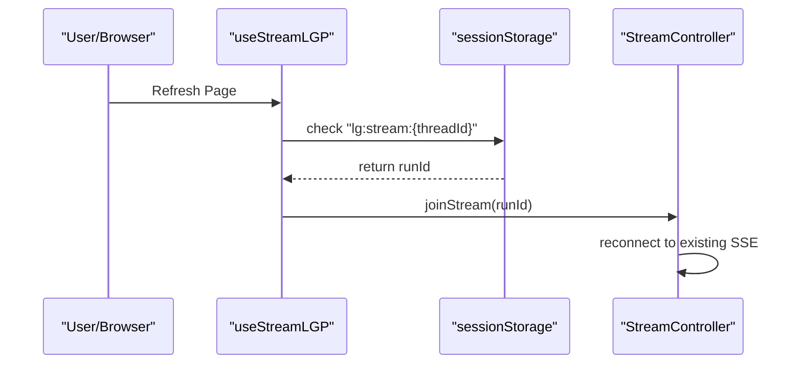

<!-- source: DeepWiki mcp.deepwiki.com · repo langchain-ai/langgraphjs · extra page Streaming Implementation Details · fetched 2026-10-26 -->

# Streaming Implementation Details

<details>
<summary>Relevant source files</summary>

The following files were used as context for generating this wiki page:

- [libs/langgraph-api/src/experimental/embed.mts](libs/langgraph-api/src/experimental/embed.mts)
- [libs/langgraph-api/src/state.mts](libs/langgraph-api/src/state.mts)
- [libs/langgraph-api/src/utils/runnableConfig.mts](libs/langgraph-api/src/utils/runnableConfig.mts)
- [libs/sdk-angular/src/use-stream.ts](libs/sdk-angular/src/use-stream.ts)
- [libs/sdk-react/src/use-stream.ts](libs/sdk-react/src/use-stream.ts)
- [libs/sdk-svelte/src/use-stream.svelte.ts](libs/sdk-svelte/src/use-stream.svelte.ts)
- [libs/sdk-vue/docs/interrupts.md](libs/sdk-vue/docs/interrupts.md)
- [libs/sdk-vue/src/use-stream.ts](libs/sdk-vue/src/use-stream.ts)
- [libs/sdk/src/client/stream/error.ts](libs/sdk/src/client/stream/error.ts)
- [libs/sdk/src/client/stream/index.test.ts](libs/sdk/src/client/stream/index.test.ts)
- [libs/sdk/src/client/stream/index.ts](libs/sdk/src/client/stream/index.ts)
- [libs/sdk/src/client/stream/test/mock-protocol-server.ts](libs/sdk/src/client/stream/test/mock-protocol-server.ts)
- [libs/sdk/src/client/stream/test/reconnect.int.test.ts](libs/sdk/src/client/stream/test/reconnect.int.test.ts)
- [libs/sdk/src/client/stream/transport/index.ts](libs/sdk/src/client/stream/transport/index.ts)
- [libs/sdk/src/react-ui/client.tsx](libs/sdk/src/react-ui/client.tsx)
- [libs/sdk/src/react/index.ts](libs/sdk/src/react/index.ts)
- [libs/sdk/src/react/stream.custom.tsx](libs/sdk/src/react/stream.custom.tsx)
- [libs/sdk/src/react/stream.lgp.test.tsx](libs/sdk/src/react/stream.lgp.test.tsx)
- [libs/sdk/src/react/stream.lgp.tsx](libs/sdk/src/react/stream.lgp.tsx)
- [libs/sdk/src/react/stream.tsx](libs/sdk/src/react/stream.tsx)
- [libs/sdk/src/react/thread.tsx](libs/sdk/src/react/thread.tsx)
- [libs/sdk/src/react/types.tsx](libs/sdk/src/react/types.tsx)
- [libs/sdk/src/stream/controller.test.ts](libs/sdk/src/stream/controller.test.ts)
- [libs/sdk/src/stream/controller.ts](libs/sdk/src/stream/controller.ts)
- [libs/sdk/src/stream/root-message-projection.test.ts](libs/sdk/src/stream/root-message-projection.test.ts)
- [libs/sdk/src/stream/root-message-projection.ts](libs/sdk/src/stream/root-message-projection.ts)
- [libs/sdk/src/stream/submit-coordinator.test.ts](libs/sdk/src/stream/submit-coordinator.test.ts)
- [libs/sdk/src/stream/submit-coordinator.ts](libs/sdk/src/stream/submit-coordinator.ts)
- [libs/sdk/src/ui/manager.test.ts](libs/sdk/src/ui/manager.test.ts)
- [libs/sdk/src/ui/manager.ts](libs/sdk/src/ui/manager.ts)
- [libs/sdk/src/ui/subagents.ts](libs/sdk/src/ui/subagents.ts)
- [libs/sdk/src/ui/types.ts](libs/sdk/src/ui/types.ts)
- [libs/sdk/src/ui/utils.test.ts](libs/sdk/src/ui/utils.test.ts)
- [libs/sdk/src/ui/utils.ts](libs/sdk/src/ui/utils.ts)

</details>


This document describes the low-level implementation of streaming in the LangGraph SDK's React integration layer. It covers the `StreamController`, `StreamStore`, `ChannelRegistry`, and supporting projection logic that handle event processing, state synchronization, and message reconstruction.

## Overview

The streaming implementation consists of three main layers:

1.  **StreamController**: The framework-agnostic central coordinator that owns the `ThreadStream` and manages the lifecycle of runs and subscriptions.
2.  **StreamStore**: A state container that exposes observable surfaces for root values, subagents, and subgraphs.
3.  **Projections and Trackers**: Specialized modules like `RootMessageProjection` and `MessageMetadataTracker` that transform raw protocol events into UI-ready data structures.

These components work together to provide real-time updates to UI components, handling event throttling, optimistic updates, and reconnection logic.

## Core Architecture

The system uses a multi-channel subscription model. A single root pump delivers core events, while selector hooks can lazily open per-namespace subscriptions.



**Sources:** [libs/sdk/src/stream/controller.ts:5-22](), [libs/sdk/src/react/stream.tsx:44-55](), [libs/sdk/src/react/stream.lgp.tsx:210-223]()

### StreamController

The `StreamController` is the primary entry point for managing a thread's streaming state. It is responsible for hydrating the initial state and maintaining at most one active `ThreadStream` at a time.

**Key responsibilities:**
-   **Hydration**: Fetches initial thread state via `client.threads.getState()` and decides if the thread is "active" (requiring an immediate SSE pump) [libs/sdk/src/stream/controller.ts:150-165]().
-   **Subscription Management**: Opens the "root pump" covering `values`, `checkpoints`, `lifecycle`, `input`, `messages`, and `tools` [libs/sdk/src/stream/controller.ts:174-181]().
-   **Dispatching**: delegates run execution to the `SubmitCoordinator` [libs/sdk/src/stream/controller.ts:79-83]().
-   **Cleanup**: Disposes of active subscriptions and aborts in-flight requests [libs/sdk/src/stream/controller.ts:270-271]().

**Sources:** [libs/sdk/src/stream/controller.ts:1-100]()

### StreamStore

The `StreamStore` is a simple observable container used to bridge the controller's internal state to framework-specific hooks (like React's `useSyncExternalStore`).

**Key surfaces:**
-   **rootStore**: Contains values, messages, tool calls, and interrupts for the root namespace [libs/sdk/src/stream/controller.ts:8-10]().
-   **subagentStore**: A discovery map of active subagents [libs/sdk/src/stream/controller.ts:9-9]().
-   **subgraphStore**: A discovery map of subgraphs [libs/sdk/src/stream/controller.ts:10-10]().

**Sources:** [libs/sdk/src/stream/store.ts:1-20](), [libs/sdk/src/stream/controller.ts:7-14]()

## Message Projection and Reconstruction

### RootMessageProjection

This module manages the "Two Streams of Truth" problem: merging incremental token-level deltas from the `messages` channel with authoritative full-state snapshots from the `values` channel.

**Reconciliation Logic:**
1.  **Messages Channel**: The `MessageAssembler` collects deltas and emits updated `BaseMessage` objects [libs/sdk/src/stream/root-message-projection.ts:17-19]().
2.  **Values Channel**: Full snapshots dictate the final ordering and handle server-side message removals [libs/sdk/src/stream/root-message-projection.ts:20-23]().
3.  **Coalescing**: To prevent React "Maximum update depth exceeded" errors during long replays, updates are staged in a buffer and flushed via `setTimeout(0)` at the next macrotask boundary [libs/sdk/src/stream/root-message-projection.ts:44-60]().

**Sources:** [libs/sdk/src/stream/root-message-projection.ts:1-69]()

### MessageMetadataTracker

The `MessageMetadataTracker` associates metadata with messages, such as which checkpoint or branch a message belongs to. It listens for `checkpoints` events to create `CheckpointEnvelope` objects that map timestamps to checkpoint IDs.

**Sources:** [libs/sdk/src/stream/message-metadata-tracker.ts:1-50](), [libs/sdk/src/stream/controller.ts:65-70]()

## Run Lifecycle and Throttling

### SubmitCoordinator

The `SubmitCoordinator` manages the complexities of run submission, including multitask strategies (abort, enqueue, reject) and racing dispatch responses against terminal lifecycle events.

**The Command vs. Terminal Race:**
For high-performance runs, the server's `completed` lifecycle event might arrive via SSE before the HTTP `submit` response returns. The coordinator races these two, allowing the UI to settle as soon as the terminal event is observed [libs/sdk/src/stream/submit-coordinator.ts:36-43]().

**Sources:** [libs/sdk/src/stream/submit-coordinator.ts:1-55]()

### Throttling Implementation

Throttling is implemented in the `StreamManager` (used by legacy and LGP hooks) to limit the frequency of React re-renders.

```typescript
// libs/sdk/src/ui/manager.ts:137-159
subscribe = (listener: () => void): (() => void) => {
  if (this.throttle === false) {
    this.listeners.add(listener);
    return () => this.listeners.delete(listener);
  }

  const timeoutMs = this.throttle === true ? 0 : this.throttle;
  let timeoutId: any;

  const throttledListener = () => {
    clearTimeout(timeoutId);
    timeoutId = setTimeout(() => {
      listener();
    }, timeoutMs);
  };

  this.listeners.add(throttledListener);
  return () => {
    clearTimeout(timeoutId);
    this.listeners.delete(throttledListener);
  };
};
```

**Sources:** [libs/sdk/src/ui/manager.ts:137-159]()

## Reconnection Logic

The SDK provides resilient streaming through `reconnectOnMount` and session storage persistence.



**Implementation Details:**
-   **Storage**: When a run starts, the `runId` is stored in `sessionStorage` [libs/sdk/src/react/stream.lgp.tsx:478-481]().
-   **Mount Check**: On component mount, the hook checks for a pending `runId` for the current thread [libs/sdk/src/react/stream.lgp.tsx:569-575]().
-   **Join**: If found, it calls `joinStream(runId)` to resume observing the server-side execution [libs/sdk/src/react/stream.lgp.tsx:590-594]().

**Sources:** [libs/sdk/src/react/stream.lgp.tsx:569-595](), [libs/sdk/src/stream/controller.ts:14-21]()

## ChannelRegistry

The `ChannelRegistry` enables lazy, deduplicated subscriptions to specific namespaces and channels. When a UI component calls a hook like `useMessages({ namespace: ["subagent"] })`, the registry:
1.  Checks if a subscription for that namespace already exists.
2.  If not, it opens a new subscription via the active `ThreadStream`.
3.  Increments a reference count to ensure the subscription stays open as long as at least one component needs it.

**Sources:** [libs/sdk/src/stream/channel-registry.ts:1-40](), [libs/sdk/src/stream/controller.ts:11-13]()

---

