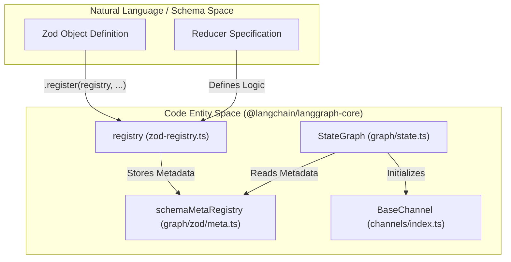
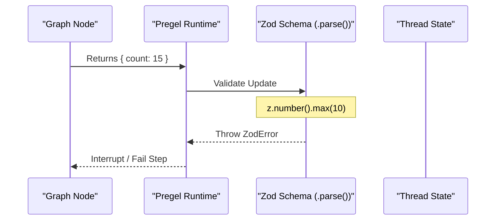

<!-- source: DeepWiki mcp.deepwiki.com · repo langchain-ai/langgraphjs · extra page Zod Schema Integration · fetched 2026-10-26 -->

# Zod Schema Integration

<details>
<summary>Relevant source files</summary>

The following files were used as context for generating this wiki page:

- [libs/langgraph-api/src/graph/load.utils.mts](libs/langgraph-api/src/graph/load.utils.mts)
- [libs/langgraph-api/src/graph/parser/index.mts](libs/langgraph-api/src/graph/parser/index.mts)
- [libs/langgraph-api/src/graph/parser/parser.mts](libs/langgraph-api/src/graph/parser/parser.mts)
- [libs/langgraph-api/src/graph/parser/parser.worker.mjs](libs/langgraph-api/src/graph/parser/parser.worker.mjs)
- [libs/langgraph-api/src/graph/parser/schema/types.template.mts](libs/langgraph-api/src/graph/parser/schema/types.template.mts)
- [libs/langgraph-api/tests/parser.test.mts](libs/langgraph-api/tests/parser.test.mts)
- [libs/langgraph-core/src/channels/any_value.ts](libs/langgraph-core/src/channels/any_value.ts)
- [libs/langgraph-core/src/channels/binop.ts](libs/langgraph-core/src/channels/binop.ts)
- [libs/langgraph-core/src/constants.ts](libs/langgraph-core/src/constants.ts)
- [libs/langgraph-core/src/graph/annotation.ts](libs/langgraph-core/src/graph/annotation.ts)
- [libs/langgraph-core/src/graph/index.ts](libs/langgraph-core/src/graph/index.ts)
- [libs/langgraph-core/src/graph/state.test.ts](libs/langgraph-core/src/graph/state.test.ts)
- [libs/langgraph-core/src/graph/state.ts](libs/langgraph-core/src/graph/state.ts)
- [libs/langgraph-core/src/graph/types.ts](libs/langgraph-core/src/graph/types.ts)
- [libs/langgraph-core/src/graph/zod/meta.ts](libs/langgraph-core/src/graph/zod/meta.ts)
- [libs/langgraph-core/src/state/values/reduced.test.ts](libs/langgraph-core/src/state/values/reduced.test.ts)
- [libs/langgraph-core/src/tests/channels.test.ts](libs/langgraph-core/src/tests/channels.test.ts)
- [libs/langgraph-core/src/tests/constants.test.ts](libs/langgraph-core/src/tests/constants.test.ts)
- [libs/langgraph-core/src/tests/run_control.test.ts](libs/langgraph-core/src/tests/run_control.test.ts)
- [libs/langgraph-core/src/tests/set_node_defaults.test.ts](libs/langgraph-core/src/tests/set_node_defaults.test.ts)
- [libs/langgraph-core/src/tests/state_graph_compat.test-d.ts](libs/langgraph-core/src/tests/state_graph_compat.test-d.ts)
- [libs/langgraph-core/src/tests/types.test-d.ts](libs/langgraph-core/src/tests/types.test-d.ts)
- [libs/langgraph-core/src/tests/zod_state.test.ts](libs/langgraph-core/src/tests/zod_state.test.ts)
- [libs/langgraph-core/src/web.ts](libs/langgraph-core/src/web.ts)
- [libs/langgraph-core/tsconfig.json](libs/langgraph-core/tsconfig.json)
- [libs/langgraph/.gitignore](libs/langgraph/.gitignore)
- [libs/langgraph/src/graph/zod/index.ts](libs/langgraph/src/graph/zod/index.ts)
- [libs/langgraph/src/graph/zod/schema.ts](libs/langgraph/src/graph/zod/schema.ts)

</details>


## Purpose and Scope

This document describes how LangGraph integrates with [Zod](https://zod.dev/) for defining graph state schemas with runtime validation. Zod is a TypeScript-first schema declaration and validation library that provides an alternative to LangGraph's [Annotation System](2.3.1) for state definition.

This page covers the Zod-specific utilities for defining state, including the `registry` system for adding reducers and the `MessagesZodMeta` helper for message channels. For broader state management concepts, see [State Management](2.3).

## Package Organization

The Zod integration is provided through a dedicated subpackage within `@langchain/langgraph`:

| Package Path | Purpose |
|--------------|---------|
| `@langchain/langgraph/zod` | Main Zod integration exports including `registry` |
| `@langchain/langgraph/zod/schema` | Schema-specific utilities and schema extraction |

Both paths are also available through the canonical `langgraph` package name (`langgraph/zod`, `langgraph/zod/schema`).

**Sources:** [libs/langgraph/src/graph/zod/index.ts:1-12](), [libs/langgraph/src/graph/zod/schema.ts:1-12]()

## StateGraph Construction with Zod

Zod schemas are passed directly to the `StateGraph` constructor. The `StateGraph` constructor is overloaded to accept either an `AnnotationRoot` or a Zod object schema. When using Zod, the framework uses `z.infer` to determine the internal state types.

```typescript
import { StateGraph } from "@langchain/langgraph";
import { z } from "zod";

const StateSchema = z.object({
  query: z.array(z.string()),
  count: z.number().default(0),
});

const graph = new StateGraph(StateSchema)
  .addNode("node1", (state) => ({ count: state.count + 1 }))
  .compile();
```

**Sources:** [libs/langgraph-core/src/graph/state.ts:93-101](), [libs/langgraph-core/src/tests/zod_state.test.ts:20-33]()

## Zod Registry System

The `registry` object from `@langchain/langgraph-core` (re-exported by `@langchain/langgraph/zod`) extends Zod schemas with LangGraph-specific metadata. This is primarily used to associate reducers with specific keys in a Zod object, which the graph engine then translates into `BaseChannel` configurations.

### Data Flow from Zod to Pregel Channels

The following diagram illustrates how a Zod schema is processed into the internal Pregel runtime configuration.

**Diagram: Zod to Code Entity Mapping**



**Sources:** [libs/langgraph-core/src/graph/zod/zod-registry.ts:1-15](), [libs/langgraph-core/src/graph/zod/meta.ts:1-84](), [libs/langgraph-core/src/graph/state.ts:121-127]()

## Defining Reducers with Zod

By default, keys in a Zod object schema are treated as `LastValue` channels (the last update overwrites the current value). To use custom reducers (e.g., for appending to lists), you must register LangGraph metadata.

### Using .register() Method (Zod v4)

Zod v4 introduced a `.register()` method that allows attaching external metadata to a schema. LangGraph utilizes this to inject reducer functions.

```typescript
import { registry } from "@langchain/langgraph/zod";
import { z } from "zod/v4";

const schema = z.object({
  messages: z.array(z.any()).register(registry, {
    reducer: {
      fn: (current, next) => [...current, ...next],
      schema: z.array(z.any())
    }
  })
});
```

**Sources:** [libs/langgraph-core/src/tests/zod_state.test.ts:192-196](), [libs/langgraph-core/src/graph/zod/meta.ts:84-100]()

### MessagesZodMeta Helper

For standard message handling, LangGraph provides `MessagesZodMeta`. This automatically applies the `messagesStateReducer` (also known as `addMessages`) to the channel.

```typescript
import { MessagesZodMeta } from "@langchain/langgraph";
import { registry } from "@langchain/langgraph/zod";
import { z } from "zod/v4";

const schema = z.object({
  messages: z.array(z.any()).register(registry, MessagesZodMeta),
});
```

**Sources:** [libs/langgraph-core/src/graph/messages_annotation.js:167-168](), [libs/langgraph-core/src/tests/zod_state.test.ts:191-195]()

## Runtime Validation

One of the primary advantages of Zod integration is automatic runtime validation of state updates. If a node returns an update that violates the Zod schema constraints (e.g., a number outside a `min/max` range), the graph will throw an error during execution.

**Diagram: Validation Flow**



**Sources:** [libs/langgraph-core/src/tests/zod_state.test.ts:92-104](), [libs/langgraph-core/src/graph/state.ts:63-67]()

## Schema Extraction for Platform Tools

LangGraph provides utilities to extract JSON Schema representations from Zod-based graphs. This is critical for LangGraph Studio and API deployments to display input/output forms.

### getRuntimeGraphSchema

The `getRuntimeGraphSchema` function (located in `libs/langgraph-api`) traverses the graph's internal `builder` to extract schemas for:
1.  **State**: The full internal state schema.
2.  **Input**: The schema required to invoke the graph (often subset of state).
3.  **Output**: The schema returned by the graph.
4.  **Config**: The schema for `configurable` parameters.

**Sources:** [libs/langgraph-api/src/graph/parser/parser.mts:9-14](), [libs/langgraph-api/src/graph/parser/index.mts:1-10]()

### Extraction Logic

The extractor uses the TypeScript compiler API to inspect the graph's types if runtime metadata is missing, but it prioritizes the `schemaMetaRegistry` when Zod schemas are used with `.register()`.

| Schema Source | Extraction Priority | Metadata Key |
| :--- | :--- | :--- |
| `StateSchema` Class | 1 (Highest) | Internal properties |
| Zod + `registry` | 2 | `langgraph_type` |
| Plain Zod | 3 | Standard Zod properties |

**Sources:** [libs/langgraph-api/tests/parser.test.mts:154-186](), [libs/langgraph-core/src/graph/zod/meta.ts:10-30]()

## Build Artifacts and Exports

The Zod integration is exported across several layers to support different Zod versions and environment constraints.

-   **Core Implementation**: `libs/langgraph-core/src/graph/zod/`
-   **Public API**: `libs/langgraph/src/graph/zod/`
-   **Schema Utilities**: `libs/langgraph-core/src/graph/zod/schema.ts` provides functions like `getStateTypeSchema` and `getUpdateTypeSchema`.

**Sources:** [libs/langgraph/src/graph/zod/index.ts:1-12](), [libs/langgraph-core/src/graph/zod/schema.ts:9-13]()

---

