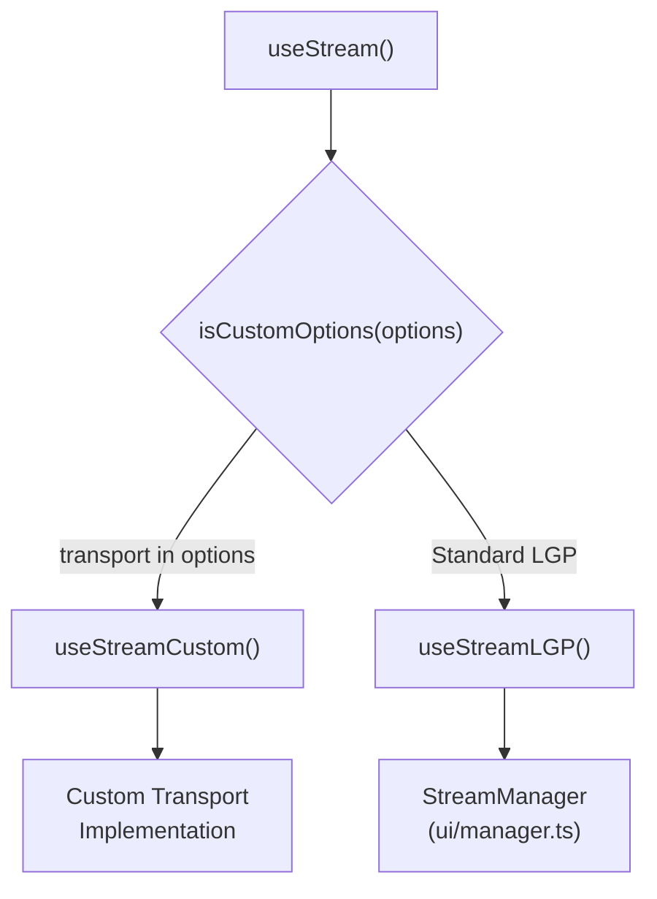
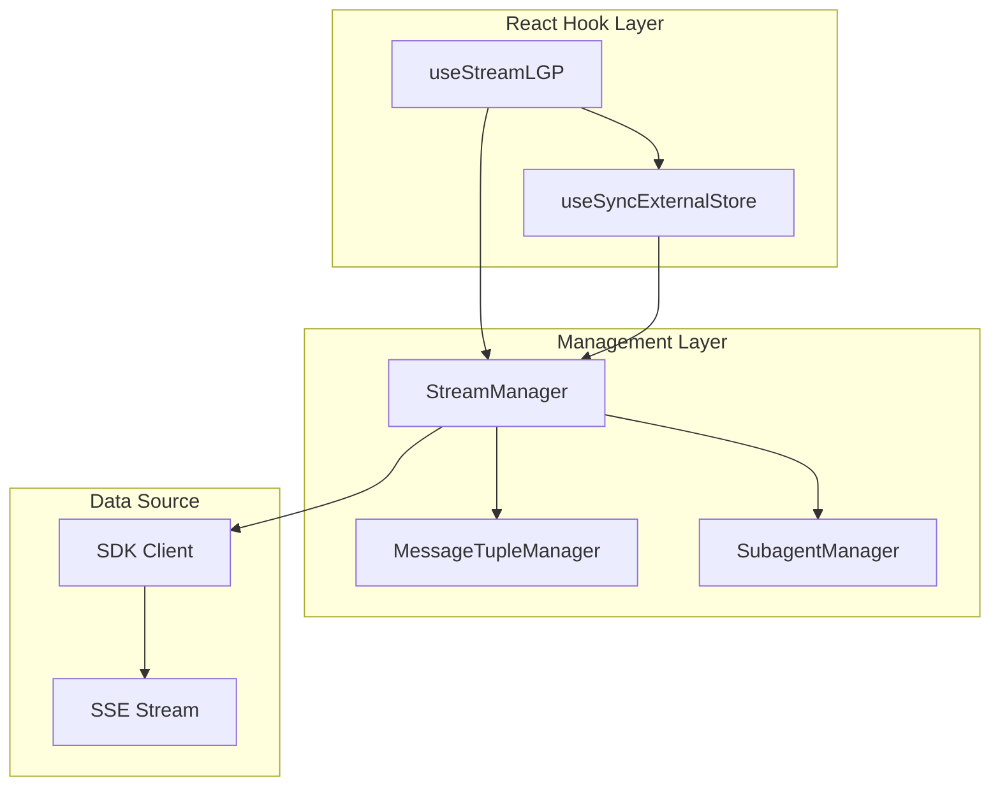
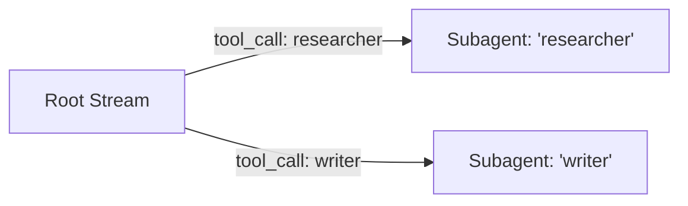

<!-- source: DeepWiki mcp.deepwiki.com · repo langchain-ai/langgraphjs · extra page useStream Hook · fetched 2026-10-26 -->

# useStream Hook

<details>
<summary>Relevant source files</summary>

The following files were used as context for generating this wiki page:

- [libs/langgraph-api/src/experimental/embed.mts](libs/langgraph-api/src/experimental/embed.mts)
- [libs/langgraph-api/src/state.mts](libs/langgraph-api/src/state.mts)
- [libs/langgraph-api/src/utils/runnableConfig.mts](libs/langgraph-api/src/utils/runnableConfig.mts)
- [libs/sdk-angular/docs/v1-migration.md](libs/sdk-angular/docs/v1-migration.md)
- [libs/sdk-angular/src/use-stream.ts](libs/sdk-angular/src/use-stream.ts)
- [libs/sdk-react/docs/use-stream.md](libs/sdk-react/docs/use-stream.md)
- [libs/sdk-react/docs/v1-migration.md](libs/sdk-react/docs/v1-migration.md)
- [libs/sdk-react/src/use-stream.ts](libs/sdk-react/src/use-stream.ts)
- [libs/sdk-svelte/docs/v1-migration.md](libs/sdk-svelte/docs/v1-migration.md)
- [libs/sdk-svelte/src/use-stream.svelte.ts](libs/sdk-svelte/src/use-stream.svelte.ts)
- [libs/sdk-vue/docs/interrupts.md](libs/sdk-vue/docs/interrupts.md)
- [libs/sdk-vue/docs/v1-migration.md](libs/sdk-vue/docs/v1-migration.md)
- [libs/sdk-vue/src/use-stream.ts](libs/sdk-vue/src/use-stream.ts)
- [libs/sdk/src/react-ui/client.tsx](libs/sdk/src/react-ui/client.tsx)
- [libs/sdk/src/react/index.ts](libs/sdk/src/react/index.ts)
- [libs/sdk/src/react/stream.custom.tsx](libs/sdk/src/react/stream.custom.tsx)
- [libs/sdk/src/react/stream.lgp.test.tsx](libs/sdk/src/react/stream.lgp.test.tsx)
- [libs/sdk/src/react/stream.lgp.tsx](libs/sdk/src/react/stream.lgp.tsx)
- [libs/sdk/src/react/stream.tsx](libs/sdk/src/react/stream.tsx)
- [libs/sdk/src/react/thread.tsx](libs/sdk/src/react/thread.tsx)
- [libs/sdk/src/react/types.tsx](libs/sdk/src/react/types.tsx)
- [libs/sdk/src/stream/controller.test.ts](libs/sdk/src/stream/controller.test.ts)
- [libs/sdk/src/stream/controller.ts](libs/sdk/src/stream/controller.ts)
- [libs/sdk/src/stream/index.ts](libs/sdk/src/stream/index.ts)
- [libs/sdk/src/stream/root-message-projection.test.ts](libs/sdk/src/stream/root-message-projection.test.ts)
- [libs/sdk/src/stream/root-message-projection.ts](libs/sdk/src/stream/root-message-projection.ts)
- [libs/sdk/src/stream/submit-coordinator.test.ts](libs/sdk/src/stream/submit-coordinator.test.ts)
- [libs/sdk/src/stream/submit-coordinator.ts](libs/sdk/src/stream/submit-coordinator.ts)
- [libs/sdk/src/ui/manager.test.ts](libs/sdk/src/ui/manager.test.ts)
- [libs/sdk/src/ui/manager.ts](libs/sdk/src/ui/manager.ts)
- [libs/sdk/src/ui/subagents.ts](libs/sdk/src/ui/subagents.ts)
- [libs/sdk/src/ui/types.ts](libs/sdk/src/ui/types.ts)
- [libs/sdk/src/ui/utils.test.ts](libs/sdk/src/ui/utils.test.ts)
- [libs/sdk/src/ui/utils.ts](libs/sdk/src/ui/utils.ts)

</details>


The `useStream` hook is the primary React integration for LangGraph streaming capabilities. It provides a declarative interface for managing real-time agent execution, handling message state, branching contexts, interrupts, and streaming events. This hook abstracts the complexity of Server-Sent Events (SSE) communication, state synchronization, and thread management, enabling developers to build interactive chat and agent interfaces.

For lower-level streaming implementation details, see [Streaming Implementation Details](#6.2.2). For general information about the Client SDK, see [Client API Reference](#6.1). For branching and state history functionality, see [Branching and State History](#6.3).

## Hook Variants and Dispatching

The `useStream` function serves as a dispatcher that selects between two underlying implementations based on the provided options. It uses a `useState` check to ensure the implementation doesn't change during re-renders.



**Diagram: Hook variant selection logic**

Sources: [libs/sdk/src/react/stream.tsx:15-55]()

### LangGraph Platform Mode (`useStreamLGP`)

The default mode when no `transport` property is provided. This mode uses the LangGraph Platform Client to communicate with a LangGraph API server. It manages a `StreamManager` and `MessageTupleManager` to handle incoming SSE events and project them into React state.

| Parameter | Type | Description |
|-----------|------|-------------|
| `assistantId` | `string` | The graph/assistant identifier to execute |
| `apiKey` | `string \| undefined` | Optional API key for authentication |
| `apiUrl` | `string \| undefined` | Optional custom API endpoint |
| `client` | `Client \| undefined` | Optional pre-configured Client instance |

Sources: [libs/sdk/src/react/stream.lgp.tsx:172-207]()

### Custom Transport Mode (`useStreamCustom`)

An advanced mode for custom streaming implementations, identified by the presence of a `transport` property in options. This allows integration with non-standard backends or custom protocols while maintaining the same UI interface.

Sources: [libs/sdk/src/react/stream.tsx:15-24](), [libs/sdk/src/react/stream.tsx:48-51]()

## Core Architecture and Data Flow

The `useStreamLGP` implementation relies on several key entities to manage the lifecycle of a stream.



**Diagram: useStreamLGP Internal Entity Mapping**

Sources: [libs/sdk/src/react/stream.lgp.tsx:209-223](), [libs/sdk/src/ui/manager.ts:183-230]()

### StreamManager
The `StreamManager` is a framework-agnostic class that owns the streaming state. It handles:
- **Throttling**: Batches updates to prevent React render storms [libs/sdk/src/ui/manager.ts:120-127]().
- **Event Dispatching**: Maps protocol events (values, updates, messages, tools) to state updates [libs/sdk/src/ui/manager.ts:47-67]().
- **Subagent Tracking**: Manages nested agent executions via `SubagentManager` [libs/sdk/src/ui/manager.ts:224-229]().

### MessageTupleManager
Manages the internal collection of messages, handling deduplication and ordered updates as tokens stream in [libs/sdk/src/ui/manager.ts:189-204]().

## Configuration Options

The hook accepts a comprehensive set of configuration options that control streaming behavior, state management, and event handling.

### Core Configuration

```typescript
interface UseStreamOptions<StateType, Bag> {
  // Identification
  assistantId: string;
  threadId?: string | null;
  
  // Client configuration
  apiKey?: string;
  apiUrl?: string;
  client?: Client;
  
  // State management
  initialValues?: Partial<StateType>;
  fetchStateHistory?: boolean | number; // history limit
  
  // Subagent configuration
  subagentToolNames?: string[];
  filterSubagentMessages?: boolean;
  
  // Performance
  throttle?: boolean | number;
}
```

Sources: [libs/sdk/src/react/stream.lgp.tsx:172-223](), [libs/sdk/src/ui/manager.ts:119-181]()

### Thread History and Persistence
The hook uses `useThreadHistory` to fetch existing thread states when a `threadId` is provided. This ensures that the conversation history is available immediately on mount [libs/sdk/src/react/stream.lgp.tsx:79-170]().

## Return Values

The hook returns an object (defined by the `UseStream` interface) containing state, methods, and metadata.

| Property | Type | Description |
|----------|------|-------------|
| `messages` | `Message[]` | Array of messages for the current thread [libs/sdk/src/react/types.tsx:79-84](). |
| `values` | `StateType` | The current state of the graph [libs/sdk/src/react/types.tsx:79-84](). |
| `isLoading` | `boolean` | True while a run is actively streaming [libs/sdk/src/react/types.tsx:79-84](). |
| `isThreadLoading`| `boolean` | True while fetching thread history [libs/sdk/src/react/types.tsx:88](). |
| `submit` | `Function` | Starts a new run on the thread [libs/sdk/src/react/types.tsx:98-101](). |
| `stop` | `Function` | Aborts the current active run [libs/sdk/src/react/types.tsx:93](). |
| `subagents` | `Map` | Access to nested subagent streams [libs/sdk/src/react/types.tsx:184-189](). |

Sources: [libs/sdk/src/react/types.tsx:75-167]()

## Control Methods

### submit(values, options)
The `submit` method initiates a run. It handles optimistic updates, creates threads if necessary, and establishes the SSE connection [libs/sdk/src/react/stream.lgp.tsx:325-374]().

### stop()
Calls the internal `StreamManager`'s abort controller to terminate the active fetch request and stop processing events [libs/sdk/src/ui/manager.ts:187-188]().

## Subagent Support
LangGraph supports "Deep Agents" where a tool call can trigger a nested graph execution. The `useStream` hook tracks these automatically.

- **`subagentToolNames`**: Defines which tool calls represent subagents (default: `["task"]`) [libs/sdk/src/ui/manager.ts:129-143]().
- **`filterSubagentMessages`**: If true, messages from subagents are excluded from the main `messages` array and must be accessed via `stream.subagents.get(id).messages` [libs/sdk/src/ui/manager.ts:145-172]().



Sources: [libs/sdk/src/ui/manager.ts:224-229](), [libs/sdk/src/ui/subagents.ts:1-50]()

## Interrupts and Human-in-the-Loop

The hook provides `interrupt` and `interrupts` properties to handle graph pauses.
- **`interrupt`**: The most recent pending interrupt [libs/sdk/src/react/types.tsx:179]().
- **`interrupts`**: A collection of all pending interrupts on the thread [libs/sdk/src/react/types.tsx:180]().

To resume from an interrupt, users call `submit` with a `command` containing the resume value:
```typescript
submit(null, { command: { resume: "User Approval" } });
```

Sources: [libs/sdk/src/react/stream.lgp.tsx:355-365](), [libs/sdk/src/ui/interrupts.ts:1-49]()

## Type Safety and Inference

`useStream` uses a "Bag" template pattern to provide deep type safety for state updates, interrupts, and custom events.

```typescript
export function useStream<
  T = Record<string, unknown>,
  Bag extends BagTemplate = BagTemplate,
>(options: ResolveStreamOptions<T, InferBag<T, Bag>>)
```

This allows the hook to infer:
- `UpdateType`: The partial state shape accepted by `submit` [libs/sdk/src/ui/manager.ts:34-39]().
- `CustomEventType`: The type of data received in `onCustomEvent` [libs/sdk/src/ui/manager.ts:41-45]().
- `InterruptType`: The shape of payloads for human-in-the-loop nodes.

Sources: [libs/sdk/src/react/stream.tsx:26-41](), [libs/sdk/src/ui/manager.ts:34-67]()

---
Sources: [libs/sdk/src/react/stream.tsx:1-55](), [libs/sdk/src/react/stream.lgp.tsx:1-223](), [libs/sdk/src/ui/manager.ts:1-230](), [libs/sdk/src/react/types.tsx:1-195]()

---

