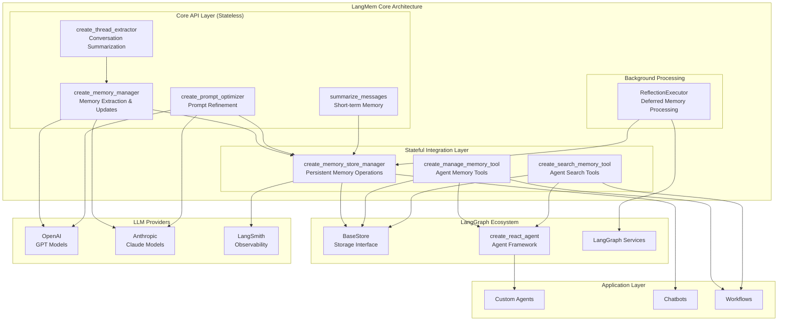
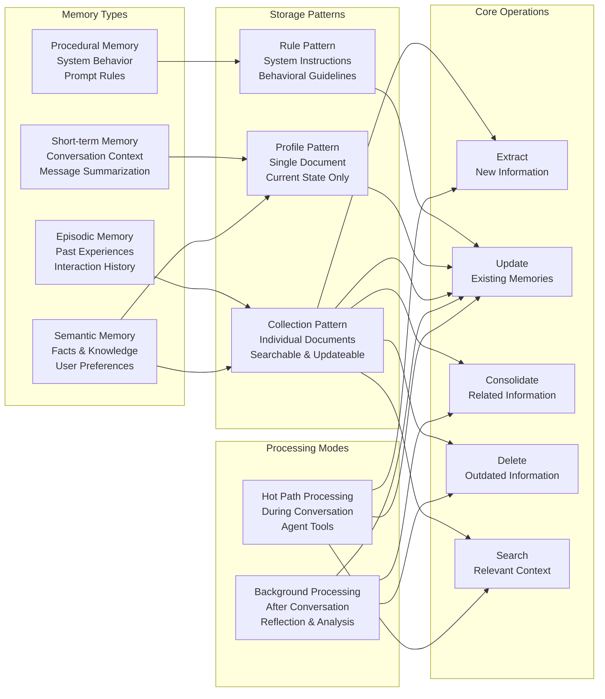
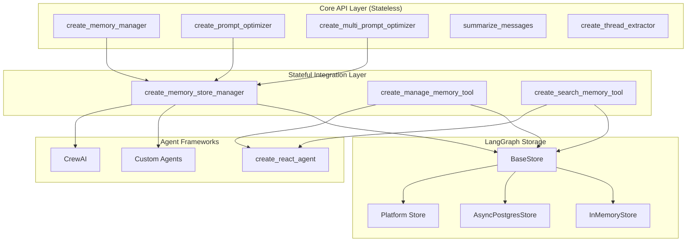
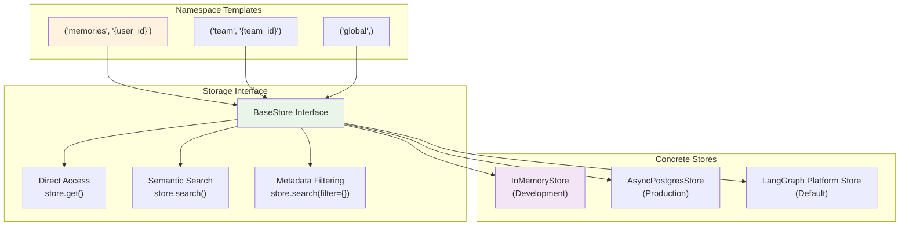

<!-- source: DeepWiki mcp.deepwiki.com · repo langchain-ai/langmem · page 1 Overview · fetched 2026-10-26 -->

# Overview

Relevant source files

The following files were used as context for generating this wiki page:

- [README.md](README.md)
- [docs/docs/concepts/conceptual_guide.md](docs/docs/concepts/conceptual_guide.md)
- [pyproject.toml](pyproject.toml)

LangMem is a memory management system for LLM applications that enables agents to learn and adapt from their interactions over time. It provides prebuilt utilities for memory extraction, storage, optimization, and retrieval that work with any storage system, with native integration for LangGraph's storage layer.

For detailed information about specific memory types, see [Memory Management](#2). For integration with different agent frameworks, see [Integration](#4). For API documentation, see [API Reference](#9).

## Purpose and Scope

LangMem addresses the challenge of giving LLM applications persistent, searchable memory. The system extracts important information from conversations, optimizes agent behavior through prompt refinement, and maintains long-term memory across sessions.

The library follows a two-layer design:
- **Core API Layer**: Stateless functions like `create_memory_manager` and `create_prompt_optimizer` that work with any storage system
- **Stateful Integration Layer**: Components like `create_memory_store_manager` and memory tools that integrate with LangGraph's `BaseStore`

LangMem supports two main processing approaches:
- **Hot Path Processing**: Agent-driven memory operations during conversations using `create_manage_memory_tool` and `create_search_memory_tool`
- **Background Processing**: Deferred memory extraction and consolidation using `ReflectionExecutor`

Sources: [README.md:1-96](), [docs/docs/concepts/conceptual_guide.md:318-339](), [pyproject.toml:1-93]()

## LangMem High-Level System Architecture

LangMem follows a two-layer architecture that separates stateless core operations from stateful integrations:

The **Core API Layer** provides stateless functions that transform memory state without side effects. These work with any storage system and include:
- `create_memory_manager`: Extract and consolidate memories from conversations
- `create_prompt_optimizer`: Optimize system prompts based on feedback
- `create_thread_extractor`: Generate conversation summaries
- `summarize_messages`: Handle short-term memory within token limits

The **Stateful Integration Layer** builds on the Core API to provide persistent memory operations with LangGraph's `BaseStore`:
- `create_memory_store_manager`: Automatically persist extracted memories
- `create_manage_memory_tool`: Agent tools for creating/updating/deleting memories
- `create_search_memory_tool`: Agent tools for semantic memory search

Sources: [README.md:30-87](), [docs/docs/concepts/conceptual_guide.md:318-339](), [pyproject.toml:8-17]()

## Core Components

LangMem is built around several key components that handle different aspects of memory management:

| Component | Purpose | Key Functions | Layer |
|-----------|---------|---------------|--------|
| **Memory Manager** | Extract, consolidate, and update memories from conversations | `create_memory_manager` | Core API |
| **Store Manager** | Persist extracted memories to LangGraph storage | `create_memory_store_manager` | Stateful Integration |
| **Memory Tools** | Agent-accessible memory operations during conversations | `create_manage_memory_tool`, `create_search_memory_tool` | Stateful Integration |
| **Prompt Optimizer** | Improve system behavior through prompt refinement | `create_prompt_optimizer`, `create_multi_prompt_optimizer` | Core API |
| **Message Summarizer** | Handle short-term memory and conversation context | `summarize_messages` | Core API |
| **Thread Extractor** | Extract conversation summaries and insights | `create_thread_extractor` | Core API |
| **Reflection Executor** | Background processing coordination for deferred memory operations | `ReflectionExecutor` | Background Processing |

### Memory Types and Processing Pipeline

Sources: [docs/docs/concepts/conceptual_guide.md:19-292](), [docs/docs/concepts/conceptual_guide.md:295-316]()

## Memory Types and Processing

LangMem supports multiple memory types that mirror human memory systems, each with specific storage patterns and processing approaches:

### Semantic Memory
Stores facts and knowledge using two patterns:
- **Collections** (`enable_inserts=True`): Unbounded knowledge stored as individual documents, searchable and updateable
- **Profiles** (with Pydantic schemas): Structured information that updates in-place for current state

### Episodic Memory  
Captures successful interactions as learning examples using collection pattern with Episode schemas:
- Situation context and relevant environment
- Thought processes and reasoning steps
- Actions taken in response
- Results achieved and why they worked

### Procedural Memory
Encodes system behavior and response patterns:
- Core personality through system prompts
- Behavioral guidelines using rule patterns
- Adaptive improvements via `create_prompt_optimizer`

### Short-term Memory
Handles conversation context within token limits:
- Message summarization using `summarize_messages`
- Running conversation state with profile pattern
- Context management for ongoing interactions

| Memory Type | Storage Pattern | Key Functions | Use Case |
|-------------|-----------------|---------------|----------|
| Semantic Collections | Collection | `create_memory_manager(enable_inserts=True)` | Facts, preferences, knowledge |
| Semantic Profiles | Profile | `create_memory_manager(schemas=[UserProfile])` | Current user state, settings |
| Episodic | Collection | `create_memory_manager(schemas=[Episode])` | Learning from past successes |
| Procedural | Rules/Prompts | `create_prompt_optimizer()` | System behavior adaptation |
| Short-term | Profile | `summarize_messages()` | Conversation context |

Sources: [docs/docs/concepts/conceptual_guide.md:19-292](), [docs/docs/concepts/conceptual_guide.md:295-316]()

## Processing Approaches

LangMem supports two distinct processing approaches for memory formation:

### Hot Path Processing (Agent-Driven)
Memory operations occur during conversations with immediate latency impact:
- Agents use `create_manage_memory_tool` to actively decide what to store
- `create_search_memory_tool` provides semantic search during conversations  
- Memory updates happen in real-time as part of agent tool execution
- Higher latency but immediate context availability

### Background Processing (Subconscious)
Memory operations occur after conversations without latency impact:
- `ReflectionExecutor` coordinates deferred memory processing
- `create_memory_store_manager` handles batch memory extraction
- Pattern analysis and consolidation without blocking user interactions
- Delayed updates but comprehensive analysis

| Processing Type | Latency Impact | Update Speed | Processing Load | Implementation |
|----------------|----------------|--------------|-----------------|----------------|
| Hot Path | Higher | Immediate | During Response | `create_manage_memory_tool`, `create_search_memory_tool` |
| Background | None | Delayed | Between/After Calls | `ReflectionExecutor`, `create_memory_store_manager` |

## Integration Patterns

LangMem follows a two-layer integration design:

### 1. Core API Layer (Stateless)
Side-effect-free functions that work with any storage system:
- `create_memory_manager`: Transform memory state without persistence
- `create_prompt_optimizer`: Update prompts based on feedback
- `create_multi_prompt_optimizer`: Optimize multiple prompts together
- `summarize_messages`: Handle conversation context
- `create_thread_extractor`: Extract conversation insights

### 2. Stateful Integration Layer  
Components that integrate with LangGraph's `BaseStore`:
- `create_memory_store_manager`: Automatically persist extracted memories
- `create_manage_memory_tool`: Agent tools for memory operations
- `create_search_memory_tool`: Agent tools for memory retrieval

Sources: [docs/docs/concepts/conceptual_guide.md:295-316](), [docs/docs/concepts/conceptual_guide.md:318-339](), [README.md:30-87]()

## Storage and Namespace Organization

The storage system is built on LangGraph's `BaseStore` interface and supports hierarchical namespace organization:

### Namespace Structure
Namespaces provide natural data segmentation:
- **Multi-level hierarchies**: Organization → User → Application
- **Template variables**: Dynamic resolution using `"{user_id}"` syntax
- **Contextual keys**: Unique identification within namespaces

### Storage Backends
- **InMemoryStore**: Development and testing
- **AsyncPostgresStore**: Production persistence
- **LangGraph Platform Store**: Default cloud deployment

Sources: [docs/docs/concepts/conceptual_guide.md:341-377](), [README.md:40-62]()

## Key Design Principles

LangMem is built on several key principles:

1. **Dual Processing Modes**: Support both real-time and background memory processing
2. **Storage Agnostic**: Core functionality works with any storage system
3. **Framework Flexible**: Native LangGraph integration with support for other frameworks
4. **Memory Type Diversity**: Support for semantic, episodic, and procedural memory
5. **Namespace Organization**: Hierarchical organization for multi-tenancy
6. **Prompt Optimization**: Continuous improvement through feedback-driven optimization

This architecture enables LangMem to serve as a comprehensive memory management solution for language model applications, from simple chatbots to complex multi-agent systems.

Sources: [docs/docs/concepts/conceptual_guide.md:1-377](), [README.md:1-96](), [src/langmem/__init__.py:1-28]()

---

