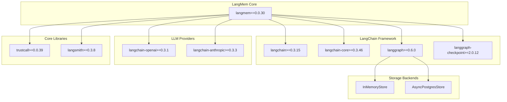
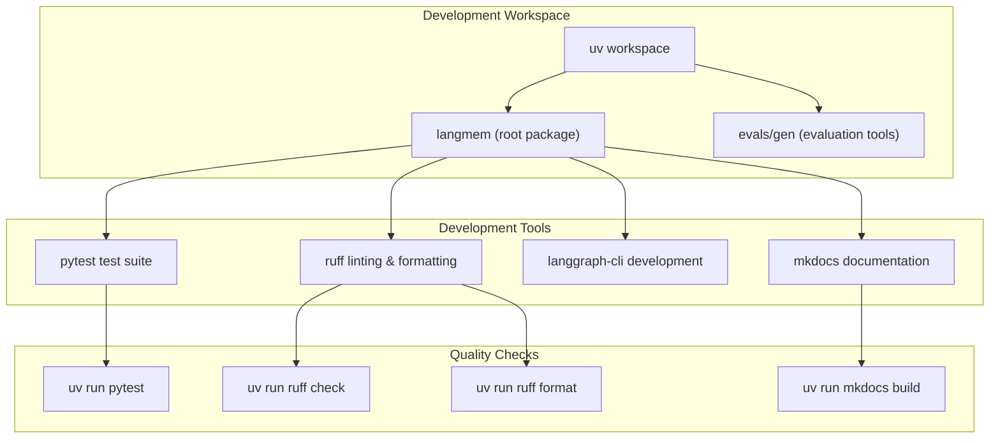

<!-- source: DeepWiki mcp.deepwiki.com · repo langchain-ai/langmem · page 1.1 Installation and Setup · fetched 2026-10-26 -->

# Installation and Setup

<details>
<summary>Relevant source files</summary>

The following files were used as context for generating this wiki page:

- [README.md](README.md)
- [pyproject.toml](pyproject.toml)
- [uv.lock](uv.lock)

</details>


This document covers installing LangMem and setting up your environment to start building memory-enabled agents. It includes both basic installation for users and development setup for contributors.

For information about integrating LangMem with specific frameworks after installation, see [Agent Integration](#4.2). For storage backend configuration, see [Storage Types](#7.1).

## System Requirements

LangMem requires Python 3.10 or higher and integrates with the LangChain ecosystem.

### Core Requirements

| Component | Version | Purpose |
|-----------|---------|---------|
| Python | >=3.10 | Runtime environment |
| LangChain | >=0.3.15 | Core framework |
| LangGraph | >=0.6.0 | State management and tools |

**Sources:** [pyproject.toml:6](), [pyproject.toml:9-10](), [pyproject.toml:13]()

## Installation

### Standard Installation

Install LangMem from PyPI:

```bash
pip install -U langmem
```

This installs the current version (0.0.30) with all core dependencies including `langchain`, `langgraph`, `trustcall`, and LLM provider integrations.

### Development Installation

For development work, clone the repository and use `uv`:

```bash
# Clone the repository
git clone https://github.com/langchain-ai/langmem
cd langmem

# Install with development dependencies
uv sync --group dev
```

**Sources:** [README.md:20-22](), [pyproject.toml:3](), [pyproject.toml:26-36]()

## Environment Setup

### API Key Configuration

LangMem requires an LLM provider API key. Configure your environment with one of the supported providers:

```bash
# Anthropic (recommended)
export ANTHROPIC_API_KEY="sk-ant-..."

# OpenAI
export OPENAI_API_KEY="sk-..."
```

### Environment Variables

| Variable | Purpose | Example |
|----------|---------|---------|
| `ANTHROPIC_API_KEY` | Anthropic Claude models | `sk-ant-api03-...` |
| `OPENAI_API_KEY` | OpenAI models and embeddings | `sk-...` |
| `LANGSMITH_API_KEY` | Optional: LangSmith tracing | `ls__...` |

**Sources:** [README.md:24-28](), [pyproject.toml:14-15]()

## Core Dependencies

### LangMem Runtime Dependencies



### Key Function Dependencies

| LangMem Function | Required Dependencies | Purpose |
|------------------|----------------------|---------|
| `create_manage_memory_tool` | `langgraph`, `langchain-core` | Memory management tools |
| `create_search_memory_tool` | `langgraph`, `langchain-core` | Memory search tools |
| `create_memory_manager` | `trustcall`, LLM provider | Memory extraction |
| `create_react_agent` | `langgraph.prebuilt` | Agent creation |

**Sources:** [pyproject.toml:8-17](), [README.md:36-38](), [README.md:49-57]()

## Basic Setup Verification

### Quick Start Test

After installation, verify LangMem works with this minimal example:

```python
# Test basic imports
from langmem import create_manage_memory_tool, create_search_memory_tool
from langgraph.store.memory import InMemoryStore
from langgraph.prebuilt import create_react_agent

# Create basic store
store = InMemoryStore()

# Verify tools can be created
memory_tool = create_manage_memory_tool(namespace=("test",))
search_tool = create_search_memory_tool(namespace=("test",))

print("LangMem setup successful!")
```

### Storage Configuration Test

```python
# Test with embedding support
from langgraph.store.memory import InMemoryStore

store = InMemoryStore(
    index={
        "dims": 1536,
        "embed": "openai:text-embedding-3-small",
    }
)

print("Storage with embeddings configured!")
```

**Sources:** [README.md:40-46](), [README.md:52-54]()

## Development Setup

For contributors working on LangMem itself:

### Development Environment Setup



### Development Dependencies

| Category | Key Packages | Purpose |
|----------|-------------|---------|
| Testing | `pytest>=8.3.4`, `pytest-xdist>=3.6.1` | Test execution |
| Code Quality | `ruff>=0.12.12` | Linting and formatting |
| LangGraph Tools | `langgraph-cli[inmem]>=0.1.70` | Development utilities |
| Documentation | `mkdocs>=1.6.1`, `mkdocs-material>=9.6.1` | Docs generation |

**Sources:** [pyproject.toml:55-56](), [pyproject.toml:27-36](), [pyproject.toml:38-53]()

## Verification Steps

After installation, verify the setup:

### For Production Installation

```python
import langmem
print(langmem.__version__)  # Should print 0.0.28
```

### For Development Installation

```bash
# Run tests
uv run pytest

# Check code quality
uv run ruff check
uv run ruff format --check

# Build documentation (if docs group installed)
uv run mkdocs build
```

### Testing Workspace Members

```bash
# Test the main package
uv run pytest

# Test evaluation utilities
cd evals/gen
uv run pytest
```

**Sources:** [pyproject.toml:2-3](), [pyproject.toml:55-56](), [pyproject.toml:32-35]()

---

