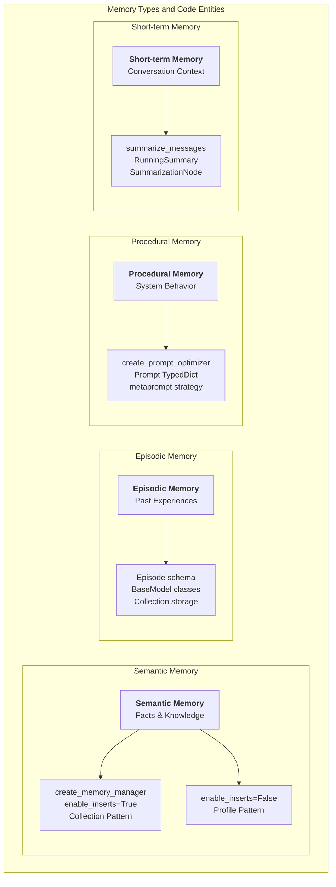
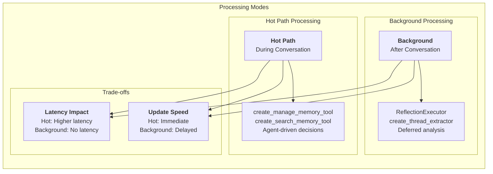
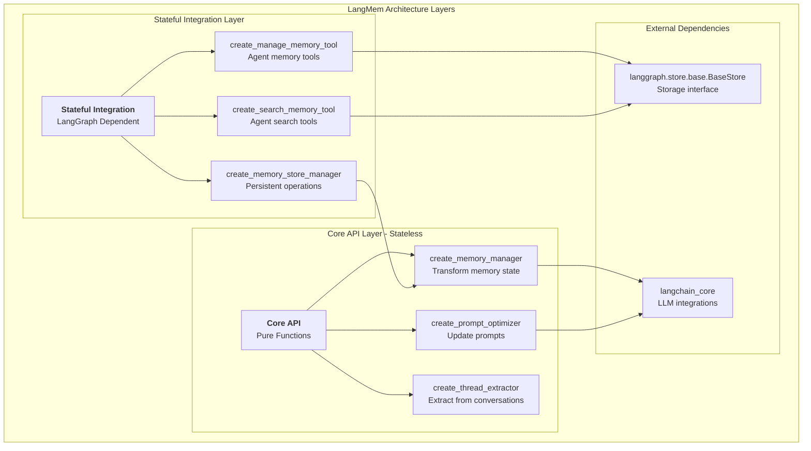
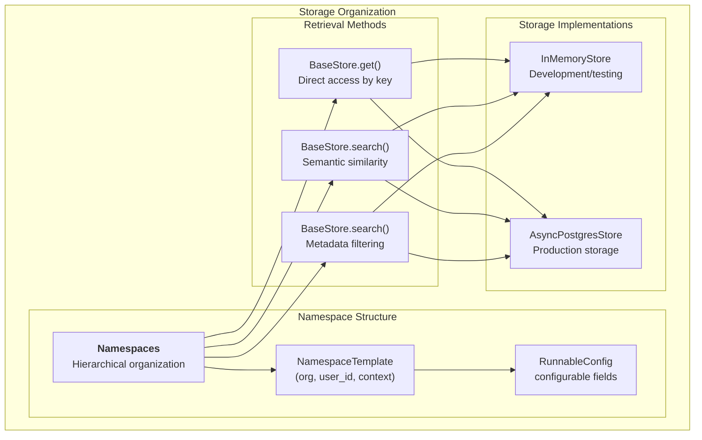

<!-- source: DeepWiki mcp.deepwiki.com · repo langchain-ai/langmem · page 1.2 Key Concepts · fetched 2026-10-26 -->

# Key Concepts

Relevant source files

The following files were used as context for generating this wiki page:

- [docs/docs/concepts/conceptual_guide.md](docs/docs/concepts/conceptual_guide.md)
- [src/langmem/__init__.py](src/langmem/__init__.py)
- [src/langmem/prompts/types.py](src/langmem/prompts/types.py)

This document explains the fundamental concepts underlying LangMem's memory system for LLM applications. It covers memory types, processing modes, storage patterns, and architectural layers that enable persistent, searchable memory capabilities.

For specific implementation details about memory managers and tools, see [Memory Management](#2). For integration with agents and workflows, see [Integration](#4). For storage configuration and setup, see [Storage](#7).

## Memory Types

LangMem supports four distinct memory types, each serving specific purposes in LLM applications. These types align with human memory structures to create adaptive, context-aware systems.

**Sources:** [docs/docs/concepts/conceptual_guide.md:19-29](), [src/langmem/__init__.py:1-27]()

### Semantic Memory: Facts and Knowledge

Semantic memory stores factual information and knowledge that grounds agent responses. Two primary storage patterns are available:

| Pattern | Code Entity | Use Case | Enable Inserts |
|---------|-------------|----------|----------------|
| **Collection** | `create_memory_manager(enable_inserts=True)` | Unbounded knowledge accumulation | `True` |
| **Profile** | `create_memory_manager(enable_inserts=False)` | Current state tracking | `False` |

Collections create individual memory documents that can be searched and updated independently. The memory enrichment process in `create_memory_manager` balances memory creation with consolidation to prevent over-extraction while maintaining recall.

Profiles maintain a single document representing current state, updating in-place rather than creating new records. This pattern works well for user preferences, settings, and other state-based information.

**Sources:** [docs/docs/concepts/conceptual_guide.md:30-165]()

### Episodic Memory: Past Experiences  

Episodic memory captures successful interactions as learning examples. Unlike semantic memory's factual storage, episodic memory preserves full interaction context including situation, reasoning process, and success factors.

Episodic memories typically use Pydantic `BaseModel` schemas with fields like `observation`, `thoughts`, `action`, and `result` to structure experience data systematically.

**Sources:** [docs/docs/concepts/conceptual_guide.md:167-248]()

### Procedural Memory: System Instructions

Procedural memory encodes agent behavior patterns and response guidelines. The `create_prompt_optimizer` function with strategies like `metaprompt` enables iterative refinement of system prompts based on interaction feedback.

The `Prompt` TypedDict in [src/langmem/prompts/types.py:7-34]() provides structured prompt management with fields for `name`, `prompt`, `update_instructions`, and `when_to_update`.

**Sources:** [docs/docs/concepts/conceptual_guide.md:250-292](), [src/langmem/prompts/types.py:7-34]()

### Short-term Memory: Conversation Context

Short-term memory manages immediate conversation context within token limits. Key components include:

- `summarize_messages` for conversation summarization
- `RunningSummary` for incremental context management  
- `SummarizationNode` for workflow integration

This memory type focuses on maintaining conversational coherence rather than long-term knowledge retention.

**Sources:** [src/langmem/__init__.py:7-8]()

## Processing Modes

LangMem supports two distinct processing modes that determine when and how memories are formed.

**Sources:** [docs/docs/concepts/conceptual_guide.md:295-316]()

### Hot Path (Conscious) Formation

Hot path processing occurs during active conversations using memory tools. Agents make real-time decisions about memory operations through `create_manage_memory_tool` and `create_search_memory_tool`.

This approach provides immediate memory updates but adds perceptible latency to user interactions. The agent must balance memory management with primary task completion.

**Sources:** [docs/docs/concepts/conceptual_guide.md:306-310]()

### Background (Subconscious) Formation

Background processing uses `ReflectionExecutor` and `create_thread_extractor` to analyze conversations after completion. This enables deeper pattern analysis without impacting response time.

The `ReflectionExecutor` orchestrates deferred memory operations, allowing for more thorough analysis and consolidation processes.

**Sources:** [docs/docs/concepts/conceptual_guide.md:312-316](), [src/langmem/__init__.py:14]()

## Integration Architecture

LangMem's architecture consists of two distinct layers that provide different levels of integration complexity.

**Sources:** [docs/docs/concepts/conceptual_guide.md:318-340](), [src/langmem/__init__.py:1-27]()

### Core API Layer

The Core API provides stateless functions that transform memory state without side effects. These functions operate independently of any storage system:

- `create_memory_manager`: Extracts, updates, and consolidates memories
- `create_prompt_optimizer`: Refines prompts based on feedback
- `create_thread_extractor`: Processes conversation threads

This layer enables memory operations in any application context without requiring specific storage infrastructure.

**Sources:** [docs/docs/concepts/conceptual_guide.md:322-330]()

### Stateful Integration Layer

The Stateful Integration layer depends on LangGraph's `BaseStore` interface for persistence. Components include:

- `create_memory_store_manager`: Automatically persists extracted memories
- `create_manage_memory_tool`: Provides agent tools for memory operations
- `create_search_memory_tool`: Enables agent memory search capabilities

This layer simplifies LangGraph integration by handling storage operations automatically.

**Sources:** [docs/docs/concepts/conceptual_guide.md:331-340]()

## Storage Patterns and Namespace Organization

LangMem organizes memories using namespace hierarchies and flexible retrieval mechanisms built on LangGraph's storage primitives.

**Sources:** [docs/docs/concepts/conceptual_guide.md:341-377]()

### Memory Namespaces

Namespaces provide hierarchical memory organization using tuple structures like `("acme_corp", "{user_id}", "code_assistant")`. Template variables in namespaces get populated from `RunnableConfig.configurable` fields at runtime.

The `NamespaceTemplate` utility manages dynamic namespace configuration, enabling user isolation and contextual memory organization.

**Sources:** [docs/docs/concepts/conceptual_guide.md:350-367]()

### Flexible Retrieval

LangMem integrates with LangGraph's `BaseStore` interface supporting multiple retrieval patterns:

- **Direct Access**: `BaseStore.get()` retrieves specific memories by key
- **Semantic Search**: `BaseStore.search()` finds memories by similarity
- **Metadata Filtering**: `BaseStore.search()` filters by memory attributes

Storage implementations include `InMemoryStore` for development and `AsyncPostgresStore` for production deployments.

**Sources:** [docs/docs/concepts/conceptual_guide.md:368-377]()

---

