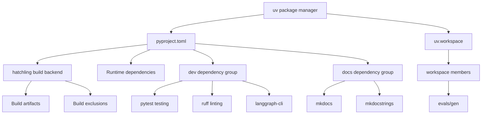
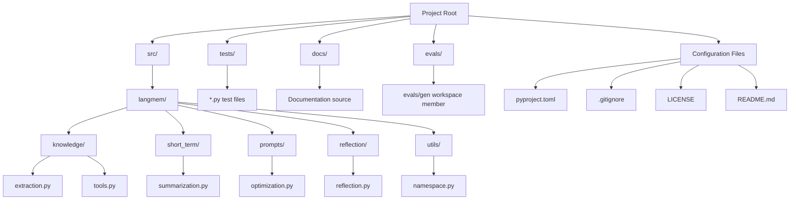
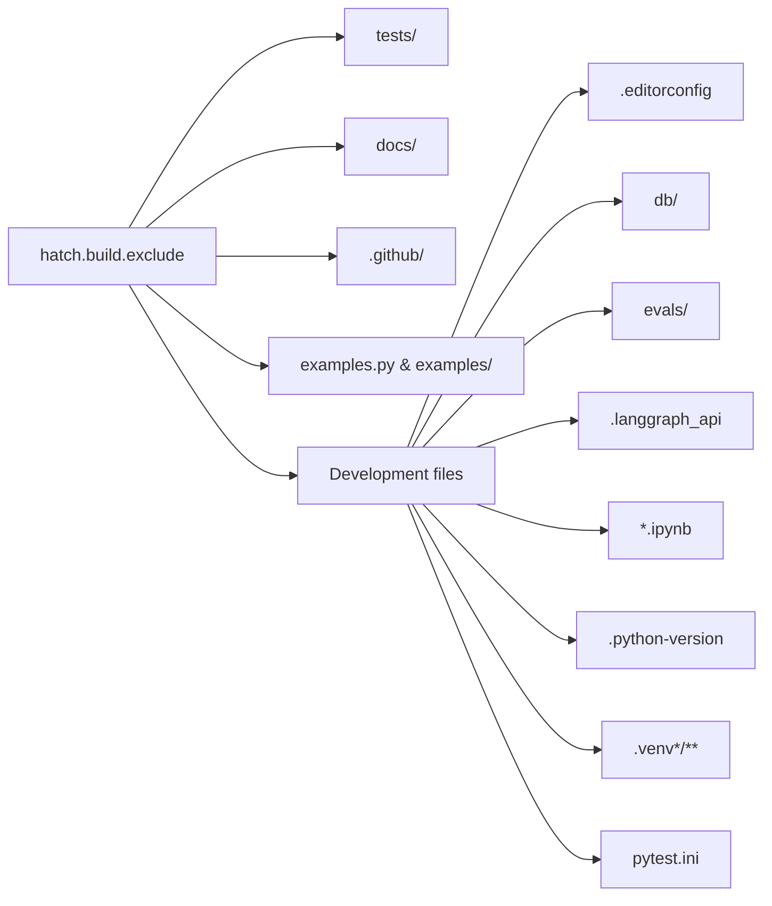
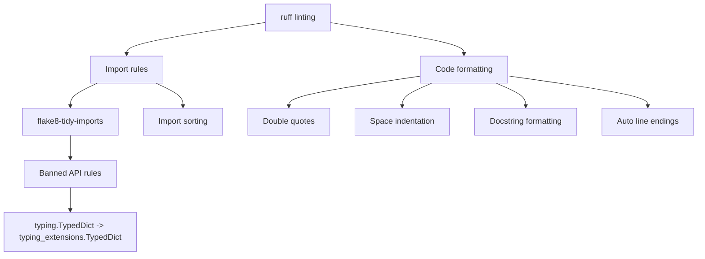
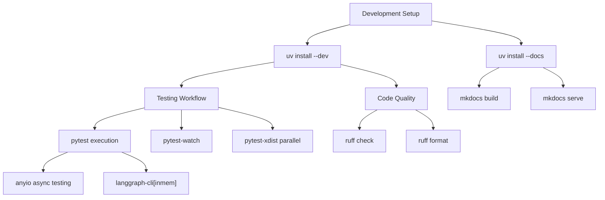

<!-- source: DeepWiki mcp.deepwiki.com · repo langchain-ai/langmem · page 10 Development · fetched 2026-10-26 -->

# Development

Relevant source files

The following files were used as context for generating this wiki page:

- [.gitignore](.gitignore)
- [LICENSE](LICENSE)
- [pyproject.toml](pyproject.toml)

This section covers information for developers who want to contribute to LangMem or understand its internal development processes. It includes details about the project structure, build system, dependency management, and development workflows.

For information about using LangMem in your applications, see [Overview](#1). For API documentation, see [API Reference](#9).

## Development Environment

LangMem uses the `uv` package manager for dependency management and workspace configuration. The project follows modern Python packaging standards with a `pyproject.toml`-based configuration.

### Package Manager and Build System

The project uses `uv` as the primary package manager with workspace support:

Sources: [pyproject.toml:1-93]()

The build system uses `hatchling` as the backend with specific exclusion patterns for development and testing files. Key configuration elements:

| Component | Configuration | Location |
|-----------|---------------|----------|
| Build Backend | `hatchling.build` | [pyproject.toml:23-24]() |
| Package Discovery | `src/` layout | [pyproject.toml:19-20]() |
| Workspace | `uv.workspace` | [pyproject.toml:55-56]() |
| Linting | `ruff` with specific rules | [pyproject.toml:58-74]() |

### Dependency Groups

LangMem organizes dependencies into distinct groups for different development contexts:

**Runtime Dependencies** ([pyproject.toml:8-17]())
- Core LangChain ecosystem packages (`langchain`, `langchain-core`, `langgraph`)
- LLM provider integrations (`langchain-openai`, `langchain-anthropic`)
- Utilities (`trustcall`, `langsmith`)

**Development Dependencies** ([pyproject.toml:27-37]())
- Testing framework (`pytest`, `pytest-watch`, `pytest-xdist`)
- Code quality (`ruff` for linting and formatting)
- LangGraph development tools (`langgraph-cli[inmem]`)

**Documentation Dependencies** ([pyproject.toml:38-53]())
- MkDocs ecosystem (`mkdocs`, `mkdocs-material`, `mkdocstrings`)
- Documentation plugins and utilities

## Project Structure

Sources: [pyproject.toml:19-20](), [pyproject.toml:76-92]()

The project follows the `src/` layout pattern, with source code organized under `src/langmem/`. Build exclusions are configured to prevent development artifacts from being included in distributions.

## Build Exclusions and Artifacts

The build system explicitly excludes development and testing artifacts:

Sources: [pyproject.toml:76-92]()

This configuration ensures that only the core `langmem` package and essential metadata are included in built distributions.

## Code Quality and Linting

LangMem uses `ruff` for both linting and code formatting with specific rule configurations:

### Ruff Configuration

| Setting | Value | Purpose |
|---------|-------|---------|
| Line Length | 88 characters | [pyproject.toml:61]() |
| Indent Width | 4 spaces | [pyproject.toml:62]() |
| Selected Rules | `E`, `F`, `I`, `TID251` | [pyproject.toml:59]() |
| Ignored Rules | `E501` (line too long) | [pyproject.toml:60]() |
| Extended Include | `*.ipynb` | [pyproject.toml:63]() |

### Import Management

The configuration includes specific rules for import management, including banned API patterns:

Sources: [pyproject.toml:58-74]()

## Version Management

The project maintains version information in the `pyproject.toml` file:

- Current version: `0.0.30` ([pyproject.toml:3]())
- Python requirement: `>=3.10` ([pyproject.toml:6]())
- License: MIT ([pyproject.toml:7](), [LICENSE:1-21]())

## Development Workflow

The development environment supports various workflows through the dependency groups and tooling configuration:

Sources: [pyproject.toml:26-37](), [pyproject.toml:38-53]()

The workspace configuration supports additional evaluation components through the `evals/gen` member, enabling extended testing and evaluation workflows.

---

