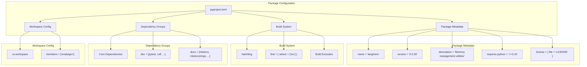
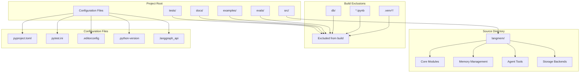
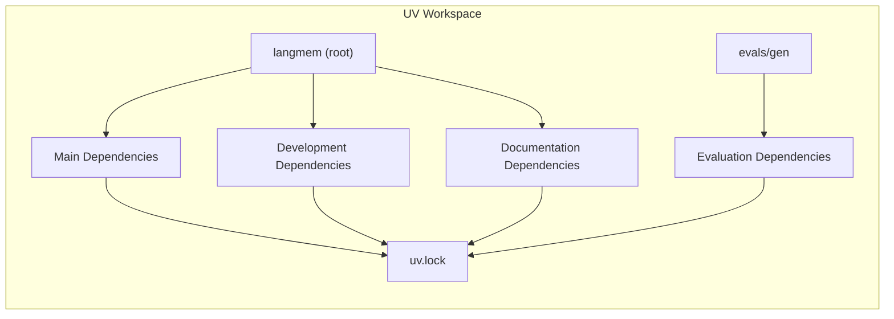
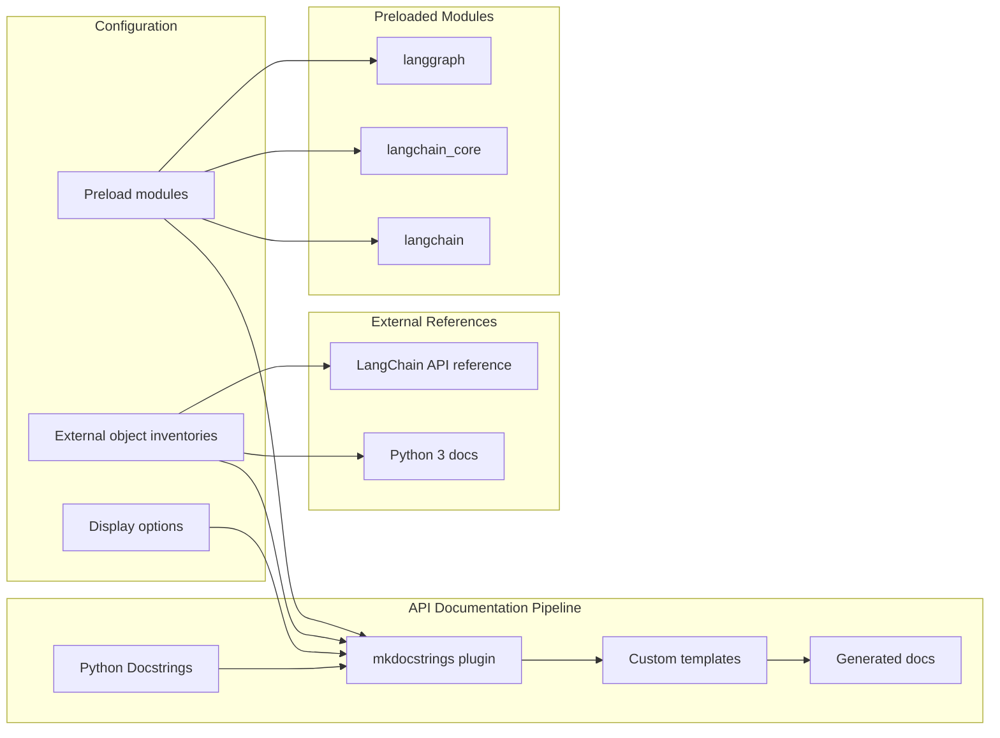
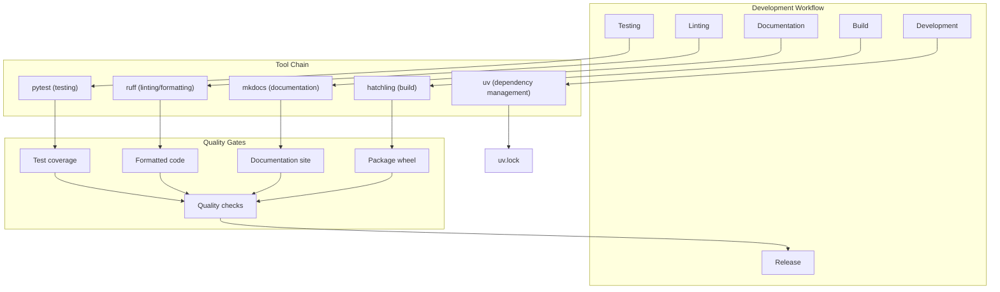

<!-- source: DeepWiki mcp.deepwiki.com · repo langchain-ai/langmem · page 10.1 Project Structure · fetched 2026-10-26 -->

# Project Structure

Relevant source files

The following files were used as context for generating this wiki page:

- [.gitignore](.gitignore)
- [LICENSE](LICENSE)
- [pyproject.toml](pyproject.toml)
- [uv.lock](uv.lock)

This document describes the organization of the langmem codebase, including its build system, package configuration, dependency management, and development tools setup. Understanding this structure is essential for contributing to the project and maintaining consistency across the codebase.

For information about the actual memory management components and their APIs, see [Memory Management](#2) and [API Reference](#9).

## Package Configuration and Build System

The langmem project uses a modern Python packaging setup with `pyproject.toml` as the central configuration file. The package is built using the `hatchling` build backend and follows PEP 517/518 standards.

### Package Metadata

Sources: [pyproject.toml:1-24]()

### Core Dependencies

The project has carefully selected dependencies that align with the LangChain ecosystem:

| Category | Dependencies | Purpose |
|----------|--------------|---------|
| Core | `langchain>=0.3.15`, `langchain-core>=0.3.46` | Base LangChain functionality |
| Graph | `langgraph>=0.3.23`, `langgraph-checkpoint>=2.0.12` | State management and persistence |
| LLMs | `langchain-openai>=0.3.1`, `langchain-anthropic>=0.3.3` | Language model integrations |
| Tools | `trustcall>=0.0.39`, `langsmith>=0.3.8` | Function calling and observability |

Sources: [pyproject.toml:8-17]()

## Directory Structure and Build Configuration

The project follows a standard Python package structure with source code in the `src/` directory. The build system excludes development and documentation files from the distributed package.

### Source Organization

Sources: [pyproject.toml:19-21](), [pyproject.toml:76-92]()

### Workspace Configuration

The project uses `uv` for dependency management with workspace support:

Sources: [pyproject.toml:55-56]()

## Development Tools Configuration

The project includes comprehensive development tool configuration for code quality, testing, and documentation.

### Code Quality Tools

```mermaid
flowchart TD
    subgraph "Development Tools"
        RUFF["ruff"]
        PYTEST["pytest"]
        MKDOCS["mkdocs"]
    end
    
    subgraph "Ruff Configuration"
        RUFF --> SELECT["lint.select = ['E', 'F', 'I', 'TID251']"]
        RUFF --> IGNORE["lint.ignore = ['E501']"]
        RUFF --> LENGTH["line-length = 88"]
        RUFF --> INDENT["indent-width = 4"]
        RUFF --> NOTEBOOKS["extend-include = ['*.ipynb']"]
    end
    
    subgraph "Format Settings"
        RUFF --> QUOTES["quote-style = 'double'"]
        RUFF --> SPACES["indent-style = 'space'"]
        RUFF --> DOCSTRING["docstring-code-format = true"]
        RUFF --> ENDINGS["line-ending = 'auto'"]
    end
    
    subgraph "Import Bans"
        RUFF --> TYPEDDICT["typing.TypedDict -> typing_extensions.TypedDict"]
    end
    
    subgraph "Test Configuration"
        PYTEST --> XDIST["pytest-xdist for parallel testing"]
        PYTEST --> WATCH["pytest-watch for development"]
        PYTEST --> ANYIO["anyio for async testing"]
    end
```

Sources: [pyproject.toml:58-75]()

### Development Dependencies

The development environment includes tools for testing, linting, and development workflow:

| Tool | Purpose | Version Constraint |
|------|---------|-------------------|
| `pytest` | Test framework | `>=8.3.4` |
| `pytest-xdist` | Parallel test execution | `>=3.6.1` |
| `pytest-watch` | Continuous testing | `>=4.2.0` |
| `anyio` | Async testing support | `>=4.8.0` |
| `langgraph-cli[inmem]` | Development CLI | `>=0.1.70` |
| `langgraph-prebuilt` | Prebuilt components | `>=0.1.1` |

Sources: [pyproject.toml:26-36]()

## Documentation Structure

The documentation system uses MkDocs with Material theme and comprehensive plugin support for API documentation generation.

### Documentation Configuration

```mermaid
flowchart TD
    subgraph "Documentation System"
        MKDOCS["mkdocs.yml"]
        MATERIAL["Material Theme"]
        PLUGINS["Plugin System"]
        CONTENT["Content Structure"]
    end
    
    subgraph "MkDocs Configuration"
        MKDOCS --> SITE["site_name: 'LangMem'"]
        MKDOCS --> URL["site_url: langchain-ai.github.io/langmem"]
        MKDOCS --> REPO["repo_url: github.com/langchain-ai/langmem"]
        MKDOCS --> EDIT["edit_uri: edit/main/docs/docs/"]
    end
    
    subgraph "Theme Configuration"
        MATERIAL --> LOGOS["Custom logos (light/dark)"]
        MATERIAL --> FAVICON["favicon.png"]
        MATERIAL --> FEATURES["Navigation features"]
        MATERIAL --> PALETTE["Color schemes"]
        MATERIAL --> FONTS["Public Sans / Roboto Mono"]
    end
    
    subgraph "Plugin System"
        PLUGINS --> SEARCH["Search with custom separator"]
        PLUGINS --> AUTOREFS["Auto-reference linking"]
        PLUGINS --> REDIRECTS["URL redirects"]
        PLUGINS --> MKDOCSTRINGS["API documentation"]
    end
    
    subgraph "Content Navigation"
        CONTENT --> INTRO["Introduction"]
        CONTENT --> QUICKSTART["Quickstart guides"]
        CONTENT --> CONCEPTS["Concepts"]
        CONTENT --> HOWTO["How-to guides"]
        CONTENT --> REFERENCE["API Reference"]
    end
```

Sources: [docs/mkdocs.yml:1-120]()

### API Documentation Generation

The documentation system automatically generates API reference from docstrings:

Sources: [docs/mkdocs.yml:60-93]()

### Documentation Dependencies

The documentation build requires specialized packages:

| Package | Purpose | Version |
|---------|---------|---------|
| `mkdocs` | Static site generator | `>=1.6.1` |
| `mkdocs-material` | Material design theme | `>=9.6.1` |
| `mkdocstrings` | API doc generation | `>=0.27.0` |
| `mkdocstrings-python` | Python support | `>=1.13.0` |
| `markdown-callouts` | Callout styling | `>=0.4.0` |
| `markdown-include` | File inclusion | `>=0.8.1` |

Sources: [pyproject.toml:37-53]()

## Development Workflow Integration

The project structure supports modern Python development workflows with comprehensive tooling integration.

### Build and Release Process

Sources: [pyproject.toml:22-24](), [pyproject.toml:26-53]()

This project structure provides a solid foundation for collaborative development while maintaining high code quality and comprehensive documentation. The configuration files work together to create a seamless development experience with modern Python tooling.

---

