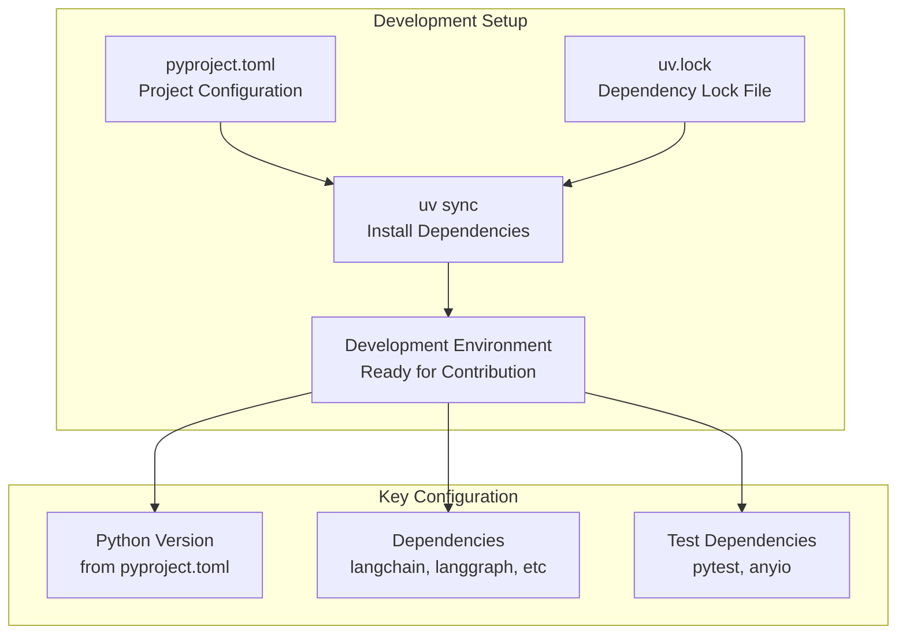
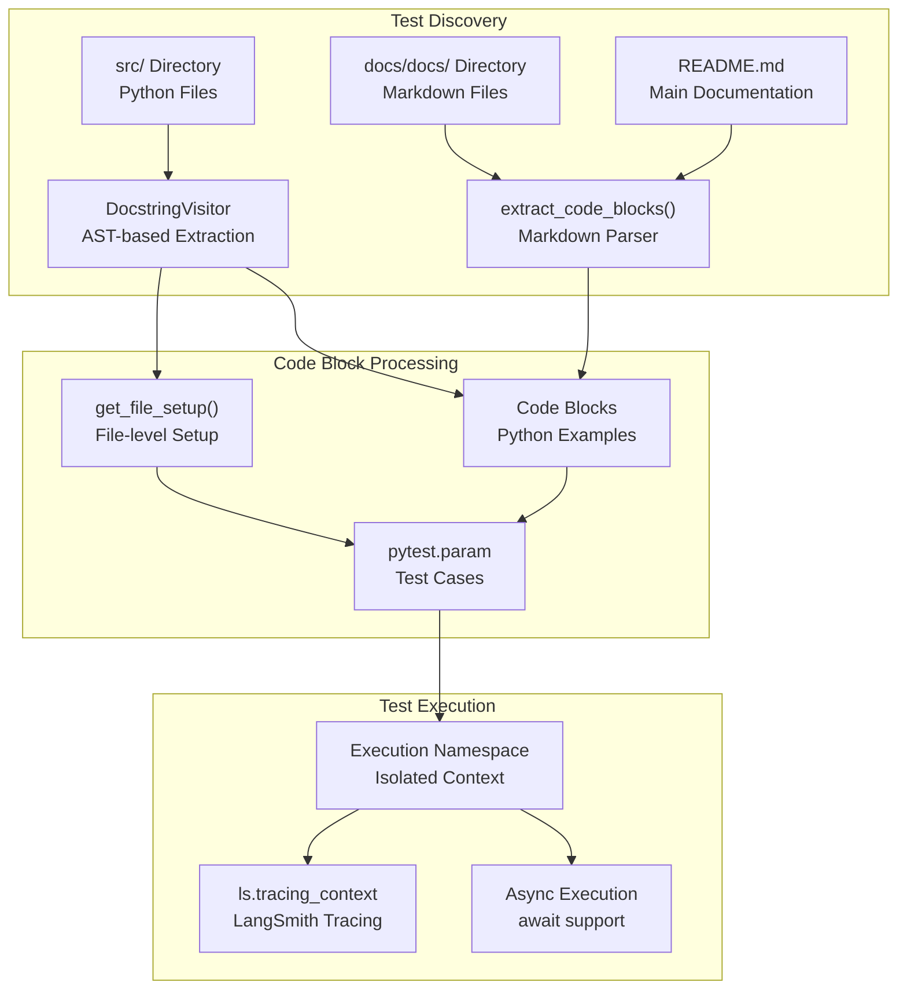
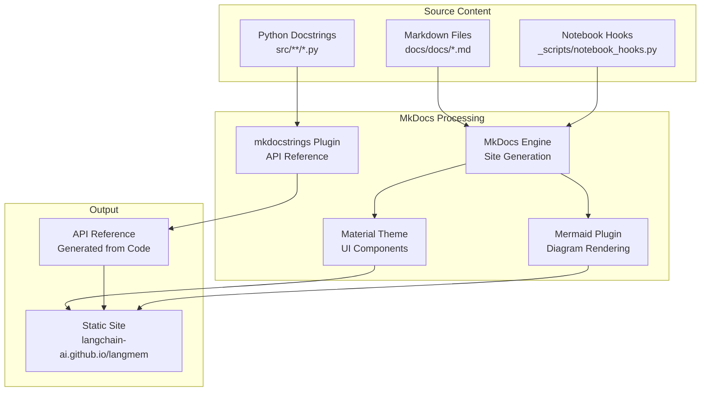
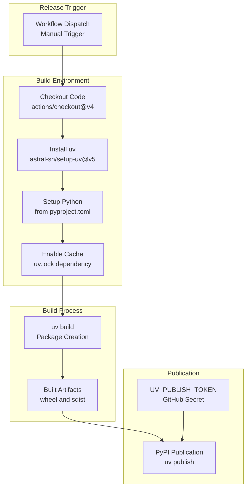
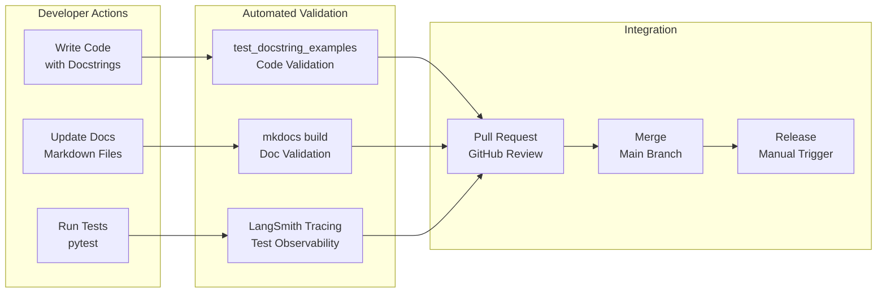

<!-- source: DeepWiki mcp.deepwiki.com · repo langchain-ai/langmem · page 10.2 Contributing · fetched 2026-10-26 -->

# Contributing

<details>
<summary>Relevant source files</summary>

The following files were used as context for generating this wiki page:

- [.github/workflows/release.yml](.github/workflows/release.yml)
- [docs/mkdocs.yml](docs/mkdocs.yml)
- [tests/test_docstring_examples.py](tests/test_docstring_examples.py)

</details>


This guide covers the contribution workflow for LangMem, including development environment setup, testing procedures, documentation generation, and the release process. It provides the technical details needed to contribute code, documentation, and improvements to the project.

For information about the overall project structure and codebase organization, see [Project Structure](#10.1).

## Development Environment Setup

LangMem uses `uv` as its package manager and build system. The development environment is configured through the `pyproject.toml` file with dependencies managed via `uv.lock`.

### Package Management

The project uses `uv` for all package management operations:

```bash
# Install development environment
uv sync

# Add new dependencies
uv add <package-name>

# Build package
uv build

# Publish package
uv publish
```

**Development Environment Setup Process**



Sources: [.github/workflows/release.yml:14-24](), [pyproject.toml]()

## Testing

The testing system automatically validates code examples from both docstrings and documentation files. The primary test runner is implemented in `test_docstring_examples.py`.

### Docstring Example Testing

The testing framework extracts and executes Python code blocks from:
- Function and class docstrings in the `src/` directory
- Markdown files in the `docs/docs/` directory  
- The main `README.md` file

**Test Discovery and Execution Pipeline**



### Test Configuration

The test system uses several key components:

| Component | Purpose | Implementation |
|-----------|---------|----------------|
| `DocstringVisitor` | Extract code blocks from Python AST | [tests/test_docstring_examples.py:97-129]() |
| `extract_code_blocks()` | Parse markdown code blocks | [tests/test_docstring_examples.py:52-94]() |
| `get_file_setup()` | Extract file-level setup code | [tests/test_docstring_examples.py:25-49]() |
| `collect_docstring_tests()` | Generate pytest parameters | [tests/test_docstring_examples.py:183-232]() |

### Special Test Features

- **Setup Blocks**: File-level setup code in comments starting with `# ```python setup`
- **Async Support**: Automatic detection and handling of `await` statements
- **Namespace Isolation**: Each test maintains its own execution context
- **LangSmith Integration**: All tests run under `langmem_docstrings` project tracing
- **Selective Skipping**: CrewAI examples skip in CI but test locally

Sources: [tests/test_docstring_examples.py:1-298]()

## Documentation

Documentation is built using MkDocs with the Material theme and several plugins for enhanced functionality.

### Documentation Stack

The documentation system uses:

| Component | Purpose | Configuration |
|-----------|---------|---------------|
| MkDocs | Static site generator | [docs/mkdocs.yml:1-5]() |
| Material Theme | Modern documentation theme | [docs/mkdocs.yml:6-53]() |
| mkdocstrings | API reference generation | [docs/mkdocs.yml:60-92]() |
| Mermaid | Diagram rendering | [docs/mkdocs.yml:162-164]() |

### Documentation Build Process



### Key Documentation Features

- **Auto-generated API Reference**: Using mkdocstrings with Google-style docstrings
- **Cross-references**: Automatic linking with autorefs plugin
- **Code Highlighting**: Pygments-based syntax highlighting
- **Mermaid Diagrams**: Native diagram support for system documentation
- **Mobile Responsive**: Material theme with responsive design
- **Search**: Full-text search with advanced features

**Navigation Structure**:
- Introduction and quickstarts
- Conceptual guides
- How-to guides
- API reference with automatic generation

Sources: [docs/mkdocs.yml:1-201]()

## Release Process

LangMem uses GitHub Actions for automated building and releasing to PyPI.

### Release Workflow

The release process is triggered manually through GitHub's workflow dispatch:

**Release Pipeline**



### Release Configuration

| Step | Tool | Configuration |
|------|------|---------------|
| Environment Setup | `uv` v0.6.3 | [.github/workflows/release.yml:14-19]() |
| Python Version | `pyproject.toml` | [.github/workflows/release.yml:24]() |
| Package Build | `uv build` | [.github/workflows/release.yml:28]() |
| PyPI Upload | `uv publish` | [.github/workflows/release.yml:30-33]() |

### Release Security

- **Secret Management**: Uses `PYPI_API_TOKEN` stored in GitHub secrets
- **Manual Trigger**: Requires explicit workflow dispatch to prevent accidental releases
- **Dependency Caching**: Caches based on `uv.lock` for consistent builds

Sources: [.github/workflows/release.yml:1-33]()

## Contribution Workflow

### Code Contributions

1. **Setup Development Environment**:
   ```bash
   git clone https://github.com/langchain-ai/langmem
   cd langmem
   uv sync
   ```

2. **Run Tests**:
   ```bash
   pytest tests/
   # Run specific docstring tests
   pytest tests/test_docstring_examples.py -v
   ```

3. **Update Documentation**:
   - Add docstring examples to new functions
   - Update markdown files in `docs/docs/`
   - Test examples are automatically validated

4. **Build Documentation Locally**:
   ```bash
   mkdocs serve
   ```

### Testing Guidelines

- All public functions should include docstring examples
- Code blocks in docstrings must be executable
- Use `# ```python setup` for file-level test setup
- Mark non-executable blocks with `skip` in the language identifier

### Documentation Guidelines

- Follow Google-style docstrings for API documentation
- Include practical examples in how-to guides
- Use mermaid diagrams for system architecture
- Test all code examples automatically

**Contribution Validation Pipeline**



Sources: [.github/workflows/release.yml:1-33](), [tests/test_docstring_examples.py:235-298](), [docs/mkdocs.yml:94-201]()