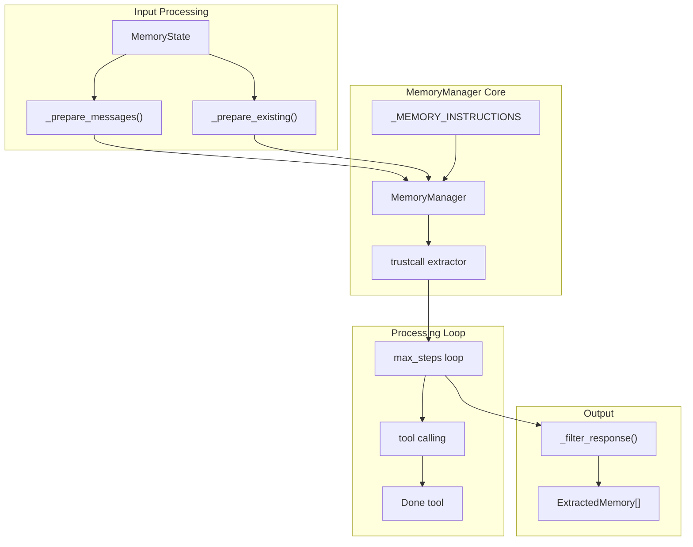
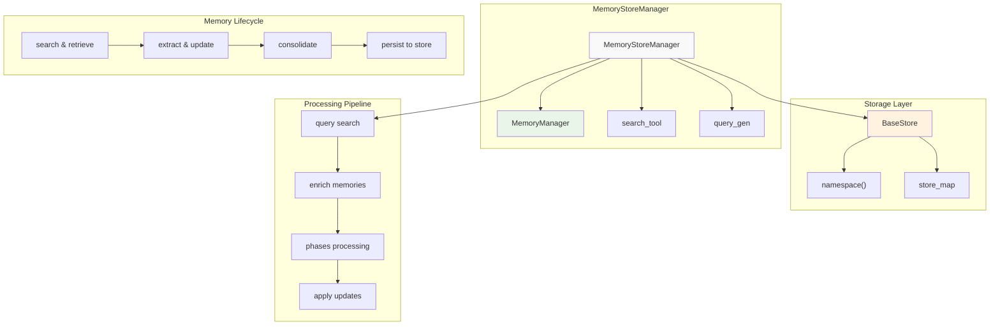
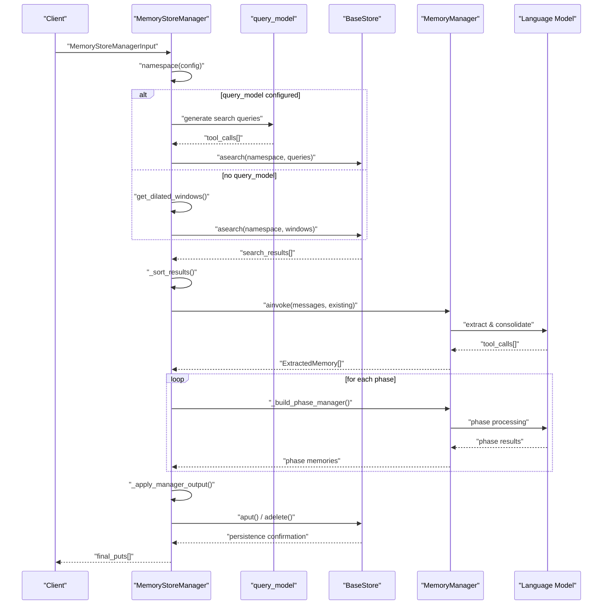
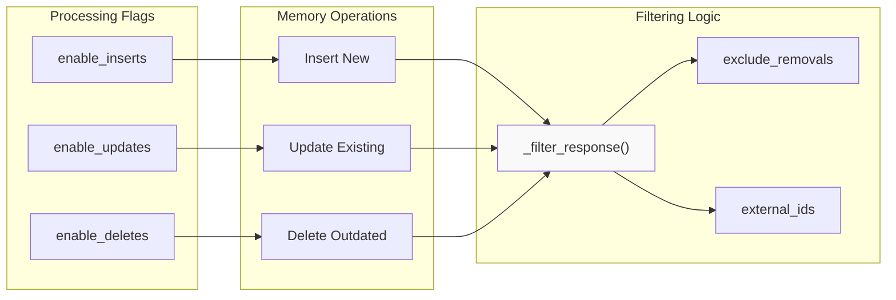

<!-- source: DeepWiki mcp.deepwiki.com · repo langchain-ai/langmem · page 2 Memory Management · fetched 2026-10-26 -->

# Memory Management

Relevant source files

The following files were used as context for generating this wiki page:

- [docs/docs/concepts/conceptual_guide.md](docs/docs/concepts/conceptual_guide.md)
- [src/langmem/knowledge/extraction.py](src/langmem/knowledge/extraction.py)

This document covers LangMem's core memory management capabilities, focusing on the two primary factory functions `create_memory_manager` and `create_memory_store_manager` and their respective implementations. These functions provide the foundation for extracting, processing, and managing conversation memories in LLM applications.

For information about specific memory types (semantic, episodic, procedural), see [Semantic Memory](#2.1), [Episodic Memory](#2.2), and [User Profiles](#2.4). For short-term memory and conversation summarization, see [Short-Term Memory and Summarization](#2.3). For hot path versus background processing approaches, see [Processing Approaches](#3).

## Core Memory Management Functions

LangMem provides two main factory functions that handle memory management at different levels of integration:

| Function | Purpose | Storage Integration | Use Case |
|----------|---------|-------------------|-----------|
| `create_memory_manager` | Stateless memory processing | None - returns extracted memories | Standalone memory extraction, custom storage |
| `create_memory_store_manager` | Stateful memory processing | LangGraph BaseStore | Automatic persistence, full memory lifecycle |

Both functions return `Runnable` instances that can be invoked with conversation messages to process memories, but they differ significantly in their integration patterns and capabilities.

**Sources:** [src/langmem/knowledge/extraction.py:536-692](), [src/langmem/knowledge/extraction.py:1666-2105]()

## Memory Manager Architecture

The `MemoryManager` class provides the core stateless memory processing functionality. It analyzes conversation messages against existing memories to extract, update, consolidate, or remove memory entries.

The `MemoryManager` supports configurable memory operations through boolean flags:

- `enable_inserts`: Allow creation of new memories
- `enable_updates`: Allow modification of existing memories  
- `enable_deletes`: Allow removal of outdated memories

**Sources:** [src/langmem/knowledge/extraction.py:217-533](), [src/langmem/knowledge/extraction.py:185-207]()

## Memory Store Manager Architecture  

The `MemoryStoreManager` extends memory management with full storage integration, automatic memory search, and lifecycle management. It combines memory processing with LangGraph's `BaseStore` for persistence.

The `MemoryStoreManager` includes several advanced features:
- **Query Generation**: Uses a separate LLM to generate optimized search queries
- **Default Factory**: Provides fallback memories when no existing memories are found
- **Multi-Phase Processing**: Supports multiple rounds of memory enrichment
- **Namespace Templating**: Dynamic namespace configuration with runtime variables

**Sources:** [src/langmem/knowledge/extraction.py:832-1665](), [src/langmem/knowledge/extraction.py:877-914]()

## Memory Processing Data Flow

The following diagram shows how conversation messages flow through the memory processing pipeline from input to persistent storage:

**Sources:** [src/langmem/knowledge/extraction.py:1006-1137](), [src/langmem/knowledge/extraction.py:977-989]()

## Memory State and Schemas

Both memory managers work with structured memory representations using Pydantic models. The base `Memory` class provides a simple content-based memory, while custom schemas enable structured memory types.

| Class | Purpose | Key Fields | Usage |
|-------|---------|------------|--------|
| `Memory` | Default unstructured memory | `content: str` | Basic memory storage |
| `ExtractedMemory` | Processed memory result | `id: str`, `content: BaseModel` | Memory manager output |
| `MemoryState` | Input state container | `messages: list`, `existing: list`, `max_steps: int` | Processing input |
| `MemoryStoreManagerInput` | Store manager input | `messages: list`, `max_steps: int` | Store processing input |

The memory processing supports multi-step extraction with a configurable `max_steps` parameter. When `max_steps > 1`, the system adds a `Done` tool to allow the LLM to signal completion of memory formation.

**Sources:** [src/langmem/knowledge/extraction.py:64-94](), [src/langmem/knowledge/extraction.py:78-81](), [src/langmem/knowledge/extraction.py:209-215]()

## Memory Operations and Filtering

The memory processing pipeline handles three core operations on existing memories:

The `_filter_response()` method handles complex memory ID tracking to distinguish between externally-provided memories (that can be deleted) and internally-generated memories (that should not appear as deletions in the final output).

**Sources:** [src/langmem/knowledge/extraction.py:509-533](), [src/langmem/knowledge/extraction.py:940-975]()

## Integration with LangGraph Store

The `MemoryStoreManager` provides a complete storage interface through delegation to LangGraph's `BaseStore`. Key storage methods include:

| Method | Purpose | Async Version | Key Features |
|--------|---------|---------------|--------------|
| `get()` | Retrieve single item | `aget()` | TTL refresh, default factory |
| `search()` | Find multiple items | `asearch()` | Query + filter, pagination |
| `put()` | Store/update item | `aput()` | Indexing control, TTL |
| `delete()` | Remove item | `adelete()` | Namespace-aware deletion |

All storage operations use the configured namespace template, supporting dynamic runtime configuration through `RunnableConfig`.

**Sources:** [src/langmem/knowledge/extraction.py:1318-1658](), [src/langmem/knowledge/extraction.py:877-914]()

---

