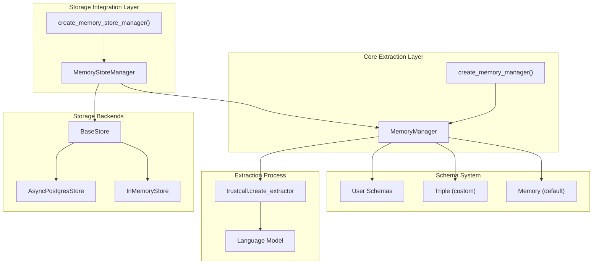
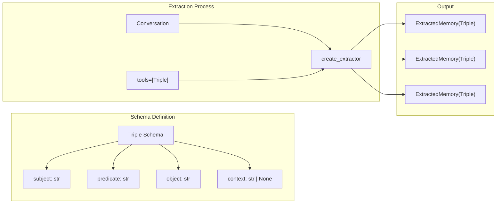
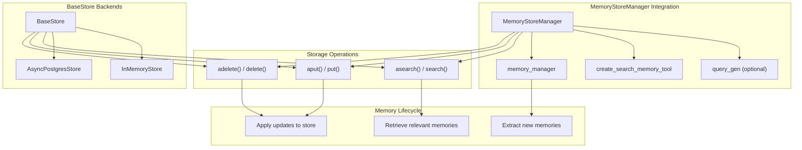

<!-- source: DeepWiki mcp.deepwiki.com · repo langchain-ai/langmem · page 2.1 Semantic Memory · fetched 2026-10-26 -->

# Semantic Memory

<details>
<summary>Relevant source files</summary>

The following files were used as context for generating this wiki page:

- [docs/docs/guides/extract_semantic_memories.md](docs/docs/guides/extract_semantic_memories.md)
- [src/langmem/knowledge/extraction.py](src/langmem/knowledge/extraction.py)

</details>


This document covers LangMem's semantic memory extraction and management capabilities. Semantic memory handles the extraction, structuring, and storage of factual information, preferences, relationships, and knowledge from conversations. For episodic memory (capturing interaction experiences), see [Episodic Memory](#2.2). For user profile management, see [User Profiles](#2.4).

## Core Architecture

LangMem's semantic memory system centers around two primary components: `MemoryManager` for stateless extraction and `MemoryStoreManager` for integrated storage management. Both use schema-based extraction to convert conversational content into structured memory objects.



**Sources:** [src/langmem/knowledge/extraction.py:217-692](), [src/langmem/knowledge/extraction.py:832-2105]()

## Memory Extraction Process

The memory extraction process uses `trustcall.create_extractor` to enable structured extraction through parallel tool calling. The system analyzes conversations against existing memories and generates create, update, or delete operations.

```mermaid
sequenceDiagram
    participant Input as "MemoryState"
    participant MM as "MemoryManager"  
    participant Extractor as "create_extractor"
    participant LLM as "Language Model"
    participant Output as "ExtractedMemory[]"
    
    Input->>MM: "messages + existing memories"
    MM->>MM: "_prepare_messages()"
    MM->>MM: "_prepare_existing()"
    MM->>Extractor: "tools=[schemas], enable_inserts/updates/deletes"
    
    loop "max_steps iterations"
        MM->>Extractor: "payload with prepared data"
        Extractor->>LLM: "parallel tool calling"
        LLM-->>Extractor: "tool responses + metadata"
        Extractor-->>MM: "responses with json_doc_id"
        MM->>MM: "update results dict"
        
        alt "step > 1"
            MM->>Extractor: "add Done tool"
        end
        
        alt "is_done or no tool_calls"
            break
        end
        
        MM->>MM: "prepare next iteration payload"
    end
    
    MM->>MM: "_filter_response()"
    MM-->>Output: "filtered ExtractedMemory list"
```

**Sources:** [src/langmem/knowledge/extraction.py:237-339](), [src/langmem/knowledge/extraction.py:457-478]()

## Schema-Based Extraction

Semantic memory uses Pydantic schemas to define the structure of extracted information. The default `Memory` schema provides unstructured text storage, while custom schemas enable structured extraction.

### Default Memory Schema

The basic `Memory` schema stores unstructured content:

[src/langmem/knowledge/extraction.py:86-93]()

### Custom Schemas

Custom schemas like `Triple` enable structured fact extraction:



**Sources:** [docs/docs/guides/extract_semantic_memories.md:17-31](), [src/langmem/knowledge/extraction.py:222-235]()

## Collection vs Profile Patterns

Semantic memory supports two primary storage patterns:

| Pattern | Description | Use Case | Storage |
|---------|-------------|----------|---------|
| Collection | Multiple related memories with unique IDs | Facts, preferences, relationships | Multiple documents |
| Profile | Single consolidated memory document | User profiles, system state | Single document with updates |

### Collection Pattern

The collection pattern stores multiple discrete memory objects, each with unique identifiers. This pattern supports the full range of operations: create, update, and delete.

**Memory Manager Configuration:**
- `enable_inserts=True` - Allow new memory creation
- `enable_updates=True` - Allow memory modifications  
- `enable_deletes=True` - Allow memory removal

**Sources:** [src/langmem/knowledge/extraction.py:543-544](), [docs/docs/guides/extract_semantic_memories.md:28-31]()

### Profile Pattern 

The profile pattern maintains a single memory document that gets updated in-place. This pattern typically disables inserts and deletes to maintain a consolidated view.

**Memory Store Manager Configuration:**
- `enable_inserts=False` - Prevent new memory creation
- Default value initialization for empty profiles

**Sources:** [src/langmem/knowledge/extraction.py:1674-1675](), [src/langmem/knowledge/extraction.py:1696-1700]()

## Memory Enrichment Operations

The memory enrichment process supports three core operations managed through the `MemoryManager` class:

### Insert Operations

New memories are created when `enable_inserts=True` and novel information is detected. Each memory receives a unique UUID identifier.

**Sources:** [src/langmem/knowledge/extraction.py:224](), [src/langmem/knowledge/extraction.py:284-287]()

### Update Operations  

Existing memories are modified when `enable_updates=True` and contradictory or supplementary information is found. Updates preserve the original memory ID.

**Sources:** [src/langmem/knowledge/extraction.py:225](), [src/langmem/knowledge/extraction.py:301-308]()

### Delete Operations

Memories are marked for deletion when `enable_deletes=True` and information becomes outdated or contradicted. The system returns `RemoveDoc` objects for external handling.

**Sources:** [src/langmem/knowledge/extraction.py:226](), [src/langmem/knowledge/extraction.py:304-306]()

## Storage Integration

The `MemoryStoreManager` integrates semantic memory with LangGraph's `BaseStore` system, providing automatic search, persistence, and namespace organization.



### Query Generation

Optional query model support enables optimized memory retrieval through the `query_model` parameter. When configured, the system uses a separate model to generate search queries before extracting memories.

**Sources:** [src/langmem/knowledge/extraction.py:846](), [src/langmem/knowledge/extraction.py:1015-1029]()

### Namespace Organization  

Memory organization uses tuple-based namespaces with template variable support:

```python
# Template namespace
("memories", "{langgraph_user_id}")

# Resolved at runtime
("memories", "user-123")
```

**Sources:** [src/langmem/knowledge/extraction.py:848](), [src/langmem/knowledge/extraction.py:877]()

### Memory Phases

The system supports multi-phase processing through the `phases` parameter, enabling complex memory consolidation workflows:

**Sources:** [src/langmem/knowledge/extraction.py:850](), [src/langmem/knowledge/extraction.py:1087-1100]()

---

