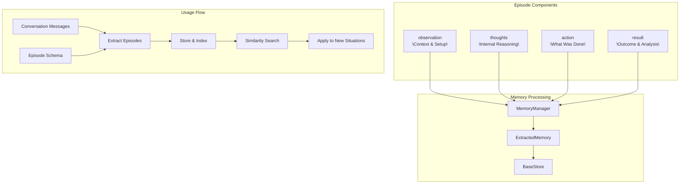
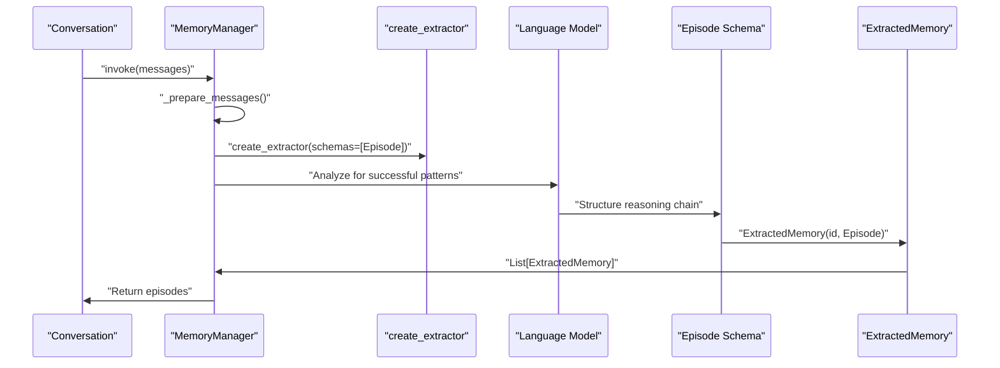
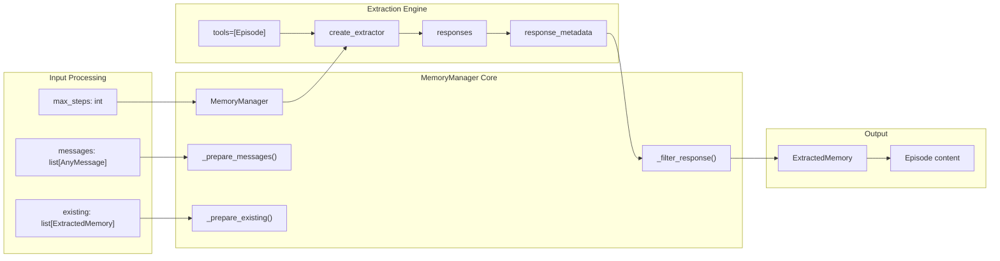

<!-- source: DeepWiki mcp.deepwiki.com · repo langchain-ai/langmem · page 2.2 Episodic Memory · fetched 2026-10-26 -->

# Episodic Memory

<details>
<summary>Relevant source files</summary>

The following files were used as context for generating this wiki page:

- [docs/docs/guides/extract_episodic_memories.md](docs/docs/guides/extract_episodic_memories.md)
- [docs/docs/guides/memory_tools.md](docs/docs/guides/memory_tools.md)
- [docs/docs/guides/use_tools_in_crewai.md](docs/docs/guides/use_tools_in_crewai.md)
- [src/langmem/knowledge/extraction.py](src/langmem/knowledge/extraction.py)

</details>


Episodic memory in LangMem captures complete interaction experiences rather than isolated facts. While semantic memory (see [Semantic Memory](#2.1)) stores what the agent knows, episodic memory preserves how the agent successfully reasoned through problems. This enables experience replay and adaptive learning from past successful interactions.

## What is Episodic Memory

Episodic memory stores structured records of successful problem-solving experiences, including the complete reasoning chain that led to positive outcomes. Each episode contains the context, internal thought process, actions taken, and retrospective analysis.

**Key Differences from Semantic Memory:**

| Memory Type | Content | Purpose | Schema Pattern |
|-------------|---------|---------|----------------|
| Semantic | Facts, preferences, relationships | Knowledge base | Triple, UserProfile |
| Episodic | Complete interaction experiences | Learning from success | Episode with reasoning chain |

Sources: [docs/docs/guides/extract_episodic_memories.md:1-196](), [src/langmem/knowledge/extraction.py:185-206]()

## Episode Schema Structure

The standard episodic memory schema captures four essential components of successful interactions:

```python
class Episode(BaseModel):
    observation: str  # Context and setup - what happened
    thoughts: str     # Internal reasoning process - "I..."  
    action: str       # What was done and how - "I..."
    result: str       # Outcome and retrospective - "I..."
```

This schema is designed to preserve the complete decision-making process, enabling the agent to learn not just what worked, but why it worked and how to replicate the success.

**Episode Schema Architecture:**



Sources: [docs/docs/guides/extract_episodic_memories.md:19-47](), [src/langmem/knowledge/extraction.py:86-93]()

## Episodic Extraction Process

Episodic memory extraction uses the same `MemoryManager` infrastructure as semantic memory but with Episode-specific schemas and instructions focused on capturing successful reasoning patterns.

**Memory Manager Configuration:**

```python
manager = create_memory_manager(
    model="anthropic:claude-3-5-sonnet-latest",
    schemas=[Episode],
    instructions="Extract examples of successful explanations, capturing the full chain of reasoning.",
    enable_inserts=True
)
```

The extraction process analyzes conversation messages to identify successful interactions and structures them into Episode records containing the complete reasoning chain.

**Episodic Memory Extraction Flow:**



Sources: [src/langmem/knowledge/extraction.py:217-294](), [src/langmem/knowledge/extraction.py:536-692]()

## Storage and Retrieval Patterns

Episodic memories use the collection storage pattern, where each episode is stored as a separate document that can be searched and retrieved based on similarity to current situations.

**Storage Architecture:**

```mermaid
graph TB
    subgraph "Storage Layer"
        MSM["MemoryStoreManager"]
        NS["namespace=(\"memories\", \"episodes\")"]
        BS["BaseStore"]
        VS["Vector Search"]
    end
    
    subgraph "Episode Lifecycle"
        EXT["Extract Episode"]
        INDEX["Index for Search"]
        SIMILAR["Find Similar Episodes"]
        APPLY["Apply Past Learning"]
    end
    
    subgraph "Code Entities"
        CMS["create_memory_store_manager"]
        CM["create_memory_manager"] 
        ST["search_tool"]
        EMC["ExtractedMemory"]
    end
    
    EXT --> MSM
    MSM --> NS
    NS --> BS
    BS --> VS
    
    SIMILAR --> ST
    ST --> VS
    
    CMS --> MSM
    CM --> EMC
    EMC --> INDEX
```

**Key Storage Operations:**

| Operation | Method | Purpose |
|-----------|--------|---------|
| Store Episode | `MemoryStoreManager.ainvoke()` | Persist new episodes |
| Search Similar | `BaseStore.asearch()` | Find relevant past experiences |
| Update Episode | `enable_updates=True` | Refine existing episodes |
| Namespace Episodes | `("memories", "episodes")` | Organize by memory type |

Sources: [docs/docs/guides/extract_episodic_memories.md:82-172](), [src/langmem/knowledge/extraction.py:832-1137]()

## Integration with Memory Manager

Episodic memory integrates with LangMem's core memory management infrastructure through the `MemoryManager` class and storage systems.

**Core Integration Points:**

- **Schema Definition**: Episode schemas define the structure of episodic memories
- **Memory Manager**: `create_memory_manager()` processes conversations into episodes  
- **Storage Manager**: `create_memory_store_manager()` handles persistence and retrieval
- **Vector Search**: `BaseStore.asearch()` enables similarity-based episode retrieval
- **Extraction Pipeline**: `create_extractor()` with Episode tools structures the reasoning chains

**Memory Manager Integration:**



Sources: [src/langmem/knowledge/extraction.py:217-446](), [src/langmem/knowledge/extraction.py:457-508]()

## Usage Patterns

Episodic memory supports both standalone extraction and integrated storage workflows:

**Standalone Extraction**: Use `create_memory_manager()` to extract episodes without persistence
**Integrated Storage**: Use `create_memory_store_manager()` for persistent episodes with search capabilities
**Experience Replay**: Search similar episodes before processing new interactions
**Adaptive Learning**: Update system prompts based on retrieved episode insights

The episodic memory system enables agents to build expertise through experience rather than just accumulating facts, creating a foundation for continuous learning and improvement.

Sources: [docs/docs/guides/extract_episodic_memories.md:9-82](), [docs/docs/guides/extract_episodic_memories.md:185-196]()

---

