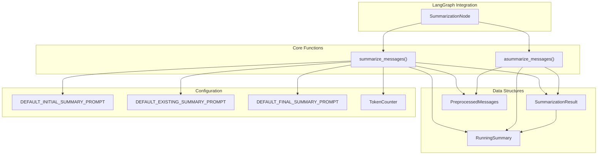
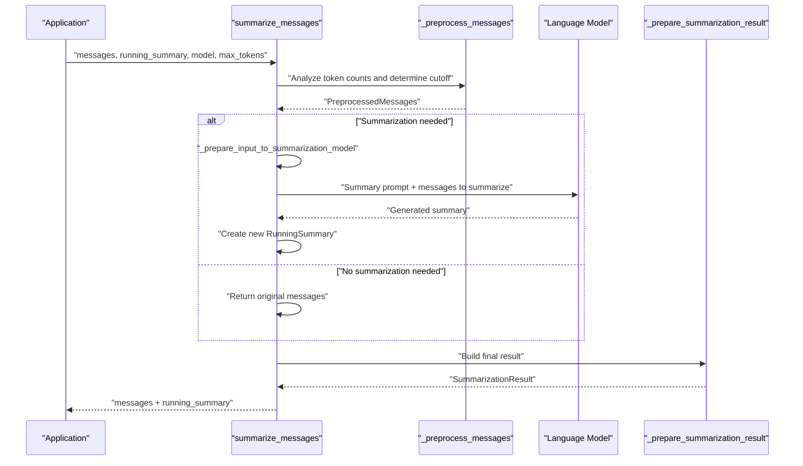
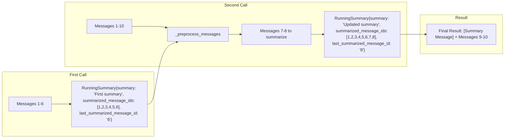
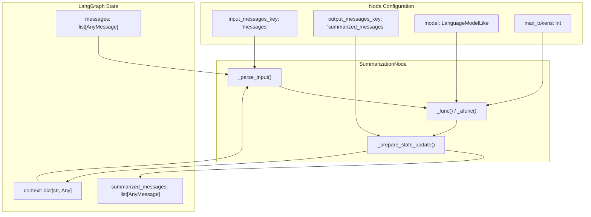
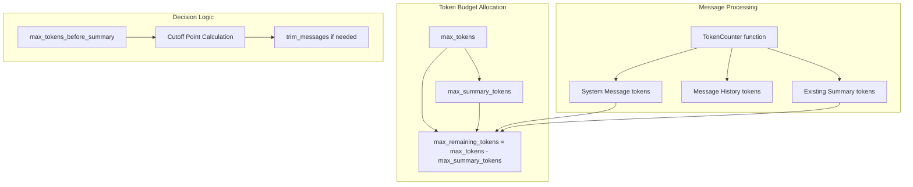
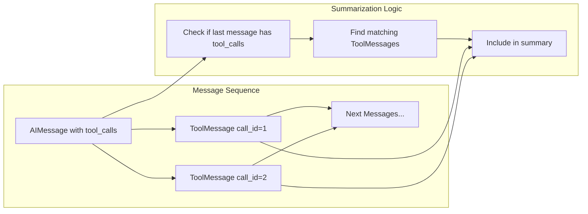

<!-- source: DeepWiki mcp.deepwiki.com · repo langchain-ai/langmem · page 2.3 Short-Term Memory and Summarization · fetched 2026-10-26 -->

# Short-Term Memory and Summarization

Relevant source files

The following files were used as context for generating this wiki page:

- [Makefile](Makefile)
- [docs/docs/guides/summarization.md](docs/docs/guides/summarization.md)
- [src/langmem/short_term/summarization.py](src/langmem/short_term/summarization.py)
- [tests/cassettes/ed2e87ca-f890-4900-9a09-dfbc12b51964.yaml](tests/cassettes/ed2e87ca-f890-4900-9a09-dfbc12b51964.yaml)
- [tests/short_term/__init__.py](tests/short_term/__init__.py)
- [tests/short_term/test_summarization.py](tests/short_term/test_summarization.py)

This document covers LangMem's short-term memory and message summarization capabilities, focusing on managing conversation context within token limits through intelligent summarization. For long-term memory storage and retrieval, see [Memory Management](#2). For background processing of conversations, see [Background Memory Processing](#3.2).

## Purpose and Scope

Short-term memory in LangMem addresses the fundamental challenge of context window limitations in LLM applications. As conversations grow longer or agents make numerous tool calls, the message history can exceed model token limits. LangMem's summarization system provides automated, incremental summarization that preserves important context while keeping conversations within token budgets.

The system operates on conversation messages, creating summaries when token thresholds are exceeded and maintaining a running summary across multiple conversation turns. This differs from long-term semantic memory extraction, which focuses on persistent knowledge storage.

## Core Components

**Sources:** [src/langmem/short_term/summarization.py:1-658]()

The summarization system centers around the `summarize_messages` function, which processes message lists and returns `SummarizationResult` objects containing both the summarized messages and updated `RunningSummary` state.

| Component | Purpose | Key Fields/Methods |
|-----------|---------|-------------------|
| `summarize_messages` | Main synchronous summarization function | `messages`, `running_summary`, `model`, `max_tokens` |
| `asummarize_messages` | Asynchronous version of summarization | Same parameters as synchronous version |
| `RunningSummary` | Tracks summarization state across calls | `summary`, `summarized_message_ids`, `last_summarized_message_id` |
| `SummarizationResult` | Output containing processed messages | `messages`, `running_summary` |
| `SummarizationNode` | LangGraph node wrapper for summarization | `model`, `max_tokens`, `input_messages_key`, `output_messages_key` |

**Sources:** [src/langmem/short_term/summarization.py:52-80](), [src/langmem/short_term/summarization.py:337-496](), [src/langmem/short_term/summarization.py:660-857]()

## Message Processing Flow

**Sources:** [src/langmem/short_term/summarization.py:337-496](), [src/langmem/short_term/summarization.py:102-222](), [src/langmem/short_term/summarization.py:289-335]()

The summarization process involves several key steps:

1. **Message Preprocessing** - `_preprocess_messages` analyzes the message list to determine if summarization is needed based on token counts and identifies which messages should be summarized.

2. **Token Budget Management** - The system calculates remaining token budgets, accounting for system messages, existing summaries, and the target summary length.

3. **Cutoff Point Detection** - Messages are processed sequentially until the `max_tokens_before_summary` threshold is reached, with special handling for AI messages with tool calls.

4. **Summary Generation** - When needed, messages are sent to the LLM with appropriate prompts to generate or update summaries.

5. **Result Assembly** - Final messages are constructed with summaries integrated and `RunningSummary` state updated.

## RunningSummary for Incremental Processing

**Sources:** [src/langmem/short_term/summarization.py:52-67](), [src/langmem/short_term/summarization.py:144-156]()

The `RunningSummary` class enables incremental summarization by tracking:

- **`summary`** - The current text summary of all previously summarized messages
- **`summarized_message_ids`** - Set of message IDs that have already been processed  
- **`last_summarized_message_id`** - ID of the most recent message included in the summary

This state prevents re-summarizing the same messages on subsequent calls. When `summarize_messages` is called with a `RunningSummary`, it:

1. Identifies previously summarized messages using the stored message IDs
2. Only processes new messages that haven't been summarized yet
3. Updates the existing summary by incorporating new content
4. Maintains the tracking state for future calls

**Sources:** [tests/short_term/test_summarization.py:330-431](), [tests/short_term/test_summarization.py:433-533]()

## SummarizationNode Integration

**Sources:** [src/langmem/short_term/summarization.py:660-857](), [src/langmem/short_term/summarization.py:795-828]()

`SummarizationNode` provides a LangGraph-compatible wrapper around the core summarization functionality. Key features include:

- **State Integration** - Reads messages from configurable state keys and writes results to separate keys
- **Context Management** - Stores `RunningSummary` in the `context` field of graph state
- **Flexible I/O** - Supports different input/output message keys to isolate summarization from main message flow
- **Remove Messages Support** - When input and output keys are the same, automatically removes old messages using `RemoveMessage`

The node supports both synchronous and asynchronous execution through `_func` and `_afunc` methods that delegate to the appropriate summarization function.

**Sources:** [tests/short_term/test_summarization.py:734-792](), [tests/short_term/test_summarization.py:794-890]()

## Token Management Strategy

**Sources:** [src/langmem/short_term/summarization.py:112-121](), [src/langmem/short_term/summarization.py:225-256]()

The system uses a sophisticated token management approach:

1. **Budget Allocation** - `max_tokens` is split between summary space (`max_summary_tokens`) and remaining message space
2. **System Message Handling** - System messages are excluded from summarization but counted against the token budget
3. **Existing Summary Accounting** - When a `RunningSummary` exists, its token cost is deducted from the available budget
4. **Cutoff Determination** - Messages are processed until `max_tokens_before_summary` is reached and remaining messages fit in `max_remaining_tokens`
5. **Overflow Protection** - If messages to summarize exceed `max_tokens`, `trim_messages` reduces them to fit the summarization model's context window

| Parameter | Purpose | Default Behavior |
|-----------|---------|------------------|
| `max_tokens` | Total token budget for final output | Required parameter |
| `max_tokens_before_summary` | Threshold to trigger summarization | Defaults to `max_tokens` |
| `max_summary_tokens` | Reserved space for summary | 256 tokens |
| `token_counter` | Function to count message tokens | `count_tokens_approximately` |

**Sources:** [src/langmem/short_term/summarization.py:342-348](), [src/langmem/short_term/summarization.py:14]()

## Tool Call Handling

The summarization system includes special logic for handling AI messages with tool calls to maintain conversation coherence:

**Sources:** [src/langmem/short_term/summarization.py:204-214](), [tests/short_term/test_summarization.py:536-575]()

When the last message to be summarized is an AI message with tool calls, the system automatically includes the corresponding tool messages in the summary. This prevents incomplete tool call sequences that would cause issues with LLM providers expecting tool calls to be followed by their results.

## Configuration and Customization

The summarization system provides several customization points through prompt templates and configuration parameters:

| Prompt Template | Usage | Default Behavior |
|----------------|--------|------------------|
| `DEFAULT_INITIAL_SUMMARY_PROMPT` | First-time summarization | Simple "create a summary" instruction |
| `DEFAULT_EXISTING_SUMMARY_PROMPT` | Updating existing summaries | "Extend this summary" with previous context |
| `DEFAULT_FINAL_SUMMARY_PROMPT` | Final message assembly | Integrates summary with remaining messages |

**Sources:** [src/langmem/short_term/summarization.py:23-49]()

Advanced configuration options include:

- **Custom Token Counters** - Replace approximate counting with model-specific implementations using `model.get_num_tokens_from_messages`
- **Model Binding** - Use `model.bind(max_tokens=N)` to enforce summary length limits at the LLM level
- **Prompt Customization** - Override default prompts for domain-specific summarization styles
- **Async Support** - Use `asummarize_messages` for non-blocking operation in async applications

**Sources:** [docs/docs/guides/summarization.md:22-23](), [docs/docs/guides/summarization.md:37-38]()

---

