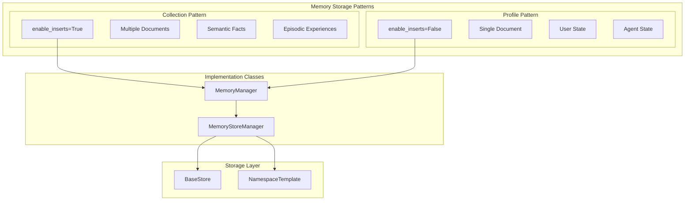
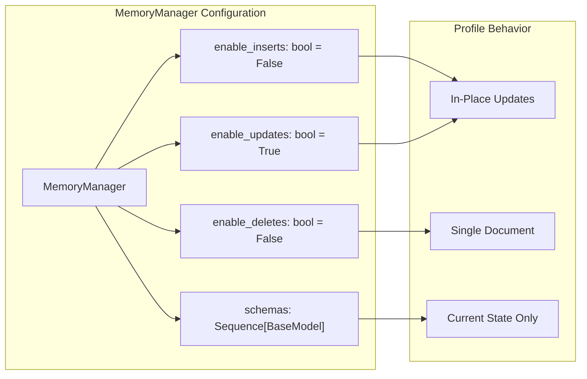
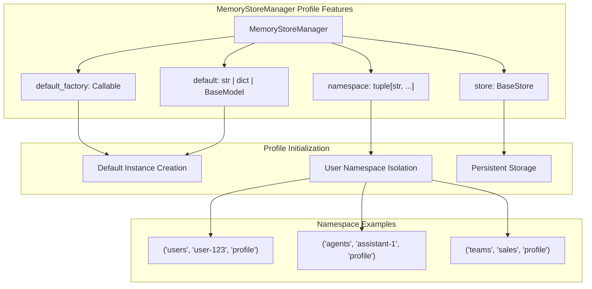
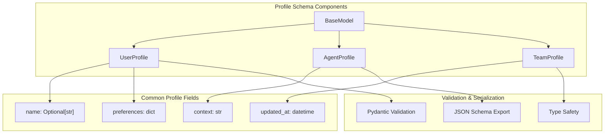
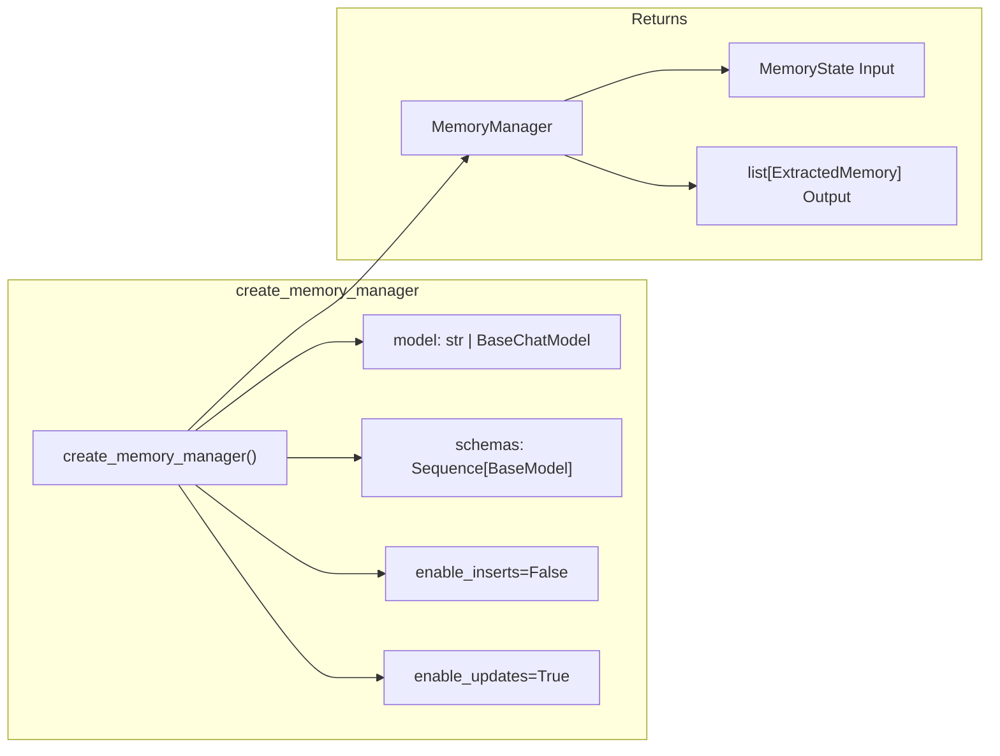
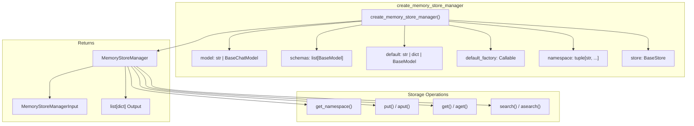
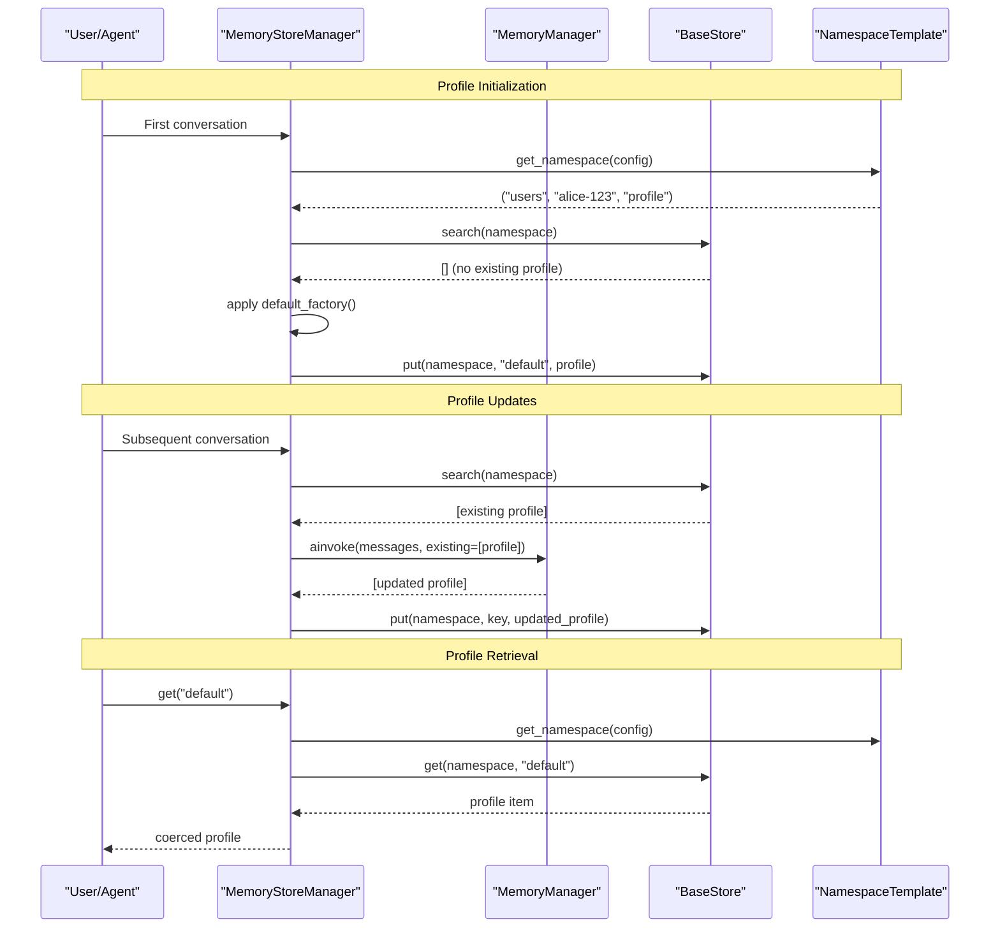

<!-- source: DeepWiki mcp.deepwiki.com · repo langchain-ai/langmem · page 2.4 User Profiles · fetched 2026-10-26 -->

# User Profiles

Relevant source files

The following files were used as context for generating this wiki page:

- [docs/docs/guides/manage_user_profile.md](docs/docs/guides/manage_user_profile.md)
- [src/langmem/knowledge/extraction.py](src/langmem/knowledge/extraction.py)

User profiles maintain a single, structured representation of a user (or agent) that gets updated in-place as new information becomes available. Unlike semantic memory collections that accumulate multiple facts over time, profiles use the "profile pattern" to maintain current state information in a single document.

For information about managing multiple evolving facts and knowledge, see [Semantic Memory](#2.1). For managing successful interaction patterns, see [Episodic Memory](#2.2).

## Profile Pattern vs Collection Pattern

User profiles implement a specific storage pattern that differs fundamentally from standard memory collection approaches:

| Aspect | Profile Pattern | Collection Pattern |
|--------|----------------|-------------------|
| Storage | Single document per namespace | Multiple documents per namespace |
| Updates | In-place modification | Accumulative insertion |
| `enable_inserts` | `False` | `True` |
| Use Cases | User preferences, current state | Facts, experiences, knowledge |

**Implementation Classes for Profile Pattern**
- Profile Pattern uses `enable_inserts=False`
- Collection Pattern uses `enable_inserts=True`
- Both patterns use `MemoryManager` and `MemoryStoreManager`
- Storage organized via `NamespaceTemplate`

Sources: [src/langmem/knowledge/extraction.py:224](), [src/langmem/knowledge/extraction.py:844](), [docs/docs/guides/manage_user_profile.md:36]()

## Core Components

### MemoryManager with Profile Configuration

The `MemoryManager` class handles profile extraction with specific parameters for in-place updates:

**Profile-Specific Parameters**
- `enable_inserts=False` prevents creating multiple profile instances
- `enable_updates=True` allows modifying existing profile data
- `enable_deletes=False` prevents accidental profile removal
- `schemas` defines profile structure using Pydantic models

Sources: [src/langmem/knowledge/extraction.py:218-235](), [src/langmem/knowledge/extraction.py:542-544]()

### MemoryStoreManager for Persistent Profiles

The `MemoryStoreManager` extends profile management with persistent storage and namespace organization:

**Profile Storage Features**
- `default` or `default_factory` creates initial profile instances
- `namespace` isolates profiles by user, agent, or team
- `store` provides persistent storage via `BaseStore`
- Profile namespaces typically end with `"profile"` for organization

Sources: [src/langmem/knowledge/extraction.py:832-851](), [src/langmem/knowledge/extraction.py:1666-1681]()

## Namespace Organization

User profiles use specific namespace patterns for isolation and organization:

| Namespace Pattern | Purpose | Example |
|------------------|---------|---------|
| `("users", "{user_id}", "profile")` | Individual user profiles | `("users", "alice-123", "profile")` |
| `("agents", "{agent_id}", "profile")` | Agent self-profiles | `("agents", "assistant-v1", "profile")` |
| `("teams", "{team_id}", "profile")` | Team/group profiles | `("teams", "engineering", "profile")` |
| `("sessions", "{session_id}", "profile")` | Session-specific profiles | `("sessions", "chat-abc", "profile")` |

The `NamespaceTemplate` class handles runtime substitution of template variables like `{user_id}` from the LangGraph configuration.

Sources: [src/langmem/knowledge/extraction.py:877](), [docs/docs/guides/manage_user_profile.md:89](), [docs/docs/guides/manage_user_profile.md:138-148]()

## Profile Schema Definition

Profiles are typically defined using Pydantic models that specify the structure and validation rules:

**Profile Model Features**
- Inherit from Pydantic `BaseModel` for validation
- Use `Optional` fields for incomplete information
- Support nested structures for complex preferences
- Automatic JSON serialization for storage

Sources: [docs/docs/guides/manage_user_profile.md:24-29](), [src/langmem/knowledge/extraction.py:86-93]()

## Factory Functions and Creation

### create_memory_manager for Profiles

**Profile Manager Creation**
- `create_memory_manager()` factory function
- `enable_inserts=False` for profile pattern
- Returns `MemoryManager` instance
- Input: `MemoryState` with messages and existing memories
- Output: `list[ExtractedMemory]` with updated profile

Sources: [src/langmem/knowledge/extraction.py:536-545](), [src/langmem/knowledge/extraction.py:685-692]()

### create_memory_store_manager for Persistent Profiles

**Persistent Profile Manager Features**
- `create_memory_store_manager()` factory function
- `default` or `default_factory` for profile initialization
- `namespace` template for user isolation
- Storage operations for profile CRUD
- Returns update operations as `list[dict]`

Sources: [src/langmem/knowledge/extraction.py:1666-1681](), [src/langmem/knowledge/extraction.py:2092-2105]()

## Profile Lifecycle

**Profile Lifecycle Stages**
1. **Initialization**: Create default profile if none exists
2. **Updates**: In-place modification via `enable_inserts=False`
3. **Retrieval**: Direct access via key or search
4. **Namespace Resolution**: Runtime template substitution

Sources: [src/langmem/knowledge/extraction.py:1006-1137](), [src/langmem/knowledge/extraction.py:1318-1351]()

## Integration Patterns

User profiles integrate with LangGraph applications through several patterns:

| Integration Pattern | Implementation | Use Case |
|-------------------|----------------|----------|
| Direct Manager | `create_memory_manager()` | Standalone profile extraction |
| Store Manager | `create_memory_store_manager()` | Persistent cross-session profiles |
| Agent Tools | `create_manage_memory_tool()` | Agent-driven profile updates |
| Background Processing | `ReflectionExecutor` | Deferred profile enrichment |

For more information on tool-based profile management, see [Memory Creation and Management](#5.1). For background profile processing, see [Background Memory Processing](#3.2).

Sources: [docs/docs/guides/manage_user_profile.md:67-151](), [src/langmem/knowledge/extraction.py:1666-2105]()

---

