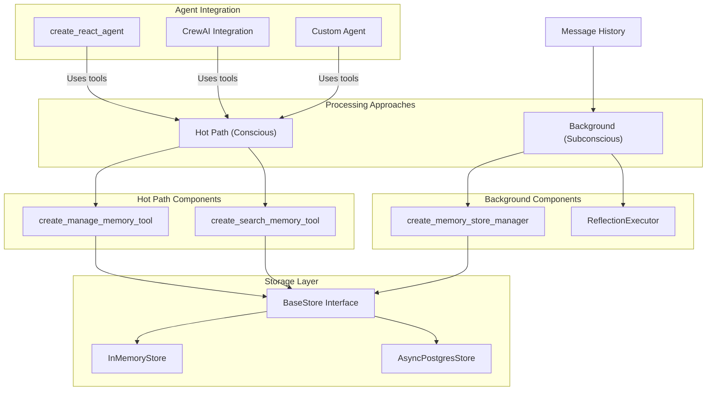
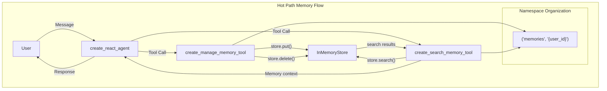
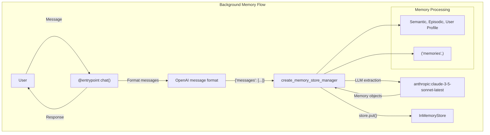
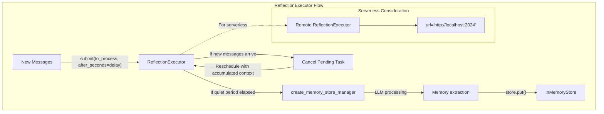

<!-- source: DeepWiki mcp.deepwiki.com · repo langchain-ai/langmem · page 3 Processing Approaches · fetched 2026-10-26 -->

# Processing Approaches

Relevant source files

The following files were used as context for generating this wiki page:

- [docs/docs/background_quickstart.md](docs/docs/background_quickstart.md)
- [docs/docs/concepts/conceptual_guide.md](docs/docs/concepts/conceptual_guide.md)
- [docs/docs/hot_path_quickstart.md](docs/docs/hot_path_quickstart.md)

## Purpose and Scope

This document explains the two main approaches for memory processing in LangMem:
1. **Hot Path (Conscious)** - Memory management driven directly by agents using memory tools
2. **Background (Subconscious)** - Automatic memory extraction that happens without agent involvement

These approaches represent fundamentally different architectures for when and how memories are formed, extracted, and managed within LangMem applications. For information about specific memory types (semantic, episodic, etc.), see Key Concepts (1.2).

## Comparison of Processing Approaches

The table below compares the key characteristics of hot path and background memory processing:

| Feature | Hot Path (Agent-Driven) | Background (Automatic) |
|---------|-------------------------|-----------------------|
| When memories are formed | During conversation (immediate) | After conversation or during quiet periods |
| Who initiates memory creation | Agent explicitly via tools | System automatically |
| Latency impact | Higher (adds to response time) | None (happens in background) |
| Agent complexity | Higher (agent must decide when to use memory tools) | Lower (agent doesn't need to manage memory) |
| Implementation components | `create_manage_memory_tool`, `create_search_memory_tool` | `create_memory_store_manager`, optional `ReflectionExecutor` |
| Best suited for | Critical context that must be saved immediately | Pattern analysis, summaries, non-urgent extraction |

The two approaches are complementary and can be used together in the same application.

**Diagram: Processing Approaches Overview**

Sources: [docs/docs/hot_path_quickstart.md:9-13](), [docs/docs/background_quickstart.md:8-13](), [docs/docs/hot_path_quickstart.md:74-89]()

## Hot Path Memory (Agent-Driven)

In the hot path approach, the agent actively manages its own memory using tools. This "conscious" memory formation happens during the conversation, enabling immediate updates when critical context emerges.

The agent must decide when to save memories and when to retrieve them, making memory management an explicit part of its decision-making process. This approach gives finer control but adds complexity to the agent implementation and impacts response time.

### Components and Architecture

The hot path approach is implemented using memory management tools:

- `create_manage_memory_tool`: Allows agents to create, update, and delete memories
- `create_search_memory_tool`: Enables agents to search for previously stored memories

These tools are provided to the agent, which can decide when to use them based on its reasoning about the conversation.

**Diagram: Hot Path Memory Flow with Code Entities**

Sources: [docs/docs/hot_path_quickstart.md:15-89](), [docs/docs/hot_path_quickstart.md:74-89](), [docs/docs/hot_path_quickstart.md:48-63]()

### Implementation Pattern

To implement the hot path approach:

1. Create memory tools with appropriate namespaces
2. Add these tools to your agent framework (LangGraph ReAct, CrewAI, or custom)
3. The agent will call these tools to manage its memory during conversations

### Implementation Pattern

The hot path approach uses the `create_react_agent` pattern from LangGraph with memory tools. The complete implementation is shown in [docs/docs/hot_path_quickstart.md:74-89]() where:

- `create_manage_memory_tool` creates a tool that agents can use to store/update/delete memories
- `create_search_memory_tool` enables memory retrieval during conversations  
- Both tools operate on a `BaseStore` instance (typically `InMemoryStore` or `AsyncPostgresStore`)
- Namespace configuration supports multi-tenancy patterns like `("memories", "{user_id}")`

The agent configuration and prompt function that integrates memory search is demonstrated in [docs/docs/hot_path_quickstart.md:46-63]().

Sources: [docs/docs/hot_path_quickstart.md:74-89](), [docs/docs/hot_path_quickstart.md:91-121]()

## Background Memory Processing

In the background approach, memories are automatically extracted from conversations without the agent's direct involvement. This "subconscious" memory formation happens after the conversation or during quiet periods, allowing deeper pattern analysis without impacting response time.

The agent doesn't need to be aware of the memory extraction process, making implementation simpler but giving less direct control over what information is stored.

### Components and Architecture

The background approach is implemented using:

- `create_memory_store_manager`: Creates a memory manager that automatically extracts and stores memories
- Optional `ReflectionExecutor`: Provides debounced processing to avoid redundant work

**Diagram: Background Memory Flow with Code Entities**

Sources: [docs/docs/background_quickstart.md:15-69](), [docs/docs/background_quickstart.md:33-69](), [docs/docs/background_quickstart.md:55-63]()

### Implementation Pattern

The background approach uses `create_memory_store_manager` to automatically extract memories from conversations. The complete implementation is shown in [docs/docs/background_quickstart.md:33-69]() where:

- `create_memory_store_manager` creates a Runnable that processes conversation history
- Messages must be formatted in OpenAI's message format: `{"messages": [{"role": "user", "content": "..."}, ...]}`
- The `@entrypoint` decorator from LangGraph provides store integration
- Memory extraction happens via `ainvoke()` calls on the memory manager

The store configuration and memory search example is demonstrated in [docs/docs/background_quickstart.md:84-105]().

Sources: [docs/docs/background_quickstart.md:33-69]()

### Delayed Processing with ReflectionExecutor

When conversations are active, processing each message immediately for memory extraction can be inefficient. `ReflectionExecutor` allows you to defer memory processing until conversation activity settles, using debouncing to cancel redundant work.

**Diagram: ReflectionExecutor Debouncing Flow**

### Implementation Pattern

The `ReflectionExecutor` wraps `create_memory_store_manager` to provide debounced processing, as shown in [docs/docs/guides/delayed_processing.md:19-53]() where:

- `ReflectionExecutor(memory_manager)` creates a wrapper for delayed processing
- `executor.submit(to_process, after_seconds=delay)` schedules memory processing
- Cancellation and rescheduling happens automatically when new messages arrive
- For serverless deployments, remote execution is configured via URL parameter

The complete delayed processing pattern is demonstrated in [docs/docs/guides/delayed_processing.md:25-53]().

Sources: [docs/docs/guides/delayed_processing.md:8-53]()

## Choosing and Combining Approaches

Both approaches have their strengths and can be used together in the same application:

- **Hot Path (Agent-Driven)** is best for:
  - Critical information that must be saved immediately
  - Selective memory storage where the agent should decide what's important
  - Interactive memory management where users might instruct the agent about what to remember

- **Background (Automatic)** is best for:
  - Comprehensive memory extraction without interrupting conversations
  - Pattern analysis across multiple interactions
  - Maintaining consistent memory without relying on agent decisions

**Diagram: Combined Processing Approach**

```mermaid
graph TD
    subgraph "Combined Processing Approach"
        User["User"] -->|"Message"| ReactAgent["create_react_agent"]
        ReactAgent -->|"Response"| User
        
        ReactAgent -->|"Immediate critical info"| ManageTool["create_manage_memory_tool"]
        ManageTool -->|"store.put()"| InMemStore["InMemoryStore"]
        
        Messages["Message History"] -->|"Automatic processing"| StoreManager["create_memory_store_manager"]
        StoreManager -->|"LLM extraction"| LLMModel["anthropic:claude-3-5-sonnet-latest"]
        LLMModel -->|"Memory objects"| InMemStore
        
        InMemStore -->|"store.search()"| SearchTool["create_search_memory_tool"]
        SearchTool -->|"Retrieved context"| ReactAgent
        
        subgraph "Optional Debouncing"
            ReflectionExec["ReflectionExecutor"]
            DelayedProc["after_seconds=1800"]
        end
        
        Messages -.->|"For efficiency"| ReflectionExec
        ReflectionExec --> DelayedProc
        DelayedProc --> StoreManager
    end
```

In practice, many applications combine both approaches:
- Use hot path for immediate, critical memory operations
- Use background processing for thorough, non-disruptive memory management

By understanding both approaches, you can choose the best strategy for your specific use case or combine them for a comprehensive memory management solution.

Sources: [docs/docs/concepts/conceptual_guide.md:296-307]()

---

