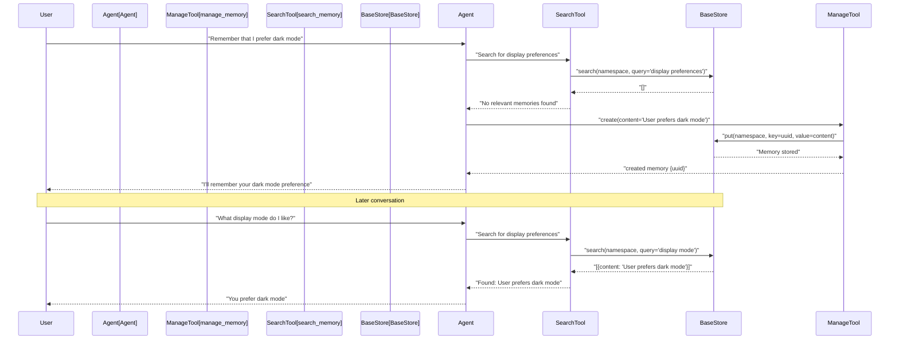
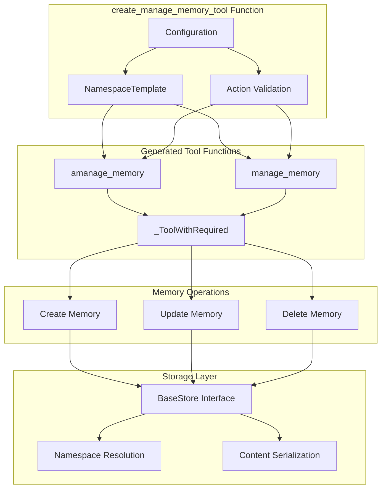
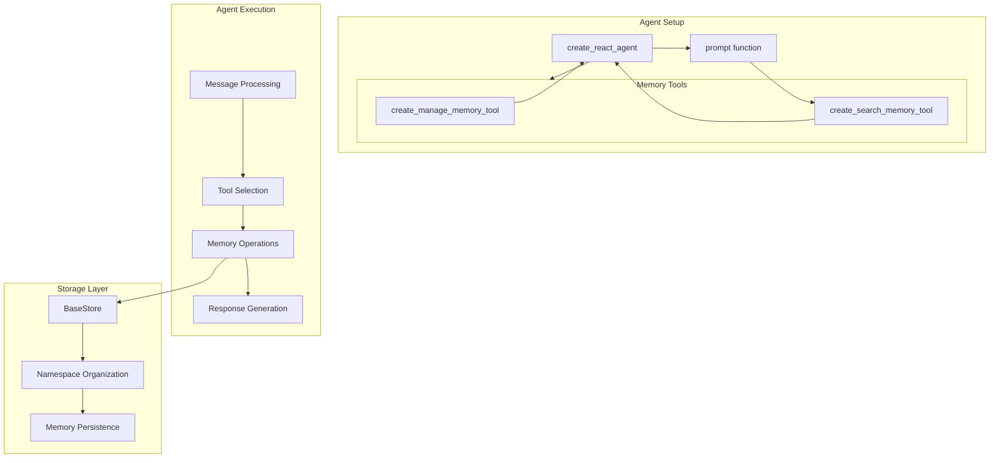
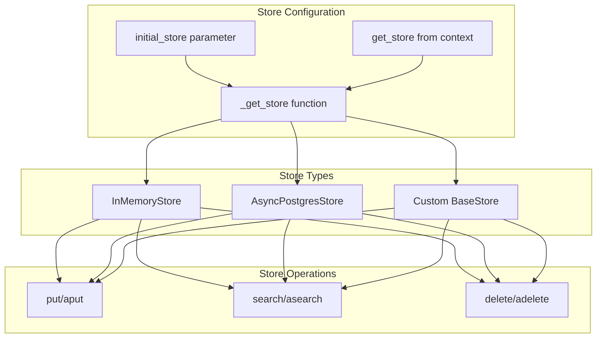

<!-- source: DeepWiki mcp.deepwiki.com · repo langchain-ai/langmem · page 3.1 Hot Path Memory (Agent-Driven) · fetched 2026-10-26 -->

# Hot Path Memory (Agent-Driven)

<details>
<summary>Relevant source files</summary>

The following files were used as context for generating this wiki page:

- [docs/docs/hot_path_quickstart.md](docs/docs/hot_path_quickstart.md)
- [src/langmem/knowledge/tools.py](src/langmem/knowledge/tools.py)

</details>


This document covers LangMem's hot path memory processing approach, where agents actively decide what information to store as memories during real-time conversations using memory management tools. This approach gives agents conscious control over their memory formation process.

For automated memory extraction that happens after conversations, see [Background Memory Processing](#3.2). For the broader context of memory processing approaches, see [Processing Approaches](#3).

## Overview

Hot path memory processing enables agents to make deliberate decisions about memory storage during active conversations. Agents use specialized tools to create, update, delete, and search memories in real-time as part of their reasoning process. This approach provides immediate memory persistence and allows for strategic memory management based on conversational context.

The hot path approach relies on two primary tools from [src/langmem/knowledge/tools.py]():
- `create_manage_memory_tool` for creating, updating, and deleting memories
- `create_search_memory_tool` for retrieving relevant memories during conversations

**Hot Path Memory Flow During Conversation**


Sources: [src/langmem/knowledge/tools.py:25-486](), [docs/docs/hot_path_quickstart.md:1-176]()

## Memory Management Tool

The `create_manage_memory_tool` function creates a tool that agents can use to perform CRUD operations on their memory store. This tool supports three primary actions: create, update, and delete.

### Tool Configuration

The tool accepts several configuration parameters:

| Parameter | Type | Description |
|-----------|------|-------------|
| `namespace` | `tuple[str, ...]` or `str` | Namespace template for organizing memories |
| `instructions` | `str` | Custom instructions for when to use the tool |
| `schema` | `Type` | Expected schema for memory content (defaults to `str`) |
| `actions_permitted` | `tuple` | Allowed actions: create, update, delete |
| `store` | `BaseStore` | Storage backend (uses context if None) |
| `name` | `str` | Tool name for agent usage |

**Memory Management Tool Architecture**


Sources: [src/langmem/knowledge/tools.py:25-356]()

### Action Types and Validation

The tool validates actions and parameters based on the permitted operations:

- **Create**: Requires `content`, generates new UUID, rejects explicit `id`
- **Update**: Requires both `content` and `id` of existing memory
- **Delete**: Requires only `id`, removes memory from store

The function dynamically creates type annotations based on `actions_permitted` using `typing.Literal` [src/langmem/knowledge/tools.py:266]().

Sources: [src/langmem/knowledge/tools.py:271-303](), [src/langmem/knowledge/tools.py:305-337]()

## Memory Search Tool

The `create_search_memory_tool` function creates a tool for retrieving memories using semantic or exact matching. The tool queries the BaseStore and returns formatted results.

### Search Parameters

| Parameter | Type | Description |
|-----------|------|-------------|
| `query` | `str` | Search query to match against memories |
| `limit` | `int` | Maximum results to return (default: 10) |
| `offset` | `int` | Results to skip for pagination (default: 0) |
| `filter` | `dict` | Additional filter criteria |

The tool supports two response formats controlled by the `response_format` parameter:
- `"content"`: Returns serialized memory content only
- `"content_and_artifact"`: Returns both serialized content and raw memory objects

Sources: [src/langmem/knowledge/tools.py:362-486]()

## Agent Integration Patterns

Hot path memory tools integrate with agents through LangGraph's tool system. Agents receive these tools in their tool list and can call them during their reasoning process.

### ReAct Agent Integration



Sources: [docs/docs/hot_path_quickstart.md:74-89]()

### Custom Agent Integration

The tools work with any LangGraph agent architecture that supports tool calling. Custom agents can integrate memory tools by including them in their tool list and implementing appropriate tool calling logic.

Sources: [src/langmem/knowledge/tools.py:25-39]()

## Namespace Organization

Namespaces provide hierarchical organization for memories using the `NamespaceTemplate` utility. Templates support runtime variable substitution from the LangGraph configuration.

### Namespace Patterns

| Pattern | Template | Use Case |
|---------|----------|----------|
| Global | `("memories",)` | Shared memories across all users |
| Per-user | `("memories", "{langgraph_user_id}")` | User-specific memory isolation |
| Per-organization | `("memories", "{org_id}", "{user_id}")` | Hierarchical organization |
| Feature-specific | `("memories", "{user_id}", "preferences")` | Categorized memory types |

The `NamespaceTemplate` class [src/langmem/knowledge/tools.py:263]() handles runtime template resolution by substituting bracketed variables with values from the LangGraph configuration's `configurable` field.

Sources: [docs/docs/hot_path_quickstart.md:94-103](), [src/langmem/knowledge/tools.py:292](), [src/langmem/knowledge/tools.py:326](), [src/langmem/knowledge/tools.py:444]()

## Storage Integration

Hot path memory tools integrate with LangGraph's `BaseStore` interface through the `_get_store` helper function [src/langmem/knowledge/tools.py:489-497](). The function either uses a provided store or retrieves the store from LangGraph's context using `get_store()`.

### Content Serialization

The `_ensure_json_serializable` function [src/langmem/knowledge/tools.py:500-510]() handles serialization of memory content:
- Primitives (str, int, float, bool, dict, list) are stored directly  
- Pydantic models are serialized using `model_dump(mode="json")`
- Other objects fall back to string representation

### Store Configuration



Sources: [src/langmem/knowledge/tools.py:489-497](), [src/langmem/knowledge/tools.py:500-510](), [docs/docs/hot_path_quickstart.md:66-71]()

## Tool Schema Customization

The management tool supports custom schemas for structured memory content. When a schema is provided, the tool validates and serializes content according to the schema definition.

### Schema Examples

For string-based memories (default):
```python
# Uses str schema by default
memory_tool = create_manage_memory_tool(namespace=("memories",))
```

For structured memories with Pydantic models:
```python
class UserProfile(BaseModel):
    name: str
    preferences: dict
    
memory_tool = create_manage_memory_tool(
    namespace=("profiles", "{user_id}"),
    schema=UserProfile
)
```

The tool automatically handles serialization through the `_ensure_json_serializable` function for both simple and complex data types.

Sources: [src/langmem/knowledge/tools.py:178-197](), [src/langmem/knowledge/tools.py:500-510]()

---

