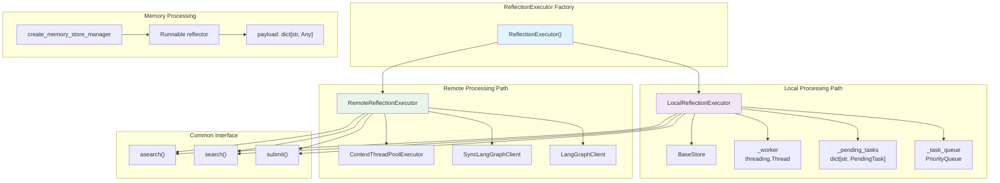
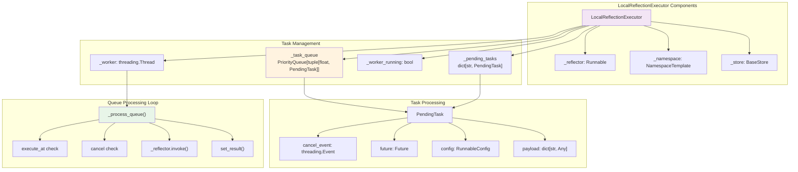
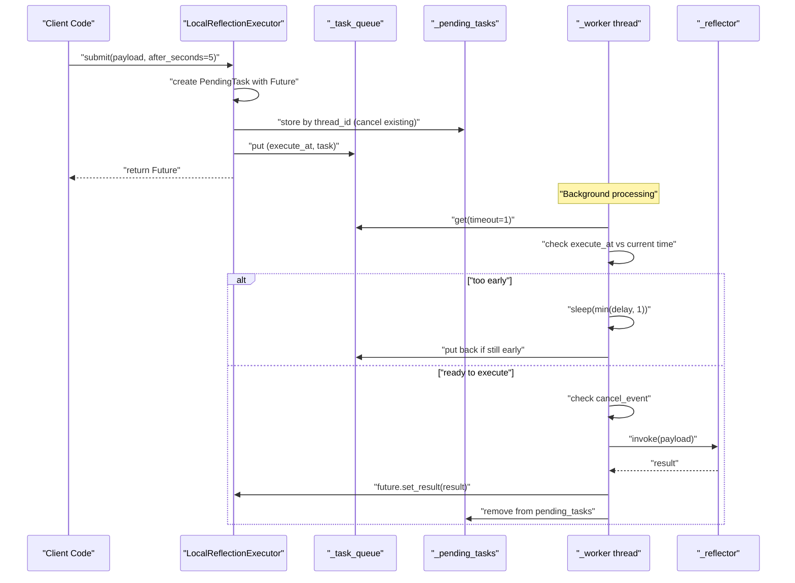
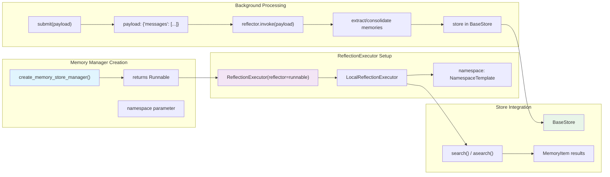

<!-- source: DeepWiki mcp.deepwiki.com · repo langchain-ai/langmem · page 3.2 Background Memory Processing · fetched 2026-10-26 -->

# Background Memory Processing

<details>
<summary>Relevant source files</summary>

The following files were used as context for generating this wiki page:

- [docs/docs/background_quickstart.md](docs/docs/background_quickstart.md)
- [src/langmem/graphs/semantic.py](src/langmem/graphs/semantic.py)
- [src/langmem/reflection.py](src/langmem/reflection.py)

</details>


Background memory processing enables automatic, deferred extraction and consolidation of memories from conversation history without blocking the main conversation flow. This approach processes memories "subconsciously" after conversations occur, as opposed to hot path processing where agents actively decide what to remember during conversation. For information about agent-driven memory processing, see [Hot Path Memory (Agent-Driven)](#3.1).

The core component for background processing is the `ReflectionExecutor` system, which handles task queuing, threading, and both local and remote execution patterns. This system integrates with memory managers created by `create_memory_store_manager` to process conversation history asynchronously.

## ReflectionExecutor Architecture

The `ReflectionExecutor` provides a unified interface for background memory processing through two implementation patterns: local processing with threading and queue management, and remote processing via LangGraph services.



Sources: [src/langmem/reflection.py:89-141]()

## Local vs Remote Processing

The `ReflectionExecutor` factory function determines the execution mode based on the reflector parameter type. Local processing uses a `Runnable` reflector with direct store access, while remote processing uses a string assistant ID to delegate work to LangGraph services.

### Local Processing

Local processing uses `LocalReflectionExecutor` with threading and queue management to handle background tasks without blocking the main application.



Sources: [src/langmem/reflection.py:254-387](), [src/langmem/reflection.py:389-472]()

### Remote Processing

Remote processing uses `RemoteReflectionExecutor` to delegate memory processing tasks to LangGraph services running elsewhere.

| Component | Purpose | Configuration |
|-----------|---------|---------------|
| `_assistant_id` | Target LangGraph assistant | String identifier |
| `_aclient` | Async LangGraph client | Auto-configured or provided |
| `_client` | Sync LangGraph client | Auto-configured or provided |
| `_executor` | Thread pool executor | `ContextThreadPoolExecutor` |

Sources: [src/langmem/reflection.py:143-252]()

## Task Queuing and Threading

The `LocalReflectionExecutor` implements sophisticated task management with priority queuing, cancellation support, and thread-safe execution.

### Task Lifecycle



Sources: [src/langmem/reflection.py:273-330](), [src/langmem/reflection.py:401-472]()

### Cancellation and Conflict Resolution

The system handles task cancellation and thread-specific conflict resolution to prevent duplicate processing:

- When a new task is submitted for an existing `thread_id`, the previous task is cancelled via `cancel_event.set()`
- Tasks check cancellation status before execution in `_process_queue`
- The `Future` objects allow callers to cancel or wait for completion

Sources: [src/langmem/reflection.py:308-313](), [src/langmem/reflection.py:414-423]()

## Integration with Memory Managers

Background processing integrates with memory managers created by `create_memory_store_manager` to process conversation history asynchronously.



Sources: [src/langmem/reflection.py:257-262](), [docs/docs/background_quickstart.md:48-63]()

## Usage Patterns

### Basic Background Processing

The most common pattern involves creating a memory manager and using it for deferred processing:

```python
# Create memory manager for background processing
memory_manager = create_memory_store_manager(
    "anthropic:claude-3-5-sonnet-latest",
    namespace=("memories",),
)

# Use in LangGraph entrypoint
@entrypoint(store=store)
async def chat(message: str):
    response = llm.invoke(message)
    to_process = {"messages": [{"role": "user", "content": message}] + [response]}
    await memory_manager.ainvoke(to_process)  # Background processing
    return response.content
```

Sources: [docs/docs/background_quickstart.md:48-63](), [src/langmem/graphs/semantic.py:40-47]()

### Direct ReflectionExecutor Usage

For more control over background processing, you can use `ReflectionExecutor` directly:

```python
# Create executor with memory manager
executor = ReflectionExecutor(memory_manager, store=store)

# Submit tasks with delay
future = executor.submit(
    {"messages": conversation_history},
    after_seconds=30  # Process 30 seconds after submission
)

# Search processed memories
memories = executor.search(query="user preferences", limit=5)
```

The `after_seconds` parameter enables debounced processing to avoid redundant work during active conversations.

Sources: [src/langmem/reflection.py:273-330]()

### Remote Processing Setup

For distributed deployments, use remote processing with LangGraph services:

```python
# Remote executor with assistant ID
executor = ReflectionExecutor(
    "memory-assistant-v1",  # String assistant ID
    namespace=("user", "123"),
    url="https://my-langgraph-service.com"
)

# Same interface as local processing
future = executor.submit(conversation_data)
memories = await executor.asearch(query="recent topics")
```

Sources: [src/langmem/reflection.py:143-158](), [src/langmem/reflection.py:161-198]()

---

