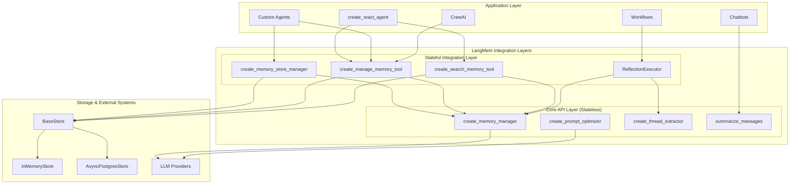
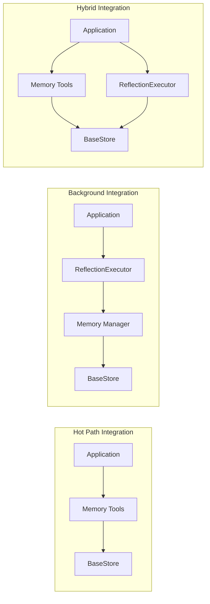
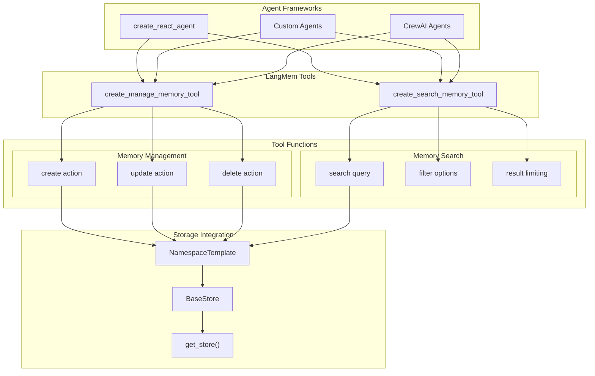
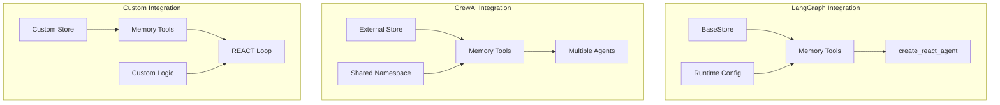

<!-- source: DeepWiki mcp.deepwiki.com · repo langchain-ai/langmem · page 4 Integration · fetched 2026-10-26 -->

# Integration

Relevant source files

The following files were used as context for generating this wiki page:

- [README.md](README.md)
- [src/langmem/knowledge/tools.py](src/langmem/knowledge/tools.py)

This document provides an overview of how LangMem integrates with different frameworks and systems. It covers the core integration architecture, patterns for connecting LangMem with various agent frameworks, and the tool-based integration approach that enables seamless memory management across different systems.

For detailed information about specific integration approaches, see [LangGraph Integration](#4.1), [ReAct Agents](#4.2.1), [CrewAI Integration](#4.2.2), and [Custom Agents](#4.2.3).

## Integration Architecture

LangMem follows a two-layer integration architecture that provides flexibility for different deployment scenarios and framework requirements:

### Two-Layer Integration Design

**Core API Layer (Stateless)**: Provides functional primitives that work with any storage system. These functions handle memory extraction, prompt optimization, and conversation processing without maintaining state.

**Stateful Integration Layer**: Connects the Core API to specific frameworks and storage systems. This layer manages persistent state, provides agent tools, and handles background processing.

Sources: [src/langmem/knowledge/tools.py:1-531](), [README.md:1-96]()

## Integration Patterns

LangMem supports three primary integration patterns, each suited for different use cases and architectural requirements:

### Integration Pattern Overview

| Pattern | Description | Use Cases | Key Components |
|---------|-------------|-----------|----------------|
| **Hot Path** | Agents actively manage memory during conversations | Interactive agents, ReAct workflows | `create_manage_memory_tool`, `create_search_memory_tool` |
| **Background** | Deferred memory processing after conversations | High-throughput systems, batch processing | `ReflectionExecutor`, `create_memory_manager` |
| **Hybrid** | Combines immediate and deferred memory operations | Complex agents needing both patterns | All memory components |

Sources: [src/langmem/knowledge/tools.py:25-356](), [README.md:30-86]()

## Tool-Based Integration

The primary integration mechanism for LangMem is through memory tools that can be added to any agent framework supporting LangChain tools. These tools provide a standardized interface for memory operations across different systems.

### Memory Tool Integration

**Memory Management Tool**: The `create_manage_memory_tool` function creates tools that allow agents to create, update, and delete memories. It supports customizable schemas and action permissions.

**Memory Search Tool**: The `create_search_memory_tool` function creates tools for semantic and exact matching searches across stored memories with filtering and pagination support.

**Namespace Integration**: Both tools use `NamespaceTemplate` for dynamic namespace resolution, enabling user isolation and organizational flexibility.

Sources: [src/langmem/knowledge/tools.py:25-356](), [src/langmem/knowledge/tools.py:362-486]()

## Framework Support

LangMem provides integration support for multiple agent frameworks through its tool-based architecture:

### Framework Integration Matrix

| Framework | Integration Type | Key Features | Status |
|-----------|-----------------|--------------|--------|
| **LangGraph** | Native | BaseStore integration, create_react_agent support | Full Support |
| **Custom Agents** | Tool-based | Direct tool integration, flexible architecture | Full Support |
| **CrewAI** | Tool-based | Multi-agent memory sharing, team workflows | Full Support |
| **LangChain Agents** | Tool-based | Standard tool interface, callback support | Full Support |

### Integration Requirements

All framework integrations share common requirements:

1. **Tool Support**: Framework must support LangChain `StructuredTool` interface
2. **Storage Access**: Access to a `BaseStore` implementation for persistence  
3. **Configuration**: Ability to pass runtime configuration for namespace resolution
4. **Async Support**: Optional but recommended for better performance

### Framework-Specific Integration

**LangGraph**: Provides the most seamless integration with native BaseStore support, automatic configuration, and prebuilt agent compatibility.

**CrewAI**: Enables multi-agent systems with shared memory through namespace organization and external store configuration.

**Custom Agents**: Offers maximum flexibility for custom REACT loops and specialized agent architectures.

Sources: [src/langmem/knowledge/tools.py:489-497](), [README.md:34-58]()

---

