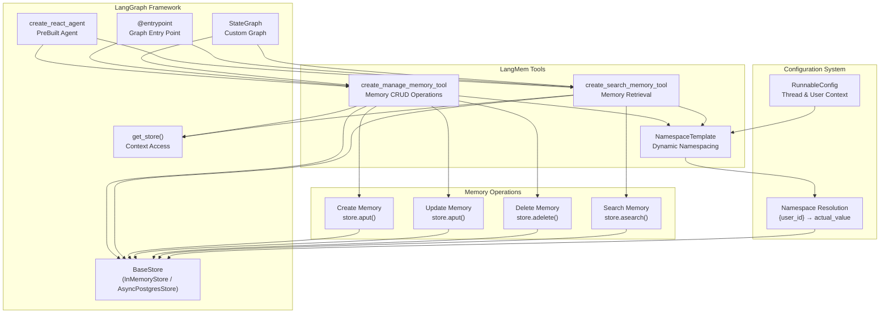
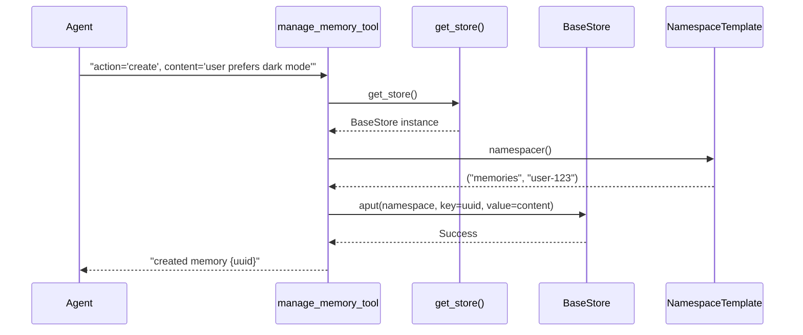
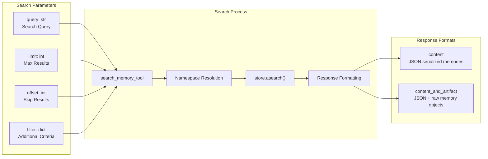
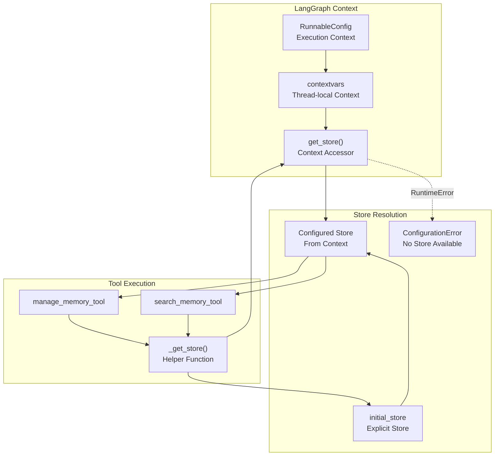
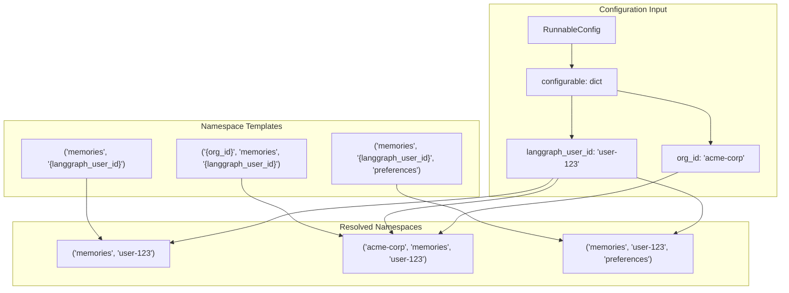
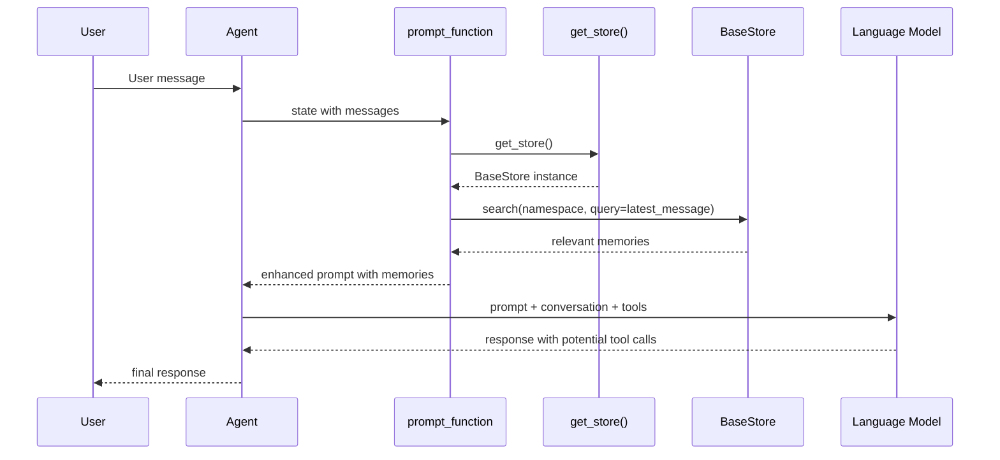

<!-- source: DeepWiki mcp.deepwiki.com · repo langchain-ai/langmem · page 4.1 LangGraph Integration · fetched 2026-10-26 -->

# LangGraph Integration

<details>
<summary>Relevant source files</summary>

The following files were used as context for generating this wiki page:

- [docs/docs/hot_path_quickstart.md](docs/docs/hot_path_quickstart.md)
- [src/langmem/graphs/auth.py](src/langmem/graphs/auth.py)
- [src/langmem/knowledge/__init__.py](src/langmem/knowledge/__init__.py)
- [src/langmem/knowledge/tools.py](src/langmem/knowledge/tools.py)

</details>


This document covers LangMem's native integration with LangGraph, focusing on how LangMem leverages LangGraph's storage layer, configuration system, and agent framework. This includes the memory tools that agents can use and how they interface with LangGraph's `BaseStore`.

For information about integrating with other agent frameworks like CrewAI or custom agents, see [Agent Integration](#4.2).

## Core Integration Components

LangMem's LangGraph integration centers around two main tools that provide agents with memory capabilities through LangGraph's `BaseStore` infrastructure. These tools are designed to work seamlessly within LangGraph's configuration and execution context.



**LangGraph Integration Architecture**

Sources: [src/langmem/knowledge/tools.py:1-531](), [docs/docs/hot_path_quickstart.md:35-90]()

## Memory Tools

LangMem provides two primary tools that integrate with LangGraph's tool system and storage infrastructure:

### Memory Management Tool

The `create_manage_memory_tool` function creates a tool that allows agents to perform CRUD operations on their persistent memory.

| Operation | Description | Tool Parameters |
|-----------|-------------|----------------|
| `create` | Create new memory | `content`, `action="create"` |
| `update` | Update existing memory | `content`, `id`, `action="update"` |
| `delete` | Delete memory by ID | `id`, `action="delete"` |



**Memory Management Tool Flow**

The tool signature supports customizable schemas and action restrictions:

```python
# Basic string content
create_manage_memory_tool(namespace=("memories", "{user_id}"))

# Custom schema with restricted actions  
create_manage_memory_tool(
    namespace=("profiles", "{user_id}"),
    schema=UserProfile,
    actions_permitted=("create", "update")
)
```

Sources: [src/langmem/knowledge/tools.py:25-356]()

### Memory Search Tool

The `create_search_memory_tool` function creates a tool for semantic and exact search across stored memories.



**Memory Search Process**

Sources: [src/langmem/knowledge/tools.py:362-486]()

## Storage Integration

LangMem integrates with LangGraph's `BaseStore` system, supporting both development and production storage backends.

### Store Configuration

| Store Type | Use Case | Configuration |
|------------|----------|---------------|
| `InMemoryStore` | Development/Testing | Ephemeral, vector indexing |
| `AsyncPostgresStore` | Production | Persistent, scalable |
| Custom `BaseStore` | Specialized needs | User-implemented |

```python
# Development setup
store = InMemoryStore(
    index={
        "dims": 1536,
        "embed": "openai:text-embedding-3-small",
    }
)

# Production setup (provided automatically on LangGraph platform)
# AsyncPostgresStore with persistent storage
```

### Context-Based Store Access

LangMem tools use LangGraph's context system to access the configured store:



**Store Resolution Process**

Sources: [src/langmem/knowledge/tools.py:489-497](), [docs/docs/hot_path_quickstart.md:48-49](), [docs/docs/hot_path_quickstart.md:117-119]()

## Configuration and Namespacing

LangMem uses LangGraph's configuration system to provide dynamic namespace resolution and user isolation.

### Namespace Templating

The `NamespaceTemplate` class enables runtime namespace resolution using configuration values:

```python
# Template definition
namespace = ("memories", "{langgraph_user_id}", "preferences")

# Runtime resolution
config = {"configurable": {"langgraph_user_id": "user-123"}}
# Resolves to: ("memories", "user-123", "preferences")
```

### Common Namespace Patterns

| Pattern | Namespace Template | Use Case |
|---------|-------------------|----------|
| Global | `("memories",)` | Shared across all users |
| Per-user | `("memories", "{langgraph_user_id}")` | User isolation |
| Hierarchical | `("org", "{org_id}", "{user_id}")` | Multi-tenant |
| Typed | `("memories", "{user_id}", "preferences")` | Memory categorization |



**Namespace Template Resolution**

Sources: [src/langmem/knowledge/tools.py:263](), [docs/docs/hot_path_quickstart.md:94-103]()

## Agent Integration

LangMem tools integrate seamlessly with LangGraph's agent constructs, particularly `create_react_agent`.

### ReAct Agent Integration

```python
from langgraph.prebuilt import create_react_agent
from langmem import create_manage_memory_tool, create_search_memory_tool

agent = create_react_agent(
    "anthropic:claude-3-5-sonnet-latest",
    tools=[
        create_manage_memory_tool(namespace=("memories", "{langgraph_user_id}")),
        create_search_memory_tool(namespace=("memories", "{langgraph_user_id}")),
    ],
    store=store,
    checkpointer=checkpointer,
)
```

### Memory-Enhanced Prompts

Agents can dynamically load relevant memories in their prompt function:



**Memory-Enhanced Agent Flow**

Sources: [docs/docs/hot_path_quickstart.md:46-63](), [src/langmem/knowledge/tools.py:142-175]()

## Usage Patterns

### Basic Integration

```python
from langgraph.prebuilt import create_react_agent
from langgraph.store.memory import InMemoryStore
from langmem import create_manage_memory_tool

# Configure store with embedding support
store = InMemoryStore(
    index={
        "dims": 1536,
        "embed": "openai:text-embedding-3-small",
    }
)

# Create agent with memory capability
agent = create_react_agent(
    "anthropic:claude-3-5-sonnet-latest", 
    tools=[create_manage_memory_tool(namespace=("memories",))],
    store=store,
)
```

### Multi-User Configuration

```python
# Per-user memory isolation
memory_tool = create_manage_memory_tool(
    namespace=("memories", "{langgraph_user_id}"),
    instructions="Store user-specific preferences and context."
)

# Usage with user-specific configuration
config = {"configurable": {"langgraph_user_id": "user-123"}}
agent.invoke({"messages": [...]}, config=config)
```

### Custom Schema Integration

```python
from pydantic import BaseModel

class UserPreferences(BaseModel):
    theme: str = "light"
    language: str = "en"
    notifications: bool = True

profile_tool = create_manage_memory_tool(
    namespace=("profiles", "{langgraph_user_id}"),
    schema=UserPreferences,
    actions_permitted=("create", "update"),
)
```

Sources: [docs/docs/hot_path_quickstart.md:32-90](), [src/langmem/knowledge/tools.py:178-258]()

---

