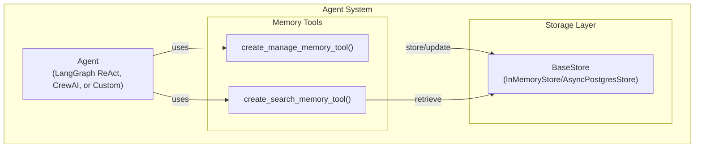
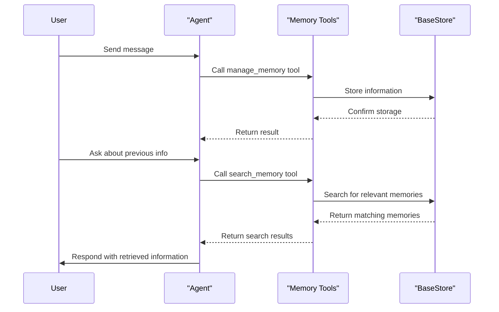
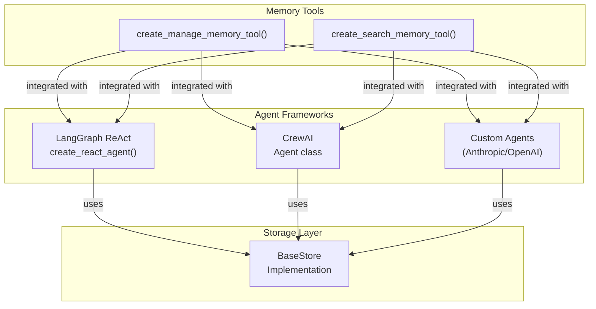
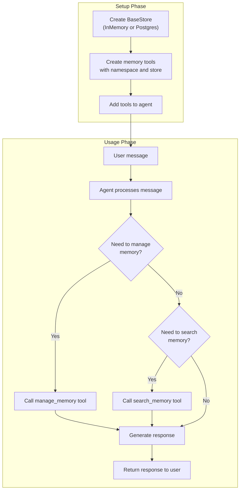

<!-- source: DeepWiki mcp.deepwiki.com · repo langchain-ai/langmem · page 4.2 Agent Integration · fetched 2026-10-26 -->

# Agent Integration

<details>
<summary>Relevant source files</summary>

The following files were used as context for generating this wiki page:

- [docs/docs/guides/extract_episodic_memories.md](docs/docs/guides/extract_episodic_memories.md)
- [docs/docs/guides/memory_tools.md](docs/docs/guides/memory_tools.md)
- [docs/docs/guides/use_tools_in_crewai.md](docs/docs/guides/use_tools_in_crewai.md)
- [docs/docs/guides/use_tools_in_custom_agent.md](docs/docs/guides/use_tools_in_custom_agent.md)

</details>


This page provides an overview of integrating LangMem with different agent frameworks. LangMem's memory tools can be integrated with various types of agents to enable them to store, retrieve, and manage memories across conversations. For specific implementation details, see the child pages on [ReAct Agents](#4.2.1), [CrewAI Integration](#4.2.2), and [Custom Agents](#4.2.3).

## Memory Tools for Agent Integration

LangMem provides two primary tools that can be integrated with any agent framework:

1. `create_manage_memory_tool` - Allows agents to create, update, and delete memories
2. `create_search_memory_tool` - Enables agents to search through previously stored memories

These tools work with LangGraph's storage layer (typically `BaseStore` implementations) to provide persistent memory capabilities to agents.



Sources: [README.md:36-57]()

## Integration Patterns

LangMem follows a consistent pattern for integrating with different agent frameworks. The general approach is:

1. Set up a storage backend (e.g., `InMemoryStore` or `AsyncPostgresStore`)
2. Create memory tools that are connected to this store
3. Add these tools to your agent's available tools
4. The agent can then actively use these tools during conversations

This pattern works across all supported agent frameworks, with minor variations in syntax.



Sources: [README.md:68-86](), [docs/docs/guides/use_tools_in_crewai.md:19-49]()

## Supported Agent Frameworks

LangMem can be integrated with multiple agent frameworks:

### LangGraph ReAct Agents

The simplest integration is with LangGraph's `create_react_agent`, where memory tools are added directly to the agent's tool list.

### CrewAI

For multi-agent systems built with CrewAI, memory tools can be added to individual agents or shared across agents.

### Custom Agent Implementations

LangMem tools can also be used with custom agent implementations built on top of LLM APIs like Anthropic or OpenAI.



Sources: [README.md:36-57](), [docs/docs/guides/use_tools_in_crewai.md:19-49](), [docs/docs/guides/use_tools_in_custom_agent.md:19-137]()

## Storage Configuration

Agents using LangMem tools can use different storage backends:

| Storage Type | Use Case | Persistence |
|--------------|----------|-------------|
| `InMemoryStore` | Development, testing | In-process only (lost on restart) |
| `AsyncPostgresStore` | Production | Persistent across restarts |

The storage configuration is consistent across all agent frameworks, using the index parameter to enable vector search capabilities:

```python
store = InMemoryStore(
    index={
        "dims": 1536,
        "embed": "openai:text-embedding-3-small",
    }
)
```

Sources: [README.md:40-46](), [docs/docs/guides/use_tools_in_crewai.md:26-32](), [docs/docs/guides/use_tools_in_custom_agent.md:102-107]()

## Example Integration Flow

The following diagram illustrates the typical workflow when using memory tools in an agent system:



Sources: [README.md:68-86](), [docs/docs/guides/use_tools_in_custom_agent.md:42-97]()

## Implementation Differences

While the core concept remains the same, there are some implementation differences when integrating with different agent frameworks:

| Framework | Tool Integration | Message Handling | Store Access |
|-----------|------------------|------------------|--------------|
| LangGraph ReAct | Direct tool list | Handled by framework | Store passed to agent |
| CrewAI | Agent tool parameter | Handled by framework | Store created separately |
| Custom (Anthropic) | Tool conversion required | Manual tool execution | Manual storage management |
| Custom (OpenAI) | Tool schema conversion | Manual tool execution | Manual storage management |

For detailed implementation specifics for each agent framework, refer to the dedicated child pages:
- [ReAct Agents](#4.2.1)
- [CrewAI Integration](#4.2.2)
- [Custom Agents](#4.2.3)

Sources: [docs/docs/guides/use_tools_in_crewai.md:19-49](), [docs/docs/guides/use_tools_in_custom_agent.md:19-265]()

---

