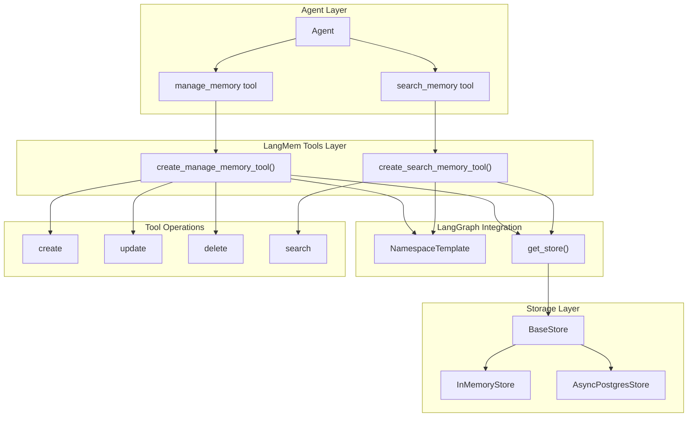
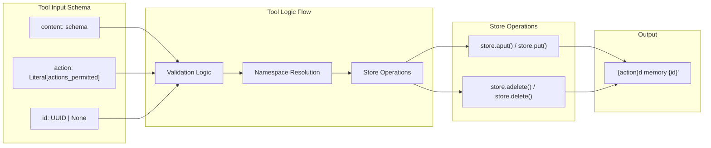
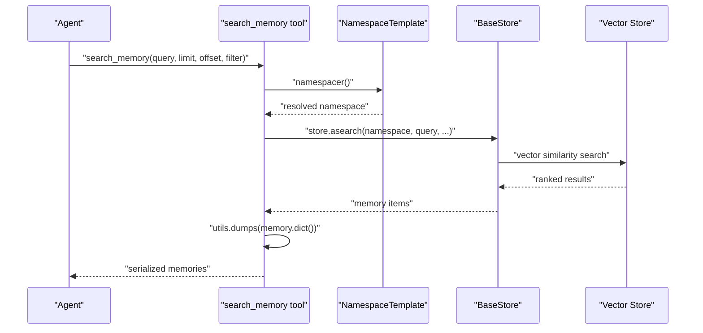
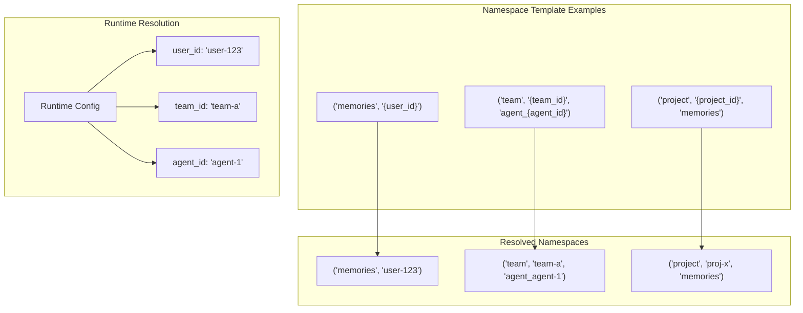
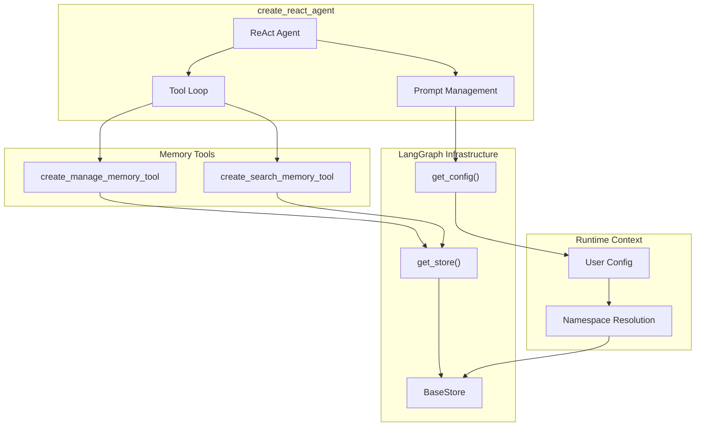

<!-- source: DeepWiki mcp.deepwiki.com · repo langchain-ai/langmem · page 5 Memory Tools · fetched 2026-10-26 -->

# Memory Tools

Relevant source files

The following files were used as context for generating this wiki page:

- [docs/docs/guides/extract_episodic_memories.md](docs/docs/guides/extract_episodic_memories.md)
- [docs/docs/guides/memory_tools.md](docs/docs/guides/memory_tools.md)
- [docs/docs/guides/use_tools_in_crewai.md](docs/docs/guides/use_tools_in_crewai.md)
- [src/langmem/knowledge/tools.py](src/langmem/knowledge/tools.py)

This document covers LangMem's memory tools that enable agents to actively manage their own persistent memory. These tools provide a "hot path" approach where agents make deliberate decisions about what to remember during conversations, as opposed to background memory processing approaches.

For background memory processing using reflection and consolidation, see [Background Memory Processing](#3.2). For core memory management concepts, see [Memory Management](#2).

## Overview

LangMem provides two primary tools that agents can use to manage persistent memories stored in LangGraph's BaseStore system:

| Tool | Function | Purpose |
|------|----------|---------|
| Memory Management | `create_manage_memory_tool` | Create, update, and delete memories |
| Memory Search | `create_search_memory_tool` | Search and retrieve existing memories |

These tools integrate directly with LangGraph's agent framework and storage layer, enabling agents to proactively store information they deem important and retrieve relevant context when needed.

**Tool Architecture Diagram**

Sources: [src/langmem/knowledge/tools.py:25-356](), [src/langmem/knowledge/tools.py:362-486]()

## Memory Management Tool

The `create_manage_memory_tool` function creates a tool that allows agents to create, update, and delete memories. The tool operates on structured memory objects stored in configurable namespaces within LangGraph's BaseStore.

### Function Signature and Parameters

The tool factory function accepts several configuration parameters:

| Parameter | Type | Default | Description |
|-----------|------|---------|-------------|
| `namespace` | `tuple[str, ...]` or `str` | Required | Namespace structure with runtime placeholders |
| `instructions` | `str` | Predefined guidelines | Custom instructions for tool usage |
| `schema` | `Type` | `str` | Expected content schema for memories |
| `actions_permitted` | `tuple` | `("create", "update", "delete")` | Allowed operations |
| `store` | `BaseStore` | `None` | Explicit store (uses runtime store if None) |
| `name` | `str` | `"manage_memory"` | Tool name |

**Generated Tool Interface**

Sources: [src/langmem/knowledge/tools.py:64-69](), [src/langmem/knowledge/tools.py:271-337]()

### Validation and Error Handling

The tool implements several validation rules:

- **Create operations**: Cannot specify an ID (auto-generated via `uuid.uuid4()`)
- **Update/Delete operations**: Must specify an existing memory ID
- **Action validation**: Only permitted actions are allowed
- **Store availability**: Validates BaseStore access via `_get_store()`

The validation logic is implemented in both sync and async versions of the tool function:

Sources: [src/langmem/knowledge/tools.py:283-291](), [src/langmem/knowledge/tools.py:317-325]()

### Content Serialization

Memory content is serialized through the `_ensure_json_serializable` function, which handles:

- Primitive types (str, int, float, bool, dict, list)
- Pydantic models via `model_dump(mode="json")`
- Fallback to string representation for other types

Sources: [src/langmem/knowledge/tools.py:500-510]()

## Memory Search Tool

The `create_search_memory_tool` function creates a tool for semantic and exact search of stored memories. It leverages the BaseStore's vector search capabilities when configured with embeddings.

### Search Parameters and Response Formats

| Parameter | Type | Default | Description |
|-----------|------|---------|-------------|
| `query` | `str` | Required | Search query text |
| `limit` | `int` | 10 | Maximum results to return |
| `offset` | `int` | 0 | Results to skip (pagination) |
| `filter` | `dict` | `None` | Additional filter criteria |

The `response_format` parameter controls output structure:
- `"content"`: Returns serialized memory data only
- `"content_and_artifact"`: Returns both serialized data and raw memory objects

**Search Tool Data Flow**

Sources: [src/langmem/knowledge/tools.py:436-454](), [src/langmem/knowledge/tools.py:456-474]()

## Namespace Configuration

Both tools use the `NamespaceTemplate` class for dynamic namespace resolution. This enables runtime configuration of memory organization patterns.

### Namespace Template System

The namespace system supports hierarchical organization with runtime variable substitution:

Sources: [src/langmem/knowledge/tools.py:263](), [src/langmem/knowledge/tools.py:292](), [src/langmem/knowledge/tools.py:326](), [src/langmem/knowledge/tools.py:433](), [src/langmem/knowledge/tools.py:444]()

### Common Namespace Patterns

| Pattern | Use Case | Example |
|---------|----------|---------|
| User-specific | Personal memories | `("memories", "{user_id}")` |
| Team-shared | Collaborative knowledge | `("team", "{team_id}")` |
| Agent-specific | Individual agent state | `("agents", "{agent_id}", "memories")` |
| Project-scoped | Project-specific context | `("projects", "{project_id}", "memories")` |

For detailed namespace organization strategies, see [Using Namespaces](#5.3).

## Integration Patterns

### LangGraph Agent Integration

The tools integrate seamlessly with LangGraph's `create_react_agent`:

**ReAct Agent Integration Architecture**

Sources: [docs/docs/guides/memory_tools.md:32-40](), [docs/docs/guides/memory_tools.md:142-175]()

### Custom Agent Integration

For agents built outside LangGraph's prebuilt patterns, the tools can be used directly by providing an explicit `store` parameter:

Sources: [src/langmem/knowledge/tools.py:37](), [src/langmem/knowledge/tools.py:366]()

### CrewAI Integration

The tools integrate with CrewAI by providing the `store` parameter explicitly, since CrewAI doesn't use LangGraph's configuration system:

Sources: [docs/docs/guides/use_tools_in_crewai.md:35-38]()

## Tool Configuration Options

### Schema Customization

Tools support custom Pydantic schemas for structured memory content:

Sources: [src/langmem/knowledge/tools.py:33](), [src/langmem/knowledge/tools.py:178-198]()

### Action Restrictions

The `actions_permitted` parameter allows limiting available operations:

| Configuration | Actions Available | Use Case |
|---------------|-------------------|----------|
| `("create", "update", "delete")` | All operations | Full memory management |
| `("create", "update")` | Creation and updates only | Append-only patterns |
| `("update",)` | Updates only | Profile management |

Sources: [src/langmem/knowledge/tools.py:34-36](), [src/langmem/knowledge/tools.py:264-268]()

### Custom Instructions

The `instructions` parameter customizes when and how agents should use the tools:

Sources: [src/langmem/knowledge/tools.py:28-32](), [src/langmem/knowledge/tools.py:350-352]()

## Tool Implementation Details

### Store Resolution

Both tools use the `_get_store` helper function to resolve the BaseStore instance:

1. Use explicit `store` parameter if provided
2. Fall back to `get_store()` from LangGraph runtime
3. Raise `ConfigurationError` if no store available

Sources: [src/langmem/knowledge/tools.py:489-497]()

### Error Handling

The tools implement comprehensive error handling for common failure modes:

- Missing store configuration
- Invalid action types
- Missing required parameters
- Serialization failures

Sources: [src/langmem/knowledge/tools.py:278-291](), [src/langmem/knowledge/tools.py:312-325]()

### Tool Schema Enhancement

The `_ToolWithRequired` class ensures proper OpenAI function calling schema generation by adding required field information:

Sources: [src/langmem/knowledge/tools.py:513-531]()

---

