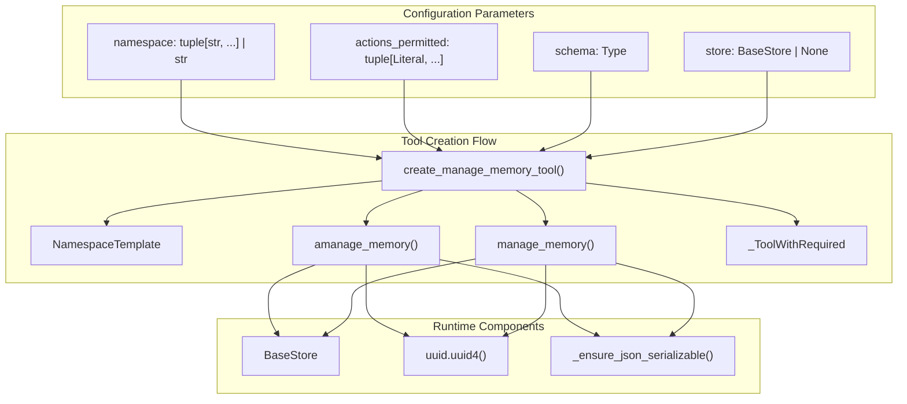
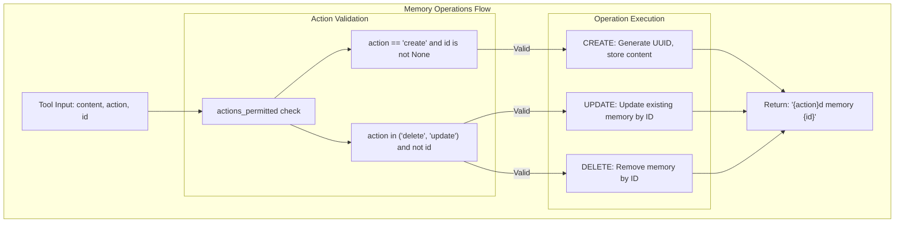
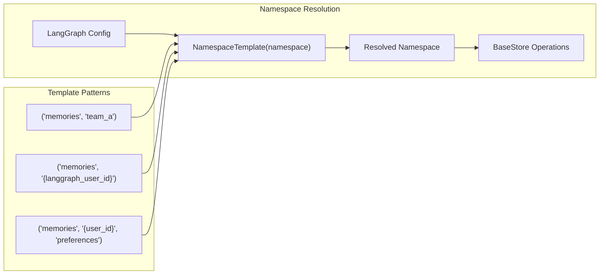
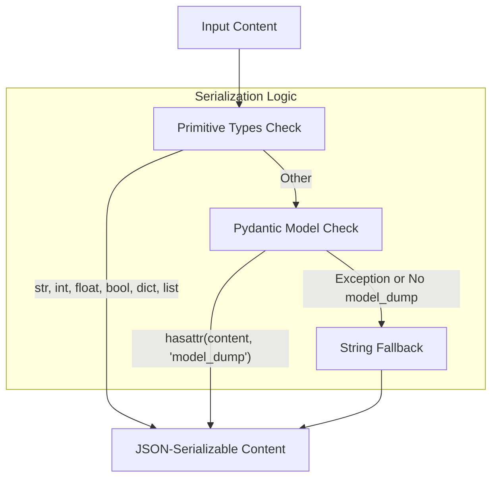

<!-- source: DeepWiki mcp.deepwiki.com · repo langchain-ai/langmem · page 5.1 Memory Creation and Management · fetched 2026-10-26 -->

# Memory Creation and Management

Relevant source files

The following files were used as context for generating this wiki page:

- [docs/docs/guides/extract_episodic_memories.md](docs/docs/guides/extract_episodic_memories.md)
- [docs/docs/guides/memory_tools.md](docs/docs/guides/memory_tools.md)
- [docs/docs/guides/use_tools_in_crewai.md](docs/docs/guides/use_tools_in_crewai.md)
- [src/langmem/knowledge/tools.py](src/langmem/knowledge/tools.py)

This page covers the `create_manage_memory_tool` function, which creates tools that agents can use to create, update, and delete persistent memories. This function is the primary interface for agent-driven memory management in hot path scenarios.

For information about searching existing memories, see [Memory Search and Retrieval](#5.2). For background memory processing without agent tools, see [Background Memory Processing](#3.2).

## Tool Creation Overview

The `create_manage_memory_tool` function creates a `StructuredTool` that agents can use to manage persistent memories stored in a LangGraph `BaseStore`. The tool supports three primary operations: create, update, and delete memories.

Sources: [src/langmem/knowledge/tools.py:25-357]()

## Function Signature and Parameters

The `create_manage_memory_tool` function accepts several key parameters for configuration:

| Parameter | Type | Default | Description |
|-----------|------|---------|-------------|
| `namespace` | `tuple[str, ...] \| str` | Required | Namespace structure for organizing memories |
| `instructions` | `str` | Predefined guidelines | Custom instructions for tool usage |
| `schema` | `Type` | `str` | Type hint for memory content validation |
| `actions_permitted` | `tuple[Literal, ...] \| None` | `("create", "update", "delete")` | Allowed operations |
| `store` | `BaseStore \| None` | `None` | BaseStore instance (uses runtime store if None) |
| `name` | `str` | `"manage_memory"` | Tool name identifier |

Sources: [src/langmem/knowledge/tools.py:25-39]()

## Memory Operations

The generated tool supports three primary memory operations through the `action` parameter:

### Create Operation

Creates a new memory with auto-generated UUID:

- Validates that no `id` is provided [src/langmem/knowledge/tools.py:283-286]()
- Generates new UUID using `uuid.uuid4()` [src/langmem/knowledge/tools.py:297]()
- Serializes content using `_ensure_json_serializable` [src/langmem/knowledge/tools.py:301]()
- Stores in BaseStore using `aput`/`put` [src/langmem/knowledge/tools.py:298-302]()

### Update Operation

Updates existing memory content:

- Requires valid `id` parameter [src/langmem/knowledge/tools.py:288-291]()
- Uses same storage mechanism as create [src/langmem/knowledge/tools.py:298-302]()
- Overwrites existing content at the specified key

### Delete Operation

Removes memory from storage:

- Requires valid `id` parameter [src/langmem/knowledge/tools.py:288-291]()
- Uses `adelete`/`delete` methods [src/langmem/knowledge/tools.py:294-295]()
- Returns confirmation message [src/langmem/knowledge/tools.py:295]()

Sources: [src/langmem/knowledge/tools.py:271-337]()

## Namespace Management

The tool uses `NamespaceTemplate` for dynamic namespace resolution:

The namespace template supports runtime variable substitution using LangGraph's configuration system. Common patterns include:

- **Static namespaces**: `("memories", "global")`
- **User-scoped**: `("memories", "{langgraph_user_id}")`
- **Team-scoped**: `("memories", "{team_id}", "shared")`
- **Multi-level**: `("memories", "{user_id}", "preferences")`

Sources: [src/langmem/knowledge/tools.py:263](), [src/langmem/knowledge/tools.py:292](), [src/langmem/knowledge/tools.py:326]()

## Content Serialization

The `_ensure_json_serializable` function handles content serialization:

The serialization process:

1. **Primitive types**: Direct pass-through for `str`, `int`, `float`, `bool`, `dict`, `list` [src/langmem/knowledge/tools.py:502-503]()
2. **Pydantic models**: Use `model_dump(mode="json")` [src/langmem/knowledge/tools.py:506]()
3. **Fallback**: Convert to string [src/langmem/knowledge/tools.py:509]()

Sources: [src/langmem/knowledge/tools.py:500-511]()

## Schema Validation

The `schema` parameter provides type hints for memory content validation. The tool dynamically creates type annotations based on the provided schema:

- **Default**: `str` type for simple text memories
- **Custom**: Any Python type, commonly Pydantic models for structured data
- **Integration**: Schema becomes part of the tool's function signature [src/langmem/knowledge/tools.py:272](), [src/langmem/knowledge/tools.py:306]()

Sources: [src/langmem/knowledge/tools.py:33](), [src/langmem/knowledge/tools.py:266]()

## Actions Permission Control

The `actions_permitted` parameter controls which operations the tool supports:

| Configuration | Allowed Operations | Use Case |
|--------------|-------------------|----------|
| `("create", "update", "delete")` | All operations | Full memory management |
| `("create", "update")` | Create and modify only | Prevent accidental deletion |
| `("create",)` | Create only | Append-only logging |
| `("update",)` | Update only | Profile management |

The tool validates actions at runtime and generates appropriate error messages for invalid operations [src/langmem/knowledge/tools.py:278-281]().

Sources: [src/langmem/knowledge/tools.py:34-36](), [src/langmem/knowledge/tools.py:264-268]()

## Store Integration

The tool integrates with LangGraph's BaseStore system through the `_get_store` helper function:

- **Provided store**: Uses the explicitly provided `BaseStore` instance
- **Runtime store**: Retrieves store from LangGraph context using `get_store()` [src/langmem/knowledge/tools.py:494]()
- **Error handling**: Raises `ConfigurationError` if no store available [src/langmem/knowledge/tools.py:497]()

Sources: [src/langmem/knowledge/tools.py:489-498](), [src/langmem/knowledge/tools.py:277](), [src/langmem/knowledge/tools.py:311]()

## Tool Schema Enhancement

The `_ToolWithRequired` class extends `StructuredTool` to ensure proper schema generation with required fields:

- Inherits from `StructuredTool` [src/langmem/knowledge/tools.py:513]()
- Uses `@functools.cached_property` for performance [src/langmem/knowledge/tools.py:514-515]()
- Applies `_ensure_schema_contains_required` to guarantee required fields [src/langmem/knowledge/tools.py:529-530]()

Sources: [src/langmem/knowledge/tools.py:513-531](), [src/langmem/knowledge/tools.py:354-356]()

---

