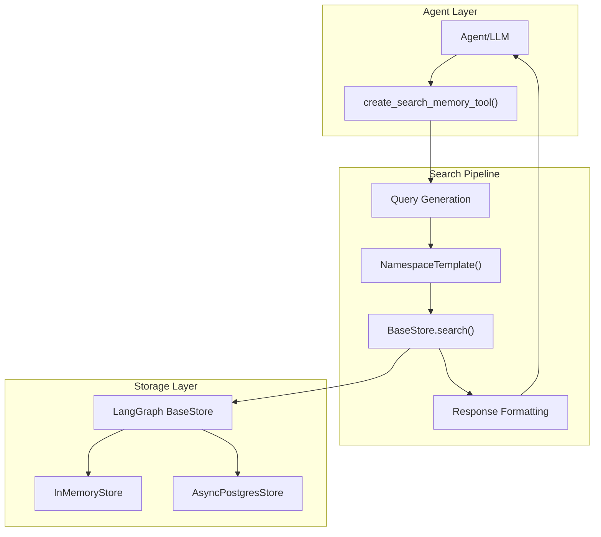
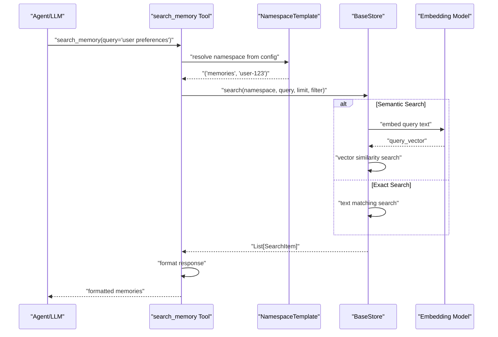
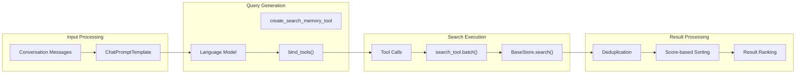

<!-- source: DeepWiki mcp.deepwiki.com · repo langchain-ai/langmem · page 5.2 Memory Search and Retrieval · fetched 2026-10-26 -->

# Memory Search and Retrieval

<details>
<summary>Relevant source files</summary>

The following files were used as context for generating this wiki page:

- [src/langmem/knowledge/extraction.py](src/langmem/knowledge/extraction.py)
- [src/langmem/knowledge/tools.py](src/langmem/knowledge/tools.py)

</details>


This document covers LangMem's memory search and retrieval capabilities, specifically focusing on the `create_search_memory_tool` function and related search functionality. This enables agents to find and retrieve relevant memories from their persistent storage during conversations.

For information about creating and managing memories, see [Memory Creation and Management](#5.1). For namespace organization patterns, see [Using Namespaces](#5.3).

## Overview

LangMem provides two primary approaches for memory search and retrieval:

1. **Agent-driven search tools** - Tools that agents can call to search their memories
2. **Automated search pipelines** - Background systems that automatically find relevant context

The search system integrates with LangGraph's `BaseStore` to perform both semantic and exact matching searches across organized memory namespaces.

**Memory Search Architecture**



Sources: [src/langmem/knowledge/tools.py:362-487](), [src/langmem/knowledge/extraction.py:695-816]()

## Search Tool Creation

The `create_search_memory_tool` function creates a structured tool that agents can use to search their persistent memories.

### Function Signature

```python
def create_search_memory_tool(
    namespace: tuple[str, ...] | str,
    *,
    instructions: str = "",
    store: BaseStore | None = None,
    response_format: Literal["content", "content_and_artifact"] = "content",
    name: str = "search_memory",
) -> StructuredTool
```

### Key Parameters

| Parameter | Type | Description |
|-----------|------|-------------|
| `namespace` | `tuple[str, ...]` | Storage namespace with template placeholders like `{langgraph_user_id}` |
| `instructions` | `str` | Custom instructions for when to use the search tool |
| `store` | `BaseStore \| None` | Optional store instance; uses LangGraph context if None |
| `response_format` | `Literal` | Either `"content"` or `"content_and_artifact"` |
| `name` | `str` | Tool name for agent recognition |

The namespace parameter supports runtime template resolution through `NamespaceTemplate`, allowing dynamic namespace construction based on configuration values.

Sources: [src/langmem/knowledge/tools.py:362-379](), [src/langmem/utils.py:NamespaceTemplate]()

## Search Query Patterns

The search tool accepts several query parameters that control how memories are retrieved:

### Tool Function Signature

```python
def search_memory(
    query: str,
    *,
    limit: int = 10,
    offset: int = 0, 
    filter: Optional[dict] = None,
) -> Union[str, Tuple[str, List[SearchItem]]]
```

### Query Types

**Semantic Search**
- Uses vector embeddings to find conceptually similar memories
- Requires store configured with embedding model
- Query example: `"user preferences about dark mode"`

**Exact Matching** 
- Searches for specific terms or phrases
- Works with any store implementation
- Query example: `"dark mode"`

**Filtered Search**
- Combines text search with metadata filters
- Uses `filter` parameter with key-value pairs
- Example: `{"type": "preference", "category": "ui"}`

**Search Tool Integration Flow**



Sources: [src/langmem/knowledge/tools.py:456-474](), [src/langmem/knowledge/tools.py:436-454]()

## Response Formats

The search tool supports two response formats controlled by the `response_format` parameter:

### Content Only Format

When `response_format="content"` (default):
- Returns serialized JSON string of memory contents
- Optimized for direct agent consumption
- Excludes metadata and search artifacts

```python
# Returns string like:
'[{"namespace": ["memories", "user-123"], "key": "pref-1", "value": {...}}]'
```

### Content and Artifact Format

When `response_format="content_and_artifact"`:
- Returns tuple of `(serialized_content, raw_search_items)`
- Provides access to `SearchItem` objects with scores and metadata
- Useful for advanced processing or ranking

```python
# Returns tuple like:
(
    '[{...}]',  # Serialized JSON string
    [SearchItem(...), SearchItem(...)]  # Raw objects with .score, .created_at, etc.
)
```

Sources: [src/langmem/knowledge/tools.py:452-454](), [src/langmem/knowledge/tools.py:472-474]()

## Automated Search Pipeline

LangMem also provides `create_memory_searcher` for automated memory retrieval with LLM-generated queries.

### Pipeline Architecture



The pipeline uses `tool_choice="search_memory"` to ensure the model generates appropriate search queries, then executes multiple searches in parallel and ranks results by relevance score.

Sources: [src/langmem/knowledge/extraction.py:777-815](), [src/langmem/knowledge/extraction.py:786-804]()

## Integration Examples

### ReAct Agent Integration

```python
from langgraph.prebuilt import create_react_agent
from langmem import create_search_memory_tool

search_tool = create_search_memory_tool(
    namespace=("memories", "{langgraph_user_id}"),
)

agent = create_react_agent(
    "anthropic:claude-3-5-sonnet-latest",
    tools=[search_tool],
    store=store,
)
```

### Custom Agent Integration

The search tool integrates with any agent framework that supports structured tools:

```python
# Agent can call the tool with:
result = await search_tool.ainvoke({
    "query": "user preferences about themes",
    "limit": 5,
    "filter": {"category": "ui"}
})
```

Sources: [src/langmem/knowledge/tools.py:406-431]()

## Error Handling

The search system includes several error conditions:

### Store Configuration Errors

When no store is available, the tool raises a `ConfigurationError`:

```python
# From _get_store function
try:
    store = get_store()
except RuntimeError as e:
    raise errors.ConfigurationError("Could not get store") from e
```

### Namespace Resolution Errors

Invalid namespace templates or missing configuration values cause runtime errors during namespace resolution.

Sources: [src/langmem/knowledge/tools.py:489-498](), [src/langmem/errors.py:ConfigurationError]()

## Performance Considerations

### Search Optimization

- **Limit Control**: Use appropriate `limit` values to balance context vs performance
- **Offset Pagination**: For large result sets, use `offset` for pagination
- **Parallel Searches**: Automated pipeline executes multiple queries concurrently
- **Result Deduplication**: Pipeline automatically deduplicates results across searches

### Store Configuration

Search performance depends heavily on the underlying `BaseStore` implementation:
- **InMemoryStore**: Fast for development, limited scalability
- **AsyncPostgresStore**: Production-ready with persistent storage
- **Vector Indexing**: Configure embedding dimensions and models for semantic search

Sources: [src/langmem/knowledge/extraction.py:994-1004](), [src/langmem/knowledge/tools.py:445-451]()

---

