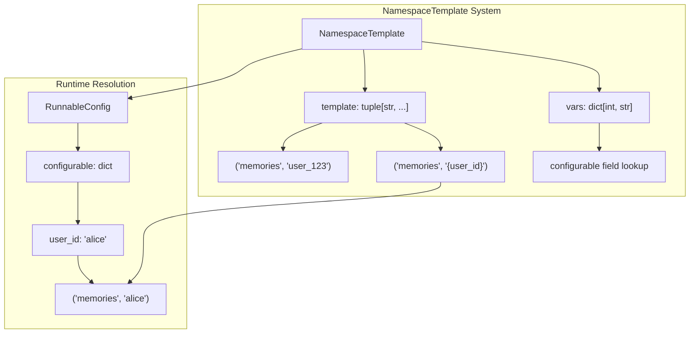
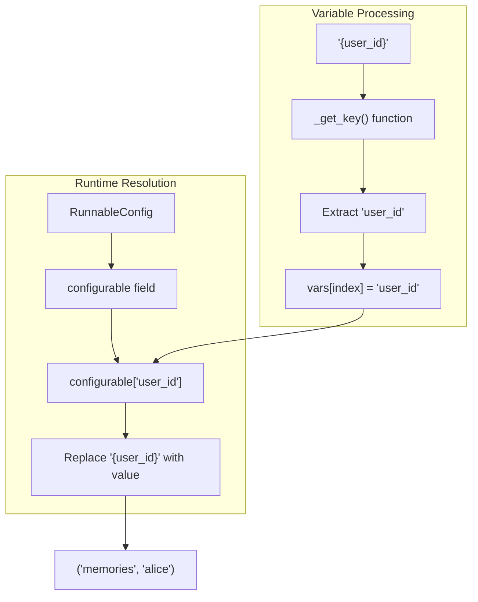
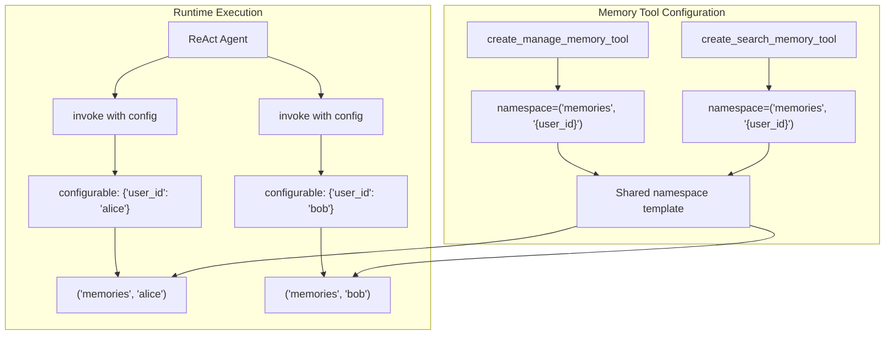
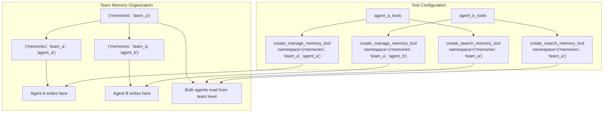
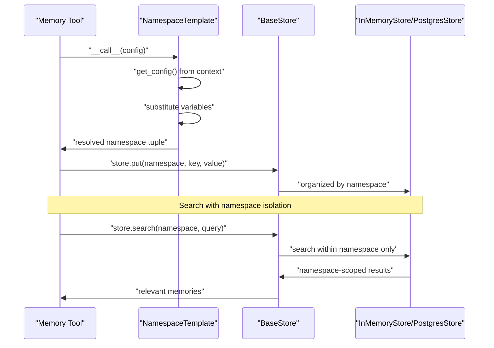
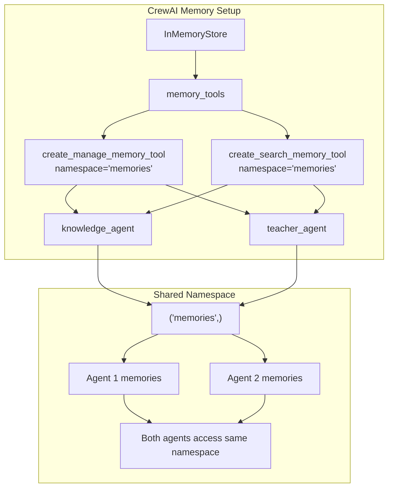
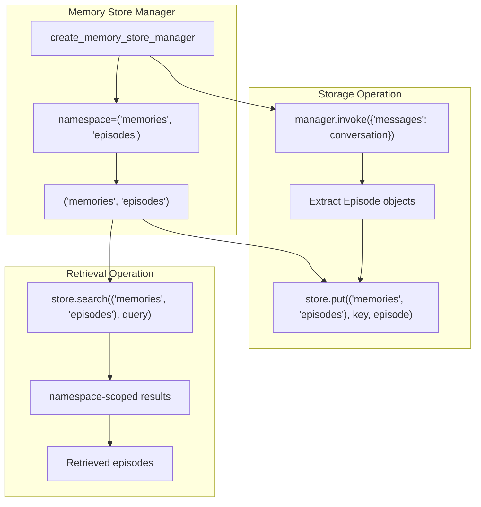
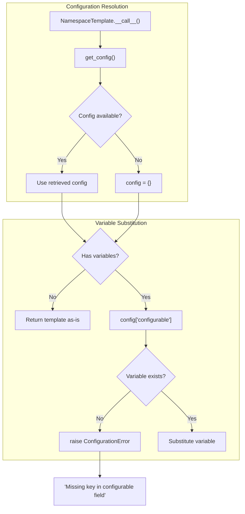

<!-- source: DeepWiki mcp.deepwiki.com · repo langchain-ai/langmem · page 5.3 Using Namespaces · fetched 2026-10-26 -->

# Using Namespaces

Relevant source files

The following files were used as context for generating this wiki page:

- [src/langmem/knowledge/tools.py](src/langmem/knowledge/tools.py)
- [src/langmem/utils.py](src/langmem/utils.py)

This document explains how to organize and isolate memories using namespaces in langmem. Namespaces provide hierarchical organization and enable multi-tenancy by creating isolated memory spaces for different users, teams, or projects.

For information about memory storage backends, see [Storage Types](#7.1). For memory organization strategies, see [Namespace Organization](#7.2).

## Purpose and Structure

Namespaces in langmem are implemented as tuples of strings that create hierarchical paths for organizing memories. They enable isolation between different contexts and support dynamic variable substitution at runtime.

### Namespace Template System

The `NamespaceTemplate` class handles dynamic namespace resolution with variable substitution from `RunnableConfig`:

Sources: [src/langmem/utils.py:15-92]()

### Namespace Hierarchy Patterns

Common namespace organization patterns support different use cases:

| Pattern | Structure | Use Case |
|---------|-----------|----------|
| Personal | `("memories", "{user_id}")` | Individual user memories |
| Team | `("memories", "team-{team_id}")` | Shared team knowledge |
| Multi-level | `("memories", "team_a", "agent_a")` | Agent-specific within team |
| Global | `("global",)` | System-wide shared memories |
| Project | `("memories", "project-{project_id}")` | Project-specific isolation |

Sources: [docs/docs/guides/memory_tools.md:59-70]()

## Dynamic Variable Substitution

The `NamespaceTemplate` class supports runtime variable substitution using curly brace syntax:

Sources: [src/langmem/utils.py:67-71](), [src/langmem/utils.py:94-95]()

### Implementation Details

The `NamespaceTemplate.__call__` method performs the substitution:

- Retrieves config using `get_config()` from langgraph context
- Accesses the `configurable` field from `RunnableConfig`
- Substitutes variables using the `vars` mapping
- Raises `ConfigurationError` for missing keys

Sources: [src/langmem/utils.py:73-91]()

## Memory Tool Integration

Memory tools use namespaces to organize and isolate memories across different contexts:

Sources: [docs/docs/guides/memory_tools.md:36-37]()

### Multi-Agent Namespace Patterns

Complex systems can use hierarchical namespaces for different read/write access patterns:

Sources: [docs/docs/guides/memory_tools.md:88-93](), [docs/docs/guides/memory_tools.md:105-109]()

## Storage Integration

Namespaces integrate with the `BaseStore` interface to provide organized memory access:

Sources: [src/langmem/utils.py:73-91]()

## CrewAI Integration

CrewAI agents use fixed namespaces since they don't have access to `RunnableConfig`:

Sources: [docs/docs/guides/use_tools_in_crewai.md:35-38]()

## Background Processing Integration

Background memory processing also uses namespaces for organization:

Sources: [docs/docs/guides/extract_episodic_memories.md:102-103]()

## Error Handling

The `NamespaceTemplate` system provides robust error handling for configuration issues:

Sources: [src/langmem/utils.py:74-89]()

## Best Practices

### Namespace Design Patterns

1. **Consistent Hierarchy**: Use consistent namespace structures across your application
2. **Variable Naming**: Use descriptive variable names like `{user_id}` instead of `{id}`
3. **Depth Management**: Keep namespace depth reasonable (2-4 levels typically)
4. **Isolation**: Ensure proper isolation between different contexts

### Configuration Management

1. **Required Variables**: Always provide required variables in the `configurable` field
2. **Error Handling**: Handle `ConfigurationError` for missing variables
3. **Context Awareness**: Use `get_config()` for automatic context retrieval in LangGraph

Sources: [src/langmem/utils.py:86-89]()

---

