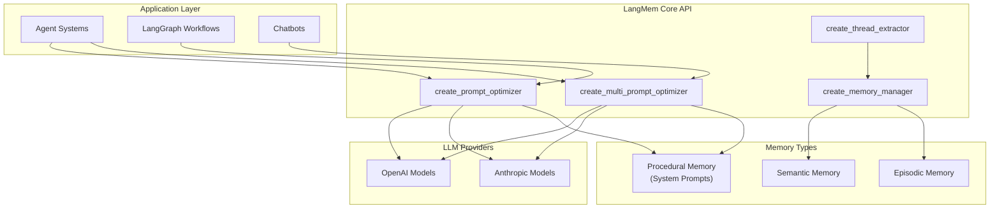
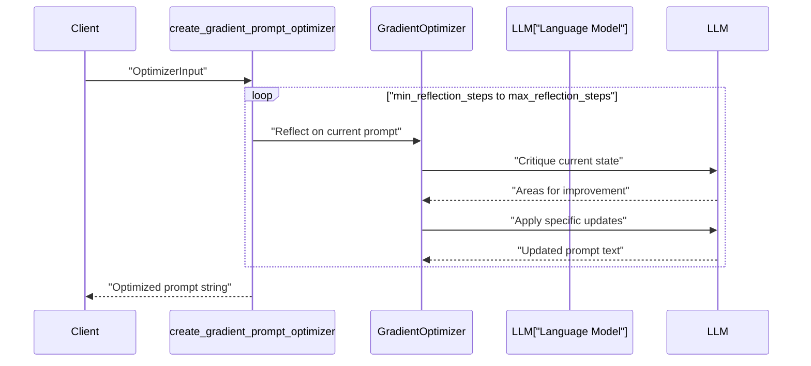
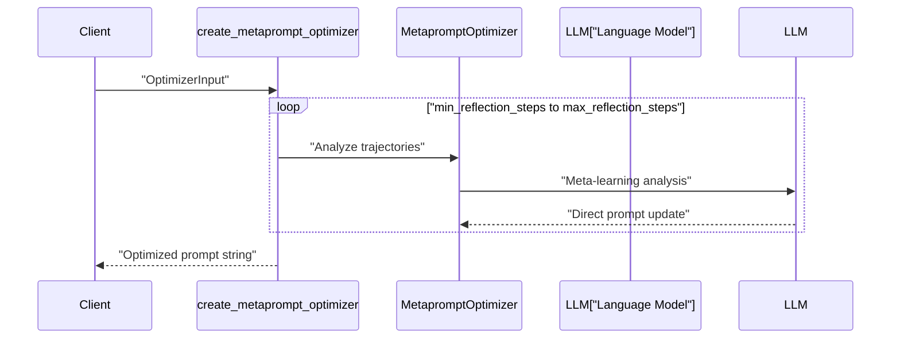
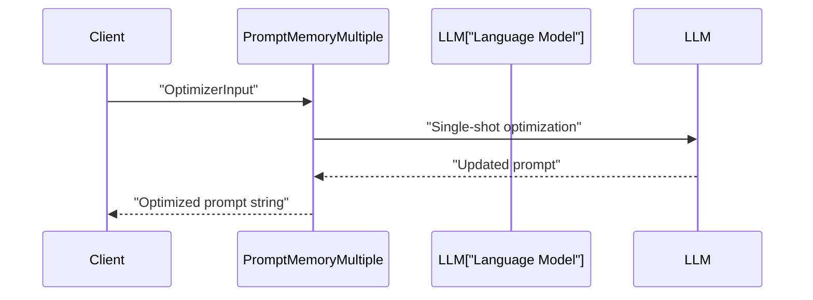
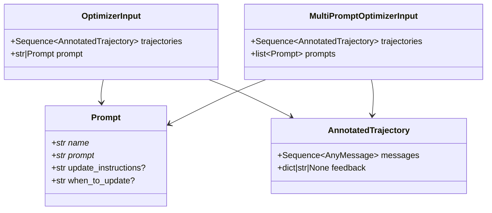
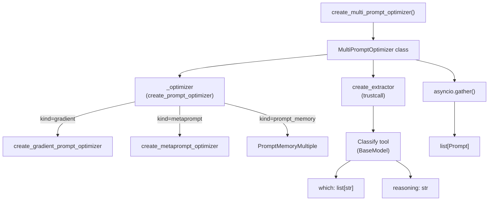
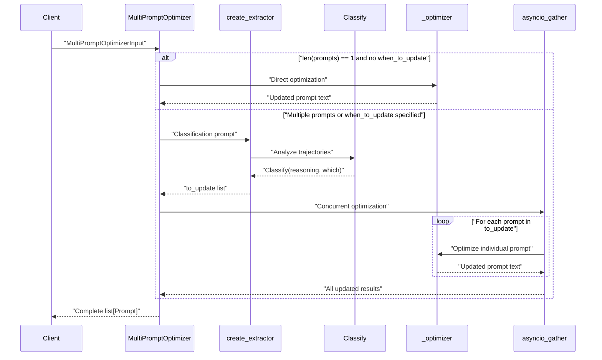
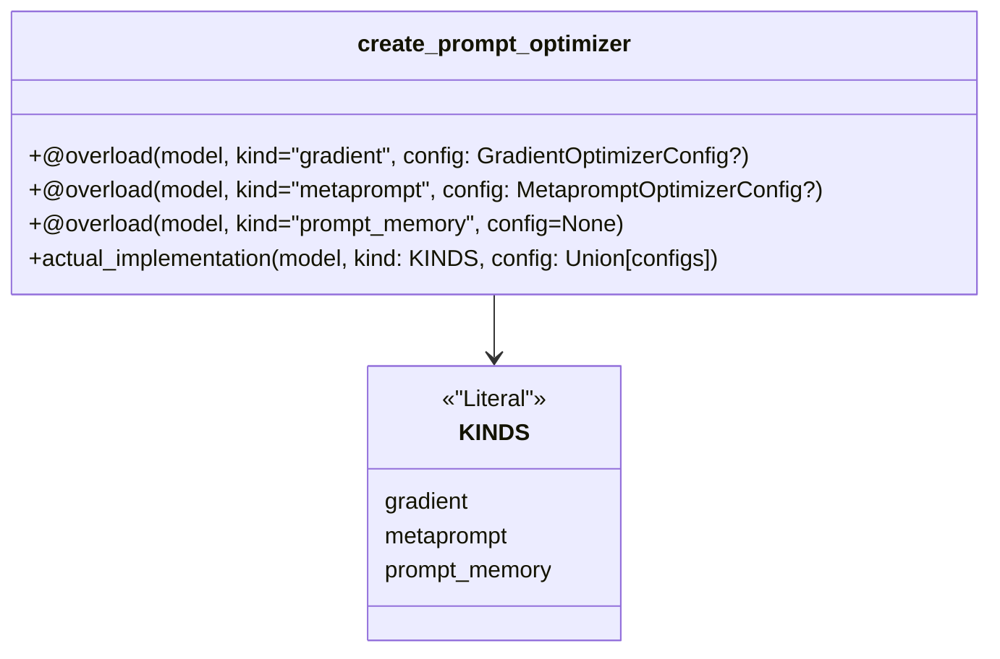
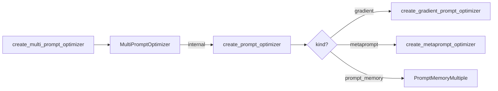
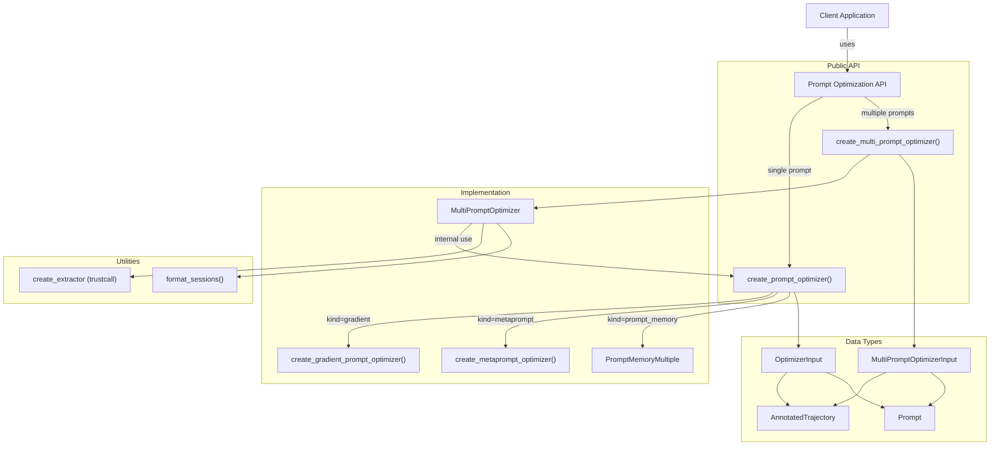

<!-- source: DeepWiki mcp.deepwiki.com · repo langchain-ai/langmem · page 6 Prompt Optimization · fetched 2026-10-26 -->

# Prompt Optimization

<details>
<summary>Relevant source files</summary>

The following files were used as context for generating this wiki page:

- [docs/docs/reference/index.md](docs/docs/reference/index.md)
- [src/langmem/__init__.py](src/langmem/__init__.py)
- [src/langmem/prompts/optimization.py](src/langmem/prompts/optimization.py)
- [src/langmem/prompts/types.py](src/langmem/prompts/types.py)

</details>


LangMem's prompt optimization system provides tools for iteratively improving LLM prompts based on conversation history and feedback. The system enables both single prompt optimization and multi-prompt optimization with different strategies to adapt to varying performance requirements and cost constraints.

For information about managing prompts as procedural memory, see [Key Concepts](1.2).

## Overview

LangMem's prompt optimization capabilities are exposed through two main functions in the public API:

- `create_prompt_optimizer` - Optimizes individual prompts using configurable strategies
- `create_multi_prompt_optimizer` - Optimizes multiple related prompts while maintaining consistency

These functions analyze `AnnotatedTrajectory` objects (conversation history with feedback) and return optimized prompt text that should perform better on similar future interactions.

## Integration with LangMem Ecosystem

Prompt optimization integrates with LangMem's broader memory management system:



Sources: [src/langmem/__init__.py:9-13](), [src/langmem/prompts/optimization.py:50-269]()

## Single Prompt Optimization

The `create_prompt_optimizer` function creates an optimizer that analyzes and improves individual prompts based on conversation trajectories and feedback.

```python
def create_prompt_optimizer(
    model: str | BaseChatModel,
    kind: Literal["gradient", "prompt_memory", "metaprompt"] = "gradient",
    config: Optional[Union[GradientOptimizerConfig, MetapromptOptimizerConfig]] = None,
) -> Runnable[prompt_types.OptimizerInput, str]:
    """Create a prompt optimizer that improves prompt effectiveness."""
```

## Optimization Strategies

The `create_prompt_optimizer` function supports three optimization strategies through the `kind` parameter:

### Strategy: `kind="gradient"`



- **Implementation**: Uses `create_gradient_prompt_optimizer` from `langmem.prompts.gradient`
- **Configuration**: `GradientOptimizerConfig` with `gradient_prompt`, `metaprompt`, and reflection step limits
- **LLM Calls**: 2 per reflection step (critique + update), total 4-10 calls
- **Best for**: Thorough optimization with separation of concerns

### Strategy: `kind="metaprompt"`



- **Implementation**: Uses `create_metaprompt_optimizer` from `langmem.prompts.metaprompt`
- **Configuration**: `MetapromptOptimizerConfig` with `metaprompt` and reflection step limits
- **LLM Calls**: 1 per reflection step, total 2-5 calls
- **Best for**: Balanced speed and improvement quality

### Strategy: `kind="prompt_memory"`



- **Implementation**: Uses `PromptMemoryMultiple` from `langmem.prompts.stateless`
- **Configuration**: No additional configuration required
- **LLM Calls**: 1 total
- **Best for**: Fast, simple updates with minimal cost

Sources: [src/langmem/prompts/optimization.py:23-269](), [src/langmem/prompts/optimization.py:260-265]()

### Performance Comparison

| Strategy | LLM Calls | Implementation | Configuration Type | Best For |
|----------|-----------|----------------|-------------------|----------|
| `prompt_memory` | 1 | `PromptMemoryMultiple` | None | Fast, simple updates |
| `metaprompt` | 1-5 | `create_metaprompt_optimizer` | `MetapromptOptimizerConfig` | Balanced cost/quality |
| `gradient` | 2-10 | `create_gradient_prompt_optimizer` | `GradientOptimizerConfig` | Thorough optimization |

The `gradient` strategy uses 2 LLM calls per reflection step (critique + update), while `metaprompt` uses 1 call per step. Both support configurable `min_reflection_steps` and `max_reflection_steps` (defaults: min=1, max=3 for gradient; min=1, max=3 for metaprompt).

Sources: [src/langmem/prompts/optimization.py:236-258](), [src/langmem/prompts/optimization.py:112-117](), [src/langmem/prompts/optimization.py:140-144]()

## Data Types

### Prompt TypedDict

The optimization system uses the `Prompt` TypedDict for structured prompt management:



The `Prompt` TypedDict structure provides:
- `name` (Required): Unique identifier for the prompt
- `prompt` (Required): The actual prompt text to optimize
- `update_instructions` (Optional): Guidelines for how to modify the prompt
- `when_to_update` (Optional): Dependencies between prompts during multi-prompt optimization

### Input Types

- `OptimizerInput`: Used by `create_prompt_optimizer`, contains trajectories and a single prompt
- `MultiPromptOptimizerInput`: Used by `create_multi_prompt_optimizer`, contains trajectories and multiple prompts
- `AnnotatedTrajectory`: Conversation messages with optional feedback for optimization analysis

Sources: [src/langmem/prompts/types.py:7-34](), [src/langmem/prompts/types.py:62-93](), [src/langmem/prompts/types.py:95-136]()

### Usage Example

```python
from langmem import create_prompt_optimizer

optimizer = create_prompt_optimizer("anthropic:claude-3-5-sonnet-latest")

# Example conversation with feedback
conversation = [
    {"role": "user", "content": "Tell me about the solar system"},
    {"role": "assistant", "content": "The solar system consists of..."},
]
feedback = {"clarity": "needs more structure"}

# Use conversation history to improve the prompt
trajectories = [(conversation, feedback)]
better_prompt = await optimizer.ainvoke(
    {"trajectories": trajectories, "prompt": "You are an astronomy expert"}
)
print(better_prompt)
```

Sources: [src/langmem/prompts/optimization.py:169-187]()

## Multi-Prompt Optimization

The `create_multi_prompt_optimizer` function creates a `MultiPromptOptimizer` that optimizes multiple related prompts while maintaining consistency. This is essential for prompt chains, multi-agent systems, and complex workflows.

### Multi-Prompt Architecture



The `MultiPromptOptimizer` class:
1. Initializes with a single-prompt optimizer (`_optimizer`) internally
2. Uses `create_extractor` with a `Classify` tool to determine which prompts need updates
3. Optimizes selected prompts concurrently using `asyncio.gather`
4. Returns the complete prompt list with updates applied

Sources: [src/langmem/prompts/optimization.py:272-287](), [src/langmem/prompts/optimization.py:471-616]()

### Multi-Prompt Optimization Workflow



### Classification Process

The multi-prompt optimizer uses a `Classify` tool created with `create_extractor` to determine which prompts need updates:

1. **Analysis**: Examines `trajectories` (conversation history with feedback)
2. **Evaluation**: Identifies which named prompts contributed to performance issues  
3. **Selection**: Returns `which` list containing prompt names to update
4. **Validation**: Ensures selected names exist in the provided prompts list

The classifier uses this prompt template:
```text
Analyze the following trajectories and decide which prompts 
ought to be updated to improve the performance on future trajectories:

{sessions_str}

Below are the prompts being optimized:
{prompt_joined_content}
```

Sources: [src/langmem/prompts/optimization.py:289-373](), [src/langmem/prompts/optimization.py:317-350](), [src/langmem/prompts/optimization.py:356-363]()

## Implementation Details

### Function Signatures and Overloads

The `create_prompt_optimizer` function uses Python overloads for type safety:



### Factory Pattern Implementation

Both optimizer functions follow a factory pattern:



### Error Handling

The system includes validation for:
- Invalid `kind` values: raises `NotImplementedError` with expected options
- Invalid prompt names in classification: `Classify` model validator ensures names exist in choices
- Type safety through overloads and TypedDict structures

Sources: [src/langmem/prompts/optimization.py:26-48](), [src/langmem/prompts/optimization.py:260-269](), [src/langmem/prompts/optimization.py:327-334]()

### Usage Example

```python
from langmem import create_multi_prompt_optimizer

optimizer = create_multi_prompt_optimizer("anthropic:claude-3-5-sonnet-latest")

# Example conversation with feedback
conversation = [
    {"role": "user", "content": "Tell me about the solar system"},
    {"role": "assistant", "content": "The solar system consists of..."},
]
feedback = {"clarity": "needs more structure"}

# Define multiple prompts to optimize
prompts = [
    {"name": "research", "prompt": "Research the given topic thoroughly"},
    {"name": "summarize", "prompt": "Summarize the research findings"},
]

# Use conversation history to improve the prompts
trajectories = [(conversation, feedback)]
better_prompts = await optimizer.ainvoke(
    {"trajectories": trajectories, "prompts": prompts}
)
print(better_prompts)
```

Sources: [src/langmem/prompts/optimization.py:538-562]()

## Implementation Architecture

Title: Complete Prompt Optimization Implementation Architecture



Sources: [src/langmem/prompts/optimization.py:1-619](), [src/langmem/prompts/types.py:1-136]()

## Integration with LangMem

The prompt optimization system integrates with the broader LangMem ecosystem:

1. It supports the same storage patterns as other LangMem components
2. It can be used with other LangMem memory types, particularly for procedural memory
3. It can be integrated with both agent-driven and background memory processes

When used in conjunction with LangMem's memory management, prompt optimization enables systems to:
1. Store and retrieve optimized prompts
2. Apply learned improvements across different contexts
3. Continuously refine prompts based on ongoing interactions

Sources: [src/langmem/prompts/__init__.py:1-28]()

---

