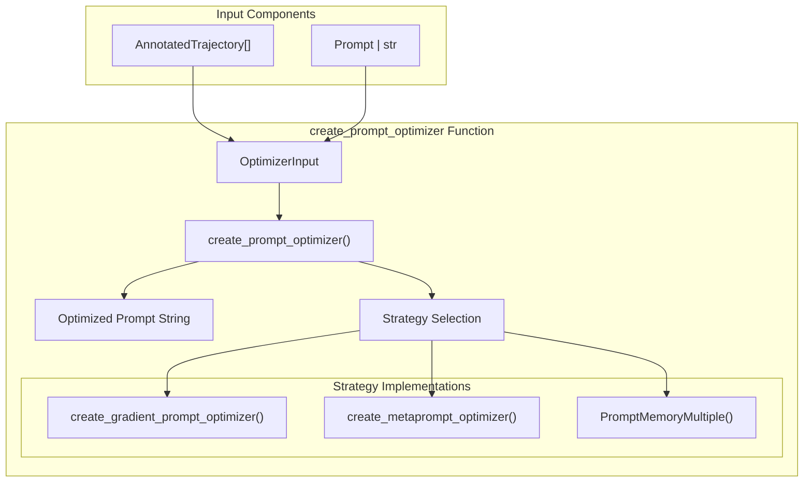
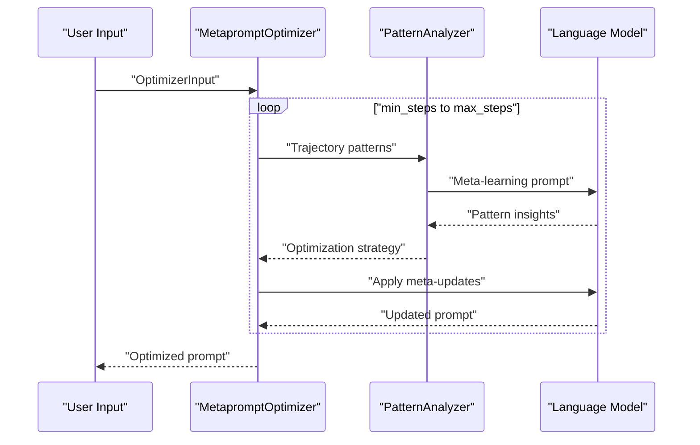
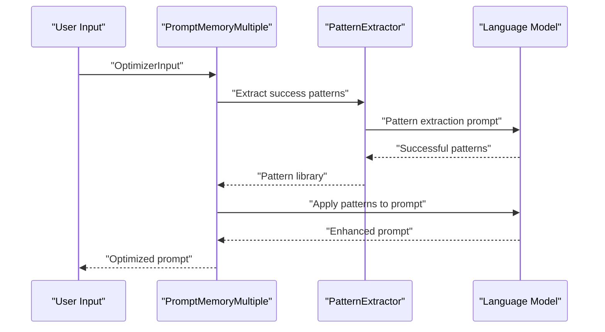
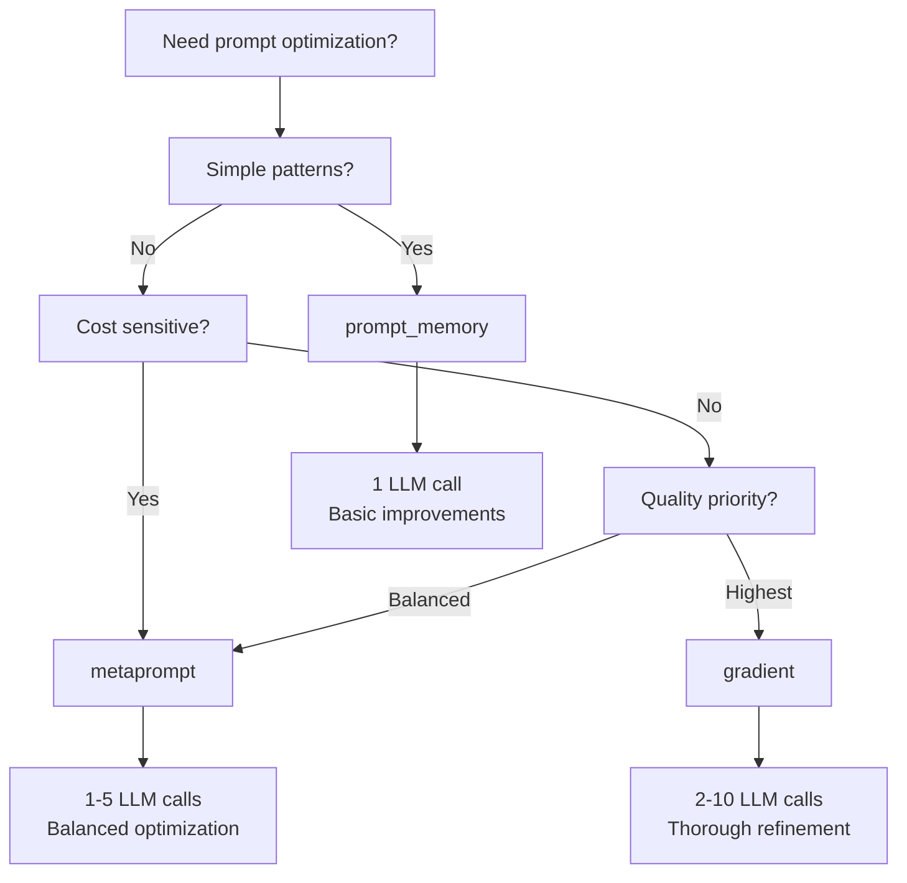
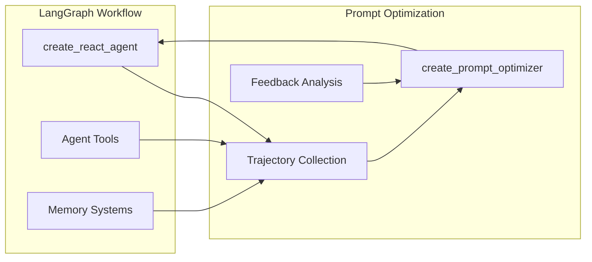

<!-- source: DeepWiki mcp.deepwiki.com · repo langchain-ai/langmem · page 6.1 Single Prompt Optimization · fetched 2026-10-26 -->

# Single Prompt Optimization

<details>
<summary>Relevant source files</summary>

The following files were used as context for generating this wiki page:

- [docs/docs/reference/index.md](docs/docs/reference/index.md)
- [src/langmem/__init__.py](src/langmem/__init__.py)
- [src/langmem/prompts/optimization.py](src/langmem/prompts/optimization.py)
- [src/langmem/prompts/types.py](src/langmem/prompts/types.py)

</details>


Single prompt optimization in LangMem provides automated improvement of individual prompts through iterative refinement using conversation feedback and trajectory analysis. This page covers the `create_prompt_optimizer` function and its three optimization strategies for enhancing prompt effectiveness.

For information about optimizing multiple prompts simultaneously, see [Multi-Prompt Optimization](#6.2). For the general overview of prompt optimization capabilities, see [Prompt Optimization](#6).

## Overview

The `create_prompt_optimizer` function creates a `Runnable` that analyzes conversation trajectories and feedback to iteratively improve prompt quality. It accepts three different optimization strategies, each with distinct approaches to prompt refinement.



**Single Prompt Optimizer Architecture**

Sources: [src/langmem/prompts/optimization.py:50-269]()

## Function Signature and Parameters

The `create_prompt_optimizer` function provides type-safe overloads for each optimization strategy:

| Parameter | Type | Description |
|-----------|------|-------------|
| `model` | `str \| BaseChatModel` | Language model for optimization |
| `kind` | `"gradient" \| "metaprompt" \| "prompt_memory"` | Optimization strategy |
| `config` | Strategy-specific config | Optional configuration object |

The function returns a `Runnable[OptimizerInput, str]` that processes conversation trajectories and returns an optimized prompt string.

Sources: [src/langmem/prompts/optimization.py:26-58]()

## Optimization Strategies

### Gradient Strategy

The gradient optimizer uses a two-phase approach separating critique generation from prompt updates through reflection cycles.

```mermaid
sequenceDiagram
    participant USER as "User Input"
    participant OPT as "GradientOptimizer"
    participant REFL as "ReflectionChain"
    participant UPD as "UpdateChain"
    participant LLM as "Language Model"
    
    USER->>OPT: "OptimizerInput"
    
    loop "min_steps to max_steps"
        OPT->>REFL: "Current prompt + feedback"
        REFL->>LLM: "Analyze and critique"
        LLM-->>REFL: "Improvement suggestions"
        REFL-->>OPT: "Reflection results"
        
        OPT->>UPD: "Apply improvements"
        UPD->>LLM: "Update prompt text"
        LLM-->>UPD: "Updated prompt"
        UPD-->>OPT: "New prompt version"
    end
    
    OPT-->>USER: "Final optimized prompt"
```

**Gradient Optimization Flow**

The gradient strategy requires 2 LLM calls per iteration (reflection + update) and supports `GradientOptimizerConfig` for customization:

- `gradient_prompt`: Custom reflection prompt
- `metaprompt`: Custom update instructions  
- `max_reflection_steps`: Maximum iterations (default: 3)
- `min_reflection_steps`: Minimum iterations (default: 1)

Sources: [src/langmem/prompts/optimization.py:88-118](), [src/langmem/prompts/gradient.py]()

### Metaprompt Strategy

The metaprompt optimizer uses meta-learning to analyze patterns and directly propose prompt improvements in single steps.



**Metaprompt Optimization Flow**

The metaprompt strategy uses 1 LLM call per step and supports `MetapromptOptimizerConfig`:

- `metaprompt`: Custom meta-learning instructions
- `max_reflection_steps`: Maximum meta-steps (default: 3)  
- `min_reflection_steps`: Minimum meta-steps (default: 1)

Sources: [src/langmem/prompts/optimization.py:119-145](), [src/langmem/prompts/metaprompt.py]()

### Prompt Memory Strategy  

The prompt memory optimizer extracts successful patterns from conversation history for single-shot prompt enhancement.



**Prompt Memory Optimization Flow**

The prompt memory strategy requires only 1 LLM call total and learns directly from conversation history without additional configuration.

Sources: [src/langmem/prompts/optimization.py:146-166](), [src/langmem/prompts/stateless.py]()

## Data Structures

### OptimizerInput

The `OptimizerInput` TypedDict defines the input structure for single prompt optimization:

| Field | Type | Description |
|-------|------|-------------|
| `trajectories` | `Sequence[AnnotatedTrajectory] \| str` | Conversation history with feedback |
| `prompt` | `str \| Prompt` | Prompt to optimize |

### AnnotatedTrajectory

The `AnnotatedTrajectory` NamedTuple contains conversation messages with optional feedback:

| Field | Type | Description |
|-------|------|-------------|
| `messages` | `Sequence[AnyMessage]` | Conversation messages |
| `feedback` | `dict \| str \| None` | Optimization feedback |

### Prompt TypedDict

The `Prompt` TypedDict provides structured prompt management:

| Field | Type | Required | Description |
|-------|------|----------|-------------|
| `name` | `str` | Yes | Prompt identifier |
| `prompt` | `str` | Yes | Prompt text |
| `update_instructions` | `str \| None` | No | Modification guidelines |
| `when_to_update` | `str \| None` | No | Update conditions |

Sources: [src/langmem/prompts/types.py:7-93]()

## Usage Patterns

### Basic Optimization

```python
from langmem import create_prompt_optimizer

optimizer = create_prompt_optimizer("anthropic:claude-3-5-sonnet-latest")

trajectories = [AnnotatedTrajectory(
    messages=[
        {"role": "user", "content": "What's the weather?"},
        {"role": "assistant", "content": "I can't check weather"}
    ],
    feedback="Should use search tools"
)]

result = await optimizer.ainvoke({
    "trajectories": trajectories,
    "prompt": "You are a helpful assistant"
})
```

### Strategy Selection

```python
# Gradient optimization with custom config
gradient_optimizer = create_prompt_optimizer(
    "openai:gpt-4",
    kind="gradient",
    config=GradientOptimizerConfig(max_reflection_steps=5)
)

# Metaprompt optimization
meta_optimizer = create_prompt_optimizer(
    "openai:gpt-4", 
    kind="metaprompt"
)

# Simple prompt memory optimization
memory_optimizer = create_prompt_optimizer(
    "openai:gpt-4",
    kind="prompt_memory"
)
```

Sources: [src/langmem/prompts/optimization.py:167-234]()

## Performance Characteristics

### LLM Call Patterns

| Strategy | Calls per Step | Total Calls | Speed | Thoroughness |
|----------|----------------|-------------|-------|--------------|
| `prompt_memory` | 1 | 1 | Fastest | Limited |
| `metaprompt` | 1 | 1-5 | Moderate | Balanced |
| `gradient` | 2 | 2-10 | Slowest | Highest |

### Strategy Selection Guidelines



**Strategy Selection Decision Tree**

Sources: [src/langmem/prompts/optimization.py:236-258]()

### Integration with LangGraph

Single prompt optimizers integrate with LangGraph workflows through the standard `Runnable` interface, enabling use in agent chains and memory systems.



**LangGraph Integration Pattern**

Sources: [src/langmem/__init__.py:9-13](), [src/langmem/prompts/optimization.py:1-28]()

---

