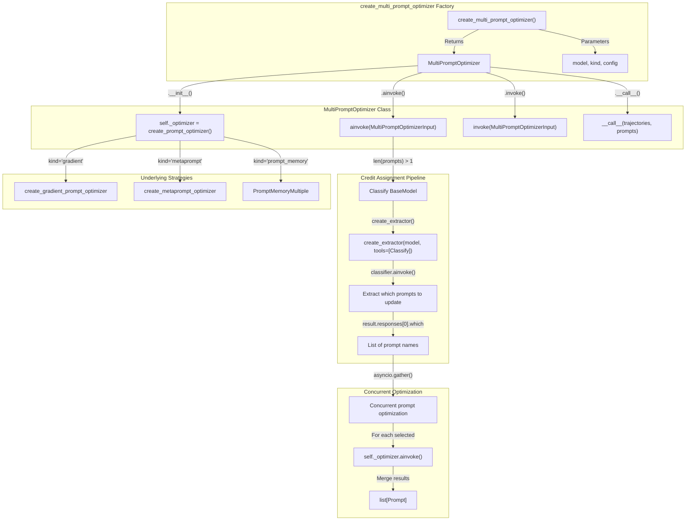

<!-- source: DeepWiki mcp.deepwiki.com · repo langchain-ai/langmem · page 6.2 Multi-Prompt Optimization · fetched 2026-10-26 -->

# Multi-Prompt Optimization

<details>
<summary>Relevant source files</summary>

The following files were used as context for generating this wiki page:

- [docs/docs/reference/index.md](docs/docs/reference/index.md)
- [src/langmem/__init__.py](src/langmem/__init__.py)
- [src/langmem/prompts/optimization.py](src/langmem/prompts/optimization.py)
- [src/langmem/prompts/types.py](src/langmem/prompts/types.py)

</details>


Multi-prompt optimization provides coordinated improvement of multiple interconnected prompts using classification-based prompt selection. The `create_multi_prompt_optimizer` function returns a `MultiPromptOptimizer` instance that analyzes conversation trajectories to determine which prompts contributed to performance issues and selectively updates only those prompts.

The system uses credit assignment through structured extraction to identify which prompts need optimization, then applies the same underlying optimization strategies as single-prompt optimization to the selected prompts.

## Core Concepts

Multi-prompt optimization addresses several key challenges when working with systems of prompts:

1. **Credit Assignment** - Determining which specific prompts contributed to performance issues from conversation trajectories
2. **Selective Updates** - Only updating prompts that need improvement rather than modifying all prompts indiscriminately  
3. **Consistency Maintenance** - Ensuring that changes to one prompt don't conflict with other prompts in the system
4. **Concurrent Optimization** - Optimizing multiple prompts simultaneously using the same underlying strategy

Sources: [src/langmem/prompts/optimization.py:471-477]()

## Implementation and Usage

### Factory Function

The `create_multi_prompt_optimizer` function creates a `MultiPromptOptimizer` instance:

```python
def create_multi_prompt_optimizer(
    model: str | BaseChatModel,
    /,
    *,
    kind: Literal["gradient", "prompt_memory", "metaprompt"] = "gradient",
    config: Optional[dict] = None,
) -> Runnable[MultiPromptOptimizerInput, list[Prompt]]
```

### Function Parameters

| Parameter | Type | Description |
|-----------|------|-------------|
| `model` | `str \| BaseChatModel` | Language model for optimization |
| `kind` | `Literal["gradient", "prompt_memory", "metaprompt"]` | Optimization strategy (default: "gradient") |
| `config` | `Optional[dict]` | Strategy-specific configuration passed to underlying `create_prompt_optimizer` |

### MultiPromptOptimizer Class Structure

The returned `MultiPromptOptimizer` extends `Runnable[MultiPromptOptimizerInput, list[Prompt]]` with these key attributes:

- `_optimizer`: Internal `create_prompt_optimizer` instance for individual prompt optimization
- `model`, `kind`, `config`: Configuration passed to constructor

### Input Types

Multi-prompt optimization uses structured input types from `langmem.prompts.types`:

**MultiPromptOptimizerInput**:
```python
{
    "trajectories": Sequence[AnnotatedTrajectory] | str,
    "prompts": list[Prompt]
}
```

**Prompt TypedDict**:
```python
{
    "name": str,                    # Required: prompt identifier
    "prompt": str,                  # Required: prompt text  
    "update_instructions": str,     # Optional: how to modify prompt
    "when_to_update": str          # Optional: dependencies for updates
}
```

**AnnotatedTrajectory**:
```python
AnnotatedTrajectory(
    messages=Sequence[AnyMessage],
    feedback=dict[str, str | int | bool] | str | None
)
```

Sources: [src/langmem/prompts/optimization.py:471-477](), [src/langmem/prompts/optimization.py:272-283](), [src/langmem/prompts/types.py:7-34](), [src/langmem/prompts/types.py:95-136]()

## Architecture and Code Entities

Multi-Prompt Optimization Code Structure



Sources: [src/langmem/prompts/optimization.py:471-616](), [src/langmem/prompts/optimization.py:272-290](), [src/langmem/prompts/optimization.py:336-373]()

## Execution Flow

MultiPromptOptimizer.ainvoke() Implementation Flow

```mermaid
flowchart TD
    subgraph "MultiPromptOptimizer.ainvoke() Method"
        Start["ainvoke(input: MultiPromptOptimizerInput)"] --> TraceStart["ls.trace('multi_prompt_optimizer.ainvoke')"]
        TraceStart --> ExtractInput["trajectories = input['trajectories']<br/>prompts = input['prompts']"]
        
        ExtractInput --> BuildChoices["choices = [p['name'] for p in prompts]"]
        BuildChoices --> FormatCheck["len(prompts) == 1 and prompts[0].get('when_to_update') is None?"]
        
        FormatCheck --> |"True"| DirectPath["updated_prompt = await self._optimizer(trajectories, prompts[0])"]
        DirectPath --> DirectReturn["Return [{...prompts[0], 'prompt': updated_prompt}]"]
        
        FormatCheck --> |"False"| MultiPath["Format sessions_str = utils.format_sessions(trajectories)"]
        MultiPath --> JoinPrompts["prompt_joined_content = join prompt names and content"]
        
        JoinPrompts --> DefineClassify["Define Classify(BaseModel) with reasoning and which fields"]
        DefineClassify --> CreateExtractor["classifier = create_extractor(self.model, tools=[Classify])"]
        
        CreateExtractor --> BuildPrompt["classification_prompt with sessions_str + prompt_joined_content"]
        BuildPrompt --> ExtractCall["result = await classifier.ainvoke(classification_prompt)"]
        
        ExtractCall --> GetToUpdate["to_update = result['responses'][0].which"]
        GetToUpdate --> FilterSelected["which_to_update = [p for p in prompts if p['name'] in to_update]"]
        
        FilterSelected --> AsyncGather["updated_results = await asyncio.gather(*[self._optimizer(trajectories, prompt=p) for p in which_to_update])"]
        AsyncGather --> BuildMap["updated_map = {p['name']: new_text for p, new_text in zip(...)}"]
        
        BuildMap --> MergeResults["Merge updated_map back into original prompts list"]
        MergeResults --> TraceEnd["rt.add_outputs({'output': final_list})"]
        TraceEnd --> Return["return final_list"]
        
        DirectReturn --> Return
    end
```



### Key Implementation Details

| Step | Code Entity | Purpose |
|------|-------------|---------|
| Input validation | `len(prompts) == 1 and prompts[0].get('when_to_update') is None` | Skip credit assignment for single prompt |
| Session formatting | `utils.format_sessions(trajectories)` | Convert trajectories to readable text |
| Credit assignment | `create_extractor(self.model, tools=[Classify])` | Use structured extraction for prompt selection |
| Concurrent optimization | `asyncio.gather(*[self._optimizer(...) for ...])` | Optimize selected prompts in parallel |
| Result merging | `{**p, "prompt": updated_map[p["name"]]}` | Preserve original prompt metadata with updated text |

Sources: [src/langmem/prompts/optimization.py:289-373](), [src/langmem/prompts/optimization.py:356-372]()

## Credit Assignment Implementation

Multi-prompt optimization uses `create_extractor()` with a `Classify` schema to determine which prompts contributed to performance issues:

Classification-Based Prompt Selection

```mermaid
flowchart TD
    subgraph "Credit Assignment in MultiPromptOptimizer.ainvoke()"
        Input["MultiPromptOptimizerInput"] --> FormatCheck["len(prompts) == 1?"]
        FormatCheck --> |"Yes & no when_to_update"| DirectOpt["Direct self._optimizer call"]
        FormatCheck --> |"No"| BuildChoices["choices = [p['name'] for p in prompts]"]
        
        BuildChoices --> FormatSessions["utils.format_sessions(trajectories)"]
        FormatSessions --> JoinPrompts["Join prompt content with names"]
        
        JoinPrompts --> CreateClassify["class Classify(BaseModel)"]
        CreateClassify --> |"reasoning: str"| ReasoningField["LLM reasoning for selection"]
        CreateClassify --> |"which: list[str]"| WhichField["Prompt names to update"]
        
        WhichField --> ModelValidator["@model_validator validates choices in available names"]
        ModelValidator --> CreateExtractor["classifier = create_extractor(model, tools=[Classify])"]
        
        CreateExtractor --> ClassificationPrompt["Generate classification prompt with trajectories + prompts"]
        ClassificationPrompt --> ExtractorCall["result = classifier.ainvoke(prompt)"]
        
        ExtractorCall --> GetSelection["to_update = result['responses'][0].which"]
        GetSelection --> FilterPrompts["which_to_update = [p for p in prompts if p['name'] in to_update]"]
    end
```



### Classify Schema Implementation

The `Classify` BaseModel schema enforces structured prompt selection:

```python
class Classify(BaseModel):
    """After analyzing the provided trajectories, determine which prompt modules (if any) contributed to degraded performance."""
    
    reasoning: str = Field(description="Reasoning for which prompts to update.")
    which: list[str] = Field(description=f"List of prompt names that should be updated. Must be among {choices}")
    
    @model_validator(mode="after")
    def validate_choices(self) -> "Classify":
        invalid = set(self.which) - set(choices)
        if invalid:
            raise ValueError(f"Invalid choices: {invalid}. Must be among: {choices}")
        return self
```

The schema ensures:
- `reasoning` field provides LLM rationale for selections
- `which` field contains only valid prompt names from the input list
- `model_validator` prevents invalid prompt name selection

Sources: [src/langmem/prompts/optimization.py:317-335](), [src/langmem/prompts/optimization.py:404-421](), [src/langmem/prompts/optimization.py:336-352]()

## Optimization Strategies

Multi-prompt optimization leverages the same underlying strategies as single-prompt optimization, applying them to selected prompts after credit assignment:

### Strategy Overview

| Strategy | Description | LLM Calls per Prompt | Best For |
|----------|-------------|---------------------|----------|
| `gradient` | Reflection-based iterative improvement | 2-10 (configurable) | Complex prompt systems with subtle interdependencies |
| `metaprompt` | Meta-learning pattern recognition | 1-5 (configurable) | Balanced speed and improvement quality |
| `prompt_memory` | Memory-based pattern application | 1 | Simple, fast updates |

### 1. Gradient Strategy (Default)

Uses `create_gradient_prompt_optimizer()` for each selected prompt:
- Separates concerns between finding areas for improvement and applying updates
- Configurable via `GradientOptimizerConfig`
- Most thorough but computationally expensive

### 2. Metaprompt Strategy

Uses `create_metaprompt_optimizer()` for each selected prompt:
- Direct prompt updates through meta-learning
- Configurable via `MetapromptOptimizerConfig`
- Moderate cost with good results

### 3. Prompt Memory Strategy

Uses `PromptMemoryMultiple()` for each selected prompt:
- Simple single-shot optimization
- No additional configuration
- Fastest option

Sources: [src/langmem/prompts/optimization.py:286-287](), [src/langmem/prompts/optimization.py:260-269]()

## Usage Examples

### Basic Multi-Prompt Optimization

```python
from langmem import create_multi_prompt_optimizer
from langmem.prompts.types import AnnotatedTrajectory

# Create optimizer with gradient strategy
optimizer = create_multi_prompt_optimizer(
    "anthropic:claude-3-5-sonnet-latest", 
    kind="gradient"
)

# Define system prompts with names and optional metadata
prompts = [
    {
        "name": "classifier",
        "prompt": "Classify user requests into technical, billing, or general categories",
        "when_to_update": "When misclassifications occur"
    },
    {
        "name": "responder", 
        "prompt": "Respond appropriately based on the classification",
        "update_instructions": "Focus on matching response tone to category"
    }
]

# Conversation with feedback using AnnotatedTrajectory
trajectory = AnnotatedTrajectory(
    messages=[
        {"role": "user", "content": "I can't log into my account"},
        {"role": "assistant", "content": "That sounds like a general inquiry..."}
    ],
    feedback={"issue": "misclassified login issue as general instead of technical"}
)

# Optimize using Runnable interface
result = await optimizer.ainvoke({
    "trajectories": [trajectory],
    "prompts": prompts
})

# Access updated prompts (preserves all original fields)
for prompt in result:
    print(f"{prompt['name']}: {prompt['prompt']}")
```

### Alternative Call Interface

The `MultiPromptOptimizer` supports direct calling via `__call__`:

```python
# Alternative calling pattern
updated_prompts = await optimizer(trajectories=[trajectory], prompts=prompts)
```

### Configuration with Different Strategies

```python
# Use metaprompt strategy with configuration
optimizer = create_multi_prompt_optimizer(
    "anthropic:claude-3-5-sonnet-latest",
    kind="metaprompt", 
    config={"max_reflection_steps": 2, "min_reflection_steps": 1}
)

# Use prompt_memory strategy (fastest, single LLM call per prompt)
optimizer = create_multi_prompt_optimizer(
    "anthropic:claude-3-5-sonnet-latest",
    kind="prompt_memory"
)
```

Sources: [src/langmem/prompts/optimization.py:539-587](), [src/langmem/prompts/optimization.py:458-468](), [src/langmem/prompts/types.py:36-60]()

## Performance Characteristics

### Computational Costs by Strategy

| Strategy | LLM Calls per Selected Prompt | Total System Cost | Best Use Case |
|----------|------------------------------|-------------------|---------------|
| `prompt_memory` | 1 | 1 + N selected prompts | Fast iterations, simple systems |
| `metaprompt` | 1-5 (configurable) | 1 + (1-5 × N selected) | Balanced performance/cost |
| `gradient` | 2-10 (configurable) | 1 + (2-10 × N selected) | Complex interdependent systems |

**Note**: All strategies require 1 additional LLM call for credit assignment via the `Classify` schema, except when optimizing a single prompt without `when_to_update`.

### Credit Assignment Bypass

Single prompts bypass credit assignment when:
```python
len(prompts) == 1 and prompts[0].get("when_to_update") is None
```

This optimization reduces costs by calling `self._optimizer` directly without classification.

### Concurrent Optimization

Selected prompts are optimized concurrently using `asyncio.gather()`:
```python
updated_results = await asyncio.gather(
    *[self._optimizer(trajectories, prompt=p) for p in which_to_update]
)
```

This parallelization reduces total execution time when multiple prompts need updates.

Sources: [src/langmem/prompts/optimization.py:312-315](), [src/langmem/prompts/optimization.py:356-359]()

## Technical Limitations

### Credit Assignment Constraints

- The `Classify` schema depends on LLM reasoning to identify problematic prompts
- Classification accuracy affects which prompts get optimized
- Complex prompt interdependencies may not be captured in credit assignment

### Concurrency and Error Handling

- `asyncio.gather()` fails fast if any individual prompt optimization fails
- No built-in retry logic for failed optimizations
- Prompt validation occurs at the `Classify` schema level, not at optimization time

### State Management

- Multi-prompt optimization is stateless - no memory of previous optimizations
- Each call requires complete trajectory and prompt context
- No built-in deduplication of similar optimization requests

### LangSmith Integration

The system includes tracing via `langsmith.trace()`:
- Traces include optimization kind and input/output metadata
- Useful for monitoring optimization patterns and costs
- Provides visibility into credit assignment decisions

Sources: [src/langmem/prompts/optimization.py:295-299](), [src/langmem/prompts/optimization.py:327-334](), [src/langmem/prompts/optimization.py:356-372]()

## Summary

Multi-prompt optimization enables coordinated improvement of interdependent prompts in complex LLM applications. By analyzing conversation threads and understanding prompt relationships, it generates consistent updates that enhance overall system performance while maintaining the integrity of prompt interactions.

---

