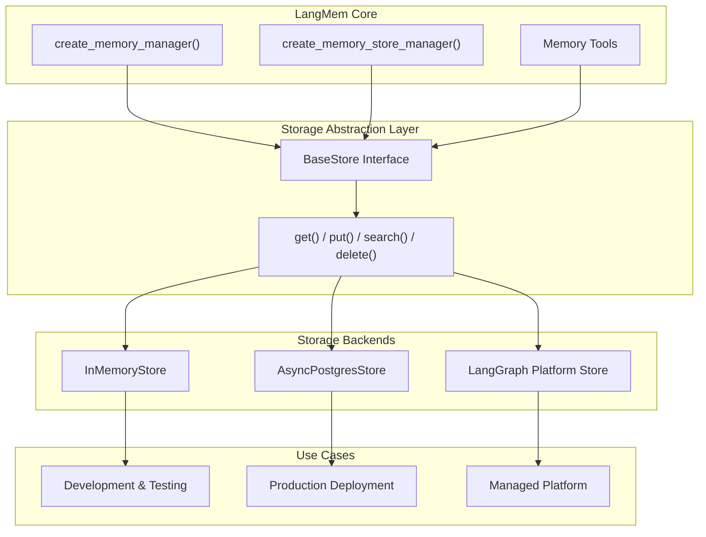
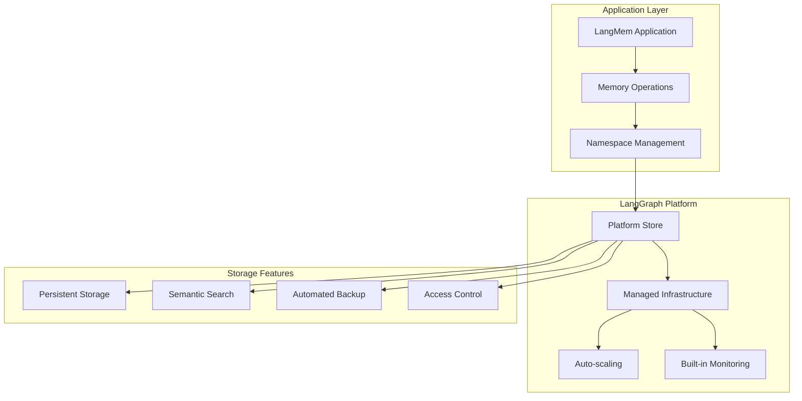
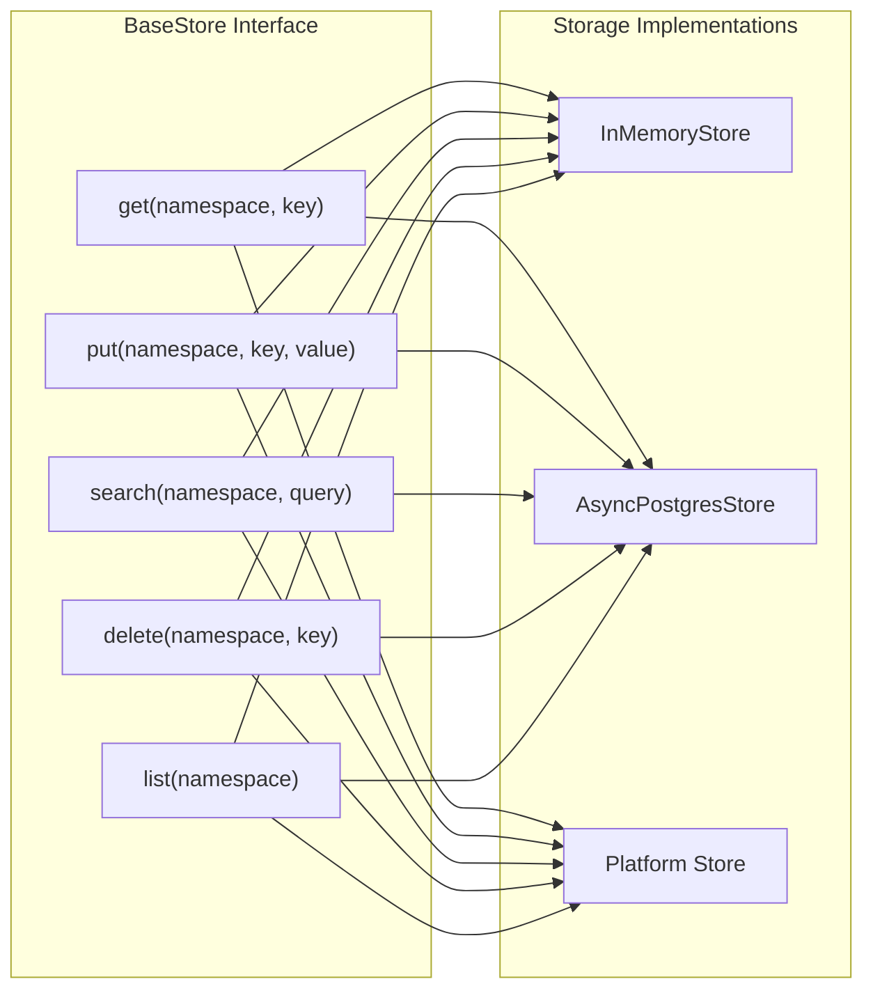
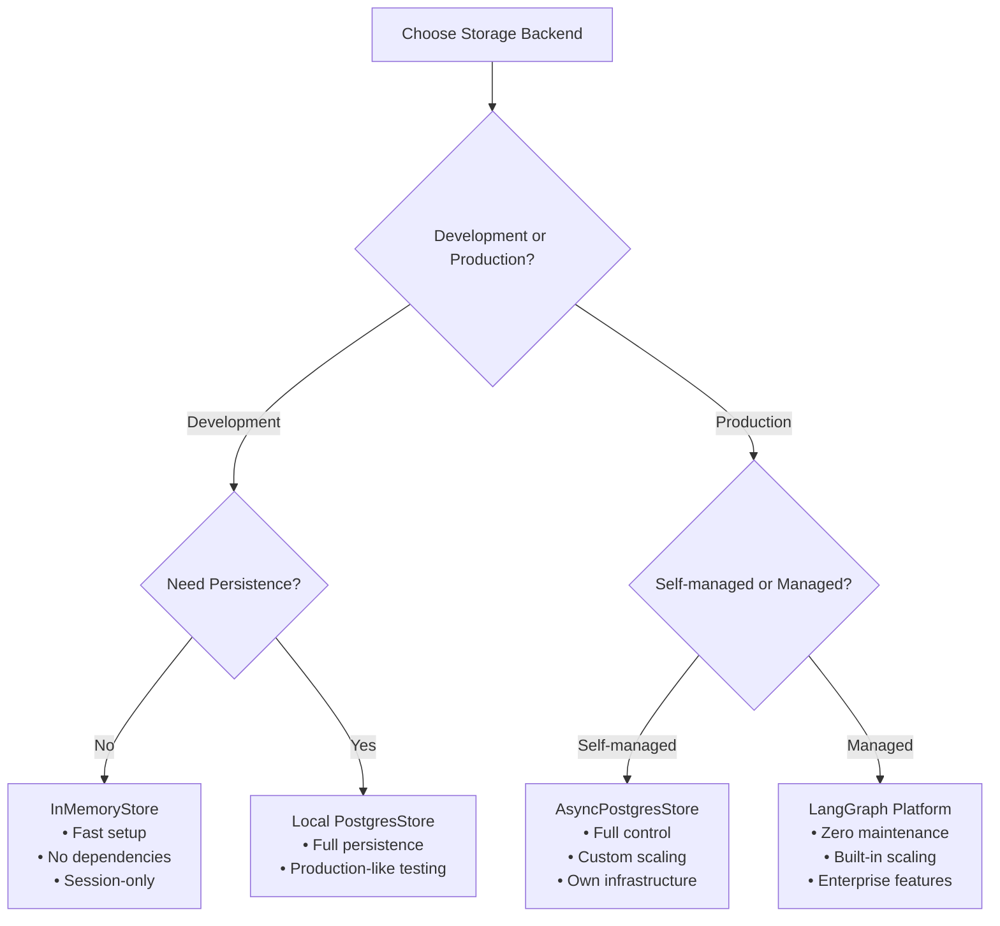

<!-- source: DeepWiki mcp.deepwiki.com · repo langchain-ai/langmem · page 7.1 Storage Types · fetched 2026-10-26 -->

# Storage Types

Relevant source files

The following files were used as context for generating this wiki page:

- [docs/docs/guides/extract_semantic_memories.md](docs/docs/guides/extract_semantic_memories.md)
- [examples/standalone_examples/README.md](examples/standalone_examples/README.md)
- [examples/standalone_examples/custom_store_example.py](examples/standalone_examples/custom_store_example.py)

This document covers the different storage backends available in langmem for persisting memories and their characteristics. For information about organizing memories within storage using hierarchical namespaces, see [Namespace Organization](#7.2).

## Storage Architecture Overview

Langmem's storage system is built on LangGraph's `BaseStore` interface, providing a flexible abstraction that supports multiple backend implementations. The system separates the core memory processing logic from storage concerns, allowing you to choose the appropriate backend based on your deployment requirements.

### Storage Backend Architecture

**Sources:** [docs/docs/concepts/conceptual_guide.md:341-376]()

## InMemoryStore

The `InMemoryStore` is designed for development, testing, and prototyping scenarios where persistence across application restarts is not required. It provides fast, local memory storage that mirrors the full `BaseStore` interface.

### Characteristics

| Feature | InMemoryStore |
|---------|---------------|
| **Persistence** | Session-only (lost on restart) |
| **Performance** | Fastest (no I/O overhead) |
| **Setup Complexity** | None (no dependencies) |
| **Use Cases** | Development, testing, demos |
| **Scalability** | Limited to single process |

### When to Use InMemoryStore

- **Development Environment**: Rapid iteration without database setup
- **Testing**: Unit tests and integration tests requiring clean state
- **Prototyping**: Quick demonstrations and proof-of-concept applications
- **CI/CD**: Automated testing pipelines where ephemeral storage is sufficient

**Sources:** [docs/docs/concepts/conceptual_guide.md:341-376]()

## PostgresStore

The `AsyncPostgresStore` provides production-ready persistent storage with full ACID compliance and advanced search capabilities. It's designed for applications requiring durable memory storage and concurrent access.

### Characteristics

| Feature | AsyncPostgresStore |
|---------|-------------------|
| **Persistence** | Full ACID durability |
| **Performance** | Optimized for concurrent access |
| **Setup Complexity** | Requires PostgreSQL instance |
| **Use Cases** | Production applications |
| **Scalability** | Horizontal scaling support |

### Production Considerations

- **Connection Management**: Supports connection pooling for high-concurrency scenarios
- **Schema Management**: Automatically handles table creation and migrations
- **Search Capabilities**: Leverages PostgreSQL's full-text search and vector similarity
- **Backup & Recovery**: Standard PostgreSQL backup procedures apply

**Sources:** [docs/docs/concepts/conceptual_guide.md:341-376]()

## LangGraph Platform Store

The LangGraph Platform provides a managed storage solution that handles infrastructure concerns while offering the same `BaseStore` interface. This option is ideal for cloud deployments where you want to focus on application logic rather than storage management.

### Platform Integration

### Platform Benefits

- **Zero Infrastructure Management**: No database setup or maintenance required
- **Built-in Monitoring**: Automatic performance metrics and alerting
- **Security**: Enterprise-grade access controls and encryption
- **Scalability**: Automatic scaling based on application demands

**Sources:** [docs/docs/concepts/conceptual_guide.md:341-376]()

## BaseStore Interface

The `BaseStore` interface provides a unified API across all storage backends, ensuring that memory operations work consistently regardless of the underlying storage implementation.

### Core Operations

### Interface Methods

| Method | Purpose | Parameters |
|--------|---------|------------|
| `get()` | Retrieve specific memory by key | `namespace`, `key` |
| `put()` | Store or update memory | `namespace`, `key`, `value` |
| `search()` | Find memories by semantic similarity | `namespace`, `query`, `limit`, `filter` |
| `delete()` | Remove memory | `namespace`, `key` |
| `list()` | List all memories in namespace | `namespace`, `prefix` |

**Sources:** [docs/docs/concepts/conceptual_guide.md:370-376]()

## Storage Selection Guide

Choose the appropriate storage backend based on your deployment requirements and application lifecycle stage:

### Decision Matrix

### Selection Criteria

| Criteria | InMemoryStore | AsyncPostgresStore | Platform Store |
|----------|---------------|-------------------|----------------|
| **Setup Time** | Immediate | Moderate | Fast |
| **Operational Overhead** | None | High | None |
| **Cost** | Free | Infrastructure costs | Service fees |
| **Scalability** | Limited | Manual scaling | Auto-scaling |
| **Persistence** | None | Full | Full |
| **Performance** | Fastest | Good | Good |
| **Suitable For** | Development, testing | Production, self-hosted | Production, managed |

**Sources:** [docs/docs/concepts/conceptual_guide.md:341-376]()

---

