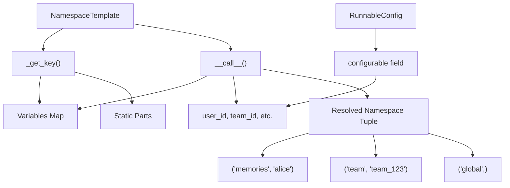
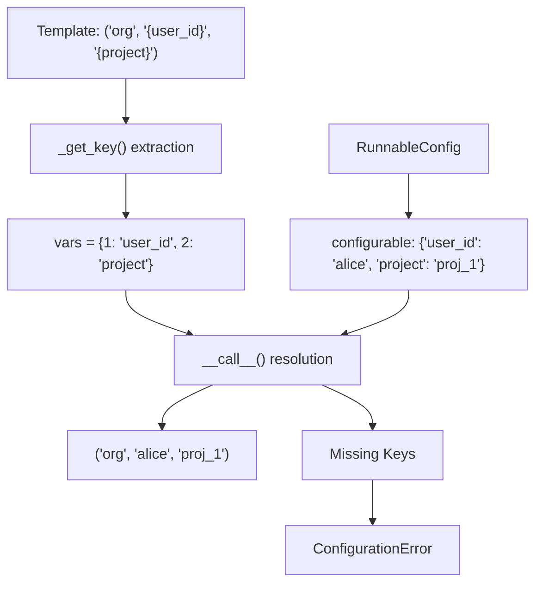
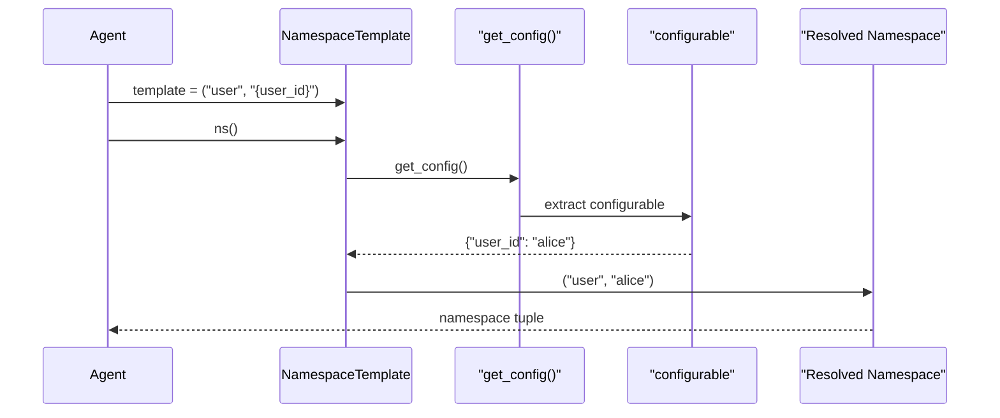
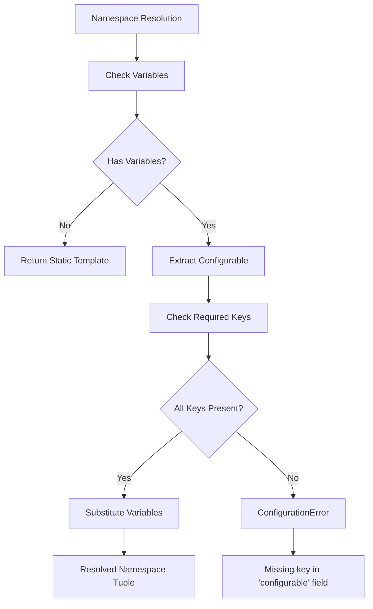
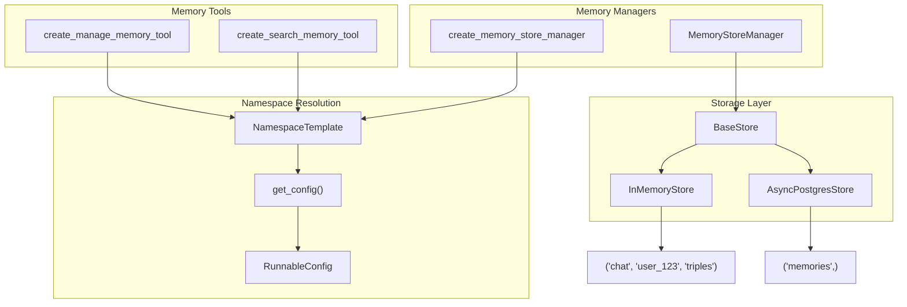

<!-- source: DeepWiki mcp.deepwiki.com · repo langchain-ai/langmem · page 7.2 Namespace Organization · fetched 2026-10-26 -->

# Namespace Organization

<details>
<summary>Relevant source files</summary>

The following files were used as context for generating this wiki page:

- [docs/docs/guides/extract_semantic_memories.md](docs/docs/guides/extract_semantic_memories.md)
- [src/langmem/utils.py](src/langmem/utils.py)

</details>


This document covers the hierarchical organization and dynamic namespace resolution system in langmem. Namespaces provide a way to organize memories by user, team, project, or other organizational units, enabling multi-tenancy and access control within the memory system.

For information about different storage backends that use these namespaces, see [Storage Types](#7.1). For details on how tools use namespaces to organize memory operations, see [Using Namespaces](#5.3).

## NamespaceTemplate System

The core of langmem's namespace organization is the `NamespaceTemplate` class, which provides dynamic namespace resolution based on runtime configuration. This system allows namespace patterns to be defined once and resolved differently for each user, team, or context.

### Template Structure and Resolution



Sources: [src/langmem/utils.py:15-96]()

### Dynamic Variable Substitution

The `NamespaceTemplate` class extracts variables from template strings using curly brace notation and substitutes them with values from the runtime configuration:



Sources: [src/langmem/utils.py:67-91]()

## Common Namespace Patterns

Based on actual usage patterns in the codebase, langmem supports several standard namespace patterns for organizing different types of memories:

| Pattern | Template | Example Resolution | Use Case |
|---------|----------|-------------------|----------|
| User Semantic Memory | `("chat", "{user_id}", "triples")` | `("chat", "user_123", "triples")` | User-specific semantic facts |
| User Preferences | `("chat", "{user_id}", "preferences")` | `("chat", "user_123", "preferences")` | Personal preferences and settings |
| Team Knowledge | `("chat", "team_{team_id}", "triples")` | `("chat", "team_x", "triples")` | Shared team knowledge base |
| Global Memory | `("chat", "global", "triples")` | `("chat", "global", "triples")` | System-wide facts and rules |
| Simple Memory Store | `("memories",)` | `("memories",)` | Basic memory collection |
| Hierarchical | `("org", "{team_id}", "{user_id}")` | `("org", "eng", "alice")` | Multi-level organization |

Sources: [docs/docs/guides/extract_semantic_memories.md:140-162]()

## Configuration Integration

The namespace system integrates with LangGraph's configuration system to automatically resolve variables from the runtime context:



Sources: [src/langmem/utils.py:73-77]()

## Error Handling and Validation

The namespace system includes comprehensive error handling for missing configuration keys:



Sources: [src/langmem/utils.py:78-89]()

## Integration with Storage Systems

Namespaces are used throughout the langmem system to organize memory storage and retrieval operations:



Sources: [src/langmem/utils.py:15-96](), [docs/docs/guides/extract_semantic_memories.md:125-146]()

## Usage Examples

### Basic Static Namespace

```python
# Fixed namespace - no variables
ns = NamespaceTemplate("global_knowledge")
resolved = ns()  # Returns: ('global_knowledge',)
```

### Dynamic User-Specific Namespace

```python
# Variable namespace for user-specific memories
ns = NamespaceTemplate(("memories", "{user_id}"))
resolved = ns({"configurable": {"user_id": "alice"}})  # Returns: ('memories', 'alice')
```

### Multi-Level Hierarchical Namespace

```python
# Complex hierarchical organization
ns = NamespaceTemplate(("org", "{team_id}", "{project_id}", "{user_id}"))
config = {
    "configurable": {
        "team_id": "engineering",
        "project_id": "langmem",
        "user_id": "alice"
    }
}
resolved = ns(config)  # Returns: ('org', 'engineering', 'langmem', 'alice')
```

Sources: [src/langmem/utils.py:22-53]()

---

