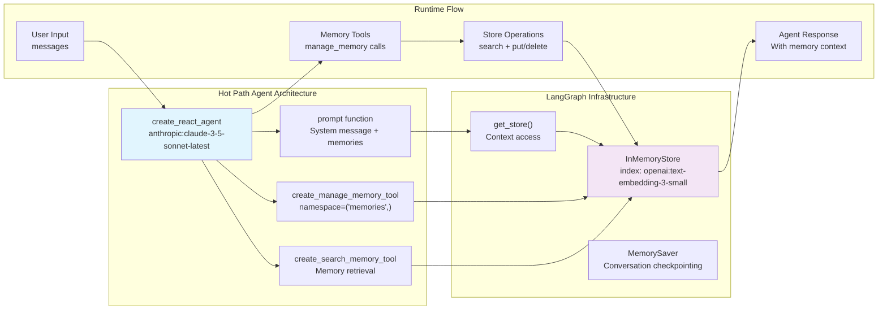
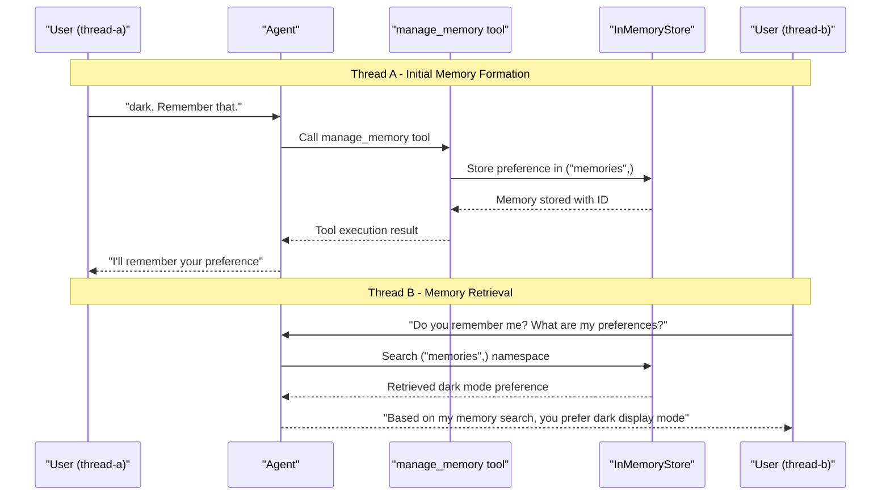
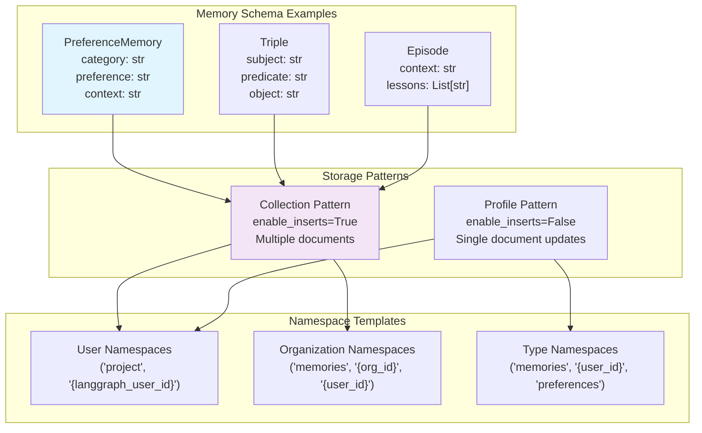
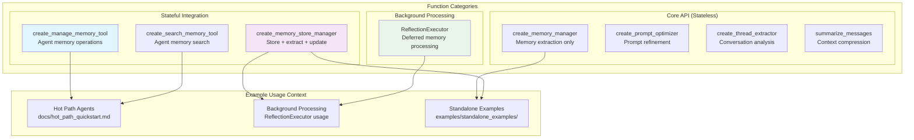

<!-- source: DeepWiki mcp.deepwiki.com · repo langchain-ai/langmem · page 8 Examples and Tutorials · fetched 2026-10-26 -->

# Examples and Tutorials

<details>
<summary>Relevant source files</summary>

The following files were used as context for generating this wiki page:

- [docs/docs/hot_path_quickstart.md](docs/docs/hot_path_quickstart.md)
- [examples/standalone_examples/README.md](examples/standalone_examples/README.md)
- [examples/standalone_examples/custom_store_example.py](examples/standalone_examples/custom_store_example.py)

</details>


This document provides practical examples and tutorials demonstrating LangMem in action across different use cases and integration patterns. Examples range from hot path agent-driven memory management to standalone applications, showing how to implement the core concepts covered in [Key Concepts](#1.2) and [Processing Approaches](#3).

For detailed API usage, see [API Reference](#9). For framework-specific integration details, see [Integration](#4).

## Example Categories and Use Cases

The examples demonstrate LangMem's flexibility across different processing approaches and integration patterns:

```mermaid
graph TB
    subgraph "Example Categories"
        subgraph "Hot Path Examples"
            HQ["Hot Path Quickstart<br/>create_react_agent + tools"]
            AT["Agent Tools Examples<br/>create_manage_memory_tool<br/>create_search_memory_tool"]
        end
        
        subgraph "Background Processing Examples"
            BQ["Background Quickstart<br/>create_memory_store_manager<br/>ReflectionExecutor"]
            SC["Subconscious Memory<br/>Deferred processing"]
        end
        
        subgraph "Standalone Examples"
            CSE["custom_store_example.py<br/>InMemoryStore integration"]
            PSE["Persistent Store Examples<br/>AsyncPostgresStore"]
        end
        
        subgraph "Testing Examples"
            UT["Unit Test Patterns<br/>Memory validation"]
            IT["Integration Tests<br/>End-to-end flows"]
        end
    end
    
    subgraph "Core Functions Demonstrated"
        CMM["create_memory_manager<br/>Core extraction"]
        CMSM["create_memory_store_manager<br/>Stateful operations"]
        CMMT["create_manage_memory_tool<br/>Agent memory tools"]
        CSMT["create_search_memory_tool<br/>Memory retrieval"]
    end
    
    subgraph "Integration Patterns"
        LG["LangGraph Integration<br/>BaseStore + MemorySaver"]
        SA["Standalone Applications<br/>Custom store setup"]
        CA["Custom Agents<br/>Direct tool usage"]
    end
    
    HQ --> CMMT
    HQ --> CSMT
    HQ --> LG
    AT --> CMMT
    AT --> CSMT
    
    BQ --> CMSM
    BQ --> LG
    SC --> CMSM
    
    CSE --> CMM
    CSE --> SA
    PSE --> CMSM
    
    UT --> CMM
    UT --> CMSM
    IT --> LG
    
    style HQ fill:#e1f5fe
    style CSE fill:#f3e5f5
    style BQ fill:#e8f5e8
```



Sources: [docs/docs/hot_path_quickstart.md](), [examples/standalone_examples/README.md](), [examples/standalone_examples/custom_store_example.py]()

## Hot Path Agent Examples

### LangGraph ReAct Agent with Memory Tools

The primary hot path example demonstrates agent-driven memory management using `create_react_agent` with memory tools:



Key implementation details from [docs/docs/hot_path_quickstart.md:35-90]():

- **Agent Creation**: Uses `create_react_agent` with memory tools in the tools list
- **Store Configuration**: `InMemoryStore` with OpenAI embeddings for development
- **Memory Tools**: `create_manage_memory_tool` allows create/update/delete operations
- **Context Access**: `get_store()` retrieves the configured store in the prompt function
- **Namespace Organization**: `("memories",)` namespace for shared memories

### Memory Persistence Across Conversations

The example demonstrates cross-thread memory access using different `thread_id` values in the config:



Sources: [docs/docs/hot_path_quickstart.md:128-169]()

## Standalone Examples

### Custom Store Integration

The standalone examples show LangMem usage outside LangGraph's context management:

Key components from [examples/standalone_examples/custom_store_example.py:19-48]():

- **Custom Schema**: `PreferenceMemory` Pydantic model for structured memory storage
- **Store Creation**: `InMemoryStore` with OpenAI embedding configuration
- **Manager Setup**: `create_memory_store_manager` with custom store parameter
- **Config Pattern**: `{"configurable": {"langgraph_user_id": "user123"}}` for namespace templating

### Memory Schema Patterns



Sources: [examples/standalone_examples/custom_store_example.py:19-24]()

## Integration Patterns and Code Entities

### Core Function Usage Patterns

Different integration scenarios use different combinations of LangMem's core functions:

| Integration Type | Core Functions | Store Management | Context |
|------------------|----------------|------------------|---------|
| **Hot Path Agents** | `create_manage_memory_tool`, `create_search_memory_tool` | LangGraph `BaseStore` | Agent tools in `create_react_agent` |
| **Background Processing** | `create_memory_store_manager`, `ReflectionExecutor` | LangGraph `BaseStore` | Deferred processing |
| **Standalone Applications** | `create_memory_manager`, `create_memory_store_manager` | Custom `BaseStore` | Manual store management |
| **Custom Agents** | `create_manage_memory_tool` + direct invocation | Any `BaseStore` | Manual tool integration |

### Memory Manager Function Mapping



### Store and Configuration Patterns

Examples demonstrate different store setup and configuration approaches:

**Development Setup** ([docs/docs/hot_path_quickstart.md:66-71]()):
```python
store = InMemoryStore(
    index={
        "dims": 1536,
        "embed": "openai:text-embedding-3-small",
    }
)
```

**Standalone Setup** ([examples/standalone_examples/custom_store_example.py:26-33]()):
```python
def create_store():
    return InMemoryStore(
        index={
            "dims": 1536,
            "embed": "openai:text-embedding-3-small",
        }
    )
```

**Namespace Configuration** ([docs/docs/hot_path_quickstart.md:82](), [examples/standalone_examples/custom_store_example.py:45]()):
- Fixed namespaces: `namespace=("memories",)`
- Templated namespaces: `namespace=("project", "{langgraph_user_id}")`
- Config resolution: `config={"configurable": {"langgraph_user_id": "user123"}}`

Sources: [docs/docs/hot_path_quickstart.md](), [examples/standalone_examples/custom_store_example.py](), [examples/standalone_examples/README.md]()

## Example Directory Structure

The codebase provides examples in multiple locations:

- **Documentation Examples**: [docs/docs/hot_path_quickstart.md]() - Complete walkthrough examples
- **Standalone Examples**: [examples/standalone_examples/]() - Independent usage patterns  
- **Test Examples**: Referenced in [Testing and Development Examples](#8.2)

Each example category serves different learning objectives:
- **Hot Path**: Agent-driven memory management with LangGraph
- **Standalone**: LangMem integration without LangGraph context
- **Background**: Deferred memory processing patterns
- **Testing**: Validation and development patterns

Sources: [examples/standalone_examples/README.md:1-72]()

---

