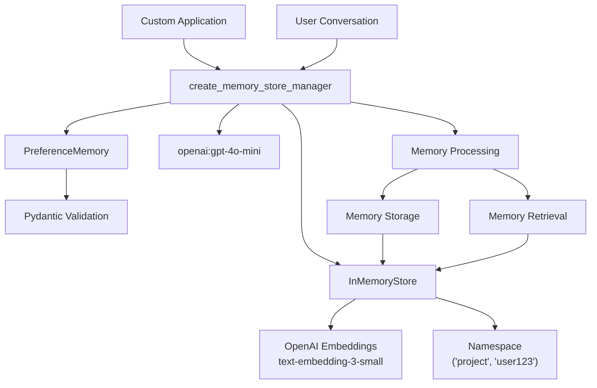
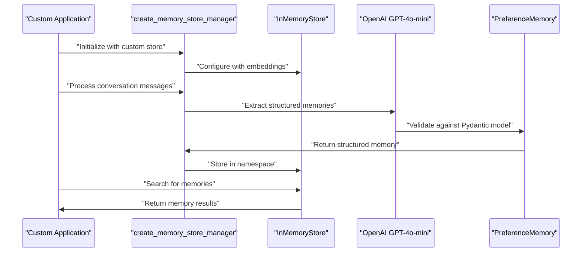

<!-- source: DeepWiki mcp.deepwiki.com · repo langchain-ai/langmem · page 8.1 Standalone Examples · fetched 2026-10-26 -->

# Standalone Examples

<details>
<summary>Relevant source files</summary>

The following files were used as context for generating this wiki page:

- [examples/standalone_examples/README.md](examples/standalone_examples/README.md)
- [examples/standalone_examples/custom_store_example.py](examples/standalone_examples/custom_store_example.py)

</details>


## Purpose and Scope

This document covers examples demonstrating how to use LangMem independently of LangGraph's integrated context and state management. These examples show how to integrate LangMem into custom applications and frameworks using your own storage backends and configuration.

For information about integrating LangMem with LangGraph's built-in state management, see [LangGraph Integration](#4.1). For general agent integration patterns, see [Agent Integration](#4.2).

## Overview

The standalone examples demonstrate LangMem's flexibility as a memory management library that can work outside of LangGraph's ecosystem. The primary focus is on showing how to:

- Use custom storage backends with memory managers
- Define structured memory schemas using Pydantic models
- Process conversations and extract memories without LangGraph context
- Retrieve and work with stored memories programmatically

## Custom Store Example Architecture

The main example demonstrates using `InMemoryStore` with a custom `PreferenceMemory` schema:



*Sources: [examples/standalone_examples/custom_store_example.py:1-75]()*

## Memory Processing Flow

The custom store example follows this processing pattern:



*Sources: [examples/standalone_examples/custom_store_example.py:36-75]()*

## Example Implementation Details

### Memory Schema Definition

The example defines a custom Pydantic model for user preferences:

| Component | Purpose | Implementation |
|-----------|---------|----------------|
| `PreferenceMemory` | Structure for user preferences | Pydantic model with `category`, `preference`, and `context` fields |
| Schema validation | Ensure memory consistency | Built-in Pydantic validation |
| Memory typing | Enable structured retrieval | Used by `create_memory_store_manager` |

*Sources: [examples/standalone_examples/custom_store_example.py:19-24]()*

### Store Configuration

The custom store setup uses OpenAI embeddings:

| Configuration | Value | Purpose |
|---------------|-------|---------|
| `dims` | 1536 | Embedding dimensions for OpenAI model |
| `embed` | `openai:text-embedding-3-small` | Embedding model for semantic search |
| Store type | `InMemoryStore` | Development/testing storage backend |

*Sources: [examples/standalone_examples/custom_store_example.py:26-33]()*

### Memory Manager Initialization

The `create_memory_store_manager` function is configured with:

| Parameter | Value | Purpose |
|-----------|--------|---------|
| `model` | `openai:gpt-4o-mini` | LLM for memory extraction |
| `schemas` | `[PreferenceMemory]` | Available memory types |
| `namespace` | `("project", "{langgraph_user_id}")` | Memory organization pattern |
| `store` | Custom `InMemoryStore` | Storage backend |

*Sources: [examples/standalone_examples/custom_store_example.py:42-47]()*

## Running the Examples

### Setup Requirements

The examples require specific dependencies and configuration:

```bash
uv venv
source .venv/bin/activate
uv sync
export OPENAI_API_KEY=your_api_key_here
```

### Execution Process

Examples can be run directly from the standalone examples directory:

```bash
cd examples/standalone_examples
uv run custom_store_example.py
```

*Sources: [examples/standalone_examples/README.md:19-38]()*

## Available Examples

### Current Examples

| Example | File | Purpose |
|---------|------|---------|
| Custom Store | `custom_store_example.py` | Using custom `InMemoryStore` with memory manager |

### Future Examples

The following examples are planned for future releases:

| Example | Purpose |
|---------|---------|
| Persistent Store | Using persistent storage backends |
| Multi-User Memory | Managing memories across multiple users |
| Memory Migration | Moving memories between different stores |

*Sources: [examples/standalone_examples/README.md:11-15]()*

## Key Learning Outcomes

These examples demonstrate several important concepts:

### Independence from LangGraph Context

The examples show how LangMem can operate without LangGraph's integrated state management, making it suitable for:

- Custom application frameworks
- Non-LangGraph agent systems
- Direct integration with existing applications

### Custom Storage Integration

The examples demonstrate how to:

- Configure custom storage backends
- Set up embedding models for semantic search
- Organize memories using namespace patterns

### Memory Processing Patterns

The examples illustrate:

- Structured memory extraction using Pydantic schemas
- Conversation processing workflows
- Memory retrieval and search operations

*Sources: [examples/standalone_examples/README.md:60-65]()*

## Technical Considerations

### API Key Requirements

The examples use OpenAI's embedding model (`text-embedding-3-small`) and require appropriate API access for both:

- Memory extraction via `gpt-4o-mini`
- Semantic search via embedding generation

### Storage Backend Selection

The examples use `InMemoryStore` for demonstration purposes. Production applications should consider:

- Persistent storage for data durability
- Distributed storage for scalability
- Security considerations for memory access

### Namespace Organization

The examples use the namespace pattern `("project", "{langgraph_user_id}")` to demonstrate:

- Memory isolation between users
- Hierarchical organization
- Dynamic namespace resolution

*Sources: [examples/standalone_examples/README.md:67-71]()*

---

