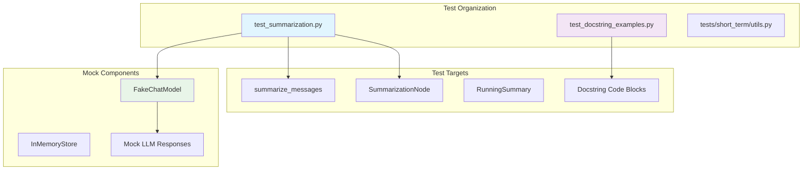
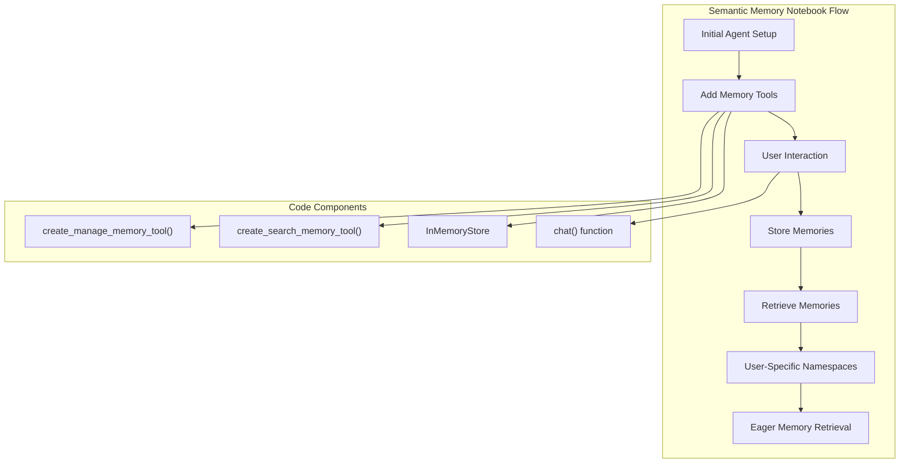
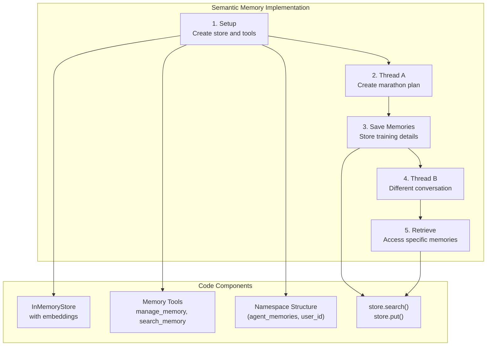
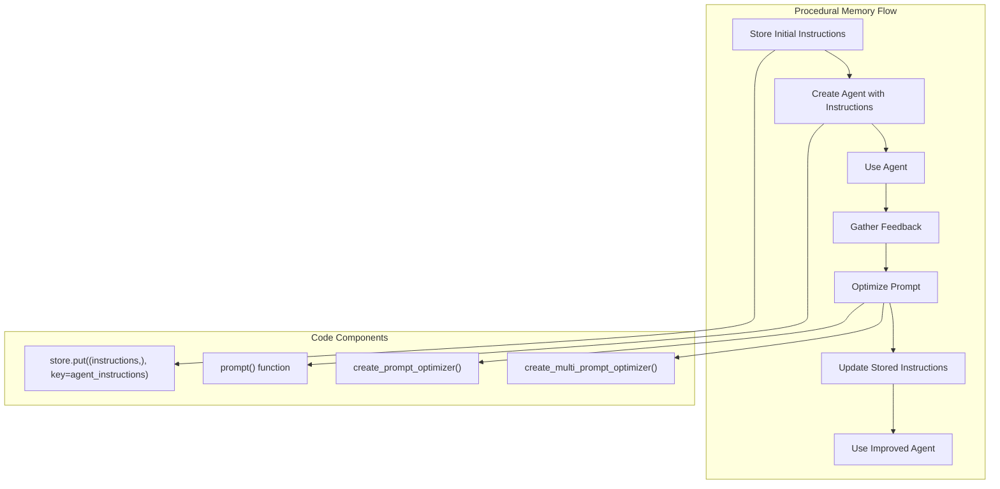
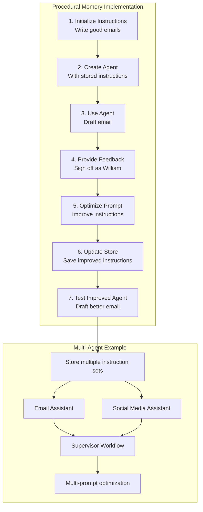

<!-- source: DeepWiki mcp.deepwiki.com · repo langchain-ai/langmem · page 8.2 Testing and Development Examples · fetched 2026-10-26 -->

# Testing and Development Examples

<details>
<summary>Relevant source files</summary>

The following files were used as context for generating this wiki page:

- [tests/short_term/__init__.py](tests/short_term/__init__.py)
- [tests/short_term/test_summarization.py](tests/short_term/test_summarization.py)
- [tests/test_docstring_examples.py](tests/test_docstring_examples.py)

</details>


This page documents testing patterns and development practices from the LangMem test suite. These examples demonstrate proper usage patterns for testing memory systems, mock implementations, and validation approaches for stateful components.

For standalone usage examples, see [Standalone Examples](#8.1).

## Testing Architecture Overview

LangMem employs a comprehensive testing strategy with unit tests for core components, docstring example validation, and mock implementations for LLM interactions. The testing framework handles the asynchronous and stateful nature of memory operations.

**LangMem Testing Framework Architecture**


Sources: [tests/short_term/test_summarization.py:1-14](), [tests/test_docstring_examples.py:1-19]()

### Notebook Locations

| Notebook Name | Location | Primary Concepts |
|---------------|----------|------------------|
| Semantic Memory | examples/intro_videos/semantic_memory.ipynb | User information, facts, search capabilities |
| Procedural Memory | examples/intro_videos/procedural_memory.ipynb | System instructions, prompt optimization |

Sources: [examples/intro_videos/semantic_memory.ipynb:1-10](), [examples/intro_videos/procedural_memory.ipynb:1-10]()

## Semantic Memory Notebook

The Semantic Memory notebook demonstrates how to create, store, and retrieve factual information about users or domains. This notebook shows multiple approaches to memory management, from basic implementations to more sophisticated pattern matching.

### Key Demonstrations

1. **Basic Agent Setup**: Creating a ReAct agent without memory
2. **Adding Memory Tools**: Implementing memory capabilities with LangMem tools
3. **User-Specific Namespaces**: Creating separate memory spaces for different users
4. **Eager Memory Retrieval**: Implementing efficient memory access patterns



Sources: [examples/intro_videos/semantic_memory.ipynb:127-132](), [examples/intro_videos/semantic_memory.ipynb:149-162](), [examples/intro_videos/semantic_memory.ipynb:52-56]()

### Implementation Examples

The notebook includes several practical examples:

1. **Marathon Training Plan**: A conversational example where an agent creates and later references a training plan
2. **Multi-User Memory**: Demonstration of maintaining separate memories for different users (User-A and User-B)
3. **Memory Retrieval Optimization**: Implementation of an "eager" memory retrieval pattern to improve response quality



Sources: [examples/intro_videos/semantic_memory.ipynb:185-202](), [examples/intro_videos/semantic_memory.ipynb:267-282](), [examples/intro_videos/semantic_memory.ipynb:392-395]()

## Procedural Memory Notebook

The Procedural Memory notebook demonstrates how to store and optimize system instructions that guide agent behavior. This notebook focuses on improving agent performance through prompt optimization.

### Key Demonstrations

1. **Storing Instructions**: Setting up procedural memory for agent instructions
2. **Prompt Optimization**: Using feedback to improve prompts automatically
3. **Multi-Agent Systems**: Managing procedural memory across multiple specialized agents



Sources: [examples/intro_videos/procedural_memory.ipynb:29-33](), [examples/intro_videos/procedural_memory.ipynb:42-55](), [examples/intro_videos/procedural_memory.ipynb:110-126]()

### Implementation Examples

The notebook includes these practical examples:

1. **Email Assistant**: An agent that drafts emails based on stored instructions
2. **Prompt Optimization**: Improving email templates based on feedback
3. **Multi-Agent System**: Coordinating multiple agents (email and social media) with separate procedural memories
4. **Multi-Prompt Optimization**: Selectively updating prompts based on specific feedback



Sources: [examples/intro_videos/procedural_memory.ipynb:29-55](), [examples/intro_videos/procedural_memory.ipynb:110-176](), [examples/intro_videos/procedural_memory.ipynb:286-322](), [examples/intro_videos/procedural_memory.ipynb:407-517]()

## Running the Notebooks

To run these notebooks:

1. Install the required packages:
   ```python
   pip install -U langmem langgraph
   ```

2. For multi-agent examples, also install:
   ```python
   pip install -U langgraph-supervisor
   ```

3. Open the notebooks in Jupyter or a compatible environment.

4. Execute the cells in order to see the demonstrations.

5. Modify the examples to experiment with different memory configurations.

Sources: [examples/intro_videos/semantic_memory.ipynb:17-19](), [examples/intro_videos/procedural_memory.ipynb:17-20](), [examples/intro_videos/procedural_memory.ipynb:271-273]()

## Video Resources

Video tutorials demonstrating LangMem concepts and implementations are planned as complementary resources to the notebooks. These videos will provide step-by-step guidance on implementing different memory types and integrating them with agents.

The notebooks are designed to align with these upcoming video tutorials, allowing users to follow along with the code examples while watching the explanatory content.

---

