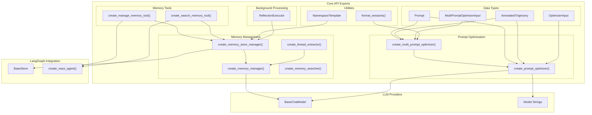
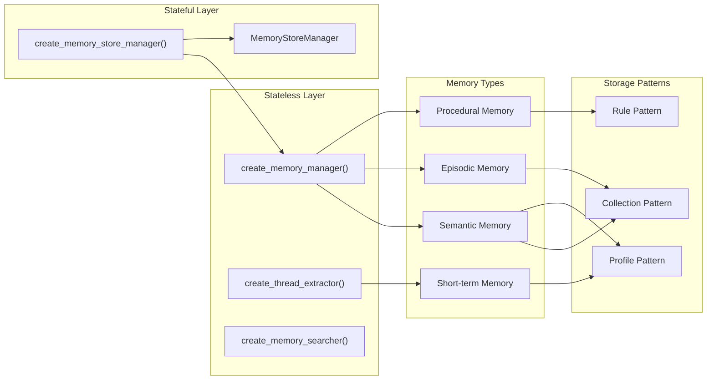
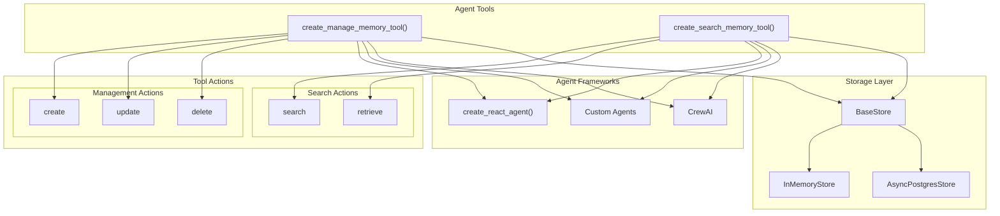
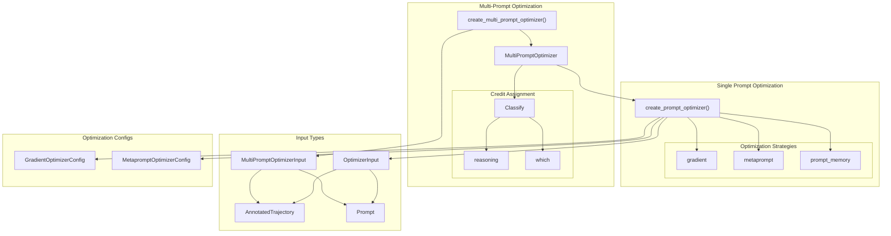
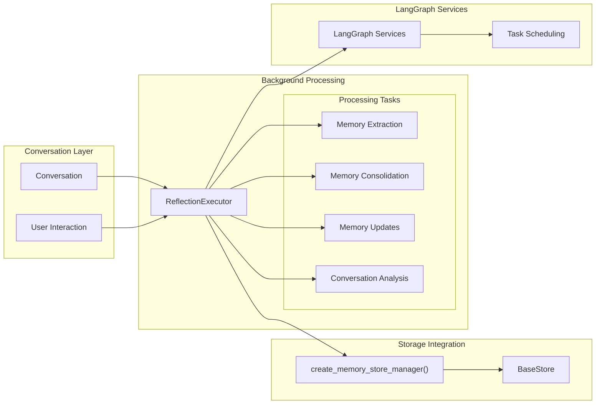
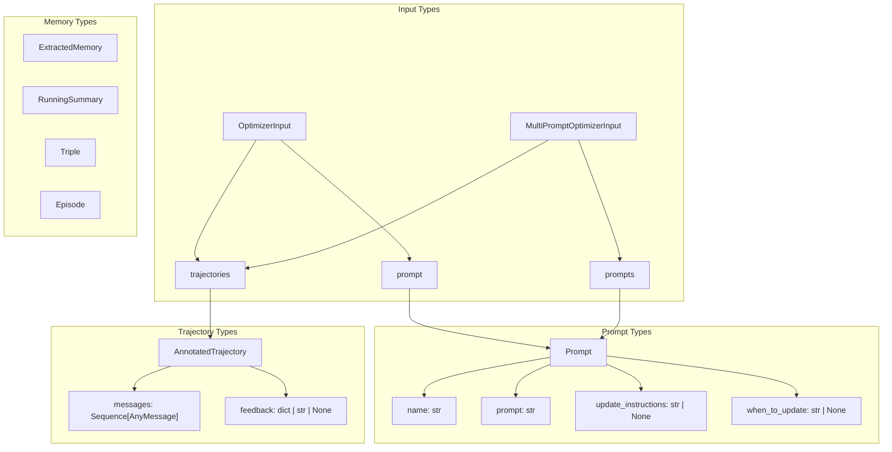

<!-- source: DeepWiki mcp.deepwiki.com · repo langchain-ai/langmem · page 9 API Reference · fetched 2026-10-26 -->

# API Reference

Relevant source files

The following files were used as context for generating this wiki page:

- [docs/docs/reference/index.md](docs/docs/reference/index.md)
- [src/langmem/__init__.py](src/langmem/__init__.py)
- [src/langmem/prompts/optimization.py](src/langmem/prompts/optimization.py)
- [src/langmem/prompts/types.py](src/langmem/prompts/types.py)

This page provides complete API documentation for all LangMem functions, classes, and utilities. It covers the Core API layer (stateless functions) and Stateful Integration layer (persistent memory management), along with supporting data types and utilities.

For detailed usage examples and integration patterns, see [Memory Management](#2), [Memory Tools](#5), and [Integration](#4). For background on the system architecture, see [Key Concepts](#1.2).

## Core API Structure

LangMem's API is organized around key functional areas, each providing specific capabilities for memory-enabled LLM applications:

#### LangMem API Organization

**Sources:** [src/langmem/__init__.py:1-28](), [docs/docs/reference/index.md:1-34]()

## Memory Management APIs

The memory management layer provides both stateless (`create_memory_manager`) and stateful (`create_memory_store_manager`) approaches to extracting, storing, and retrieving memories from conversations.

#### Memory Manager Architecture

The `create_memory_manager` function creates stateless memory extractors that analyze conversations and return structured memory objects. The `create_memory_store_manager` function wraps this with persistent storage capabilities using LangGraph's `BaseStore`.

The `create_thread_extractor` specializes in conversation summarization and context management, while `create_memory_searcher` provides semantic search across stored memories.

**Sources:** [src/langmem/__init__.py:1-8](), [docs/docs/reference/index.md:10-16]()

## Memory Tools APIs

Memory tools enable agents to actively manage their own memory through structured tool calls during conversations. These tools provide the "hot path" memory formation capabilities.

#### Memory Tools Integration

The `create_manage_memory_tool` creates a tool that agents can use to store, update, and delete memories with configurable `actions_permitted` parameters. The `create_search_memory_tool` creates a tool for semantic search and retrieval of relevant memories based on queries.

**Sources:** [src/langmem/__init__.py:2-3,19-20](), [docs/docs/reference/index.md:17-23]()

## Prompt Optimization APIs

The prompt optimization system provides iterative improvement of prompts based on conversation feedback and performance analysis.

#### Prompt Optimization Strategies

The `create_prompt_optimizer` function supports three optimization strategies with different trade-offs between speed and thoroughness. The `create_multi_prompt_optimizer` function extends this to handle multiple prompts simultaneously with credit assignment to determine which prompts need updates.

**Sources:** [src/langmem/prompts/optimization.py:50-269](), [src/langmem/prompts/optimization.py:471-616](), [src/langmem/__init__.py:9-13,22-23]()

## Background Processing APIs

The `ReflectionExecutor` enables deferred memory processing and analysis separate from real-time conversation flow.

#### Reflection Processing Architecture

The `ReflectionExecutor` processes conversations asynchronously to extract insights, consolidate related memories, and perform deeper analysis without blocking real-time interactions.

**Sources:** [src/langmem/__init__.py:14,25](), [docs/docs/reference/index.md:31-34]()

## Data Types and Schemas

LangMem defines several key data types for structured memory management and prompt optimization.

#### Core Data Type Relationships

The `Prompt` type provides structured prompt management with optimization metadata. The `AnnotatedTrajectory` type pairs conversation history with feedback for optimization. Input types like `OptimizerInput` and `MultiPromptOptimizerInput` structure the data flow for optimization functions.

**Sources:** [src/langmem/prompts/types.py:7-136](), [src/langmem/__init__.py:26]()

## Function Signature Reference

| Function | Parameters | Returns | Purpose |
|----------|------------|---------|---------|
| `create_memory_manager` | `model`, `memory_types`, `config` | Memory extractor | Stateless memory extraction |
| `create_memory_store_manager` | `model`, `store`, `namespace_template` | `MemoryStoreManager` | Persistent memory management |
| `create_manage_memory_tool` | `memory_store_manager`, `actions_permitted` | Agent tool | Memory management tool |
| `create_search_memory_tool` | `memory_store_manager`, `query_config` | Agent tool | Memory search tool |
| `create_prompt_optimizer` | `model`, `kind`, `config` | Prompt optimizer | Single prompt optimization |
| `create_multi_prompt_optimizer` | `model`, `kind`, `config` | Multi-prompt optimizer | Multiple prompt optimization |
| `create_thread_extractor` | `model`, `config` | Thread extractor | Conversation summarization |
| `create_memory_searcher` | `store`, `config` | Memory searcher | Semantic memory search |

**Sources:** [src/langmem/__init__.py:16-27](), [docs/docs/reference/index.md:8-34]()

---

