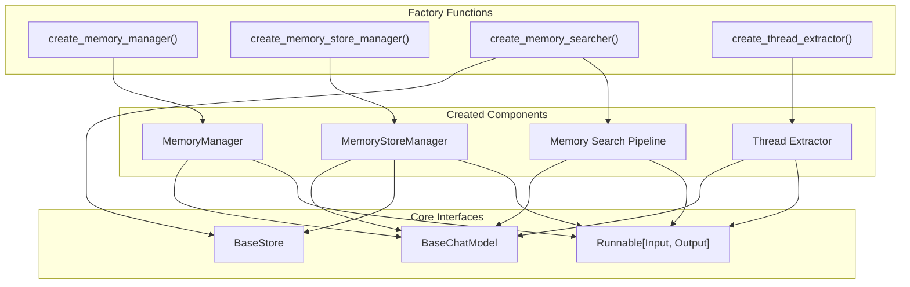
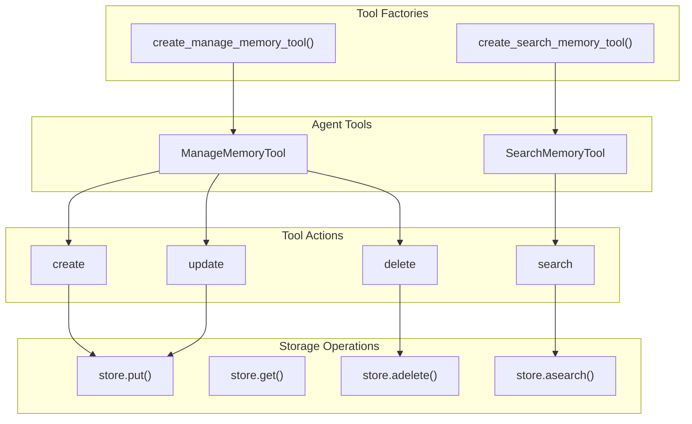
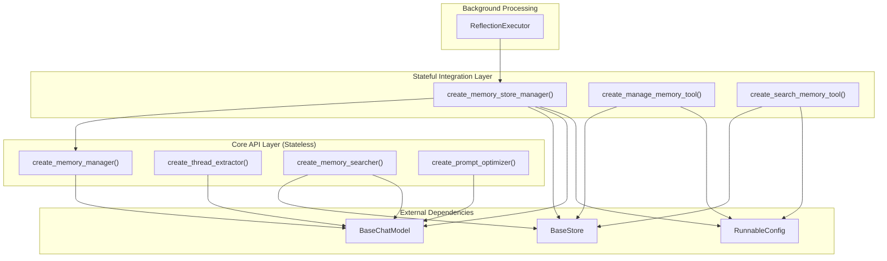
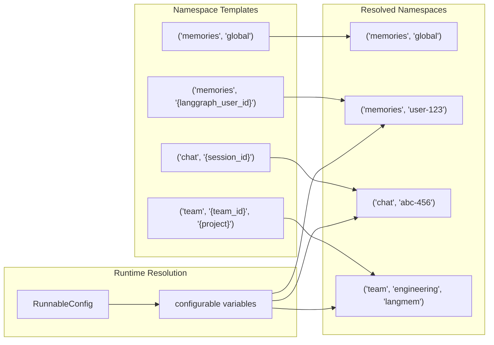

<!-- source: DeepWiki mcp.deepwiki.com · repo langchain-ai/langmem · page 9.1 Main API Functions · fetched 2026-10-26 -->

# Main API Functions

<details>
<summary>Relevant source files</summary>

The following files were used as context for generating this wiki page:

- [src/langmem/__init__.py](src/langmem/__init__.py)
- [src/langmem/knowledge/extraction.py](src/langmem/knowledge/extraction.py)
- [src/langmem/prompts/types.py](src/langmem/prompts/types.py)

</details>


This document covers the core factory functions that create LangMem's primary components. These functions serve as the main entry points for integrating memory capabilities into LLM applications. 

For information about using these components with agents, see [Memory Tools](#5). For details about specific memory types and schemas, see [Memory Types and Classes](#9.2). For background processing workflows, see [Background Memory Processing](#3.2).

## Core Factory Functions

LangMem provides several factory functions that create the main system components. These functions follow a consistent pattern of accepting a model specification and configuration parameters, then returning configured runnables or tools.

### Memory Management Factories

The primary memory management functions create components for extracting, storing, and retrieving memories from conversations.



**Sources:** [src/langmem/knowledge/extraction.py:536-692](), [src/langmem/knowledge/extraction.py:832-914](), [src/langmem/knowledge/extraction.py:695-815](), [src/langmem/knowledge/extraction.py:113-182]()

#### create_memory_manager

The `create_memory_manager` function creates a stateless memory extraction component that processes conversation messages and generates structured memory entries.

| Parameter | Type | Default | Description |
|-----------|------|---------|-------------|
| `model` | `str \| BaseChatModel` | Required | Language model for memory extraction |
| `schemas` | `Sequence[BaseModel]` | `(Memory,)` | Pydantic models defining memory structure |
| `instructions` | `str` | Built-in instructions | Custom instructions for memory generation |
| `enable_inserts` | `bool` | `True` | Allow creating new memory entries |
| `enable_updates` | `bool` | `True` | Allow updating existing memories |
| `enable_deletes` | `bool` | `False` | Allow deleting existing memories |

**Returns:** `Runnable[MemoryState, list[ExtractedMemory]]`

**Sources:** [src/langmem/knowledge/extraction.py:536-692]()

#### create_memory_store_manager

The `create_memory_store_manager` function creates a stateful memory management component that automatically handles persistence, search, and consolidation of memories.

| Parameter | Type | Default | Description |
|-----------|------|---------|-------------|
| `model` | `str \| BaseChatModel` | Required | Language model for memory processing |
| `schemas` | `list[BaseModel] \| None` | `None` | Memory schema definitions |
| `namespace` | `tuple[str, ...]` | `("memories", "{langgraph_user_id}")` | Storage namespace template |
| `store` | `BaseStore \| None` | `None` | Storage backend (uses LangGraph context if None) |
| `enable_inserts` | `bool` | `True` | Allow memory creation |
| `enable_deletes` | `bool` | `True` | Allow memory deletion |
| `query_model` | `str \| BaseChatModel \| None` | `None` | Model for search query generation |
| `query_limit` | `int` | `5` | Maximum memories to retrieve |

**Returns:** `MemoryStoreManager` (implements `Runnable[MemoryStoreManagerInput, list[dict]]`)

**Sources:** [src/langmem/knowledge/extraction.py:832-914]()

#### create_memory_searcher

The `create_memory_searcher` function creates a memory search pipeline that generates queries from conversation context and returns ranked results.

| Parameter | Type | Default | Description |
|-----------|------|---------|-------------|
| `model` | `str \| BaseChatModel` | Required | Model for query generation |
| `prompt` | `str` | Built-in search prompt | Instructions for query generation |
| `namespace` | `tuple[str, ...]` | `("memories", "{langgraph_user_id}")` | Search namespace template |

**Returns:** `Runnable[MessagesState, list[SearchItem]]`

**Sources:** [src/langmem/knowledge/extraction.py:695-815]()

#### create_thread_extractor

The `create_thread_extractor` function creates conversation summarizers using schema-based extraction.

| Parameter | Type | Default | Description |
|-----------|------|---------|-------------|
| `model` | `str` | Required | Language model for summarization |
| `schema` | `BaseModel \| type \| None` | `None` | Output schema (uses `SummarizeThread` if None) |
| `instructions` | `str` | Built-in instructions | Summarization instructions |

**Returns:** `Runnable[MessagesState, BaseModel]`

**Sources:** [src/langmem/knowledge/extraction.py:113-182]()

### Tool Creation Factories

LangMem provides factory functions for creating tools that agents can use to manage their own memories.



**Sources:** [src/langmem/knowledge/tools.py](), [src/langmem/__init__.py:1-8]()

### Prompt Optimization Factories

For prompt optimization capabilities, LangMem provides factory functions that create prompt refinement systems.

| Function | Purpose | Input Type | Output Type |
|----------|---------|------------|-------------|
| `create_prompt_optimizer` | Single prompt optimization | `OptimizerInput` | Optimized `Prompt` |
| `create_multi_prompt_optimizer` | Multi-prompt system optimization | `MultiPromptOptimizerInput` | List of optimized `Prompt`s |

**Sources:** [src/langmem/prompts/optimization.py](), [src/langmem/__init__.py:9-13]()

## Component Relationships

The factory functions create components that work together in LangMem's two-layer architecture:



**Sources:** [src/langmem/knowledge/extraction.py:1-50](), [src/langmem/__init__.py:1-27]()

## Usage Patterns

### Direct Memory Processing

Use core API functions for stateless memory processing:

```python
# Create memory manager for extraction
manager = create_memory_manager("gpt-4")

# Process conversation
memories = await manager.ainvoke({
    "messages": conversation,
    "existing": existing_memories
})
```

### Persistent Memory Management  

Use stateful integration functions for automatic persistence:

```python
# Create persistent memory manager
store_manager = create_memory_store_manager(
    "claude-3-5-sonnet",
    namespace=("user_memories", "{user_id}"),
    store=postgres_store
)

# Automatically extracts and stores memories
updates = await store_manager.ainvoke({
    "messages": conversation
})
```

### Agent Integration

Use tool creation functions for agent-driven memory:

```python
# Create tools for agent use
memory_tool = create_manage_memory_tool(
    namespace=("agent_knowledge", "{session_id}")
)
search_tool = create_search_memory_tool(
    namespace=("agent_knowledge", "{session_id}")
)

# Add to agent
agent = create_react_agent(
    model, 
    tools=[memory_tool, search_tool]
)
```

**Sources:** [src/langmem/knowledge/extraction.py:575-683](), [src/langmem/knowledge/extraction.py:1282-1283](), [src/langmem/knowledge/tools.py]()

## Configuration and Namespaces

Most factory functions accept namespace configuration using `NamespaceTemplate` for organizing memories:



**Sources:** [src/langmem/utils.py](), [src/langmem/knowledge/extraction.py:877]()

---

