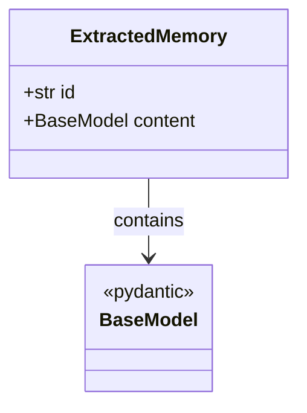
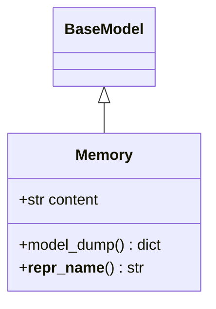
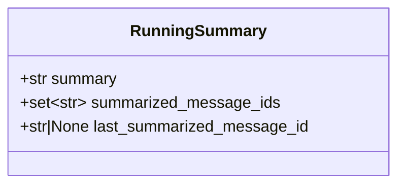
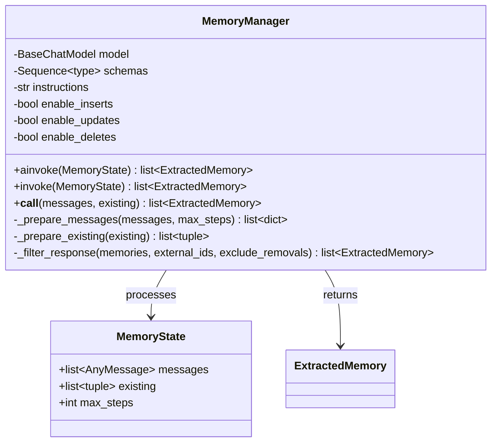
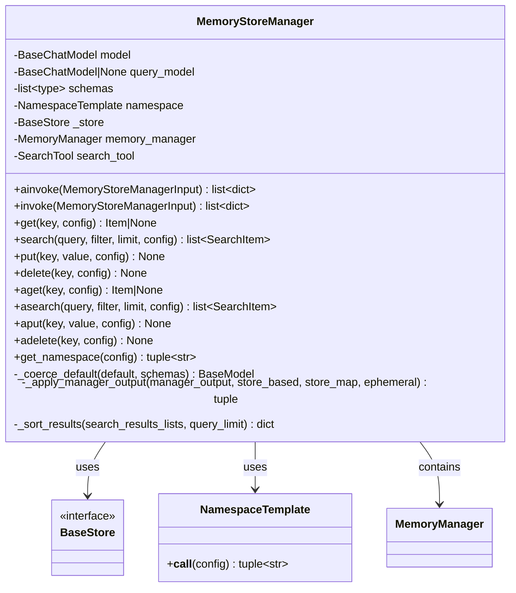
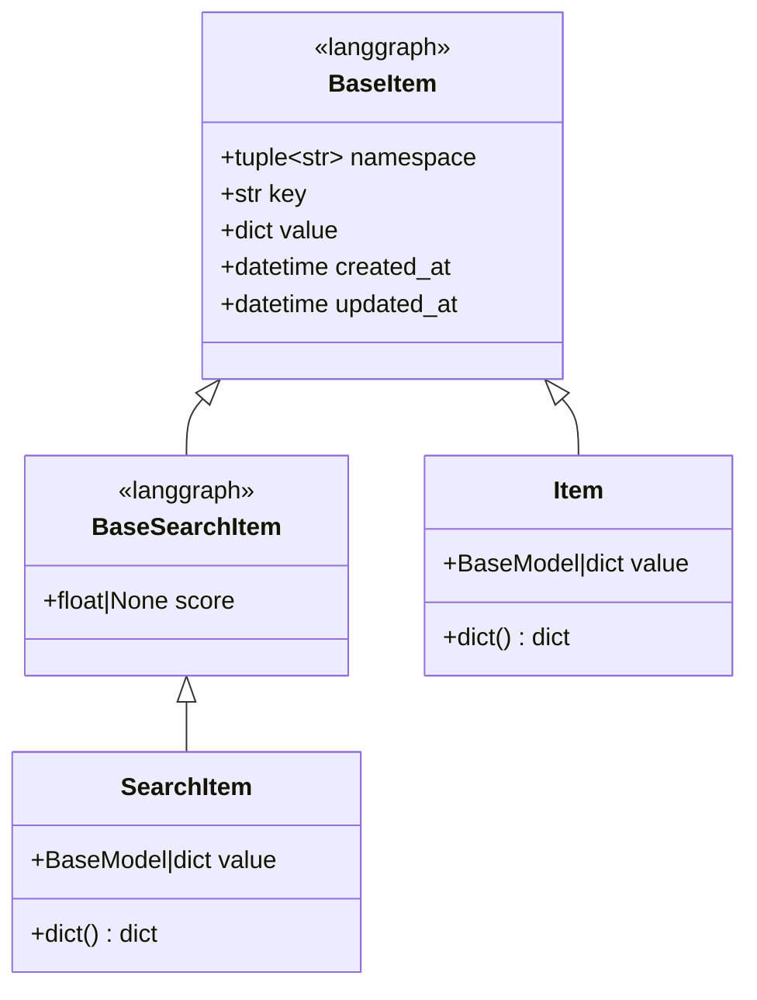
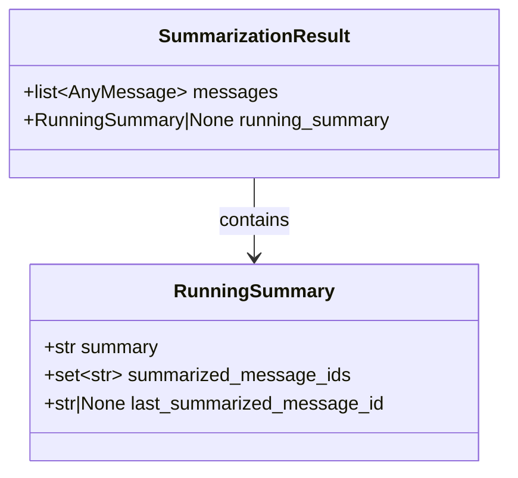
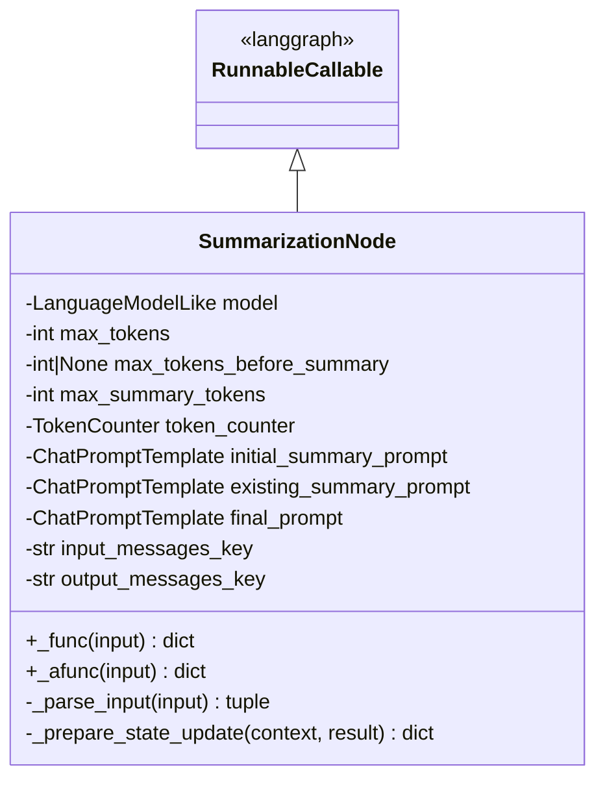
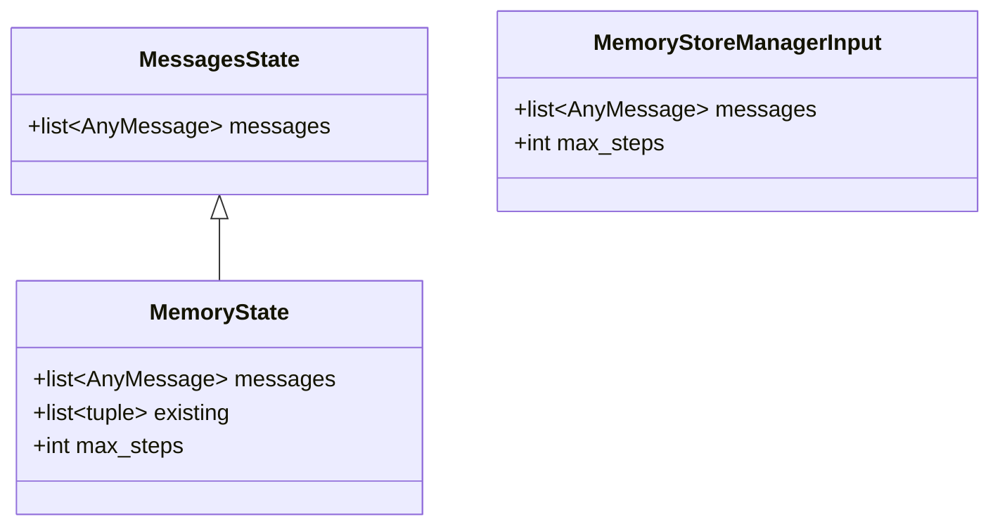
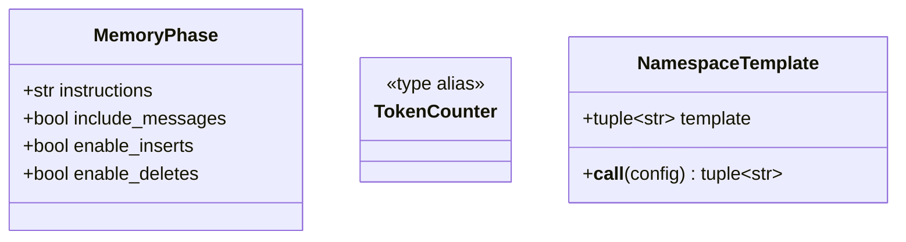

<!-- source: DeepWiki mcp.deepwiki.com · repo langchain-ai/langmem · page 9.2 Memory Types and Classes · fetched 2026-10-26 -->

# Memory Types and Classes

<details>
<summary>Relevant source files</summary>

The following files were used as context for generating this wiki page:

- [src/langmem/knowledge/extraction.py](src/langmem/knowledge/extraction.py)
- [src/langmem/short_term/summarization.py](src/langmem/short_term/summarization.py)

</details>


This page documents the core memory-related classes, data structures, and type definitions in LangMem. These classes handle memory extraction, storage, retrieval, and summarization operations within the LangMem system.

For information about using these classes in practice, see [Memory Management](#2). For details about the main API functions that create these classes, see [Main API Functions](#9.1).

## Core Memory Data Structures

### ExtractedMemory

The `ExtractedMemory` type represents the fundamental unit of extracted memory content returned by memory processing operations.



**ExtractedMemory Structure**

| Field | Type | Description |
|-------|------|-------------|
| `id` | `str` | Unique identifier for the memory |
| `content` | `BaseModel` | Structured memory content as Pydantic model |

Sources: [src/langmem/knowledge/extraction.py:78-81]()

### Memory Schema

The default `Memory` schema provides a simple structure for unstructured memory content.



Sources: [src/langmem/knowledge/extraction.py:86-93]()

### RunningSummary

The `RunningSummary` dataclass tracks conversation summarization state across multiple summarization operations.



**RunningSummary Fields**

| Field | Type | Description |
|-------|------|-------------|
| `summary` | `str` | Latest summary text |
| `summarized_message_ids` | `set[str]` | IDs of all summarized messages |
| `last_summarized_message_id` | `str \| None` | ID of most recently summarized message |

Sources: [src/langmem/short_term/summarization.py:53-67]()

## Memory Processing Classes

### MemoryManager

The `MemoryManager` class handles core memory extraction and updating logic without persistent storage.



**Key Methods:**
- `ainvoke()` / `invoke()`: Process messages and extract memories
- `_prepare_messages()`: Format conversation for LLM processing
- `_prepare_existing()`: Format existing memories for update operations
- `_filter_response()`: Handle memory removals and updates

Sources: [src/langmem/knowledge/extraction.py:217-534]()

### MemoryStoreManager

The `MemoryStoreManager` integrates memory processing with persistent storage via LangGraph's `BaseStore`.



**Storage Operations:**
- `get()` / `aget()`: Retrieve single memory by key
- `search()` / `asearch()`: Search memories with query/filter
- `put()` / `aput()`: Store memory with indexing options
- `delete()` / `adelete()`: Remove memory from storage

**Memory Processing:**
- `ainvoke()` / `invoke()`: Full memory enrichment pipeline
- `_apply_manager_output()`: Apply memory updates to storage
- `_sort_results()`: Rank search results by relevance

Sources: [src/langmem/knowledge/extraction.py:832-1663]()

## Storage Integration Classes

### Item and SearchItem

Enhanced versions of LangGraph's storage items with automatic Pydantic model coercion.



**Key Features:**
- Automatic coercion of `dict` values to Pydantic models
- Enhanced `dict()` serialization with JSON mode
- Maintains compatibility with LangGraph storage interface

Sources: [src/langmem/knowledge/extraction.py:44-61]()

## Summarization Classes

### SummarizationResult

Container for message summarization output and state tracking.



Sources: [src/langmem/short_term/summarization.py:70-79]()

### SummarizationNode

LangGraph-compatible node for message summarization within graph workflows.



**Configuration Options:**
- `input_messages_key`: State key for input messages (default: `"messages"`)
- `output_messages_key`: State key for output messages (default: `"summarized_messages"`)
- Token limits and prompt templates for summarization control

Sources: [src/langmem/short_term/summarization.py:660-860]()

## State and Configuration Types

### Input State Types



**State Type Usage:**
- `MessagesState`: Basic message container for thread extraction
- `MemoryState`: Extended state for memory processing with existing memories
- `MemoryStoreManagerInput`: Input schema for storage-integrated memory management

Sources: [src/langmem/knowledge/extraction.py:64-830]()

### Memory Processing Configuration



**Configuration Types:**
- `MemoryPhase`: Defines multi-phase memory processing steps
- `TokenCounter`: Function type for counting message tokens
- `NamespaceTemplate`: Dynamic namespace resolution from runtime config

Sources: [src/langmem/knowledge/extraction.py:818-823](), [src/langmem/short_term/summarization.py:20]()

## Class Relationships and Data Flow

```mermaid
flowchart TD
    Messages["list[AnyMessage]"] --> MemoryManager
    MemoryManager --> ExtractedMemory
    ExtractedMemory --> MemoryStoreManager
    MemoryStoreManager --> BaseStore
    BaseStore --> Item
    BaseStore --> SearchItem
    
    Messages --> SummarizationNode
    SummarizationNode --> SummarizationResult
    SummarizationResult --> RunningSummary
    
    MemoryStoreManager -.-> MemoryManager : "uses internally"
    MemoryStoreManager -.-> NamespaceTemplate : "resolves namespaces"
    
    subgraph "Memory Processing"
        MemoryManager
        ExtractedMemory
    end
    
    subgraph "Storage Layer"
        MemoryStoreManager
        BaseStore
        Item
        SearchItem
    end
    
    subgraph "Summarization"
        SummarizationNode
        SummarizationResult
        RunningSummary
    end
```

This diagram shows how messages flow through the different class layers, from raw message processing through memory extraction to persistent storage, with summarization as a parallel concern for managing conversation context.

Sources: [src/langmem/knowledge/extraction.py:217-1663](), [src/langmem/short_term/summarization.py:53-860]()

---

