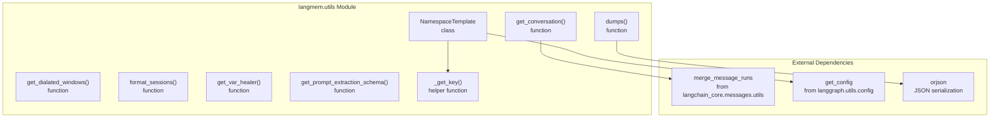
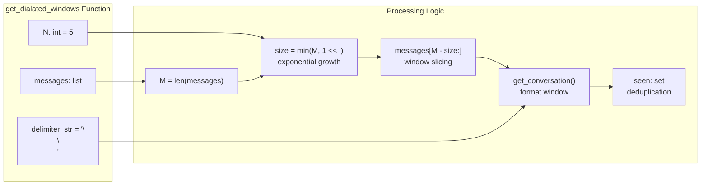
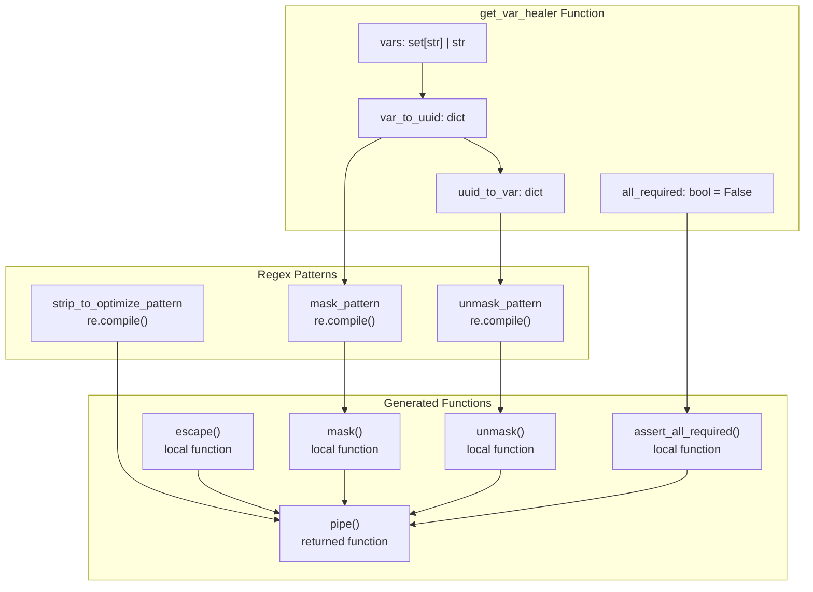
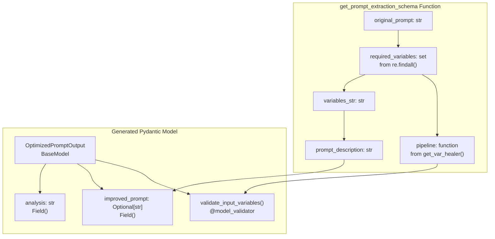

<!-- source: DeepWiki mcp.deepwiki.com · repo langchain-ai/langmem · page 9.3 Utility Functions · fetched 2026-10-26 -->

# Utility Functions

<details>
<summary>Relevant source files</summary>

The following files were used as context for generating this wiki page:

- [src/langmem/short_term/__init__.py](src/langmem/short_term/__init__.py)
- [src/langmem/utils.py](src/langmem/utils.py)

</details>


This page documents the utility functions provided by LangMem that support the core functionality of the system. These utilities handle common operations such as namespace templating, conversation formatting, variable management, and serialization, allowing the main components to focus on their primary responsibilities.

## Overview

The utility functions in LangMem serve as supporting tools for several key operations:

1. **Namespace Management** - Utilities that handle templating and dynamic namespacing
2. **Conversation Formatting** - Functions for formatting, merging, and processing conversation histories
3. **Variable Handling** - Tools for managing variables in prompts and templates
4. **Serialization** - Functions for object serialization

Core langmem.utils Module Functions


Sources: [src/langmem/utils.py:1-252]()

## Namespace Utilities

### NamespaceTemplate

The `NamespaceTemplate` class provides a flexible way to create dynamic namespaces that can include variables substituted from configuration.

NamespaceTemplate Implementation Details
```mermaid
graph TD
    subgraph "NamespaceTemplate Class"
        init["__init__()<br/>template: Union[tuple, str, NamespaceTemplate]"]
        call["__call__()<br/>config: RunnableConfig | None"]
        template_slot["template: tuple[str, ...]<br/>__slots__"]
        vars_slot["vars: dict[int, str]<br/>__slots__"]
    end
    
    subgraph "Processing Flow"
        RunnableConfig["RunnableConfig"]
        get_config_func["get_config()<br/>from langgraph.utils.config"]
        configurable["config['configurable']"]
        _get_key_func["_get_key()<br/>helper function"]
    end
    
    subgraph "Error Handling"
        ConfigurationError["ConfigurationError<br/>from langmem.errors"]
    end
    
    init --> template_slot
    init --> vars_slot
    init --> _get_key_func
    call --> get_config_func
    call --> configurable
    call --> ConfigurationError
    RunnableConfig --> get_config_func
```

Sources: [src/langmem/utils.py:15-91]()

#### Key Features

- Substitutes variables in curly braces with values from the RunnableConfig's 'configurable' field
- Works with both simple string namespaces and tuple namespaces
- Automatically retrieves the current config when called in a LangGraph context

#### Usage Examples

```python
# Fixed namespace
ns = NamespaceTemplate("user_123")
ns()  # Returns: ('user_123',)

# Variable namespace
ns = NamespaceTemplate(("org", "{user_id}"))
ns({"configurable": {"user_id": "alice"}})  # Returns: ('org', 'alice')

# In LangGraph context, the config is automatically retrieved
@entrypoint()
def my_agent(messages):
    ns = NamespaceTemplate(("org", "{user_id}"))
    print(ns())  # Will use the configurable field from context
```

Sources: [src/langmem/utils.py:15-91]()

## Conversation Formatting Utilities

LangMem provides several utilities for working with conversation histories:

### get_conversation

Merges and formats a list of messages into a pretty-printed conversation string.

```python
def get_conversation(messages: list, delimiter="\n\n"):
    merged = merge_message_runs(messages)
    return delimiter.join(m.pretty_repr() for m in merged)
```

Sources: [src/langmem/utils.py:98-100]()

### get_dialated_windows

Creates "dilated" windows of conversation history, where each window is approximately twice the size of the previous one, up to the full conversation length.

Conversation Window Processing


Sources: [src/langmem/utils.py:103-119]()

### format_sessions

Formats a list of conversation sessions, possibly with associated feedback, into a standardized string format suitable for prompts.

```python
def format_sessions(
    sessions: list[list[AnyMessage]] | list[AnyMessage] | list[tuple[list[AnyMessage], dict]] | tuple[list[AnyMessage], dict] | str,
):
    # Formats sessions with optional feedback into a string
    # Each session gets a unique ID and structured format
```

Sources: [src/langmem/utils.py:125-162]()

## Variable Handling Utilities

### get_var_healer

Creates a function that handles f-string variable substitution in prompts, ensuring variables are properly escaped and retained.

Variable Healing Implementation


Sources: [src/langmem/utils.py:165-209]()

### get_prompt_extraction_schema

Creates a Pydantic schema for extracting and validating optimized prompts, ensuring that all required variables are preserved.

OptimizedPromptOutput Schema Generation


Sources: [src/langmem/utils.py:212-248]()

## Serialization Utilities

### dumps

A simple wrapper around `orjson.dumps` that ensures the output is a UTF-8 string.

```python
def dumps(obj: typing.Any) -> str:
    return orjson.dumps(obj).decode("utf-8")
```

Sources: [src/langmem/utils.py:251-252]()

## JSON Serialization Utilities

### dumps

A simple wrapper around `orjson.dumps` that ensures the output is a UTF-8 string.

```python
def dumps(obj: typing.Any) -> str:
    return orjson.dumps(obj).decode("utf-8")
```

Sources: [src/langmem/utils.py:251-252]()

## Integration with LangMem Components

The utility functions integrate with other LangMem components to provide essential functionality for the memory management system.

langmem.utils Integration Points

```mermaid
graph TD
    subgraph "langmem.utils Functions"
        NamespaceTemplate_class["NamespaceTemplate"]
        get_conversation_func["get_conversation()"]
        get_dialated_windows_func["get_dialated_windows()"]
        format_sessions_func["format_sessions()"]
        get_var_healer_func["get_var_healer()"]
        get_prompt_extraction_schema_func["get_prompt_extraction_schema()"]
        dumps_func["dumps()"]
    end
    
    subgraph "LangMem Core Components"
        create_manage_memory_tool["create_manage_memory_tool<br/>Memory Tools"]
        create_search_memory_tool["create_search_memory_tool<br/>Memory Tools"]
        summarize_messages["summarize_messages<br/>Short-Term Memory"]
        create_prompt_optimizer["create_prompt_optimizer<br/>Prompt Optimization"]
        create_multi_prompt_optimizer["create_multi_prompt_optimizer<br/>Prompt Optimization"]
    end
    
    subgraph "External Dependencies"
        BaseStore["BaseStore<br/>from langgraph.store"]
        RunnableConfig["RunnableConfig<br/>from langchain_core.runnables"]
    end
    
    NamespaceTemplate_class --> create_manage_memory_tool
    NamespaceTemplate_class --> create_search_memory_tool
    NamespaceTemplate_class --> BaseStore
    NamespaceTemplate_class --> RunnableConfig
    
    get_conversation_func --> summarize_messages
    get_dialated_windows_func --> summarize_messages
    format_sessions_func --> create_prompt_optimizer
    format_sessions_func --> create_multi_prompt_optimizer
    
    get_var_healer_func --> create_prompt_optimizer
    get_prompt_extraction_schema_func --> create_prompt_optimizer
    
    dumps_func --> BaseStore
```


Sources: [src/langmem/utils.py:15-91](), [src/langmem/utils.py:98-100](), [src/langmem/utils.py:165-209]()

## Utility Function Reference Table

Here's a summary of the utility functions available in LangMem:

| Function | Purpose | Location |
|----------|---------|----------|
| `NamespaceTemplate` | Templates namespace strings with variable substitution | [src/langmem/utils.py:15-91]() |
| `get_conversation` | Formats message lists into readable conversation strings | [src/langmem/utils.py:98-100]() |
| `get_dialated_windows` | Creates exponentially growing conversation windows | [src/langmem/utils.py:103-119]() |
| `format_sessions` | Formats conversation sessions with optional feedback | [src/langmem/utils.py:125-162]() |
| `get_var_healer` | Creates a function to preserve variables in strings | [src/langmem/utils.py:165-209]() |
| `get_prompt_extraction_schema` | Creates schema for validating optimized prompts | [src/langmem/utils.py:212-248]() |
| `dumps` | Serializes objects to JSON strings | [src/langmem/utils.py:251-252]() |
| `create_prompt_optimizer` | Creates a single prompt optimizer | [src/langmem/prompts/optimization.py:50-269]() |
| `create_multi_prompt_optimizer` | Creates a multi-prompt optimizer | [src/langmem/prompts/optimization.py:471-616]() |

Sources: [src/langmem/utils.py:1-252](), [src/langmem/prompts/optimization.py:50-269](), [src/langmem/prompts/optimization.py:471-616]()

---

