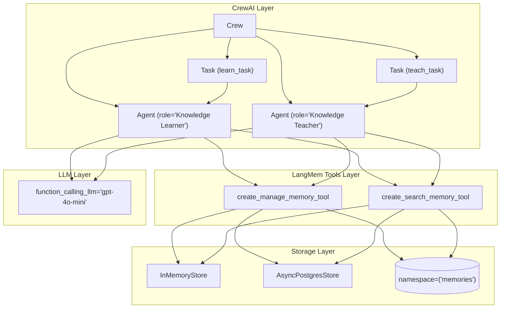
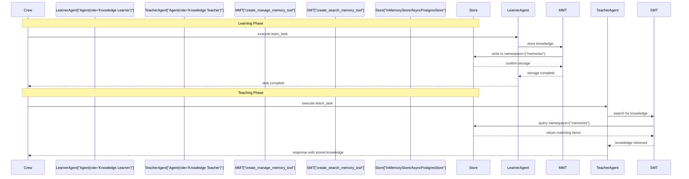

<!-- source: DeepWiki mcp.deepwiki.com · repo langchain-ai/langmem · extra page CrewAI Integration · fetched 2026-10-26 -->

# CrewAI Integration

<details>
<summary>Relevant source files</summary>

The following files were used as context for generating this wiki page:

- [docs/docs/guides/extract_episodic_memories.md](docs/docs/guides/extract_episodic_memories.md)
- [docs/docs/guides/memory_tools.md](docs/docs/guides/memory_tools.md)
- [docs/docs/guides/use_tools_in_crewai.md](docs/docs/guides/use_tools_in_crewai.md)

</details>


This document covers how to integrate LangMem memory tools with CrewAI multi-agent systems to enable persistent knowledge sharing across agents. CrewAI agents use LangMem's memory tools to store, update, and search memories in shared knowledge bases.

For LangGraph-native agent integration, see [LangGraph Integration](#4.1). For building custom agents with memory tools, see [Custom Agents](#4.2.3).

## Architecture Overview

CrewAI integration follows a tool-based pattern where LangMem provides memory management capabilities as tools that CrewAI agents can use during task execution.

### CrewAI-LangMem Integration Architecture



Sources: [docs/docs/guides/use_tools_in_crewai.md:22-92]()

## Basic Configuration

CrewAI agents receive memory tools through their `tools` parameter. Both `create_manage_memory_tool` and `create_search_memory_tool` require explicit store configuration when used outside LangGraph.

### Core Components Setup

| Component | Purpose | Configuration |
|-----------|---------|---------------|
| `InMemoryStore` | Development storage | `index={"dims": 1536, "embed": "openai:text-embedding-3-small"}` |
| `create_manage_memory_tool` | Memory CRUD operations | `namespace="memories", store=store` |
| `create_search_memory_tool` | Memory retrieval | `namespace="memories", store=store` |
| `Agent.tools` | Tool assignment | `tools=[memory_tools]` |

```python
# Basic tool configuration
memory_tools = [
    create_manage_memory_tool(namespace="memories", store=store),
    create_search_memory_tool(namespace="memories", store=store),
]

# Agent configuration  
knowledge_agent = Agent(
    role='Knowledge Manager',
    goal='Build and maintain a knowledge base',
    tools=memory_tools,
    verbose=True
)
```

Sources: [docs/docs/guides/use_tools_in_crewai.md:34-48]()

## Multi-Agent Knowledge Sharing

CrewAI's shared execution context enables multiple agents to access the same memory store, creating collaborative knowledge management workflows.

### Multi-Agent Memory Sharing Flow



Sources: [docs/docs/guides/use_tools_in_crewai.md:77-112]()

## Memory Organization Patterns

CrewAI integration supports multiple namespace organization patterns for different collaboration scenarios.

### Namespace Configuration Options

| Pattern | Namespace | Use Case |
|---------|-----------|----------|
| Shared Knowledge | `"memories"` | Team-wide knowledge base |
| Agent-Specific | `("memories", "agent_id")` | Individual agent memories |
| Project-Scoped | `("memories", "project_x")` | Project-specific knowledge |
| Role-Based | `("memories", "role_name")` | Role-specific expertise |

### Team Knowledge Base Example

```python
# Shared namespace for team collaboration
base_tools = [
    create_manage_memory_tool(namespace="memories", store=store),
    create_search_memory_tool(namespace="memories", store=store),
]

# Multiple agents sharing same knowledge base
learner = Agent(
    role="Knowledge Learner", 
    tools=base_tools,
    function_calling_llm="gpt-4o-mini",
)

teacher = Agent(
    role="Knowledge Teacher",
    tools=base_tools, 
    function_calling_llm="gpt-4o-mini", 
)
```

Sources: [docs/docs/guides/use_tools_in_crewai.md:71-92]()

## Implementation Details

### Store Configuration Requirements

CrewAI integration requires explicit store configuration since CrewAI agents operate outside LangGraph's automatic store management.

```python
# Required store configuration
store = InMemoryStore(
    index={
        "dims": 1536,  # OpenAI text-embedding-3-small dimensions
        "embed": "openai:text-embedding-3-small",
    }
)

# Tools require explicit store parameter
create_manage_memory_tool(namespace="memories", store=store)
create_search_memory_tool(namespace="memories", store=store)
```

### Task Execution Integration

CrewAI tasks trigger memory operations through agent tool usage during task execution.

```python
# Task definitions that utilize memory tools
learn_task = Task(
    description="Save some of your favorite Demon Slayer quotes in memory.",
    agent=learner,
    expected_output="Response:",
)

teach_task = Task(
    description="Search your memories for information about your teammates.", 
    agent=teacher,
    expected_output="Response:",
)

# Sequential task execution
crew = Crew(agents=[learner, teacher], tasks=[learn_task])
result = crew.kickoff()

crew = Crew(agents=[learner, teacher], tasks=[teach_task]) 
result = crew.kickoff()
```

Sources: [docs/docs/guides/use_tools_in_crewai.md:95-112]()

## Production Considerations

### Storage Backend Selection

| Environment | Store Type | Configuration |
|-------------|------------|---------------|
| Development | `InMemoryStore` | No persistence, fast startup |
| Production | `AsyncPostgresStore` | Persistent, scalable, concurrent |
| Testing | `InMemoryStore` | Isolated test environments |

### Memory Item Structure

CrewAI agents store memories as `Item` objects with standardized structure:

```python
# Example stored memory structure
Item(
    namespace=["memories"],
    key="bd61f87e-d591-45b7-b950-3f9318604ea3", 
    value={
        "content": '"The bond between Nezuko and I can never be severed..." - Tanjiro'
    },
    created_at="2025-02-07T22:24:37.736962+00:00",
    updated_at="2025-02-07T22:24:37.736969+00:00",
    score=None,
)
```

### Function Calling LLM Requirements

CrewAI memory tools require function calling capabilities:

```python
# Supported function calling models
Agent(
    function_calling_llm="gpt-4o-mini",  # OpenAI
    function_calling_llm="anthropic:claude-3-5-sonnet-latest",  # Anthropic
)
```

Sources: [docs/docs/guides/use_tools_in_crewai.md:27-32](), [docs/docs/guides/use_tools_in_crewai.md:83-91](), [docs/docs/guides/use_tools_in_crewai.md:114-127]()

---

