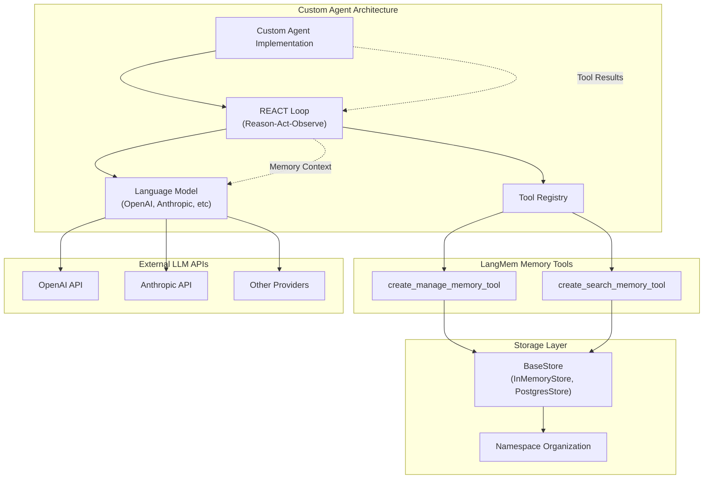
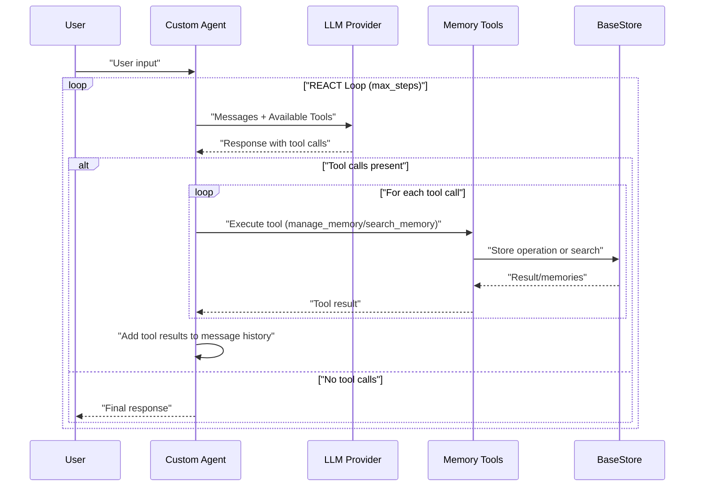
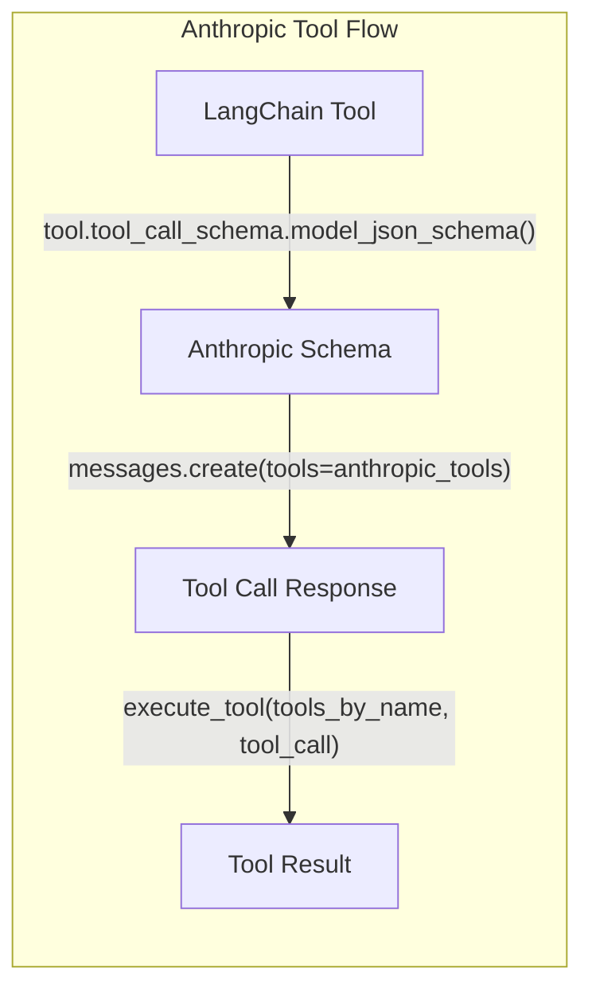

<!-- source: DeepWiki mcp.deepwiki.com · repo langchain-ai/langmem · extra page Custom Agents · fetched 2026-10-26 -->

# Custom Agents

<details>
<summary>Relevant source files</summary>

The following files were used as context for generating this wiki page:

- [docs/docs/guides/use_tools_in_custom_agent.md](docs/docs/guides/use_tools_in_custom_agent.md)
- [src/langmem/knowledge/tools.py](src/langmem/knowledge/tools.py)

</details>


This document covers building custom agents that integrate LangMem's memory tools for persistent knowledge across conversations. Custom agents give you full control over the agent implementation while leveraging LangMem's memory management capabilities.

For prebuilt agent solutions using LangGraph's `create_react_agent`, see [ReAct Agents](#4.2.1). For multi-agent system integration, see [CrewAI Integration](#4.2.2).

## Core Integration Pattern

Custom agents with LangMem follow a standard pattern where agents use memory tools during their reasoning loops to store and retrieve persistent information. The integration centers around two key tools from [src/langmem/knowledge/tools.py:25-356]():

- `create_manage_memory_tool` - Creates, updates, and deletes memories
- `create_search_memory_tool` - Searches through stored memories



**Sources:** [src/langmem/knowledge/tools.py:25-486](), [docs/docs/guides/use_tools_in_custom_agent.md:1-282]()

## Tool Integration

### Memory Management Tool

The `create_manage_memory_tool` function creates a tool that allows agents to perform CRUD operations on memories. The tool signature includes:

| Parameter | Type | Purpose |
|-----------|------|---------|
| `content` | `schema` (default: `str`) | Memory content to store |
| `action` | `Literal["create", "update", "delete"]` | Operation type |
| `id` | `UUID` | Memory identifier for update/delete |

The tool is configured with a namespace pattern and optional action restrictions via `actions_permitted` parameter from [src/langmem/knowledge/tools.py:34-36]().

### Memory Search Tool

The `create_search_memory_tool` function creates a tool for semantic and exact memory search with these parameters:

| Parameter | Type | Purpose |
|-----------|------|---------|
| `query` | `str` | Search query text |
| `limit` | `int` | Maximum results (default: 10) |
| `offset` | `int` | Result offset (default: 0) |
| `filter` | `dict` | Additional filter criteria |

**Sources:** [src/langmem/knowledge/tools.py:362-486]()

## Implementation Patterns

### REACT Loop Implementation

Custom agents typically implement a REACT (Reason-Act-Observe) loop that integrates memory tools. The pattern involves:



**Sources:** [docs/docs/guides/use_tools_in_custom_agent.md:43-98](), [docs/docs/guides/use_tools_in_custom_agent.md:171-222]()

### Tool Execution Function

Custom agents require a tool execution handler that maps tool calls to actual tool invocations. The pattern from [docs/docs/guides/use_tools_in_custom_agent.md:28-40]() shows:

```python
def execute_tool(tools_by_name: Dict[str, Any], tool_call: Dict[str, Any]) -> str:
    tool_name = tool_call.name  # or tool_call["function"]["name"] for OpenAI
    tool = tools_by_name[tool_name]
    result = tool.invoke(tool_call.input)  # or tool_call["function"]["arguments"]
    return str(result)
```

### Store Configuration

Custom agents must configure a `BaseStore` instance and pass it to the memory tools. The typical setup involves:

```python
store = InMemoryStore(
    index={
        "dims": 1536,
        "embed": "openai:text-embedding-3-small",
    }
)
memory_tools = [
    create_manage_memory_tool(namespace="memories", store=store),
    create_search_memory_tool(namespace="memories", store=store),
]
```

**Sources:** [docs/docs/guides/use_tools_in_custom_agent.md:102-111]()

## Provider-Specific Implementations

### Anthropic Integration

Anthropic's Claude models use a specific tool calling format where tools are converted to their schema format:



The schema conversion uses `tool.tool_call_schema.model_json_schema()` from [docs/docs/guides/use_tools_in_custom_agent.md:54]().

### OpenAI Integration

OpenAI's format requires wrapping tools in a function specification:

```python
openai_tools = [
    {
        "type": "function",
        "function": {
            "name": tool.name,
            "description": tool.description,
            "parameters": tool.tool_call_schema.model_json_schema(),
        },
    }
    for tool in tools
]
```

**Sources:** [docs/docs/guides/use_tools_in_custom_agent.md:178-188]()

## Namespace and Store Management

### Namespace Configuration

Custom agents must handle namespace configuration for memory organization. The tools use `NamespaceTemplate` from [src/langmem/knowledge/tools.py:263]() to support dynamic namespacing:

```python
# Simple namespace
create_manage_memory_tool(namespace="memories", store=store)

# Dynamic namespace (requires config context)
create_manage_memory_tool(namespace=("memories", "{user_id}"), store=store)
```

### Store Retrieval

When not providing an explicit store parameter, tools use `get_store()` from [src/langmem/knowledge/tools.py:494]() to retrieve the store from LangGraph context. Custom agents typically provide the store explicitly via the `store` parameter.

**Sources:** [src/langmem/knowledge/tools.py:489-497]()

## Error Handling

Custom agents should handle several error scenarios:

| Error Type | Source | Handling |
|------------|--------|----------|
| Tool not found | Agent implementation | Return error message |
| Invalid tool arguments | Memory tools | Catch `ValueError` exceptions |
| Store configuration | `_get_store()` function | Handle `ConfigurationError` |
| Action restrictions | `actions_permitted` validation | Validate before execution |

The tools include built-in validation for actions like preventing ID specification during creation from [src/langmem/knowledge/tools.py:283-286]().

**Sources:** [src/langmem/knowledge/tools.py:278-291](), [src/langmem/knowledge/tools.py:489-497]()

---

