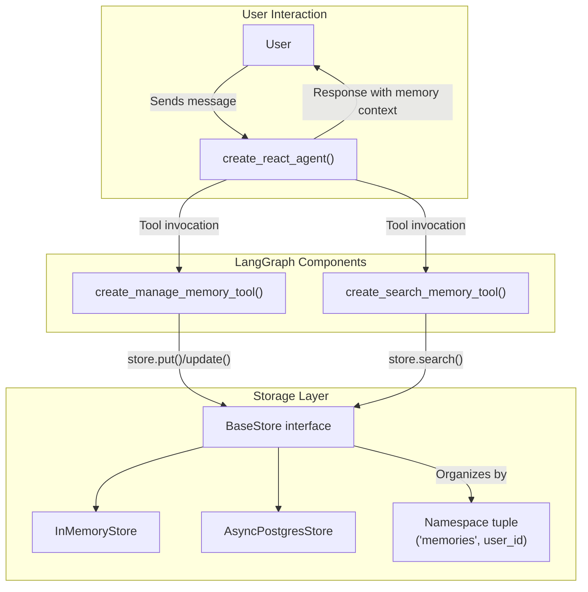
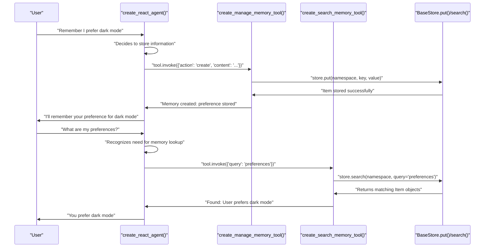
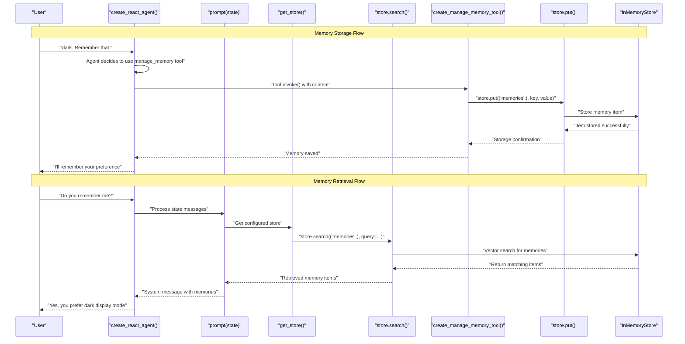
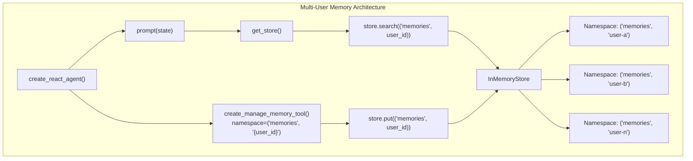

<!-- source: DeepWiki mcp.deepwiki.com · repo langchain-ai/langmem · extra page ReAct Agents · fetched 2026-10-26 -->

# ReAct Agents

<details>
<summary>Relevant source files</summary>

The following files were used as context for generating this wiki page:

- [docs/docs/guides/extract_episodic_memories.md](docs/docs/guides/extract_episodic_memories.md)
- [docs/docs/guides/memory_tools.md](docs/docs/guides/memory_tools.md)
- [docs/docs/guides/use_tools_in_crewai.md](docs/docs/guides/use_tools_in_crewai.md)
- [docs/docs/hot_path_quickstart.md](docs/docs/hot_path_quickstart.md)

</details>


This page documents how to integrate LangMem's memory capabilities with LangGraph's prebuilt ReAct agents. ReAct (Reasoning + Acting) agents use `langgraph.prebuilt.create_react_agent()` and allow LLMs to interleave reasoning steps with concrete actions through tools. For information about other agent integrations, see [CrewAI Integration](#4.2.2) and [Custom Agents](#4.2.3).

## Overview of ReAct Agents with Memory

LangGraph's `create_react_agent()` function creates agents that can be enhanced with LangMem memory tools, providing:
- Long-term memory capabilities through `create_manage_memory_tool()` and `create_search_memory_tool()`
- Persistent storage via LangGraph's `BaseStore` interface
- Automatic memory management during agent execution
- Namespace-based memory organization for multi-user applications

The integration leverages LangGraph's built-in tool calling capabilities, allowing agents to invoke memory tools during their ReAct loops.

Sources: [docs/docs/guides/use_tools_in_custom_agent.md:1-281]()

## Architecture

### ReAct Agent Memory Integration



The `create_react_agent()` function integrates with LangMem through the `create_manage_memory_tool()` and `create_search_memory_tool()` functions. These tools use LangGraph's `BaseStore` interface for persistence, supporting both `InMemoryStore` and `AsyncPostgresStore` implementations.

Sources: [docs/docs/guides/use_tools_in_custom_agent.md:24-111]()

### Memory Flow Process



This sequence shows how `create_react_agent()` uses the `tool.invoke()` method to call memory tools, which then interact with the underlying `BaseStore` using methods like `put()` and `search()`.

Sources: [docs/docs/guides/use_tools_in_custom_agent.md:28-40](), [docs/docs/guides/use_tools_in_custom_agent.md:156-168]()

## Implementation

### Creating a ReAct Agent with Memory

The recommended pattern for creating a ReAct agent with memory capabilities uses a custom `prompt` function for eager memory retrieval:

```python
from langgraph.checkpoint.memory import MemorySaver
from langgraph.prebuilt import create_react_agent
from langgraph.store.memory import InMemoryStore
from langgraph.utils.config import get_store
from langmem import create_manage_memory_tool

def prompt(state):
    """Prepare the messages for the LLM with memory context."""
    # Get store from configured contextvar
    store = get_store()
    memories = store.search(
        ("memories",),
        query=state["messages"][-1].content,
    )
    system_msg = f"""You are a helpful assistant.

## Memories
<memories>
{memories}
</memories>
"""
    return [{"role": "system", "content": system_msg}, *state["messages"]]

# Set up storage with vector indexing
store = InMemoryStore(
    index={
        "dims": 1536,
        "embed": "openai:text-embedding-3-small",
    }
) 

# Set up checkpointer for conversation state
checkpointer = MemorySaver()

# Create ReAct agent with memory tools
agent = create_react_agent( 
    "anthropic:claude-3-5-sonnet-latest",
    prompt=prompt,
    tools=[
        create_manage_memory_tool(namespace=("memories",)),
    ],
    store=store,
    checkpointer=checkpointer, 
)
```

| Component | Purpose | Key Parameters |
|-----------|---------|----------------|
| `prompt()` | Eager memory retrieval and context injection | Uses `get_store()` and `store.search()` |
| `create_manage_memory_tool()` | Agent-driven memory management | `namespace` tuple |
| `InMemoryStore` | Vector-indexed memory storage | `index` with embedding config |
| `MemorySaver` | Conversation state persistence | Maintains thread history |
| `create_react_agent()` | LangGraph's prebuilt ReAct agent | `model`, `prompt`, `tools`, `store`, `checkpointer` |

Sources: [docs/docs/hot_path_quickstart.md:35-89]()

### Memory Flow Process



This sequence demonstrates the dual-path memory integration: eager retrieval through the `prompt()` function using `get_store()` and `store.search()`, and agent-driven storage through `create_manage_memory_tool()` using `store.put()`.

Sources: [docs/docs/hot_path_quickstart.md:46-63](), [docs/docs/hot_path_quickstart.md:125-166]()

## Advanced Features

### Using the Agent

The ReAct agent usage pattern demonstrates both memory storage and cross-thread retrieval:

```python
# Configure thread for conversation persistence
config = {"configurable": {"thread_id": "thread-a"}}

# Agent stores memory when instructed
response = agent.invoke(
    {"messages": [{"role": "user", "content": "dark. Remember that."}]},
    config=config,
)

# New thread demonstrates cross-conversation memory persistence
new_config = {"configurable": {"thread_id": "thread-b"}}
response = agent.invoke(
    {"messages": [{"role": "user", "content": "Hey there. Do you remember me? What are my preferences?"}]},
    config=new_config,
)
print(response["messages"][-1].content)
# Output: "Based on my memory search, I can see that you've previously indicated a preference for dark display mode..."
```

Key behaviors:

| Aspect | Mechanism | Implementation |
|--------|-----------|----------------|
| **Memory Storage** | Agent-driven tool usage | `create_manage_memory_tool()` invoked by agent |
| **Memory Retrieval** | Eager search in prompt | `store.search()` in `prompt()` function |
| **Thread Isolation** | `MemorySaver` checkpointer | Separate conversation state per thread |
| **Cross-Thread Memory** | Persistent store | Memories accessible across threads |

The agent autonomously decides when to store memories using tools, while memory retrieval happens automatically for every message through the `prompt()` function.

Sources: [docs/docs/hot_path_quickstart.md:128-166]()

### User-Specific Memory with Namespaces



LangMem supports templated namespaces that resolve dynamically based on the `configurable` values in the runtime config:

| Organization Pattern | Namespace Template | Use Case |
|---------------------|------------------|-----------|
| By user | `("memories", "{user_id}")` | Separate memories per user |
| By assistant | `("memories", "{assistant_id}")` | Assistant may have memories spanning multiple users |
| By user & organization | `("memories", "{organization_id}", "{user_id}")` | Search across organization while scoping per user |
| Further subdivisions | `("memories", "{user_id}", "manual_memories")` | Organize different types of user data |

Implementation with templated namespaces:

```python
def prompt(state):
    """Prompt function with dynamic namespace resolution."""
    store = get_store()
    # Namespace resolves automatically from config
    memories = store.search(
        ("memories", "{user_id}"),
        query=state["messages"][-1].content,
    )
    # ... rest of prompt logic

agent = create_react_agent( 
    "anthropic:claude-3-5-sonnet-latest",
    prompt=prompt,
    tools=[
        create_manage_memory_tool(namespace=("memories", "{user_id}")),
    ],
    store=store,
    checkpointer=checkpointer,
)

# Usage with different users
response_a = agent.invoke(
    {"messages": [{"role": "user", "content": "Remember my favorite color is blue"}]},
    config={"configurable": {"user_id": "user-a"}}
)

response_b = agent.invoke(
    {"messages": [{"role": "user", "content": "Remember I prefer dark mode"}]},
    config={"configurable": {"user_id": "user-b"}}
)
```

The `{user_id}` template gets resolved at runtime from the `configurable` field, ensuring memory isolation between users while maintaining the same agent code.

Sources: [docs/docs/hot_path_quickstart.md:94-103]()

## Use Cases and Examples

### Prompt Function Memory Integration

The recommended pattern uses a `prompt()` function for eager memory retrieval, automatically including relevant memories in every LLM call:

```python
from langgraph.utils.config import get_store

def prompt(state):
    """Prepare messages with automatic memory context injection."""
    # Get store from LangGraph's managed context
    store = get_store()
    
    # Search for memories relevant to the latest user message
    memories = store.search(
        ("memories",),
        query=state["messages"][-1].content,
    )
    
    # Inject memories into system message
    system_msg = f"""You are a helpful assistant.

## Memories
<memories>
{memories}
</memories>
"""
    return [{"role": "system", "content": system_msg}, *state["messages"]]

# Agent uses prompt function for automatic memory integration
agent = create_react_agent(
    "anthropic:claude-3-5-sonnet-latest",
    prompt=prompt,  # Key: custom prompt function
    tools=[create_manage_memory_tool(namespace=("memories",))],
    store=store,
    checkpointer=checkpointer,
)
```

**Prompt Function Memory Integration Benefits:**

| Aspect | Manual Tool-Based Search | Prompt Function Integration |
|--------|--------------------------|----------------------------|
| **Performance** | Requires agent tool invocation | Direct `store.search()` call |
| **Consistency** | Agent may forget to search | Always includes relevant memories |
| **Token Efficiency** | Tool call overhead | Direct system message inclusion |
| **Context Availability** | Only when agent searches | Every LLM interaction |

The `get_store()` function accesses the LangGraph-managed store via context variables, eliminating the need to pass the store explicitly through function parameters.

Sources: [docs/docs/hot_path_quickstart.md:46-63](), [docs/docs/hot_path_quickstart.md:117-119]()

### Domain-Specific Knowledge Building

ReAct agents can accumulate domain-specific knowledge through memory tools:

| Use Case | Memory Tool Usage | Example Storage |
|----------|------------------|-----------------|
| **Personal Training** | `create_manage_memory_tool()` stores goals | `{"content": "User training for half marathon in May 2024"}` |
| **Product Support** | `create_search_memory_tool()` finds past issues | `{"content": "User had WiFi connection issues with device model X"}` |
| **Customer Service** | Both tools for preferences and history | `{"content": "User prefers email contact, not phone"}` |
| **Educational Tools** | Memory of learning patterns | `{"content": "User needs detailed math explanations"}` |

Example implementation for a support agent:

```python
# Support agent with domain-specific memory
support_agent = create_react_agent(
    "anthropic:claude-3-5-sonnet-latest",
    tools=[
        create_manage_memory_tool(namespace=("support", "{user_id}"), store=store),
        create_search_memory_tool(namespace=("support", "{user_id}"), store=store),
    ],
    store=store,
)

# Usage tracks support history automatically
response = support_agent.invoke(
    {"messages": [{"role": "user", "content": "I'm having the same WiFi issue again"}]},
    config={"configurable": {"user_id": "customer-123"}}
)
```

The agent will automatically search for previous WiFi-related issues and store new information about the current problem.

Sources: [docs/docs/guides/use_tools_in_custom_agent.md:108-111]()

## Best Practices

### Cross-Thread Memory Persistence

ReAct agents demonstrate memory persistence across different conversation threads:

```python
# Initial conversation thread
config_a = {"configurable": {"thread_id": "thread-a"}}
agent.invoke({
    "messages": [{"role": "user", "content": "Know which display mode I prefer?"}]
}, config=config_a)
# Output: "I don't seem to have any stored memories about your display mode preferences..."

agent.invoke({
    "messages": [{"role": "user", "content": "dark. Remember that."}]
}, config=config_a)
# Agent uses create_manage_memory_tool() to store preference

# New conversation thread - demonstrates cross-thread memory
config_b = {"configurable": {"thread_id": "thread-b"}}
response = agent.invoke({
    "messages": [{"role": "user", "content": "Hey there. Do you remember me? What are my preferences?"}]
}, config=config_b)

print(response["messages"][-1].content)
# Output: "Based on my memory search, I can see that you've previously indicated a preference for dark display mode..."
```

Key characteristics:

| Memory Aspect | Implementation | Behavior |
|---------------|----------------|----------|
| **Storage** | `create_manage_memory_tool()` | Agent-driven, explicit memory creation |
| **Retrieval** | `prompt()` function with `store.search()` | Automatic, every message processed |
| **Thread Isolation** | `MemorySaver` checkpointer | Separate conversation state per thread |
| **Cross-Thread Persistence** | `InMemoryStore` namespace | Memories accessible across all threads |

This demonstrates that while conversation state (checkpointer) is isolated per thread, memories (store) persist across all conversations.

Sources: [docs/docs/hot_path_quickstart.md:128-166]()

### Namespace Design Patterns

| Pattern | Namespace Example | Purpose |
|---------|------------------|---------|
| **User-scoped** | `("memories", "{user_id}")` | Individual user memories |
| **Team-scoped** | `("team", "{team_id}")` | Shared team knowledge |
| **Global** | `("global",)` | Application-wide knowledge |
| **Domain-specific** | `("support", "{user_id}")` | Domain-specific memories |

### Performance Optimization

- **Eager retrieval**: Use custom prompt functions for frequently accessed memories
- **Namespace design**: Structure namespaces to minimize search scope
- **Vector indexing**: Configure appropriate embedding dimensions for your use case

Sources: [docs/docs/guides/use_tools_in_custom_agent.md:102-107](), [docs/docs/guides/use_tools_in_custom_agent.md:226-231]()

## Related Components

- [Memory Tools](#5): Detailed documentation on memory management tools
- [Memory Creation and Management](#5.1): How to create, update, and delete memories
- [Memory Search and Retrieval](#5.2): How to search for and retrieve memories
- [Using Namespaces](#5.3): How to organize memories with namespaces
- [Storage Types](#7.1): Different storage backends supported by LangMem

---

