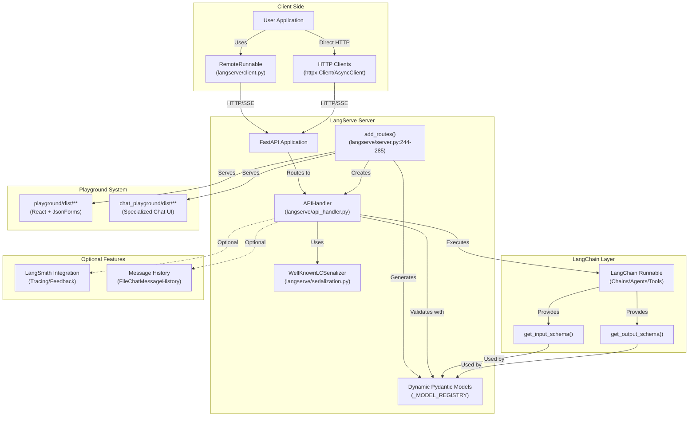
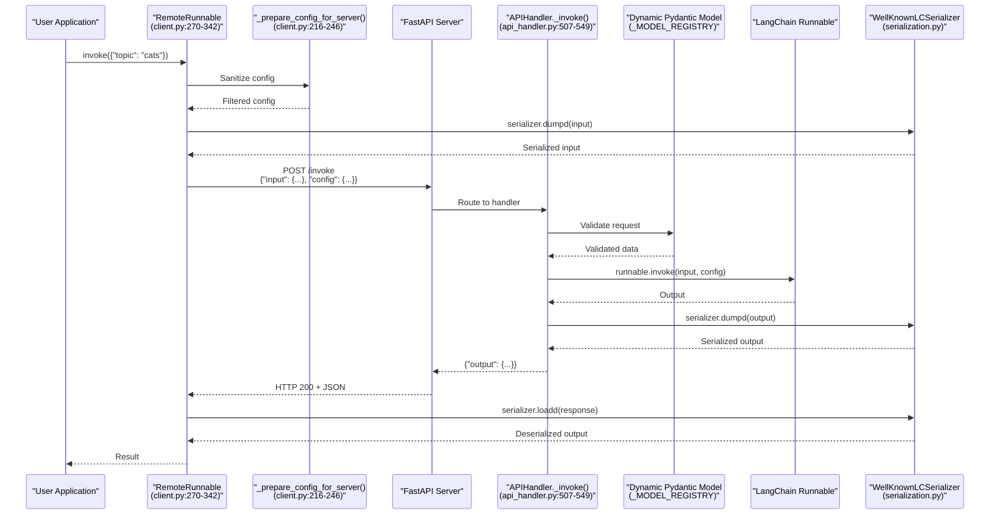
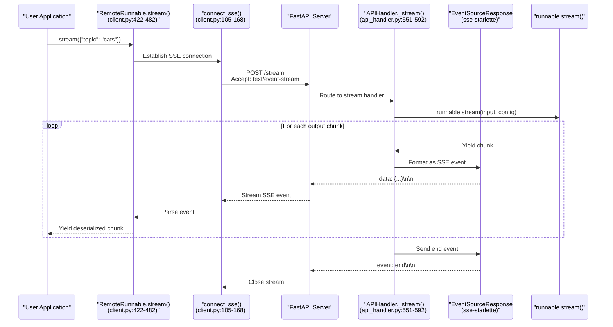
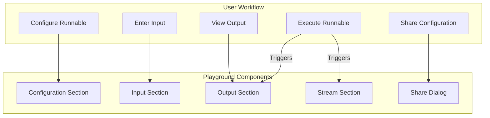

<!-- source: DeepWiki mcp.deepwiki.com · repo langchain-ai/langserve · page 1 LangServe Overview · fetched 2026-10-26 -->

# LangServe Overview

<details>
<summary>Relevant source files</summary>

The following files were used as context for generating this wiki page:

- [MIGRATION.md](MIGRATION.md)
- [README.md](README.md)
- [examples/llm/server.py](examples/llm/server.py)
- [examples/retrieval/server.py](examples/retrieval/server.py)
- [examples/router/server.py](examples/router/server.py)
- [poetry.lock](poetry.lock)
- [pyproject.toml](pyproject.toml)

</details>


LangServe is a deployment framework for serving LangChain [runnables and chains](https://python.langchain.com/docs/expression_language/) as REST APIs. It integrates with FastAPI to automatically generate HTTP endpoints with schema validation, OpenAPI documentation, and interactive testing interfaces for LangChain applications built using the LangChain Expression Language (LCEL).

## Purpose and Scope

LangServe is designed for deploying **simple to moderately complex LangChain Runnables** built with LCEL. It excels at:

- Rapid deployment of LangChain chains as HTTP APIs
- Serving stateless or simple stateful applications (via `RunnableWithMessageHistory`)
- Providing a client SDK (`RemoteRunnable`) that mirrors the Runnable interface
- Auto-generating OpenAPI documentation and interactive playgrounds

**Important**: LangServe is designed for simpler LCEL-based applications. For complex agentic systems requiring advanced features like persistence, memory management, human-in-the-loop workflows, cron jobs, webhooks, or long-running tasks, use [LangGraph Platform](https://langchain-ai.github.io/langgraph/cloud/) instead. See [MIGRATION.md:1-223]() for migration guidance.

Sources:
- [README.md:1-56]()
- [MIGRATION.md:1-29]()
- [pyproject.toml:1-11]()

## Key Features

LangServe provides the following capabilities out-of-the-box:

| Feature | Description |
|---------|-------------|
| **Automatic Schema Inference** | Input/output schemas inferred from Runnable using `get_input_schema()` and `get_output_schema()` |
| **Request Validation** | Pydantic-based validation with dynamically generated models stored in `_MODEL_REGISTRY` |
| **Multiple Invocation Modes** | `/invoke`, `/batch`, `/stream`, `/stream_log`, `/stream_events` endpoints |
| **Streaming Support** | Server-Sent Events (SSE) via `sse-starlette` and `EventSourceResponse` |
| **Interactive Playground** | React-based UI at `/playground/` using JsonForms for dynamic form generation |
| **Chat Playground** | Specialized UI for conversational interfaces when `playground_type="chat"` |
| **Client SDK** | `RemoteRunnable` class that implements the Runnable interface for transparent remote execution |
| **Serialization** | `WellKnownLCSerializer` handles 22 LangChain types (messages, documents, agent actions, etc.) |
| **LangSmith Integration** | Optional tracing, feedback endpoints, and public trace sharing |
| **OpenAPI Documentation** | Auto-generated docs at `/docs` (requires Pydantic v2 or LangServe >= 0.3.0) |

Sources:
- [README.md:31-49]()
- [langserve/serialization.py:122-161]()
- [langserve/server.py:244-285]()

## When to Use LangServe vs LangGraph Platform

Use **LangServe** when:
- Deploying simple LCEL chains or retrieval systems
- Stateless applications or minimal state requirements
- Quick prototypes or demos
- Using LangChain primitives without complex control flow

Use **LangGraph Platform** when:
- Building agentic applications with complex orchestration
- Requiring persistence, memory, or conversation management
- Needing human-in-the-loop workflows or approval steps
- Handling long-running tasks or background processing
- Requiring cron jobs, webhooks, or double-texting handling
- Deploying production applications with high-load requirements

For migration guidance, see [MIGRATION.md:1-223]().

Sources:
- [MIGRATION.md:1-34]()
- [README.md:8-14]()
- [README.md:50-56]()

## Core Architecture

LangServe operates through a two-phase architecture: **generation-time** (when `add_routes()` is called) and **request-time** (when HTTP requests are processed). The system bridges client applications to LangChain Runnables via HTTP/SSE protocols.

### High-Level System Architecture



Sources:
- [langserve/server.py:244-285]()
- [langserve/api_handler.py:103-189]()
- [langserve/client.py:270-342]()
- [langserve/serialization.py:122-161]()

### Generation-Time vs Request-Time Processing

**Generation-Time** (when `add_routes()` is called):
1. Schema inference from Runnable using `get_input_schema()` and `get_output_schema()`
2. Namespace generation to prevent model collisions in `_MODEL_REGISTRY`
3. Dynamic Pydantic model creation for request/response types
4. `APIHandler` instantiation with the Runnable and configuration
5. FastAPI route registration for all enabled endpoints
6. Playground HTML template preparation with schema injection

**Request-Time** (when HTTP requests arrive):
1. Request payload validation using dynamically generated Pydantic models
2. Configuration processing via `_unpack_request_config()`
3. Runnable execution with validated input and config
4. Output serialization using `WellKnownLCSerializer`
5. Response formatting (JSON for `/invoke`, SSE for `/stream`)
6. Optional callback event processing via `load_events()`

Sources:
- [langserve/server.py:244-468]()
- [langserve/api_handler.py:507-629]()
- [langserve/validation.py:1-166]()

### Server Components

**Core Classes and Functions**

| Component | Location | Purpose |
|-----------|----------|---------|
| `add_routes()` | [langserve/server.py:244-285]() | Entry point for registering Runnable as FastAPI routes with playground |
| `APIHandler` | [langserve/api_handler.py:103-189]() | Processes requests, executes Runnable, formats responses |
| `WellKnownLCSerializer` | [langserve/serialization.py:122-161]() | Serializes/deserializes 22 LangChain object types |
| `_resolve_model()` | [langserve/validation.py:78-109]() | Wraps schemas in `RootModel` and checks `_MODEL_REGISTRY` |
| `_rename_pydantic_model()` | [langserve/validation.py:112-137]() | Adds namespace prefix to prevent collisions |
| `EventSourceResponse` | sse-starlette | Streams Server-Sent Events for `/stream` endpoints |
| `serve_playground()` | [langserve/server.py:378-444]() | Serves playground HTML with injected schemas |

**Global Registries**

- `_MODEL_REGISTRY`: Maps schema hashes to Pydantic models to avoid regeneration
- `_SEEN_NAMES`: Tracks model names to prevent namespace collisions
- `_APP_TO_PATHS`: Tracks registered paths per FastAPI app for collision detection

Sources:
- [langserve/server.py:244-468]()
- [langserve/api_handler.py:103-189]()
- [langserve/validation.py:1-166]()
- [langserve/serialization.py:122-161]()

### Client Components

**RemoteRunnable Class**

The `RemoteRunnable` class in [langserve/client.py:270-342]() implements the LangChain `Runnable` interface for transparent remote execution:

| Method | Description |
|--------|-------------|
| `invoke()` / `ainvoke()` | Synchronous/async single input execution via `POST /invoke` |
| `batch()` / `abatch()` | Batch execution via `POST /batch` |
| `stream()` / `astream()` | Streaming via `POST /stream` using SSE |
| `stream_log()` / `astream_log()` | Stream intermediate steps via `POST /stream_log` |
| `stream_events()` / `astream_events()` | Stream events via `POST /stream_events` |

**Request Preparation**

Before sending requests, `RemoteRunnable`:
1. Sanitizes config via `_prepare_config_for_server()` (removes callbacks, filters non-serializable)
2. Serializes input using `serializer.dumpd()`
3. Constructs request payload with `input`, `config`, and optional `kwargs`

**SSE Infrastructure**

- `connect_sse()` / `aconnect_sse()`: Establishes SSE connections in [langserve/client.py:105-168]()
- `EventSource`: Wraps httpx response for event iteration
- `SSEDecoder`: Parses Server-Sent Events from response stream

Sources:
- [langserve/client.py:270-582]()
- [langserve/client.py:105-168]()

## Request-Response Flow

### Invoke Request Flow



Sources:
- [langserve/client.py:341-394]()
- [langserve/api_handler.py:507-549]()
- [langserve/serialization.py:281-351]()

### Stream Request Flow



Sources:
- [langserve/client.py:422-482]()
- [langserve/api_handler.py:551-592]()
- [langserve/client.py:105-168]()

## Endpoints and Route Generation

When `add_routes(app, runnable, path="/mychain")` is called, LangServe registers multiple FastAPI routes. Endpoints can be selectively enabled/disabled via `enabled_endpoints` or `disabled_endpoints` parameters.

### Standard Endpoints

| Endpoint | Method | Handler | Description |
|----------|--------|---------|-------------|
| `/mychain/invoke` | POST | `APIHandler._invoke()` | Execute with single input, return output |
| `/mychain/batch` | POST | `APIHandler._batch()` | Execute with multiple inputs in parallel |
| `/mychain/stream` | POST | `APIHandler._stream()` | Stream output chunks via SSE |
| `/mychain/stream_log` | POST | `APIHandler._stream_log()` | Stream intermediate steps and outputs via SSE |
| `/mychain/stream_events` | POST | `APIHandler._stream_events()` | Stream events from execution via SSE |
| `/mychain/input_schema` | GET | Generated | Return JSON Schema for input validation |
| `/mychain/output_schema` | GET | Generated | Return JSON Schema for output format |
| `/mychain/config_schema` | GET | Generated | Return JSON Schema for config options |

### Playground Endpoints

| Endpoint | Method | Handler | Description |
|----------|--------|---------|-------------|
| `/mychain/playground/` | GET | `serve_playground()` | Interactive UI with schema injection |
| `/mychain/playground/index.html` | GET | Serve static | Default playground HTML |
| `/mychain/playground/...` | GET | Serve static | Playground assets from `playground/dist/` |

### Optional Endpoints

These require explicit enabling:

| Endpoint | Parameter | Handler | Description |
|----------|-----------|---------|-------------|
| `/mychain/c/{config_hash}` | `enable_feedback_endpoint=True` | `_config_hash()` | Shareable config URLs |
| `/mychain/feedback` | `enable_feedback_endpoint=True` | Feedback handler | Submit feedback to LangSmith |
| `/mychain/public_trace_link` | `enable_public_trace_link_endpoint=True` | Trace link handler | Generate public trace URLs |

Sources:
- [langserve/server.py:244-468]()
- [langserve/api_handler.py:507-768]()
- [README.md:308-336]()

## Basic Usage

### Server Example

```python
from fastapi import FastAPI
from langchain_openai import ChatOpenAI
from langchain.prompts import ChatPromptTemplate
from langserve import add_routes

app = FastAPI()

# Create a runnable chain
model = ChatOpenAI(model="gpt-3.5-turbo")
prompt = ChatPromptTemplate.from_template("Tell me a joke about {topic}")
chain = prompt | model

# Add routes for the chain
add_routes(app, chain, path="/joke")

if __name__ == "__main__":
    import uvicorn
    uvicorn.run(app, host="localhost", port=8000)
```

Sources:
- [examples/llm/server.py:1-30]()
- [README.md:154-190]()

### Client Example

```python
from langserve import RemoteRunnable

# Connect to the server
joke_chain = RemoteRunnable("http://localhost:8000/joke/")

# Invoke the runnable
result = joke_chain.invoke({"topic": "programming"})
print(result)

# Stream results
for chunk in joke_chain.stream({"topic": "programming"}):
    print(chunk, end="", flush=True)
```

Sources:
- [README.md:232-256]()

## Playground Interface

LangServe includes a built-in playground UI at `/playground/` for interactive testing:



For chat applications, LangServe offers a specialized Chat Playground optimized for conversational interfaces.

Sources:
- [README.md:338-426]()
- [langserve/server.py:380-386]()

---

