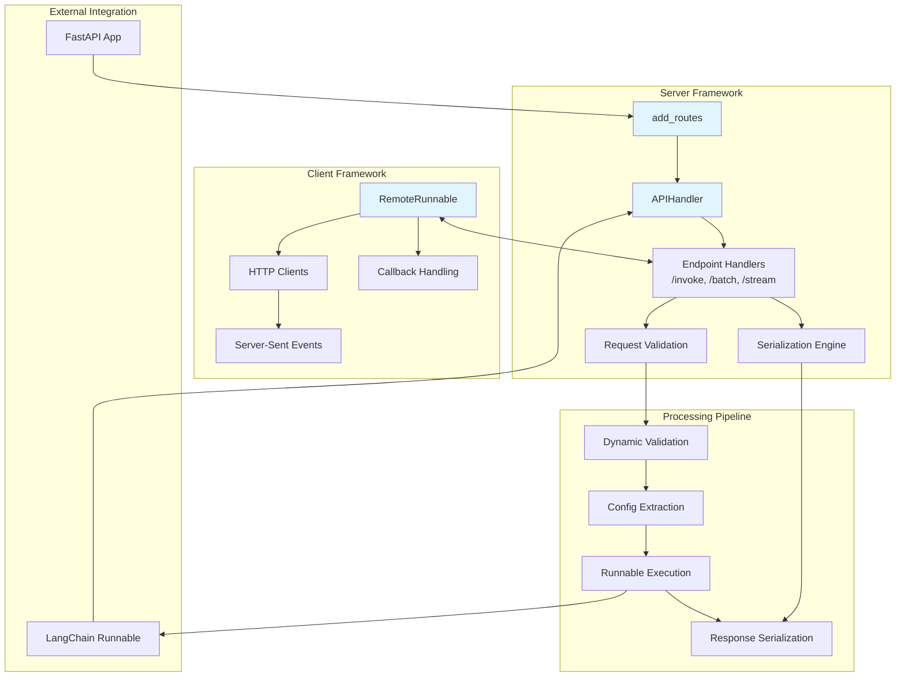
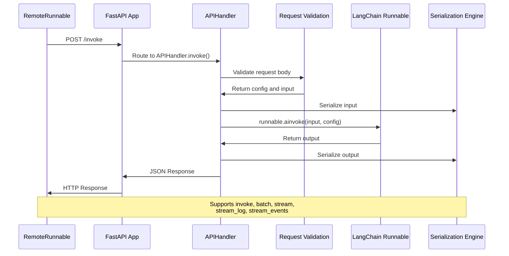
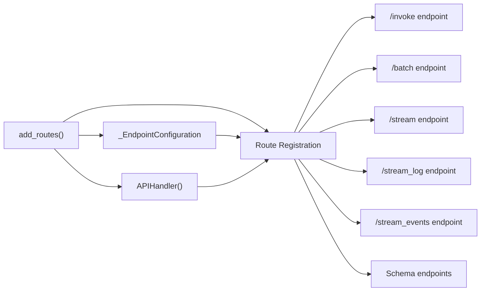
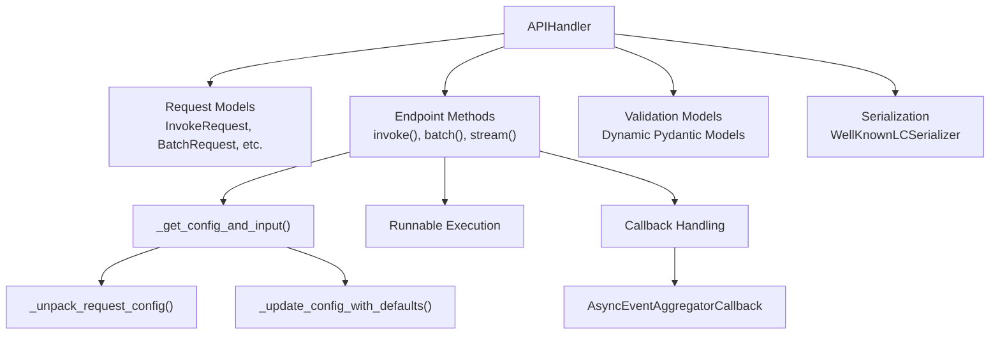
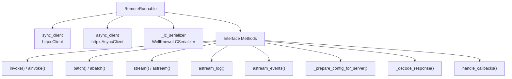
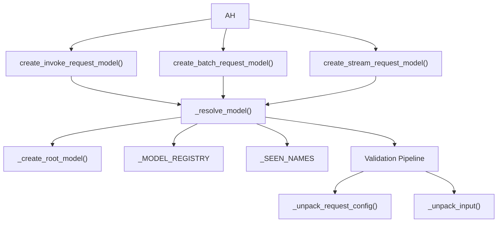
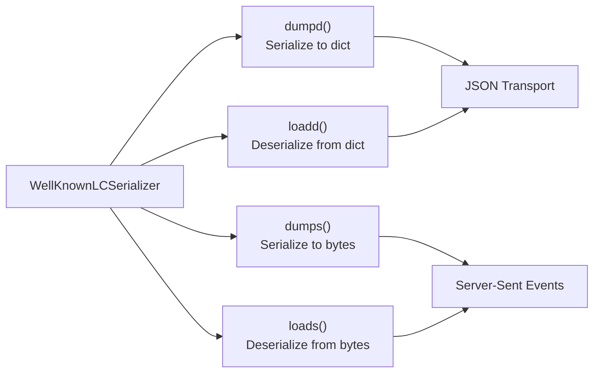
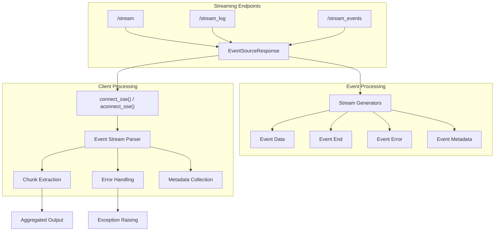
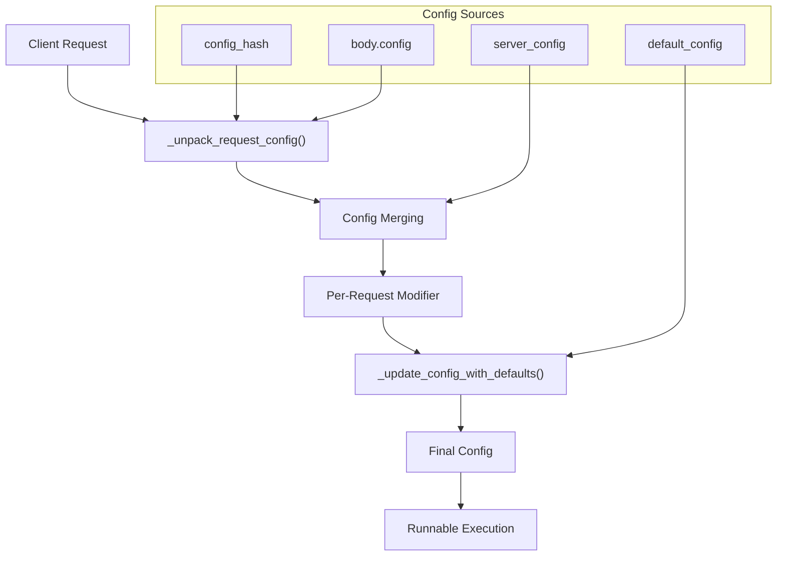
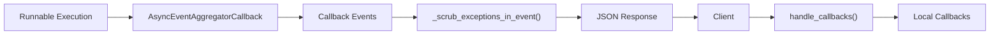

<!-- source: DeepWiki mcp.deepwiki.com · repo langchain-ai/langserve · page 2 Core Architecture · fetched 2026-10-26 -->

# Core Architecture

Relevant source files

The following files were used as context for generating this wiki page:

- [langserve/api_handler.py](langserve/api_handler.py)
- [langserve/callbacks.py](langserve/callbacks.py)
- [langserve/client.py](langserve/client.py)
- [langserve/server.py](langserve/server.py)
- [langserve/server_sent_events.py](langserve/server_sent_events.py)
- [tests/unit_tests/test_callbacks.py](tests/unit_tests/test_callbacks.py)
- [tests/unit_tests/test_server_client.py](tests/unit_tests/test_server_client.py)
- [tests/unit_tests/utils/tracer.py](tests/unit_tests/utils/tracer.py)

This document provides a detailed technical overview of LangServe's core architecture, focusing on the fundamental components that enable serving LangChain runnables as REST APIs. The architecture consists of server-side route generation, client-side remote execution, request/response processing, and data serialization systems.

For information about the web-based playground interface, see [Playground Interface](#3). For practical implementation examples, see [Example Implementations](#4). For development setup and contribution guidelines, see [Development Guide](#5).

## System Overview

LangServe's architecture centers around three main components that work together to provide a complete client-server framework for LangChain runnables.

### Core Component Architecture

**Sources:** [langserve/server.py:248-268](), [langserve/api_handler.py:507-540](), [langserve/client.py:270-294]()

## Server-Client Interaction Flow

The following sequence diagram shows how requests flow through the LangServe architecture from client invocation to final response.

### Request Processing Sequence

**Sources:** [langserve/api_handler.py:846-926](), [langserve/client.py:341-363](), [langserve/server.py:494-518]()

## Core Components

### Server Framework

The server framework is built around the `add_routes` function and `APIHandler` class, which automatically generate REST API endpoints for any LangChain runnable.

#### add_routes Function

The `add_routes` function serves as the primary entry point for integrating LangServe with FastAPI applications. It registers multiple HTTP endpoints for a given runnable.

The function automatically creates these endpoints based on the runnable's capabilities:
- `/invoke` - Single request execution
- `/batch` - Multiple request execution  
- `/stream` - Real-time streaming output
- `/stream_log` - Intermediate step logging
- `/stream_events` - Event-based streaming
- `/input_schema`, `/output_schema`, `/config_schema` - Schema introspection

**Sources:** [langserve/server.py:248-390](), [langserve/server.py:494-748]()

#### APIHandler Class

The `APIHandler` class implements the core request processing logic for each endpoint. It handles request validation, configuration management, runnable execution, and response serialization.

Key responsibilities include:
- Dynamic request/response model generation based on runnable schemas
- Configuration validation and merging
- Callback event aggregation for tracing
- Error handling and serialization

**Sources:** [langserve/api_handler.py:507-768](), [langserve/api_handler.py:805-845]()

### Client Framework

#### RemoteRunnable Class

The `RemoteRunnable` class provides a client-side proxy that implements the LangChain `Runnable` interface for remote execution. It maintains both sync and async HTTP clients for communicating with LangServe endpoints.

The client handles:
- HTTP client lifecycle management with automatic cleanup
- Request serialization and response deserialization  
- Server-sent event processing for streaming endpoints
- Callback event forwarding from server to client callbacks
- Configuration filtering to remove client-only settings

**Sources:** [langserve/client.py:270-340](), [langserve/client.py:520-677]()

## Request Validation and Serialization

LangServe implements a sophisticated validation system that dynamically creates Pydantic models based on runnable schemas and handles complex object serialization.

### Dynamic Model Creation

The validation system:
- Creates unique Pydantic models for each runnable's input/output schemas
- Maintains a global registry to avoid duplicate model creation
- Handles model name collisions through automatic renaming
- Supports both static types and dynamic schema resolution

**Sources:** [langserve/api_handler.py:339-381](), [langserve/validation.py:73-79](), [langserve/api_handler.py:285-305]()

### Serialization Engine

The serialization system handles conversion between Python objects and JSON for client-server communication.

Key serialization features:
- Support for complex LangChain objects (messages, documents, etc.)
- Streaming-compatible byte serialization for real-time data
- Automatic handling of custom user types and Pydantic models
- Preservation of object metadata during round-trip serialization

**Sources:** [langserve/serialization.py:65-89](), [langserve/client.py:234-267]()

## Streaming and Real-time Processing

LangServe provides comprehensive streaming capabilities through Server-Sent Events (SSE) for real-time data processing.

### Streaming Architecture

The streaming system supports:
- **Basic streaming** via `/stream` with chunk-by-chunk output
- **Detailed logging** via `/stream_log` with intermediate step visibility  
- **Event streaming** via `/stream_events` with fine-grained event filtering
- **Error propagation** through structured error events
- **Metadata transmission** for run IDs and feedback tokens

**Sources:** [langserve/api_handler.py:1089-1222](), [langserve/client.py:520-676](), [langserve/server_sent_events.py:50-89]()

## Configuration and Callback System

LangServe implements a sophisticated configuration management system that handles client-server config merging and callback event processing.

### Configuration Processing Pipeline

### Callback Event Processing

The system provides:
- **Multi-source config merging** with last-writer-wins semantics
- **Server-side config validation** against allowed `config_keys`
- **Per-request config modification** via custom modifier functions
- **Callback event aggregation** for distributed tracing
- **Exception scrubbing** to prevent sensitive data leakage

**Sources:** [langserve/api_handler.py:157-221](), [langserve/api_handler.py:223-282](), [langserve/callbacks.py:51-89]()

---

