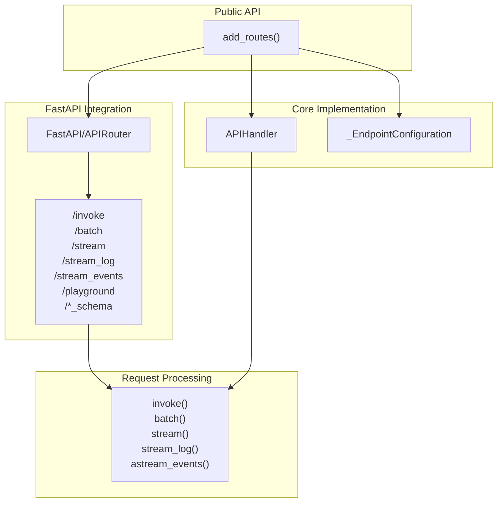
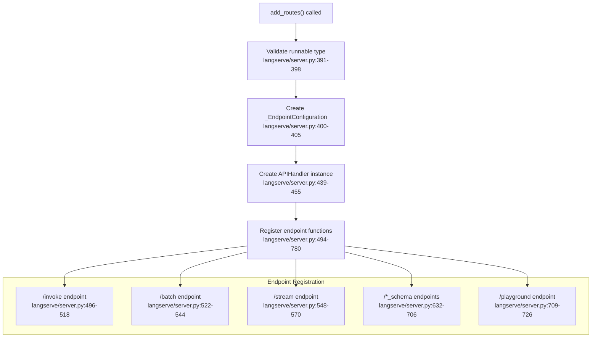
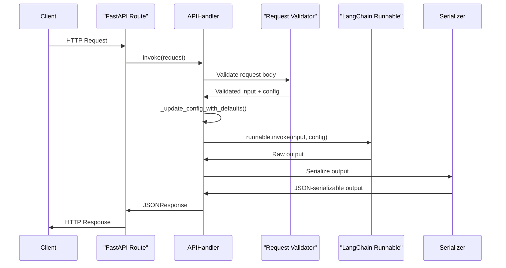
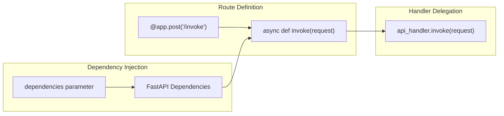

<!-- source: DeepWiki mcp.deepwiki.com · repo langchain-ai/langserve · page 2.1 Server Components · fetched 2026-10-26 -->

# Server Components

<details>
<summary>Relevant source files</summary>

The following files were used as context for generating this wiki page:

- [MIGRATION.md](MIGRATION.md)
- [README.md](README.md)
- [examples/llm/server.py](examples/llm/server.py)
- [examples/retrieval/server.py](examples/retrieval/server.py)
- [examples/router/server.py](examples/router/server.py)
- [langserve/api_handler.py](langserve/api_handler.py)
- [langserve/server.py](langserve/server.py)
- [tests/unit_tests/test_server_client.py](tests/unit_tests/test_server_client.py)

</details>


This document covers the server-side components of LangServe that transform LangChain runnables into REST API endpoints. These components handle the core functionality of registering routes, processing requests, and managing endpoint configurations. For information about client-side interaction with these endpoints, see [Client Components](#2.2). For details about the validation and serialization systems used by these components, see [Request Validation & Serialization](#2.3).

## Overview

The server components form the backbone of LangServe's architecture, providing the mechanism to expose any LangChain runnable as a set of REST API endpoints. The system consists of two primary components: the `add_routes` function that serves as the public API entry point, and the `APIHandler` class that implements the actual endpoint logic.



Sources: [langserve/server.py:1-780](), [langserve/api_handler.py:507-1271]()

## The add_routes Function

The `add_routes` function serves as the primary entry point for integrating LangChain runnables with FastAPI applications. It accepts a runnable and automatically generates all necessary API endpoints.

### Function Signature and Core Parameters

The function accepts a wide range of configuration options to control endpoint behavior:

| Parameter | Type | Purpose |
|-----------|------|---------|
| `app` | `Union[FastAPI, APIRouter]` | Target FastAPI application or router |
| `runnable` | `Runnable` | LangChain runnable to expose |
| `path` | `str` | Base path for all endpoints (default: `""`) |
| `config_keys` | `Sequence[str]` | Allowed configuration keys |
| `enabled_endpoints` | `Optional[Sequence[EndpointName]]` | Specific endpoints to enable |
| `disabled_endpoints` | `Optional[Sequence[EndpointName]]` | Specific endpoints to disable |

### Route Registration Process



Sources: [langserve/server.py:248-780]()

### Path Management and Deduplication

The system maintains global registries to prevent duplicate paths and ensure unique model names:

- `_APP_TO_PATHS`: Tracks paths registered with each FastAPI app instance
- `_APP_SEEN`: Prevents duplicate app registration for global handlers
- Model registry in `api_handler.py` prevents naming conflicts

Sources: [langserve/server.py:44-51](), [langserve/server.py:184-201]()

## APIHandler Class

The `APIHandler` class implements the core logic for each API endpoint. It handles request validation, runnable execution, response serialization, and error handling.

### Initialization and Configuration

The `APIHandler` constructor accepts comprehensive configuration options:

```mermaid
classDiagram
    class APIHandler {
        -runnable: Runnable
        -path: str
        -base_url: str
        -run_name: str
        -config_keys: Sequence[str]
        -include_callback_events: bool
        -per_req_config_modifier: PerRequestConfigModifier
        -serializer: Serializer
        +invoke(request) Response
        +batch(request) Response
        +stream(request) EventSourceResponse
        +stream_log(request) EventSourceResponse
        +astream_events(request) EventSourceResponse
        +input_schema(request) Response
        +output_schema(request) Response
        +config_schema(request) Response
        +playground(request) Response
    }
    
    class _EndpointConfiguration {
        +is_invoke_enabled: bool
        +is_batch_enabled: bool
        +is_stream_enabled: bool
        +is_stream_log_enabled: bool
        +is_stream_events_enabled: bool
        +is_playground_enabled: bool
    }
    
    APIHandler --> "_EndpointConfiguration"
```

Sources: [langserve/api_handler.py:517-670]()

### Request Processing Flow

Each endpoint follows a consistent request processing pattern:



Sources: [langserve/api_handler.py:709-846]()

## Endpoint Configuration System

The `_EndpointConfiguration` class manages which endpoints are enabled or disabled for each runnable:

### Supported Endpoints

| Endpoint | Purpose | Implementation |
|----------|---------|----------------|
| `/invoke` | Single input execution | `APIHandler.invoke()` |
| `/batch` | Multiple input execution | `APIHandler.batch()` |
| `/stream` | Streaming output | `APIHandler.stream()` |
| `/stream_log` | Streaming intermediate logs | `APIHandler.stream_log()` |
| `/stream_events` | Streaming events (v1/v2) | `APIHandler.astream_events()` |
| `/input_schema` | Input JSON schema | `APIHandler.input_schema()` |
| `/output_schema` | Output JSON schema | `APIHandler.output_schema()` |
| `/config_schema` | Configuration schema | `APIHandler.config_schema()` |
| `/playground` | Interactive UI | `serve_playground()` |

### Configuration Hash Support

For configurable runnables, the system generates additional endpoints with configuration hashes:

- `/c/{config_hash}/invoke`
- `/c/{config_hash}/batch`
- `/c/{config_hash}/stream`
- etc.

These endpoints allow sharing pre-configured runnable instances via compressed configuration URLs.

Sources: [langserve/server.py:89-182](), [langserve/api_handler.py:93-106]()

## Integration with FastAPI

The server components seamlessly integrate with FastAPI's routing system:

### Route Registration Pattern



### Global App Handlers

The system registers startup event handlers that display the LangServe banner and available endpoints:

```python
@app.on_event("startup")
async def startup_event():
    # Display LangServe ASCII art and endpoint information
```

Sources: [langserve/server.py:203-243]()

## Error Handling and Validation

The server components implement comprehensive error handling:

### Request Validation

- Uses dynamic Pydantic models for input validation
- Translates `ValidationError` to `RequestValidationError` for proper HTTP status codes
- Supports custom input/output type annotations

### Runtime Error Handling

- Catches exceptions during runnable execution
- Converts to appropriate HTTP error responses
- Maintains error context for debugging

Sources: [langserve/api_handler.py:403-413](), [tests/unit_tests/test_server_client.py:351-411]()

## Configuration and Customization

### Per-Request Configuration Modification

The system supports dynamic configuration modification via the `per_req_config_modifier` parameter:

```python
async def modify_config(config: Dict[str, Any], request: Request) -> Dict[str, Any]:
    # Extract credentials from headers, modify config based on request
    return config
```

### Callback Event Integration

When `include_callback_events=True`, the system captures and returns callback events alongside responses, enabling client-side tracing and debugging.

Sources: [langserve/api_handler.py:108-113](), [langserve/api_handler.py:637-642]()

This server component architecture provides a robust, flexible foundation for exposing LangChain runnables as production-ready REST APIs with comprehensive configuration options and seamless FastAPI integration.

---

