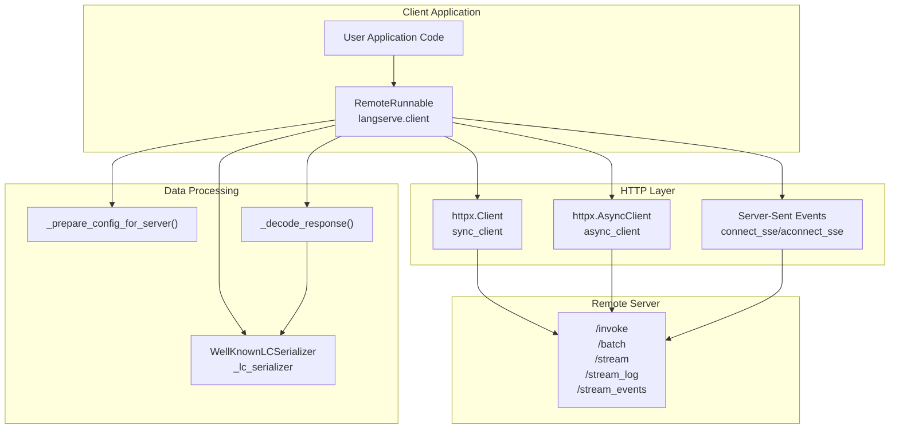
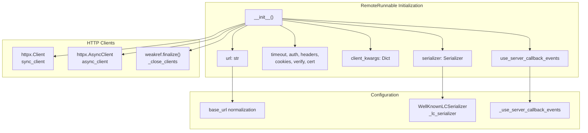
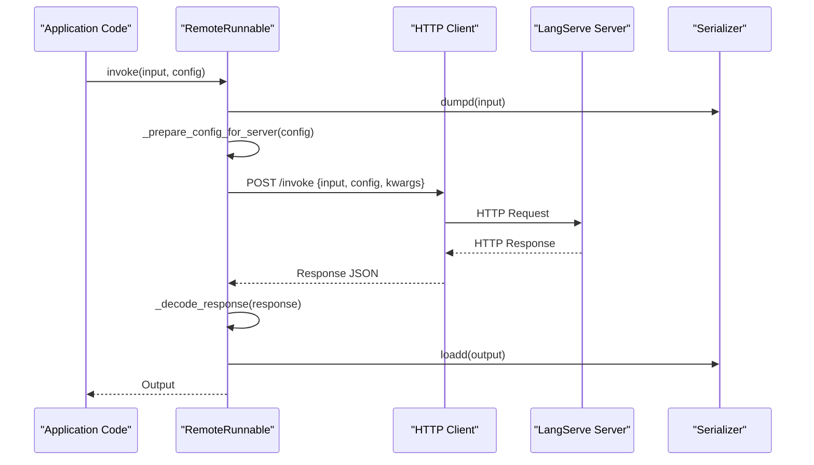
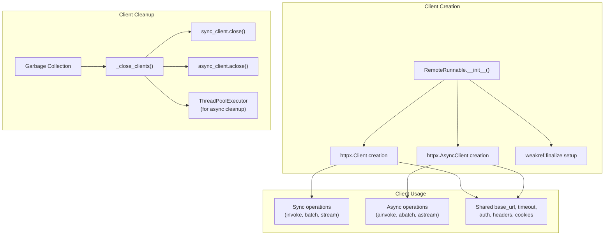
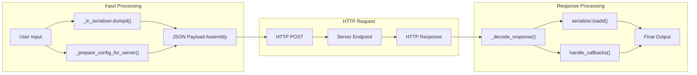
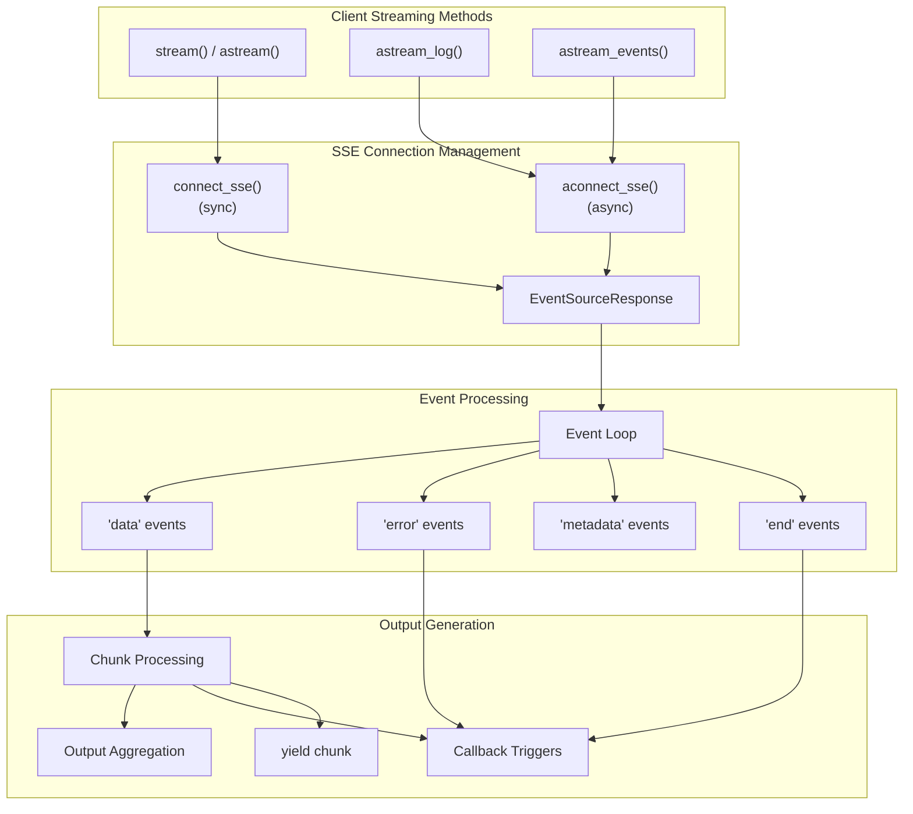
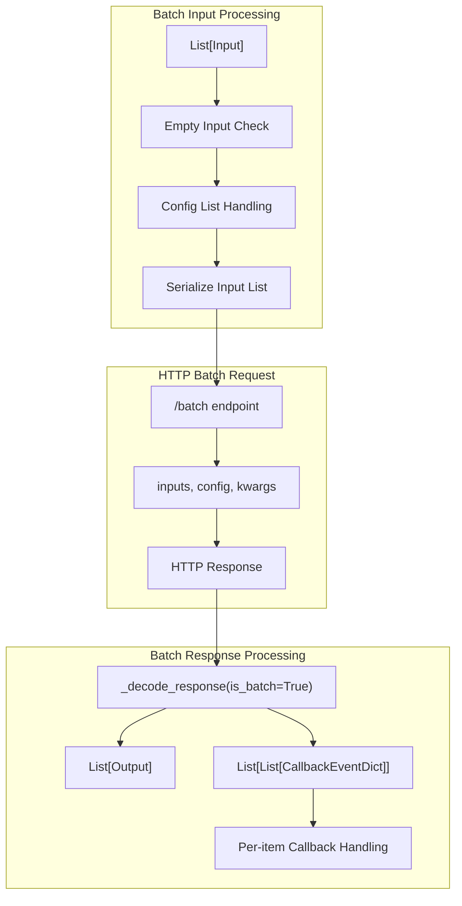
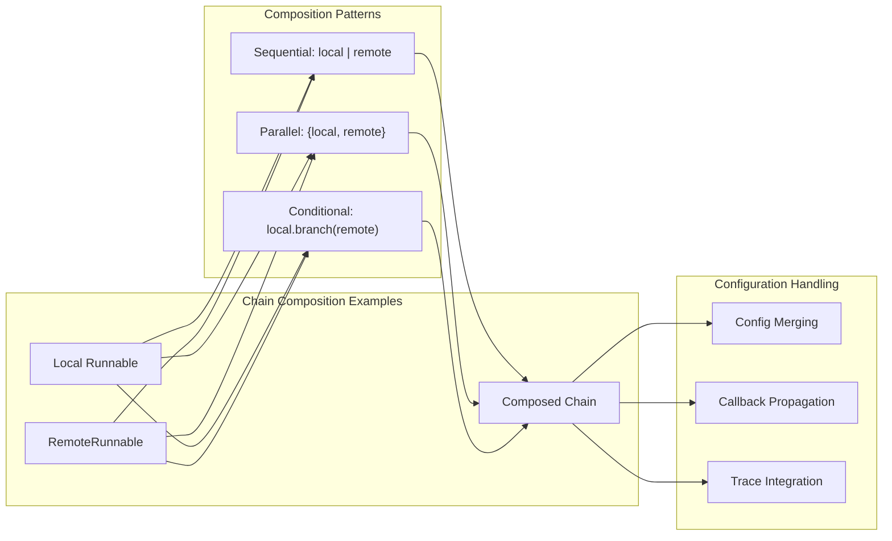

<!-- source: DeepWiki mcp.deepwiki.com · repo langchain-ai/langserve · page 2.2 Client Components · fetched 2026-10-26 -->

# Client Components

Relevant source files

The following files were used as context for generating this wiki page:

- [MIGRATION.md](MIGRATION.md)
- [README.md](README.md)
- [examples/llm/server.py](examples/llm/server.py)
- [examples/retrieval/server.py](examples/retrieval/server.py)
- [examples/router/server.py](examples/router/server.py)
- [langserve/callbacks.py](langserve/callbacks.py)
- [langserve/client.py](langserve/client.py)
- [langserve/server_sent_events.py](langserve/server_sent_events.py)
- [tests/unit_tests/test_callbacks.py](tests/unit_tests/test_callbacks.py)
- [tests/unit_tests/utils/tracer.py](tests/unit_tests/utils/tracer.py)

This document covers the client-side components of LangServe, focusing on the `RemoteRunnable` class and related infrastructure that enables remote execution of LangChain runnables over HTTP. This page details how clients connect to and interact with LangServe servers, including synchronous and asynchronous operations, streaming, and configuration management.

For information about server-side components and endpoint generation, see [Server Components](#2.1). For details on data validation and serialization mechanisms, see [Request Validation & Serialization](#2.3).

## Core Client Architecture

The central client component in LangServe is the `RemoteRunnable` class, which implements the standard LangChain `Runnable` interface while transparently executing operations on a remote server via HTTP requests.

Sources: [langserve/client.py:270-340](), [langserve/client.py:341-400]()

## RemoteRunnable Implementation

The `RemoteRunnable` class provides a complete implementation of the `Runnable` interface that proxies all operations to a remote LangServe server. It maintains both synchronous and asynchronous HTTP clients and handles the complexities of remote execution transparently.

### Class Structure and Initialization

Sources: [langserve/client.py:281-340](), [langserve/client.py:336-340]()

### Core Operation Methods

The `RemoteRunnable` implements all standard `Runnable` methods by translating them to HTTP requests:

| Method | Endpoint | Description |
|--------|----------|-------------|
| `invoke()` / `ainvoke()` | `/invoke` | Single input execution |
| `batch()` / `abatch()` | `/batch` | Multiple input execution |
| `stream()` / `astream()` | `/stream` | Streaming output |
| `astream_log()` | `/stream_log` | Streaming intermediate logs |
| `astream_events()` | `/stream_events` | Streaming execution events |

Sources: [langserve/client.py:341-370](), [langserve/client.py:372-400](), [langserve/client.py:402-456]()

## HTTP Client Management

The `RemoteRunnable` maintains separate HTTP clients for synchronous and asynchronous operations, with automatic cleanup handling through weak references.

### Client Lifecycle Management

Sources: [langserve/client.py:315-334](), [langserve/client.py:193-212]()

## Request/Response Processing

Client requests undergo several transformation steps before being sent to the server, and responses are processed through deserialization and callback handling.

### Request Preparation Pipeline

Sources: [langserve/client.py:82-120](), [langserve/client.py:234-268]()

### Configuration Filtering

The `_prepare_config_for_server()` function removes sensitive or client-specific information before sending configuration to the server:

- Removes `callbacks` (handled separately)
- Filters non-JSON-serializable objects from `configurable` field
- Preserves only server-relevant configuration keys

Sources: [langserve/client.py:82-120]()

## Streaming Support

LangServe clients support multiple streaming patterns using Server-Sent Events (SSE) for real-time communication with the server.

### Streaming Architecture

Sources: [langserve/client.py:520-598](), [langserve/client.py:599-698](), [langserve/client.py:699-798]()

### Event Stream Processing

The streaming implementation handles different event types and manages final output aggregation for callback purposes:

- **Data Events**: Contain actual output chunks that are yielded to the user
- **Error Events**: Trigger exception handling and callback error events
- **Metadata Events**: Ignored by the basic client but used by specialized implementations
- **End Events**: Signal stream completion and trigger final callbacks

Sources: [langserve/client.py:549-586](), [langserve/client.py:577-581]()

## Batch Processing and Error Handling

The client provides robust batch processing capabilities with proper error handling and callback management.

### Batch Request Processing

Sources: [langserve/client.py:402-456](), [langserve/client.py:458-519]()

### Error Handling and Exception Translation

The client includes comprehensive error handling with informative error messages:

- HTTP status errors are re-raised with additional context
- Request sanitization removes sensitive headers from error messages
- JSON decode errors in streaming are converted to HTTP exceptions
- Server-side errors in streams trigger proper exception handling

Sources: [langserve/client.py:157-181](), [langserve/client.py:214-232](), [langserve/client.py:134-155]()

## Integration Patterns

The `RemoteRunnable` is designed to integrate seamlessly with existing LangChain code patterns and can be composed with other runnables.

### Composition with Local Runnables

Sources: [examples/llm/client.ipynb:206-227](), [tests/unit_tests/test_server_client.py:928-945](), [tests/unit_tests/test_server_client.py:1026-1073]()

This integration allows developers to mix local and remote execution seamlessly, with the `RemoteRunnable` appearing identical to local runnables from the application's perspective while providing the benefits of remote execution, scaling, and resource management.

Sources: [langserve/client.py:270-340](), [tests/unit_tests/test_server_client.py:518-582](), [examples/llm/client.ipynb:28](), [examples/passthrough_dict/client.ipynb:28]()

---

