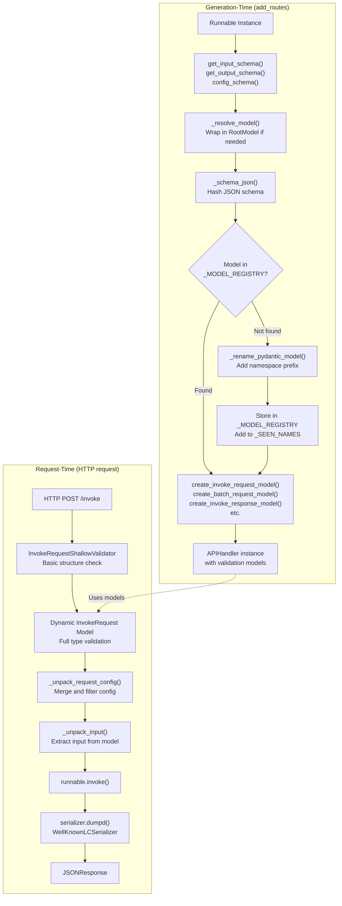
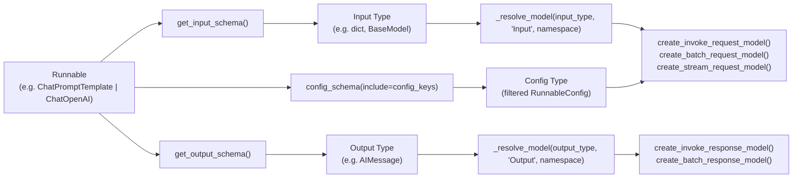
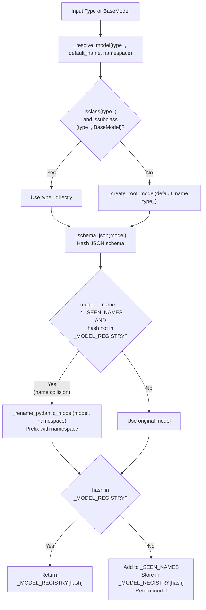
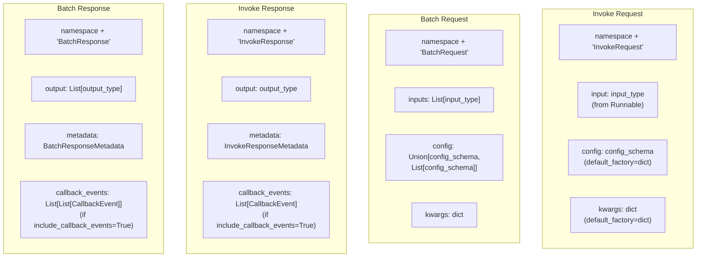
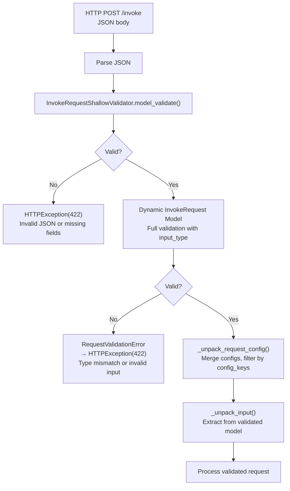
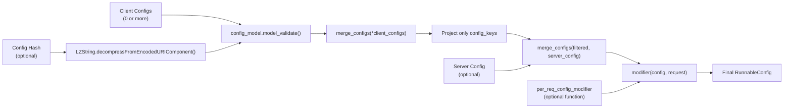
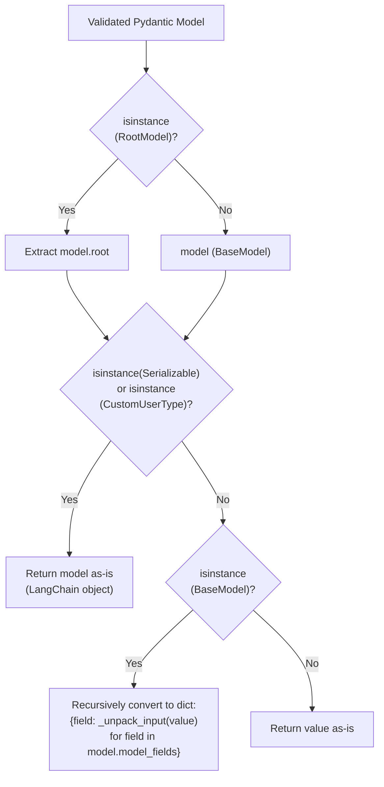
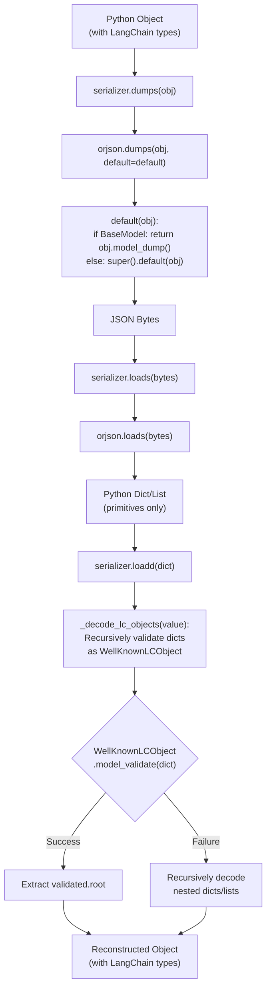

<!-- source: DeepWiki mcp.deepwiki.com · repo langchain-ai/langserve · page 2.3 Request Validation & Serialization · fetched 2026-10-26 -->

# Request Validation & Serialization

<details>
<summary>Relevant source files</summary>

The following files were used as context for generating this wiki page:

- [langserve/api_handler.py](langserve/api_handler.py)
- [langserve/playground.py](langserve/playground.py)
- [langserve/serialization.py](langserve/serialization.py)
- [langserve/server.py](langserve/server.py)
- [langserve/validation.py](langserve/validation.py)
- [tests/unit_tests/test_serialization.py](tests/unit_tests/test_serialization.py)
- [tests/unit_tests/test_server_client.py](tests/unit_tests/test_server_client.py)
- [tests/unit_tests/test_validation.py](tests/unit_tests/test_validation.py)

</details>


## Purpose and Scope

This document explains LangServe's request validation and data serialization mechanisms. It covers how LangServe automatically generates type-safe Pydantic models from Runnable schemas, validates incoming HTTP requests against those models, and serializes complex LangChain objects for transmission over the network.

For information about how these validated requests are processed and executed by the server, see [Server Components](#2.1). For details on the client-side request preparation and response deserialization, see [Client Components](#2.2).

---

## Two-Phase Architecture

LangServe's validation and serialization system operates in two distinct phases:

**Generation-Time** (when `add_routes` is called):
- Infer schemas from the Runnable
- Create namespaced Pydantic models
- Register models in global registries
- Generate endpoint-specific request/response validators

**Request-Time** (when HTTP requests arrive):
- Perform shallow validation on request structure
- Execute deep validation with dynamic Pydantic models
- Unpack and merge configuration
- Serialize outputs using WellKnownLCSerializer



**Sources:** [langserve/server.py:439-455](), [langserve/api_handler.py:339-362](), [langserve/validation.py:37-66]()

---

## Schema Inference

LangServe automatically infers schemas from Runnable instances using three methods provided by the LangChain Runnable interface:

| Method | Purpose | Returns |
|--------|---------|---------|
| `get_input_schema()` | Infer input type | Pydantic BaseModel class |
| `get_output_schema()` | Infer output type | Pydantic BaseModel class |
| `config_schema(include=...)` | Generate config schema | Pydantic BaseModel with specified keys |

These schemas are used to create the request and response validation models. The `config_keys` parameter in `add_routes` controls which configuration fields are exposed to clients (defaults to `["configurable"]`).



**Sources:** [langserve/api_handler.py:671-702](), [langserve/api_handler.py:339-362]()

---

## Dynamic Model Generation and Namespacing

To prevent Pydantic model name collisions when hosting multiple Runnables, LangServe implements a sophisticated model registry system with namespace prefixing.

### Model Registry System

Two global registries track all generated models:

- **`_MODEL_REGISTRY`**: Maps schema hashes to Pydantic models
- **`_SEEN_NAMES`**: Tracks all model names that have been used



### Namespace Generation

Namespaces are generated from the route path to ensure uniqueness:

- Path `/agent` → namespace prefix `agent_`
- Path `/chat/conversation` → namespace prefix `chat_conversation_`
- Non-alphanumeric characters are replaced with underscores

The `_rename_pydantic_model` function recursively prefixes model names and all nested model references.

**Sources:** [langserve/api_handler.py:308-332](), [langserve/api_handler.py:339-362](), [langserve/api_handler.py:365-380](), [langserve/api_handler.py:484-485]()

---

## Request and Response Model Creation

LangServe provides functions in `validation.py` that create Pydantic models for each endpoint type:

### Request Models

| Function | Endpoint | Fields |
|----------|----------|--------|
| `create_invoke_request_model()` | `/invoke` | `input`, `config`, `kwargs` |
| `create_batch_request_model()` | `/batch` | `inputs` (list), `config` (single or list), `kwargs` |
| `create_stream_request_model()` | `/stream` | `input`, `config`, `kwargs` |
| `create_stream_log_request_model()` | `/stream_log` | `input`, `config`, filter parameters |
| `create_stream_events_request_model()` | `/stream_events` | `input`, `config`, filter parameters |

### Response Models

| Function | Endpoint | Fields |
|----------|----------|--------|
| `create_invoke_response_model()` | `/invoke` | `output`, `metadata`, optional `callback_events` |
| `create_batch_response_model()` | `/batch` | `output` (list), `metadata`, optional `callback_events` |

All request models include a `config` field typed as the config schema from the Runnable. The `kwargs` field is currently ignored but reserved for future use.



**Sources:** [langserve/validation.py:37-66](), [langserve/validation.py:99-128](), [langserve/validation.py:255-296](), [langserve/validation.py:299-346]()

---

## Request Validation Pipeline

Incoming HTTP requests pass through a two-stage validation pipeline designed to provide clear error messages while maintaining security.

### Stage 1: Shallow Validation

The first stage uses simple validators (`InvokeRequestShallowValidator`, `BatchRequestShallowValidator`) to check basic structure:

- **Invoke**: Requires `input` field (any type), optional `config` dict
- **Batch**: Requires `inputs` field (any type), optional `config` (dict or list of dicts)

This stage catches malformed JSON and missing required fields with minimal processing.

### Stage 2: Deep Validation

The second stage uses the dynamically generated, type-specific Pydantic models to perform full validation:

- Type checking against Runnable's input schema
- Validation of config structure and allowed keys
- Nested model validation for complex types
- Coercion and default value application



**Sources:** [langserve/validation.py:349-358](), [langserve/validation.py:360-366](), [langserve/api_handler.py:157-221](), [langserve/api_handler.py:403-412]()

---

## Configuration Unpacking and Merging

The `_unpack_request_config` function handles complex configuration merging with multiple sources and security constraints:

### Configuration Sources (Merge Order)

1. **Client configs**: Zero or more configs sent by the client (last-writer-wins)
2. **Server config**: Optional server-side config (overrides client)
3. **Per-request modifier**: Optional function to modify config based on request

### Configuration Filtering

Only keys specified in `config_keys` (default: `["configurable"]`) are allowed through. Attempting to use `configurable` when not in `config_keys` raises an HTTP 422 error.

### Config Hash Support

Configs can be sent as compressed strings (config hashes) for shareable playground URLs:

- Hash format: LZString-compressed JSON
- Decompressed and validated like regular configs
- Enables stateless configuration sharing



**Sources:** [langserve/api_handler.py:157-221](), [langserve/api_handler.py:93-105]()

---

## Input Unpacking

After validation, inputs must be extracted from Pydantic models. The `_unpack_input` function handles this recursively:

- **RootModel**: Extract `.root` attribute
- **Serializable/CustomUserType**: Return as-is (these are LangChain objects)
- **Other BaseModel**: Convert to dict recursively (server-created validation models)

This ensures that user-defined Pydantic models are preserved while validation-only models are converted to plain dicts.



**Sources:** [langserve/api_handler.py:285-305]()

---

## Serialization System

LangServe uses a custom serialization layer to handle complex LangChain objects that cannot be serialized by standard JSON encoders.

### WellKnownLCObject Discriminated Union

The `WellKnownLCObject` is a Pydantic RootModel containing a discriminated union of 22 LangChain types:

**Message Types:**
- `AIMessage`, `HumanMessage`, `ChatMessage`, `SystemMessage`, `FunctionMessage`, `ToolMessage`
- Chunk variants: `AIMessageChunk`, `HumanMessageChunk`, `ChatMessageChunk`, `SystemMessageChunk`, `FunctionMessageChunk`, `ToolMessageChunk`

**Other Types:**
- `Document`, `StringPromptValue`, `ChatPromptValueConcrete`
- `AgentAction`, `AgentFinish`, `AgentActionMessageLog`
- `ChatGeneration`, `Generation`, `ChatGenerationChunk`, `LLMResult`

The discriminator function `_get_type` uses the `type` field to determine which variant to validate against.

```mermaid
graph TB
    WellKnownLCObject["WellKnownLCObject<br/>(RootModel)"]
    
    Discriminator["Discriminator: _get_type(v)<br/>Returns v['type'] or v.type"]
    
    subgraph "Message Types (12)"
        AIMsg["AIMessage"]
        HumanMsg["HumanMessage"]
        ChatMsg["ChatMessage"]
        SystemMsg["SystemMessage"]
        FuncMsg["FunctionMessage"]
        ToolMsg["ToolMessage"]
        AIChunk["AIMessageChunk"]
        HumanChunk["HumanMessageChunk"]
        ChatChunk["ChatMessageChunk"]
        SystemChunk["SystemMessageChunk"]
        FuncChunk["FunctionMessageChunk"]
        ToolChunk["ToolMessageChunk"]
    end
    
    subgraph "Document & Prompt Types (3)"
        Doc["Document"]
        StrPrompt["StringPromptValue"]
        ChatPrompt["ChatPromptValueConcrete"]
    end
    
    subgraph "Agent Types (3)"
        AgentAct["AgentAction"]
        AgentFin["AgentFinish"]
        AgentActMsg["AgentActionMessageLog"]
    end
    
    subgraph "Generation Types (4)"
        ChatGen["ChatGeneration"]
        Gen["Generation"]
        ChatGenChunk["ChatGenerationChunk"]
        LLMRes["LLMResult"]
    end
    
    WellKnownLCObject --> Discriminator
    Discriminator --> AIMsg
    Discriminator --> HumanMsg
    Discriminator --> ChatMsg
    Discriminator --> SystemMsg
    Discriminator --> FuncMsg
    Discriminator --> ToolMsg
    Discriminator --> AIChunk
    Discriminator --> HumanChunk
    Discriminator --> ChatChunk
    Discriminator --> SystemChunk
    Discriminator --> FuncChunk
    Discriminator --> ToolChunk
    Discriminator --> Doc
    Discriminator --> StrPrompt
    Discriminator --> ChatPrompt
    Discriminator --> AgentAct
    Discriminator --> AgentFin
    Discriminator --> AgentActMsg
    Discriminator --> ChatGen
    Discriminator --> Gen
    Discriminator --> ChatGenChunk
    Discriminator --> LLMRes
```



**Sources:** [langserve/serialization.py:73-101](), [langserve/serialization.py:56-66]()

---

## WellKnownLCSerializer

The `WellKnownLCSerializer` class implements the `Serializer` abstract interface with four key methods:

| Method | Purpose | Implementation |
|--------|---------|----------------|
| `dumps(obj)` | Serialize to JSON bytes | Uses `orjson.dumps()` with custom `default` function |
| `loads(s)` | Deserialize from JSON bytes | Uses `orjson.loads()` then `loadd()` |
| `dumpd(obj)` | Serialize to Python dict/list | Calls `dumps()` then `orjson.loads()` |
| `loadd(obj)` | Deserialize from dict/list | Recursively validates with `WellKnownLCObject` |

### Encoding Process

The custom `default` function handles Pydantic models by calling `model_dump()`. The `orjson` library handles common types (UUID, datetime, Enum) automatically.

### Decoding Process

The `_decode_lc_objects` function recursively traverses the data structure:

1. For each dict, attempt to validate it as a `WellKnownLCObject`
2. If validation succeeds, extract the validated object (`.root`)
3. If validation fails, recursively decode nested dicts/lists
4. Return primitives unchanged

This enables transparent reconstruction of LangChain objects from JSON.



**Sources:** [langserve/serialization.py:181-202](), [langserve/serialization.py:111-125](), [langserve/serialization.py:104-108]()

---

## Callback Event Serialization

Callback events require special handling because they may contain exceptions, UUIDs, and nested LangChain objects.

### Event Loading

The `load_events` function validates and transforms callback events:

1. Validate each event against `CallbackEvent` discriminated union
2. Recursively decode nested LangChain objects using `_decode_lc_objects`
3. For error events (type ends with `_error`), replace exceptions with `ServerSideException` wrapper

### CallbackEvent Types

The `CallbackEvent` discriminated union includes validators for:

- Chain events: `OnChainStart`, `OnChainEnd`, `OnChainError`
- LLM events: `OnLLMStart`, `OnLLMEnd`, `OnChatModelStart`
- Tool events: `OnToolStart`, `OnToolEnd`, `OnToolError`
- Retriever events: `OnRetrieverStart`, `OnRetrieverEnd`, `OnRetrieverError`

Each event type has specific fields (e.g., `serialized`, `inputs`, `outputs`, `error`) that are validated according to the event schema.

**Sources:** [langserve/serialization.py:210-257](), [langserve/validation.py:399-561](), [langserve/api_handler.py:383-400]()

---

## Response Encoding

After the Runnable produces output, the `APIHandler` encodes it for transmission:

### JSON Response Encoding

The `_json_encode_response` function handles both `InvokeBaseResponse` and `BatchBaseResponse`:

1. Convert Pydantic model to dict using `jsonable_encoder`
2. Collapse `root` fields from RootModel wrappers (artifact of validation)
3. Recursively collapse `root` in callback events
4. Return `JSONResponse` with cleaned structure

This ensures clients receive clean JSON without internal Pydantic structure artifacts.

### Root Field Collapsing

When the output type is wrapped in a `RootModel` (e.g., for primitive types like `int`), the validation creates a dict like `{"root": 42}`. The encoder automatically unwraps this:

- `{"output": {"root": 42}}` → `{"output": 42}`
- Batch outputs: each output in the list is unwrapped
- Callback events: each event dict is unwrapped

**Sources:** [langserve/api_handler.py:415-467]()

---

## Error Handling

### Validation Errors

Validation errors are translated to HTTP 422 responses using the `_with_validation_error_translation` context manager:

- Catches `ValidationError` from Pydantic
- Converts to `RequestValidationError` (FastAPI's exception type)
- FastAPI serializes this into a detailed 422 response with field-level errors

### Serialization Errors

If a LangChain object cannot be serialized:
- The `default` function in `orjson.dumps()` will raise `TypeError`
- This bubbles up as an HTTP 500 error
- The error is logged server-side

### Exception Scrubbing

Exceptions in callback events are scrubbed to prevent information leakage:

- Original exceptions are replaced with `{"status_code": 500, "message": "Internal Server Error"}`
- Client receives generic error without sensitive details
- Function: `_scrub_exceptions_in_event`

**Sources:** [langserve/api_handler.py:403-412](), [langserve/api_handler.py:383-400]()

---

## Custom Serializers

Users can provide custom serializers by implementing the `Serializer` abstract class and passing it to `add_routes`:

```python
class Serializer(abc.ABC):
    def dumpd(self, obj: Any) -> Any:
        """Convert to JSON-serializable dict"""
        
    def dumps(self, obj: Any) -> bytes:
        """Convert to JSON bytes"""
        
    def loadd(self, obj: Any) -> Any:
        """Convert dict to typed object"""
        
    def loads(self, s: bytes) -> Any:
        """Convert JSON bytes to typed object"""
```

Custom serializers enable:
- Support for additional LangChain types
- Custom encoding for domain-specific objects
- Alternative JSON libraries (e.g., `ujson`)
- Specialized compression or encryption

Pass to `add_routes` via the `serializer` parameter.

**Sources:** [langserve/serialization.py:159-178](), [langserve/server.py:267](), [langserve/api_handler.py:539]()

---

