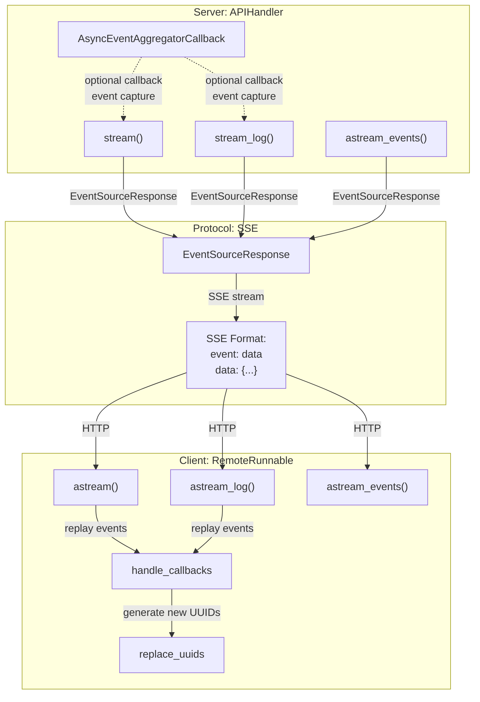
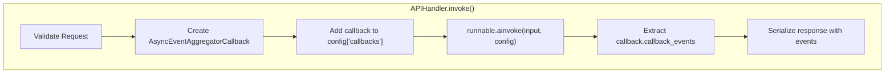
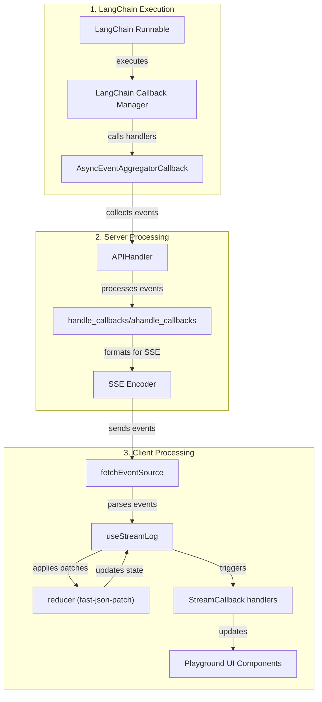

<!-- source: DeepWiki mcp.deepwiki.com · repo langchain-ai/langserve · page 2.4 Streaming & Callbacks · fetched 2026-10-26 -->

# Streaming & Callbacks

<details>
<summary>Relevant source files</summary>

The following files were used as context for generating this wiki page:

- [langserve/api_handler.py](langserve/api_handler.py)
- [langserve/callbacks.py](langserve/callbacks.py)
- [langserve/client.py](langserve/client.py)
- [langserve/server.py](langserve/server.py)
- [langserve/server_sent_events.py](langserve/server_sent_events.py)
- [tests/unit_tests/test_callbacks.py](tests/unit_tests/test_callbacks.py)
- [tests/unit_tests/test_server_client.py](tests/unit_tests/test_server_client.py)
- [tests/unit_tests/utils/tracer.py](tests/unit_tests/utils/tracer.py)

</details>


This page documents LangServe's streaming and callback event system, which enables real-time output delivery and execution visibility for LangChain Runnables. The system uses Server-Sent Events (SSE) to stream data from server to client and includes mechanisms for capturing, transmitting, and replaying callback events.

## Overview

LangServe provides three streaming endpoints for different use cases:

| Endpoint | Return Type | Purpose | Use Case |
|----------|-------------|---------|----------|
| `/stream` | Output chunks | Stream final output | Simple streaming of results |
| `/stream_log` | `RunLogPatch` | Stream execution logs | Debug intermediate steps |
| `/stream_events` | `StreamEvent` | Stream granular events | Fine-grained execution monitoring |

All streaming endpoints use Server-Sent Events (SSE) for unidirectional server-to-client communication over HTTP. The callback system optionally captures execution events on the server and replays them on the client for tracing.



Sources: [langserve/server.py:546-628](), [langserve/api_handler.py:1-82](), [langserve/client.py:520-728]()

## Streaming Endpoints

### POST /stream

The `/stream` endpoint streams output chunks from `Runnable.astream()`. The server sends a metadata event with `run_id`, followed by data events containing output chunks, and terminates with an end event.

**Server Implementation:** [langserve/api_handler.py:844-921]()

The `APIHandler.stream()` method:
1. Validates the request using shallow and deep validators
2. Unpacks input and configuration
3. Optionally attaches `AsyncEventAggregatorCallback` if `include_callback_events=True`
4. Calls `runnable.astream()` and yields chunks as SSE
5. Returns `EventSourceResponse` with event stream

**Event Format:**
```
event: metadata
data: {"run_id": "..."}

event: data
data: <serialized chunk>

event: data
data: <serialized chunk>

event: end
```

**Client Implementation:** [langserve/client.py:520-597]()

The `RemoteRunnable.stream()` method connects via `connect_sse()`, deserializes chunks, and aggregates final output for the `on_chain_end` callback.

Sources: [langserve/api_handler.py:844-921](), [langserve/client.py:520-597](), [tests/unit_tests/test_server_client.py:335-345]()

### POST /stream_log

The `/stream_log` endpoint streams `RunLogPatch` objects from `Runnable.astream_log()`. This provides visibility into intermediate steps using JSON Patch operations.

**Server Implementation:** [langserve/api_handler.py:923-1002]()

The `APIHandler.stream_log()` method:
1. Validates request with `StreamLogParameters` (includes `include_names`, `include_types`, `include_tags`)
2. Applies `stream_log_name_allow_list` filtering if configured
3. Calls `runnable.astream_log()` with filter parameters
4. Serializes and streams `RunLogPatch` objects

**Event Format:**
```
event: data
data: {"ops": [{"op": "replace", "path": "", "value": {...}}]}

event: data
data: {"ops": [{"op": "add", "path": "/streamed_output/-", "value": ...}]}

event: end
```

**Client Implementation:** [langserve/client.py:599-697]()

The `RemoteRunnable.astream_log()` method deserializes patches and yields them to the caller.

Sources: [langserve/api_handler.py:923-1002](), [langserve/client.py:599-697](), [tests/unit_tests/test_server_client.py:747-817]()

### POST /stream_events

The `/stream_events` endpoint (added in LangChain 0.2.0) streams `StreamEvent` objects from `Runnable.astream_events()`. This provides the most granular visibility into execution.

**Server Implementation:** [langserve/api_handler.py:1004-1082]()

The `APIHandler.astream_events()` method:
1. Validates request with `StreamEventsParameters` (includes version, filters)
2. Applies `stream_log_name_allow_list` filtering
3. Calls `runnable.astream_events()` with configured version (`v1` or `v2`)
4. Serializes and streams events

**Event Format:**
```
event: data
data: {"event": "on_chain_start", "data": {...}, "run_id": "...", ...}

event: data
data: {"event": "on_chain_stream", "data": {...}, "run_id": "...", ...}

event: end
```

**Client Implementation:** [langserve/client.py:699-728]()

Sources: [langserve/api_handler.py:1004-1082](), [langserve/client.py:699-728](), [tests/unit_tests/test_server_client.py:413-472]()

### Endpoint Configuration

Streaming endpoints can be selectively enabled/disabled via `add_routes()`:

```python
add_routes(
    app, 
    runnable,
    enabled_endpoints=["invoke", "stream"],  # Only invoke and stream
)

add_routes(
    app,
    runnable, 
    disabled_endpoints=["stream_log"],  # All except stream_log
)
```

Sources: [langserve/server.py:248-390](), [langserve/server.py:546-628]()

## Server-Sent Events Protocol

LangServe uses Server-Sent Events (SSE) to stream data over HTTP. SSE provides unidirectional server-to-client communication over a persistent connection.

### SSE Message Format

Each SSE message consists of fields separated by newlines:

```
event: <event_type>
data: <payload>
id: <optional_id>
retry: <optional_retry_ms>

```

Example from `/stream` endpoint:
```
event: metadata
data: {"run_id": "abc-123"}

event: data
data: "Hello"

event: data  
data: " world"

event: end

```

Sources: [langserve/server_sent_events.py:9-14]()

### Server-Side: EventSourceResponse

The server uses `sse_starlette.EventSourceResponse` to send SSE. The `APIHandler` methods yield data that `EventSourceResponse` formats into SSE:

```python
async def stream(self, request: Request) -> EventSourceResponse:
    # ... validation and setup ...
    
    async def _stream():
        # Yield metadata event
        yield _create_metadata_event(run_id=config["run_id"])
        
        # Yield data events
        async for chunk in runnable.astream(input, config=config):
            yield {"data": serializer.dumps(chunk)}
        
        # Yield end event  
        yield {"event": "end"}
    
    return EventSourceResponse(_stream())
```

The `_create_metadata_event()` function generates metadata with `run_id` and optional feedback tokens: [langserve/api_handler.py:124-154]()

Sources: [langserve/api_handler.py:844-921](), [langserve/api_handler.py:124-154]()

### Client-Side: SSEDecoder and EventSource

The client uses `SSEDecoder` to parse SSE text into structured events, and `EventSource` to manage the connection:

**SSEDecoder:** [langserve/server_sent_events.py:16-74]()

The `SSEDecoder.decode()` method implements the SSE parsing spec:
1. Split lines by field name (event, data, id, retry)
2. Accumulate data lines
3. Return a `ServerSentEvent` dict when encountering empty line

**EventSource:** [langserve/server_sent_events.py:76-111]()

The `EventSource` class wraps an `httpx.Response` and provides `iter_sse()` / `aiter_sse()` methods that yield `ServerSentEvent` dicts.

**connect_sse / aconnect_sse:** [langserve/server_sent_events.py:113-138]()

Context managers that set required headers (`Accept: text/event-stream`, `Cache-Control: no-store`) and return an `EventSource`:

```python
with connect_sse(client, "POST", url, json=data) as event_source:
    for sse in event_source.iter_sse():
        if sse["event"] == "data":
            chunk = deserialize(sse["data"])
            yield chunk
```

Sources: [langserve/server_sent_events.py:16-138](), [langserve/client.py:545-596]()

### Error Handling

Streaming endpoints handle errors by sending an `error` event:

```
event: error
data: {"status_code": 500, "message": "Internal Server Error"}
```

The client raises `httpx.HTTPStatusError` when receiving error events: [langserve/client.py:214-231]()

Sources: [langserve/client.py:577-581](), [langserve/client.py:214-231](), [tests/unit_tests/test_server_client.py:820-843]()

## Callback Event System

When `include_callback_events=True` is configured in `add_routes()`, LangServe captures execution events on the server and transmits them to the client for replay.

### Server-Side Event Capture

**AsyncEventAggregatorCallback:** [langserve/callbacks.py:28-369]()

The `AsyncEventAggregatorCallback` extends `AsyncCallbackHandler` and aggregates all callback events into a list. Each LangChain event handler (`on_chain_start`, `on_llm_start`, etc.) creates a `CallbackEventDict` and appends it to `self.callback_events`.



Implementation in `APIHandler.invoke()`: [langserve/api_handler.py:701-757]()

```python
if self._include_callback_events:
    callback = AsyncEventAggregatorCallback()
    _add_callbacks(config, [callback])

output = await runnable.ainvoke(input, config=config)

callback_events = (
    [_scrub_exceptions_in_event(event) for event in callback.callback_events]
    if self._include_callback_events
    else []
)

return InvokeResponse(output=output, callback_events=callback_events)
```

Sources: [langserve/callbacks.py:28-369](), [langserve/api_handler.py:701-757]()

### Captured Event Types

The callback system captures all LangChain event types:

| Event Type | Captured Data | When Fired |
|------------|---------------|------------|
| `on_chain_start` | `serialized`, `inputs`, `run_id`, `parent_run_id`, `tags`, `metadata` | Chain execution begins |
| `on_chain_end` | `outputs`, `run_id`, `parent_run_id`, `tags` | Chain execution completes |
| `on_chain_error` | `error`, `run_id`, `parent_run_id`, `tags` | Chain execution errors |
| `on_llm_start` | `serialized`, `prompts`, `run_id`, `parent_run_id`, `tags`, `metadata` | LLM generation begins |
| `on_llm_end` | `response`, `run_id`, `parent_run_id`, `tags` | LLM generation completes |
| `on_chat_model_start` | `serialized`, `messages`, `run_id`, `parent_run_id`, `tags`, `metadata` | Chat model begins |
| `on_tool_start` | `serialized`, `input_str`, `run_id`, `parent_run_id`, `tags`, `metadata` | Tool execution begins |
| `on_tool_end` | `output`, `run_id`, `parent_run_id`, `tags` | Tool execution completes |
| `on_tool_error` | `error`, `run_id`, `parent_run_id`, `tags` | Tool execution errors |
| `on_retriever_start` | `serialized`, `query`, `run_id`, `parent_run_id`, `tags`, `metadata` | Retriever search begins |
| `on_retriever_end` | `documents`, `run_id`, `parent_run_id`, `tags` | Retriever search completes |
| `on_agent_action` | `action`, `run_id`, `parent_run_id`, `tags` | Agent takes action |
| `on_agent_finish` | `finish`, `run_id`, `parent_run_id`, `tags` | Agent completes task |

Sources: [langserve/callbacks.py:49-369](), [langserve/callbacks.py:414-433]()

### Exception Scrubbing

The `_scrub_exceptions_in_event()` function removes exception objects from error events before transmission to prevent serialization issues:

```python
def _scrub_exceptions_in_event(event: CallbackEventDict) -> CallbackEventDict:
    if "error" not in event["type"]:
        return event
    
    if isinstance(event["error"], BaseException):
        event = event.copy()
        event["error"] = {"status_code": 500, "message": "Internal Server Error"}
    
    return event
```

Sources: [langserve/api_handler.py:383-400]()

## Integration Flow

The complete flow of data through the streaming and callback system:



Sources: [langserve/callbacks.py:436-492](), [langserve/playground/src/useStreamLog.tsx:64-94]()

## Practical Applications

### Streaming in the Playground

The LangServe Playground UI leverages the streaming system to provide:

1. Real-time token streaming for LLM outputs
2. Visibility into agent thought processes
3. Interactive updates of chat messages

The `useStreamLog` hook enables the Playground to update the UI as events occur, rather than waiting for the entire execution to complete.

### Debugging with Callbacks

Callbacks provide valuable insights for debugging:

1. Seeing the exact sequence of execution steps
2. Identifying which components are taking longer to execute
3. Examining inputs and outputs at each stage
4. Tracing error propagation through the system

Sources: [langserve/playground/src/useStreamLog.tsx:1-106](), [langserve/playground/src/types.tsx:1-9](), [langserve/callbacks.py:1-492]()

---

